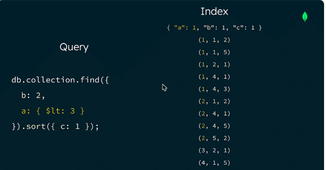
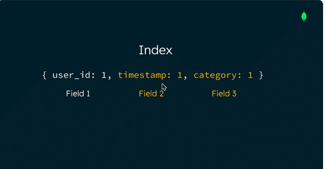

# 08.2 · Orden de las claves (ESR) y tamaño del índice

## Prefijo del índice

- El **prefijo** es el subconjunto inicial de campos de un índice compuesto.
- Un índice `{a: 1, b: 1, c: 1}` sirve para consultas sobre **a**, **a+b** y **a+b+c**. **No sirve** para **b**, **c** ni **b+c**, porque no incluyen el prefijo.

*Figura: el prefijo es el subconjunto inicial de campos del índice compuesto.*

## La guía ESR: Equality → Sort → Range

1. **E**quality: los campos con igualdad van **primero**.
2. **S**ort: los campos de ordenamiento van después, para que el *sort* no se haga en memoria.
3. **R**ange: los rangos van al final.

- Si un **rango** va antes que una igualdad o un *sort*, los valores siguientes del índice quedan desordenados. Hay que revisar muchas claves y el ordenamiento pasa a memoria.
- ESR es una **guía**, no una regla fija. A veces conviene **E-R-S** si el rango es muy **selectivo**, porque deja pocos documentos para ordenar en memoria.

*Figura: con un rango en `a` primero, los valores de `b` y `c` quedan desordenados y el índice pierde eficiencia.*

**Aplicado a LeafyBank:** el índice para las consultas 1 y 2 es `{ userId: 1, timestamp: 1, category: 1 }`. Va la igualdad en `userId` y después `timestamp`, que es un rango muy selectivo, antes que `category`.

*Figura: el índice compuesto `{ user_id: 1, timestamp: 1, category: 1 }`.*

## Tamaño del índice: compresión de prefijos e índices parciales

- Si hay **varias igualdades**, el orden entre ellas **no cambia la velocidad**, pero sí el **tamaño**.
- MongoDB usa **compresión de prefijos**: guarda los prefijos idénticos una sola vez por página.
- Poner primero un campo de **baja cardinalidad** (pocos valores distintos, como un booleano `isRead`) da un índice **más pequeño** que empezar por uno de alta cardinalidad (`userId`).
- **Índice parcial:** solo indexa los documentos que cumplen un `partialFilterExpression`. Si siempre se consulta `isRead: false`, basta con indexar esos documentos.

!!! tip "Para recordar"
    - La consulta tiene que incluir el **prefijo** del índice para poder usarlo.
    - **ESR**: Equality, después Sort, después Range. Un rango antes del *sort* manda el *sort* a memoria.
    - Entre varias igualdades, va primero la de **baja cardinalidad**, porque la compresión de prefijos achica el índice.
    - Usa **índices parciales** cuando las consultas siempre filtran por el mismo valor.
