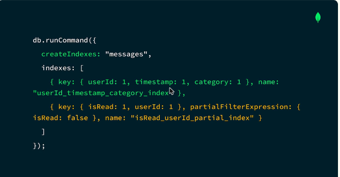
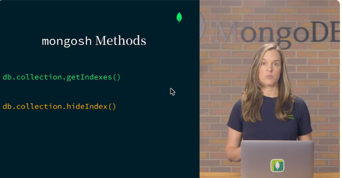
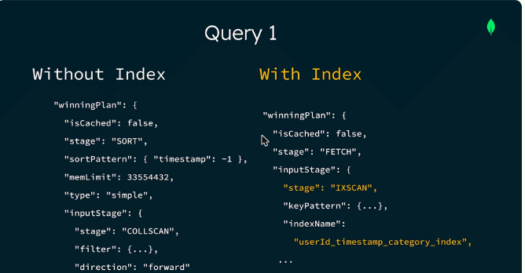
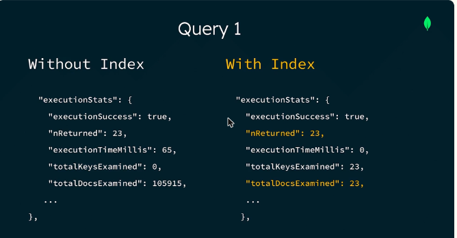
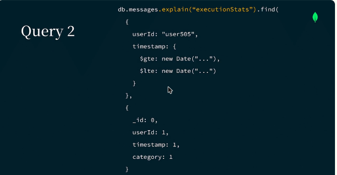
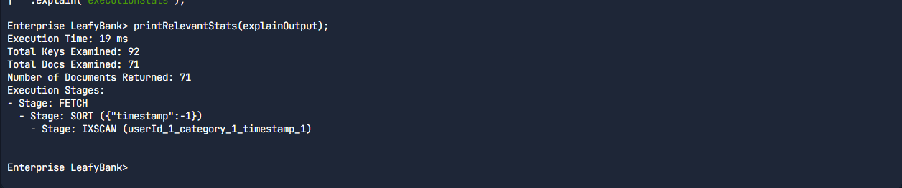
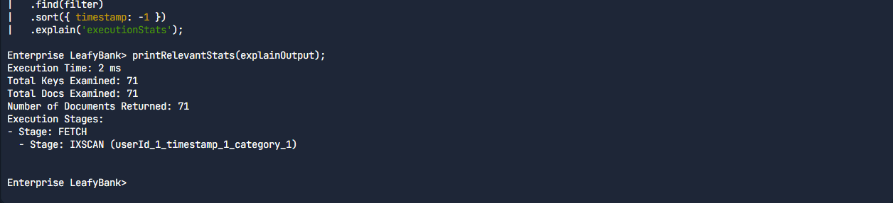
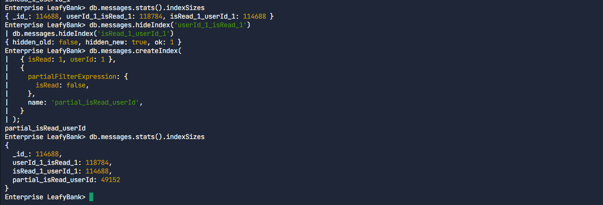

# 08.3 · Crear, gestionar y probar índices con `explain()`

## Crear índices

Atlas Data Explorer, Atlas CLI, Compass, mongosh y los drivers usan **`createIndex`** por debajo. Para crear **varios índices en una sola operación** se usa el comando `createIndexes`, que es más eficiente:

```javascript
db.runCommand({
  createIndexes: "messages",
  indexes: [
    { key: { userId: 1, timestamp: 1, category: 1 }, name: "userId_timestamp_category_index" },
    { key: { isRead: 1, userId: 1 },
      partialFilterExpression: { isRead: false },
      name: "isRead_userId_partial_index" }
  ]
})
```

- Con el comando de base de datos hay que dar un **nombre** (`name`) a cada índice.
- La colección pasa a tener 3 índices: `_id` más los dos nuevos.



*Figura: `createIndexes` crea el índice compuesto y el parcial en una sola operación.*

## Gestionar los índices

| Método de mongosh | Para qué |
|---|---|
| `db.coleccion.getIndexes()` | Listar los índices |
| `db.coleccion.hideIndex()` | Ocultar un índice al planificador para **evaluar el impacto de borrarlo** antes de hacerlo |
| `dropIndex()` / `dropIndexes()` | Eliminar índices |
| `explain()` | Ver el plan de ejecución |

Herramientas para monitorear: Atlas (con el **Performance Advisor**, que recomienda índices), Compass y herramientas de terceros.



*Figura: `getIndexes()` y `hideIndex()` para revisar los índices antes de borrar alguno.*

## Probar con `explain()`

```javascript
db.messages.explain("executionStats").find({ userId: "user505", timestamp: { $gte: ..., $lte: ... } }).sort({ timestamp: -1 })
```

- Niveles de detalle: **`queryPlanner`** (por defecto), **`executionStats`** y **`allPlansExecution`**, que incluye también los planes rechazados.
- **`winningPlan`**: dice si se usó **`COLLSCAN`** (sin índice) o **`IXSCAN`** (con índice) y cuál índice.
- **`executionStats`**: compara `nReturned` con `totalDocsExamined` y `totalKeysExamined`, y muestra `executionTimeMillis`. En el ejemplo se pasó de **105 915 documentos examinados para 23 devueltos (65 ms)** a **23 para 23 (0 ms)**.



*Figura: sin índice el plan es COLLSCAN más SORT. Con índice es IXSCAN sobre `userId_timestamp_category_index`.*



*Figura: los documentos examinados bajan de 105 915 a 23 y el tiempo de 65 ms a 0 ms.*

## Consultas cubiertas (*covered queries*)

Una consulta está **cubierta** cuando **todos los campos que filtra y devuelve están en el mismo índice**. MongoDB responde solo con el índice, **sin leer documentos** (`totalDocsExamined: 0`). Para lograrlo, la proyección solo incluye campos del índice y excluye `_id`:

```javascript
db.messages.find({ userId: "user505", timestamp: {...} }, { _id: 0, userId: 1, timestamp: 1, category: 1 })
```



*Figura: con una proyección que solo pide campos del índice (y `_id: 0`), la consulta queda cubierta.*

!!! tip "Para recordar"
    - `createIndexes` crea varios índices en una operación. Cada uno necesita `name`.
    - Antes de borrar un índice, **`hideIndex()`** para medir el impacto.
    - `explain("executionStats")`: busca **IXSCAN** frente a COLLSCAN y una relación **docsExamined ≈ nReturned**.
    - **Consulta cubierta** = filtro y proyección dentro del índice, con `_id: 0`. Examina 0 documentos.

## Laboratorio

Laboratorio práctico (*Indexing Strategies*): **Completado**. Se trabajó en mongosh sobre la colección `LeafyBank.messages` en dos retos.

**1. Optimizar un índice compuesto con ESR.** La consulta filtra por `userId` (igualdad), un rango de `timestamp` y ordena por `timestamp`. El índice existente `{ userId, category, timestamp }` obligaba a un `SORT` en memoria (92 claves examinadas para 71 documentos). Al reordenar las claves a igualdad → orden → rango el `SORT` desaparece:

```javascript
db.messages.getIndexes()
load('/lab/queries.js')                       // define la variable filter
let explainOutput = db.messages.find(filter).sort({ timestamp: -1 }).explain('executionStats')
printRelevantStats(explainOutput)             // FETCH > SORT > IXSCAN, 92 keys / 71 docs

db.messages.hideIndex('userId_1_category_1_timestamp_1')
db.messages.createIndex({ userId: 1, timestamp: 1, category: 1 })
explainOutput = db.messages.find(filter).sort({ timestamp: -1 }).explain('executionStats')
printRelevantStats(explainOutput)             // FETCH > IXSCAN, 71 keys / 71 docs, sin SORT
db.messages.dropIndex('userId_1_category_1_timestamp_1')
```

**2. Reducir el tamaño con el orden de claves y un índice parcial.** Hay 6996 mensajes leídos y 3004 sin leer. El índice con `isRead` primero ocupa menos (mejor compresión de prefijos) y el parcial, que solo indexa los no leídos, ocupa menos de la mitad:

```javascript
db.messages.createIndex({ userId: 1, isRead: 1 })     // 118784 bytes
db.messages.createIndex({ isRead: 1, userId: 1 })     // 114688 bytes
db.messages.hideIndex('userId_1_isRead_1')
db.messages.hideIndex('isRead_1_userId_1')
db.messages.createIndex({ isRead: 1, userId: 1 },
  { partialFilterExpression: { isRead: false }, name: 'partial_isRead_userId' })   // 49152 bytes
db.messages.stats().indexSizes

// Consulta cubierta: PROJECTION_COVERED sobre IXSCAN del índice parcial
db.messages.find({ userId: 'user505', isRead: false }, { userId: 1, isRead: 1, _id: 0 })
           .explain('executionStats').queryPlanner.winningPlan
db.messages.dropIndex('userId_1_isRead_1')
db.messages.dropIndex('isRead_1_userId_1')
```







## Fuentes y aviso legal

- **Fuente:** cursos de MongoDB University. Sitios oficiales: [learn.mongodb.com](https://learn.mongodb.com) · [mongodb.com/docs](https://www.mongodb.com/docs).
- **Uso:** apuntes personales de estudio, sin fines comerciales y con redacción propia. Las imágenes del curso son fragmentos breves citados con fines educativos; sus derechos son de sus titulares.
- **Sin afiliación:** sitio no oficial, no afiliado ni respaldado por MongoDB. Las marcas pertenecen a sus dueños.
- Más detalles y cómo pedir el retiro de contenido en el [aviso legal](../../../aviso-legal.md).
