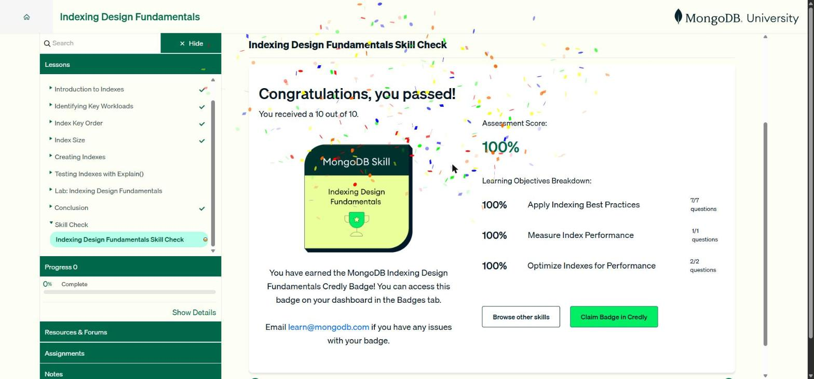

# Unidad 8 · Indexing Design Fundamentals

Unidad de la ruta *MongoDB Python Developer Path* (formato *skill badge*). Cubre qué es un índice, cómo identificar las cargas clave, el orden de las claves con la guía **ESR**, el tamaño de los índices (compresión de prefijos e índices parciales), la creación y gestión de índices y su verificación con `explain()`.

| # | Sección | Estado | Apuntes |
|---|---|---|---|
| 1 | Introduction to Indexes | Completado | [Ver](01-fundamentos-indices.md) |
| 2 | Identifying Key Workloads | Completado | [Ver](01-fundamentos-indices.md) |
| 3 | Index Key Order | Completado | [Ver](02-orden-y-tamano-de-indices.md) |
| 4 | Index Size | Completado | [Ver](02-orden-y-tamano-de-indices.md) |
| 5 | Creating Indexes | Completado | [Ver](03-crear-y-probar-indices.md) |
| 6 | Testing Indexes with Explain() | Completado | [Ver](03-crear-y-probar-indices.md) |
| 7 | Lab: Indexing Design Fundamentals | Completado | [Ver](03-crear-y-probar-indices.md#laboratorio) |
| 8 | Skill Check (insignia de Credly) | Completado | 10/10 (100 %) |

**Estado de la unidad:** Completado. Skill Check **10/10 (100 %)**: Apply Indexing Best Practices 7/7, Measure Index Performance 1/1 y Optimize Indexes for Performance 2/2. Se obtuvo la insignia **MongoDB Skill · Indexing Design Fundamentals** de Credly. El laboratorio práctico también quedó Completado.

!!! tip "Para recordar"
    - Índice = árbol B+ ordenado que evita el COLLSCAN. Mejora las lecturas y encarece las escrituras.
    - Crea el mínimo de índices, reutilizando índices compuestos entre consultas parecidas.
    - Orden de las claves: **Equality → Sort → Range**. La consulta debe usar el **prefijo**.
    - Baja cardinalidad primero entre igualdades. Índices parciales para filtros fijos.
    - `explain("executionStats")`: IXSCAN y docsExamined ≈ nReturned. Las consultas cubiertas examinan 0 documentos.
