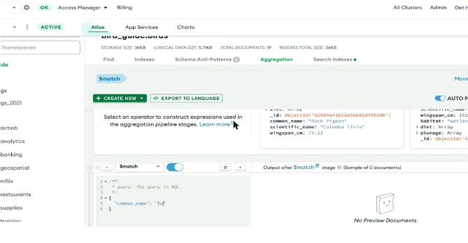
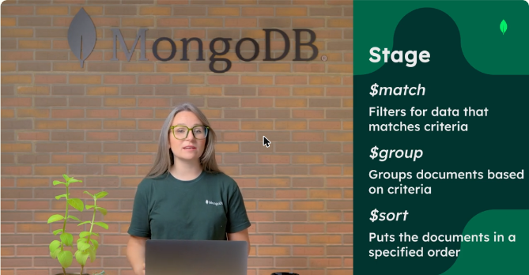
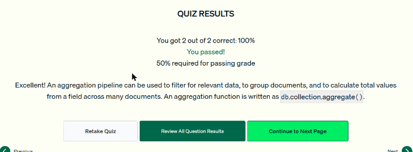

# 09.1 · Introducción a la agregación

## Conceptos

- **Agregación:** analizar y resumir datos.
- **Etapa (*stage*):** una operación de agregación sobre los datos. **No modifica** los datos de origen.
- **Pipeline:** una serie de etapas en orden. Los documentos que **salen de una etapa entran en la siguiente**, y en el camino se pueden filtrar, ordenar, agrupar y transformar.
- En Atlas hay un **editor visual** de pipelines (pestaña *Aggregation*) que muestra el resultado de cada etapa. Los drivers de cada lenguaje también soportan agregaciones.

```javascript
db.coleccion.aggregate([
  { $etapa1: { ... } },
  { $etapa2: { ... } }
])
```



*Figura: la pestaña Aggregation del Data Explorer con una etapa `$match` y la vista previa de su salida.*

## Etapas, expresiones y referencias a campos

| Etapa | Qué hace |
|---|---|
| `$match` | Filtra los documentos que cumplen un criterio (misma sintaxis que `find`) |
| `$group` | Agrupa documentos según un criterio |
| `$sort` | Ordena los documentos |

- Cada etapa tiene su sintaxis. La mayoría usa **operadores de expresión** (por ejemplo `$concat`).
- **Field path:** un nombre de campo con `$` delante (`"$first_name"`) **hace referencia al valor** de ese campo.

```javascript
{ $project: { defaultUsername: { $concat: ["$first_name", "$last_name"] } } }
```



*Figura: tres etapas muy usadas: `$match`, `$group` y `$sort`.*

!!! tip "Para recordar"
    - Se ejecuta con **`db.coleccion.aggregate([...])`**, que recibe un **arreglo de etapas**.
    - La agregación **no altera** los datos de origen (salvo `$out`, que escribe en otra colección).
    - `"$campo"` = referencia al valor del campo.
    - Un pipeline **no puede** traer datos de fuentes externas. Sirve para filtrar, agrupar y calcular totales.

## Cuestionario

Resultado: **2/2 correctas (100 %)**. Las preguntas cubrieron qué tareas no puede hacer un pipeline y qué método lo ejecuta.



*Figura: cuestionario de la lección 1 aprobado.*
