# 09.2 · Etapas del pipeline: $match, $group, $sort, $limit, $project, $set, $count y $out

## `$match` y `$group`

```javascript
db.zips.aggregate([
  { $match: { state: "CA" } },
  { $group: { _id: "$city", totalZips: { $count: {} } } }
])
```

- **`$match`** filtra con la misma sintaxis que `find`. Conviene ponerlo **lo antes posible**: puede usar índices y reduce los documentos que procesan las etapas siguientes.
- **`$group`** devuelve **un documento por cada valor distinto de la clave** `_id` (obligatoria). Los **acumuladores** (`$count`, `$sum`, `$avg`…) calculan valores por grupo.

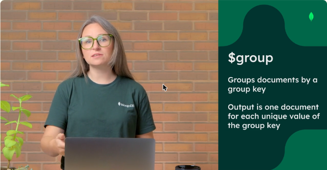

*Figura: `$group` agrupa por una clave y devuelve un documento por cada valor único.*

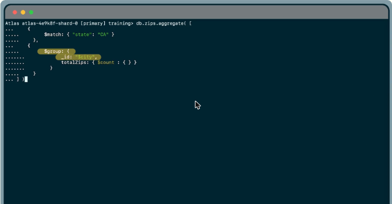

*Figura: los códigos postales de California agrupados por ciudad, con un contador `totalZips`.*

## `$sort` y `$limit`

```javascript
db.zips.aggregate([
  { $sort: { pop: -1 } },   // -1 descendente, 1 ascendente
  { $limit: 5 }             // entero positivo
])
```

- Juntos sirven para obtener el **top N**. En el ejemplo, el código postal más poblado es el 11226 de Brooklyn, con 111 396 habitantes.
- **El orden de las etapas importa:** `$limit` antes de `$sort` ordenaría solo los primeros 5 documentos de la colección.

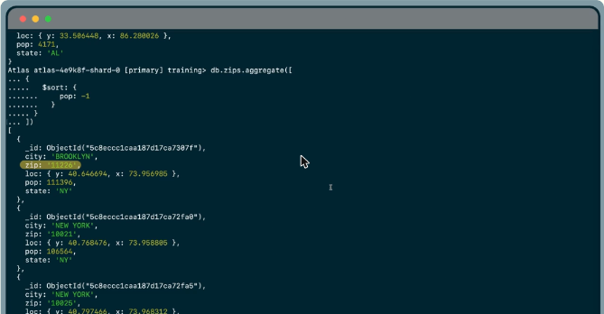

*Figura: `$sort: { pop: -1 }` deja primero los códigos postales más poblados.*


*Figura: las etapas se ejecutan en el orden en que se escriben.*

## `$project`, `$set` y `$count`

```javascript
db.zips.aggregate([{ $project: { state: 1, zip: 1, population: "$pop", _id: 0 } }])

db.zips.aggregate([{ $set: { pop_2022: { $round: { $multiply: [1.0031, "$pop"] } } } }])

db.zips.aggregate([{ $count: "total_zips" }])    // { total_zips: 29470 }
```

| Etapa | Uso |
|---|---|
| **`$project`** | Define la **forma de salida**: incluye (1) o excluye (0) campos, y puede crear o renombrar campos. Suele ir **al final** |
| **`$set`** | **Agrega o modifica** campos sin tener que listar los demás. Útil para preparar datos para etapas siguientes |
| **`$count`** | Devuelve **un solo documento con un campo** (el nombre que se le da) cuyo valor es la cantidad de documentos que llegaron a esa etapa |

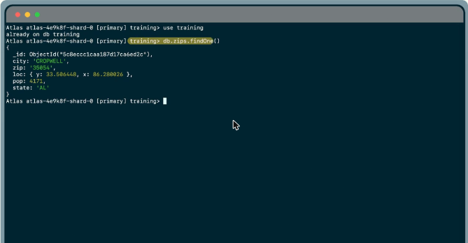

*Figura: un documento de `zips` con city, zip, loc, pop y state.*

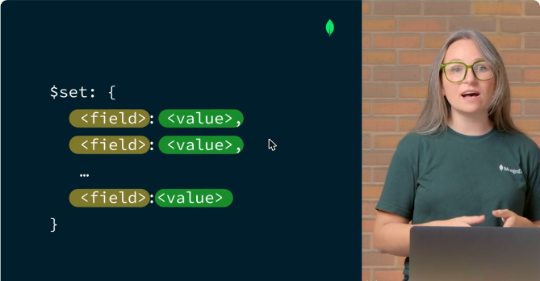

*Figura: `$set` recibe pares campo: valor que se agregan o modifican.*

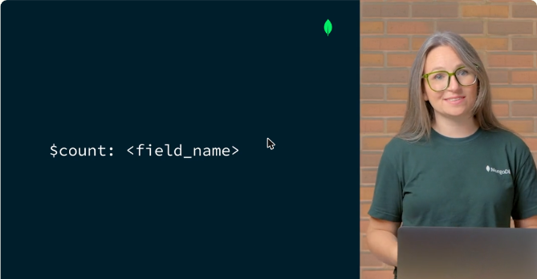

*Figura: `$count` recibe el nombre del campo que tendrá el total.*

## `$out`

```javascript
db.zips.aggregate([
  { $group: { _id: "$state", total_pop: { $sum: "$pop" } } },
  { $match: { total_pop: { $lt: 1000000 } } },
  { $out: "small_states" }          // o { db: "...", coll: "..." }
])
```

- Escribe el resultado del pipeline en una **colección**. Tiene que ser la **última etapa**.
- Si la colección no existe, la **crea**. Si ya existe, la **reemplaza** por completo.
- Recibe `{ db, coll }` o solo el nombre de la colección, y en ese caso usa la misma base.

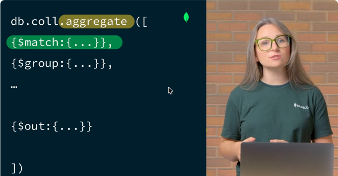

*Figura: `$out` siempre va al final del pipeline.*

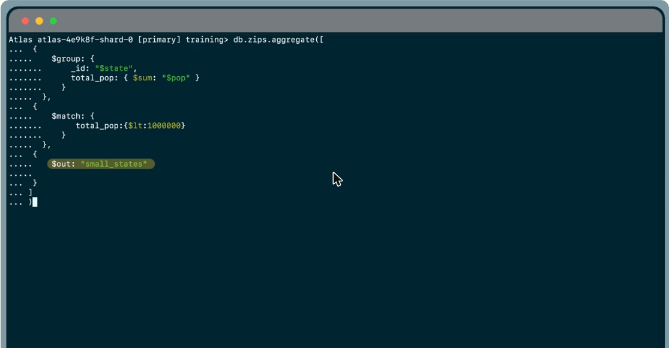

*Figura: los estados con menos de un millón de habitantes se guardan en `small_states`.*

!!! tip "Para recordar"
    - `$match` **temprano** (usa índices). `$group` necesita `_id` y devuelve un documento por clave.
    - `$sort` (1 o -1) + `$limit` (entero) = top N. **El orden de las etapas importa.**
    - `$project` da forma a la salida. `$set` agrega o modifica campos. `$count` devuelve un documento con el total.
    - `$out` va **al final**, crea la colección o **sobrescribe** la existente.

## Cuestionarios y laboratorios

- Cuestionarios de las lecciones 2 a 5: **2/2 correctas (100 %) en cada uno**. Cubrieron cómo leer la salida de pipelines con `$match` + `$group` y con `$group` + `$sort` (+ `$limit`), la diferencia entre `$set` y `$project`, el resultado de `$count`, y el comportamiento de `$out` con una colección existente.
- Laboratorios prácticos en Atlas: **Pendiente**.

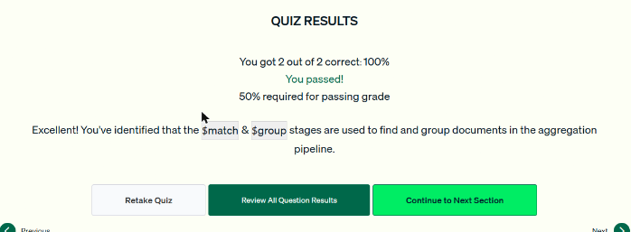

*Figura: cuestionario de la lección 2 aprobado.*

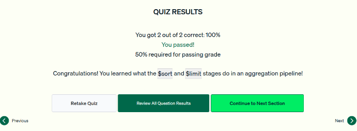

*Figura: cuestionario de la lección 3 aprobado.*

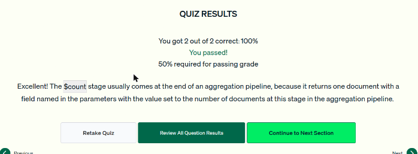

*Figura: cuestionario de la lección 4 aprobado.*

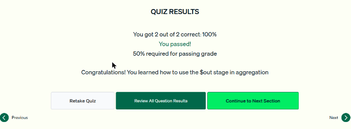

*Figura: cuestionario de la lección 5 aprobado.*
