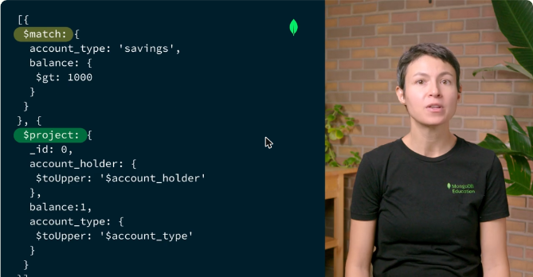
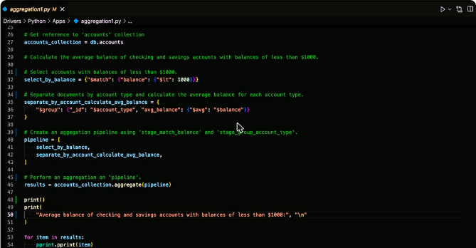
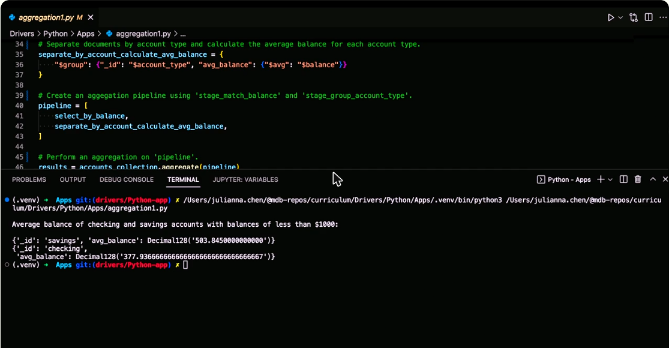
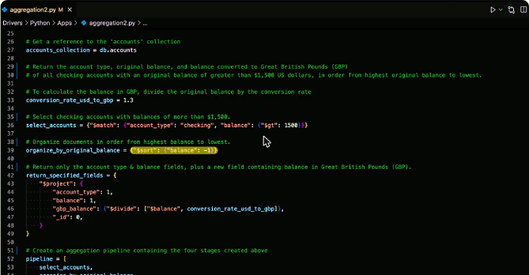
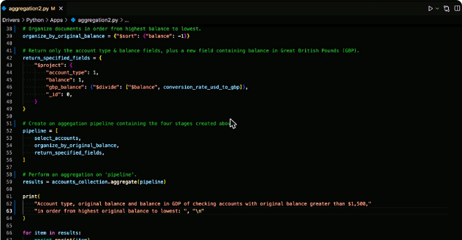
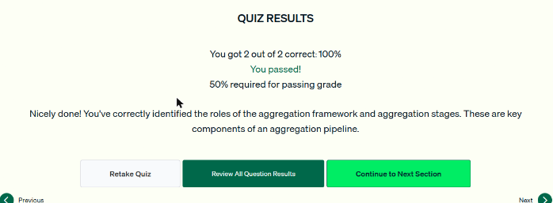
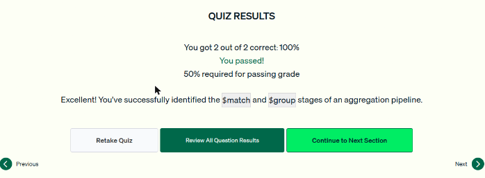
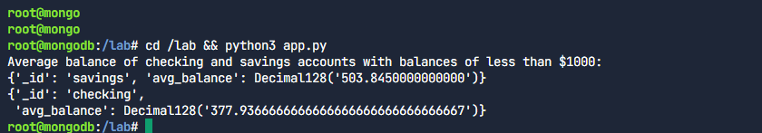
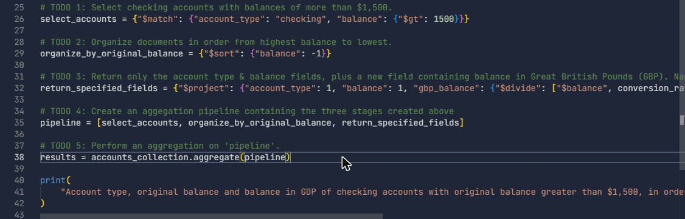
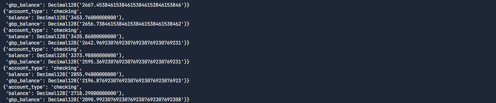

# 10.1 · Pipelines de agregación con PyMongo

## Cuándo usar `find()` y cuándo `aggregate()`

- Si la consulta se resuelve con **`find()`** y no hace falta procesar nada más, se usa `find()`.
- Si hay que **procesar documentos y devolver resultados calculados** (resúmenes, campos nuevos), se usa el **aggregation framework**, que es más flexible.
- Un pipeline está formado por **etapas**, por las que pasan los documentos en orden, y **operadores de expresión**, que funcionan como funciones con argumentos. Separarlo en etapas facilita depurar y mantener la consulta, y le permite a MongoDB optimizarla.



*Figura: cuentas de ahorro con saldo mayor a 1000, con `$toUpper` en el titular y el tipo de cuenta, y con `_id` oculto.*

## Patrón en Python

1. Se define cada etapa como un **diccionario** y se asigna a una variable.
2. Se arma el pipeline como una **lista** de etapas, en orden.
3. Se llama a **`coleccion.aggregate(pipeline)`**, que devuelve un **cursor**.

## `$match` + `$group`: saldo promedio por tipo de cuenta

```python
select_by_balance = {"$match": {"balance": {"$lt": 1000}}}
separate_by_account_calculate_avg_balance = {
    "$group": {"_id": "$account_type", "avg_balance": {"$avg": "$balance"}}
}
pipeline = [select_by_balance, separate_by_account_calculate_avg_balance]

results = accounts_collection.aggregate(pipeline)
for item in results:
    pprint.pprint(item)
# {'_id': 'savings', 'avg_balance': Decimal128('503.845')}
# {'_id': 'checking', 'avg_balance': Decimal128('377.936...')}
```

- `"$account_type"` con `$` y entre comillas = **valor del campo** usado como clave de grupo.
- **Acumuladores** como `$avg`, `$sum`, `$count`.
- `$match` **primero**, para reducir el trabajo de las etapas siguientes.



*Figura: las etapas como diccionarios, el pipeline como lista y `accounts_collection.aggregate(pipeline)`.*



*Figura: un documento por tipo de cuenta con su `avg_balance`.*

## `$match` + `$sort` + `$project`: saldo convertido a libras

```python
conversion_rate_usd_to_gbp = 1.3
select_accounts = {"$match": {"account_type": "checking", "balance": {"$gt": 1500}}}
organize_by_original_balance = {"$sort": {"balance": -1}}
return_specified_fields = {
    "$project": {
        "account_type": 1,
        "balance": 1,
        "gbp_balance": {"$divide": ["$balance", conversion_rate_usd_to_gbp]},
        "_id": 0,
    }
}
pipeline = [select_accounts, organize_by_original_balance, return_specified_fields]
results = accounts_collection.aggregate(pipeline)
```

- `$sort`: **1 ascendente, -1 descendente**.
- `$project` define la forma de salida, con campos existentes y **campos calculados** (`$divide`, `$sum`…). Va normalmente **al final**.
- Orden típico: `$match` → `$sort` → `$project`.



*Figura: `$sort` descendente por saldo y `$project` con el campo calculado `gbp_balance`.*



*Figura: el pipeline como lista, en orden: `$match`, `$sort` y `$project`.*

## Ecosistema Python de MongoDB

- **PyMongoArrow:** herramientas de análisis de datos para importar y exportar entre MongoDB y Apache Arrow, Pandas, NumPy, CSV o Parquet.
- **Motor:** driver oficial **asíncrono**.
- **MongoEngine:** ODM comunitario construido sobre PyMongo.
- Otras etapas para explorar: `$unwind` (arreglos) y `$bucket` (categorías).

!!! tip "Para recordar"
    - Etapas = **diccionarios**. Pipeline = **lista**. `coleccion.aggregate(pipeline)` devuelve un **cursor**.
    - Primera etapa para filtrar: `{"$match": {...}}`. Para agrupar: `{"$group": {"_id": "$campo", "alias": {"$avg": "$otro"}}}`.
    - Orden ascendente: `{"$sort": {"campo": 1}}`.
    - `$project` con campos calculados: `{"total": {"$sum": ["$price", "$cleaning_fee"]}}` y `"_id": 0`. **`$return` no existe.**

## Cuestionarios y laboratorios

- Cuestionarios de las lecciones 1 a 3: **2/2 correctas (100 %) en cada uno**. Cubrieron para qué sirve el aggregation framework, las etapas como componente del pipeline, cómo armar `$match` y `$group` sobre anuncios de Airbnb, y cómo completar `$sort` y `$project`.
- Laboratorios prácticos de las lecciones 2 y 3: **Completado** (ver la sección *Laboratorio*).



*Figura: cuestionario de la lección 1 aprobado.*



*Figura: cuestionario de la lección 2 aprobado.*


*Figura: cuestionario de la lección 3 aprobado.*

## Laboratorio

Los dos laboratorios trabajaron sobre `bank.accounts` (variable `accounts_collection`) completando los `# TODO` de un script de Python y ejecutándolo en la terminal.

**Lección 2: `$match` y `$group`.** Saldo promedio de las cuentas checking y savings con saldo menor a 1000:

```python
select_by_balance = {"$match": {"balance": {"$lt": 1000}}}
separate_by_account_calculate_avg_balance = {
    "$group": {"_id": "$account_type", "avg_balance": {"$avg": "$balance"}}
}
pipeline = [select_by_balance, separate_by_account_calculate_avg_balance]
results = accounts_collection.aggregate(pipeline)
# savings ≈ 503.85, checking ≈ 377.94
```

**Lección 3: `$sort` y `$project`.** Cuentas checking con saldo mayor a 1500, de mayor a menor, mostrando el saldo en dólares y convertido a libras:

```python
conversion_rate_usd_to_gbp = 1.3
select_accounts = {"$match": {"account_type": "checking", "balance": {"$gt": 1500}}}
organize_by_original_balance = {"$sort": {"balance": -1}}
return_specified_fields = {
    "$project": {
        "account_type": 1,
        "balance": 1,
        "gbp_balance": {"$divide": ["$balance", conversion_rate_usd_to_gbp]},
        "_id": 0,
    }
}
pipeline = [select_accounts, organize_by_original_balance, return_specified_fields]
results = accounts_collection.aggregate(pipeline)
```

```bash
cd /lab && python3 app.py          # lección 2
cd /lab && python3 aggregation.py  # lección 3
```






