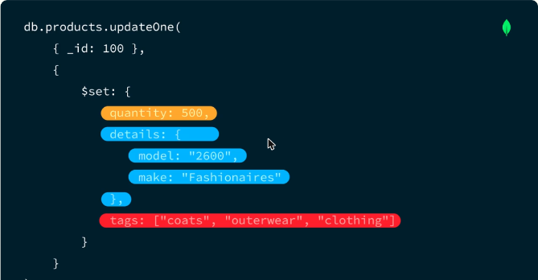
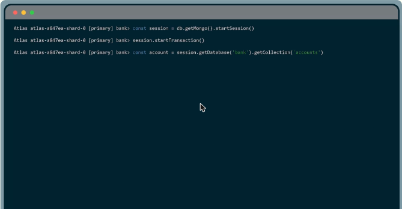
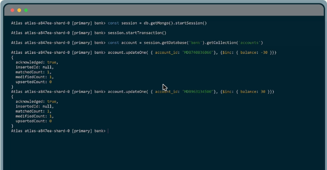
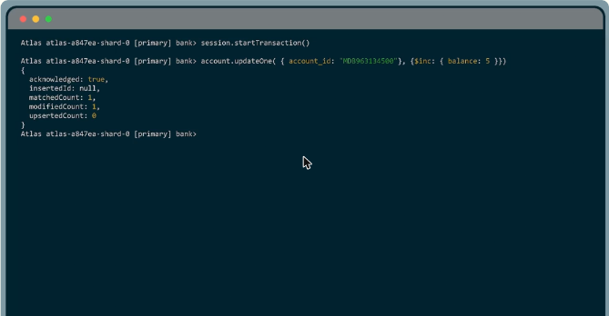
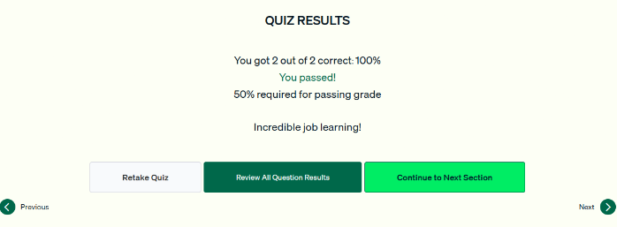
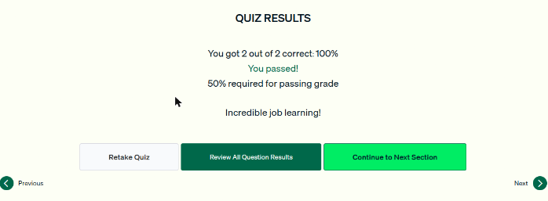
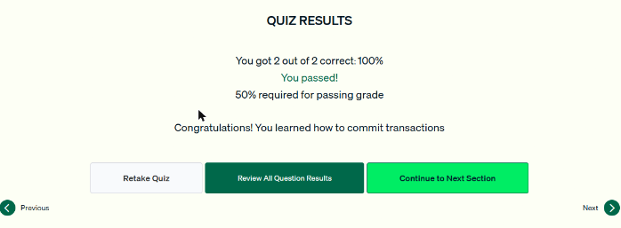

# 11.1 · Transacciones ACID y transacciones en MongoDB

## Qué es una transacción ACID

Cuando unas operaciones **transfieren valor** de un registro a otro (pagos entre personas, inventario → carrito de compras, nómina), tienen que ocurrir **todas juntas o ninguna**. Si no, se pierde la integridad: por ejemplo, el dinero sale de una cuenta y nunca llega a la otra.

| Propiedad | Garantía |
|---|---|
| **A**tomicity (atomicidad) | Todas las operaciones tienen éxito o fallan **juntas** («todo o nada») |
| **C**onsistency (consistencia) | Los cambios respetan las **restricciones** de la base (por ejemplo, un saldo que no puede ser menor que 0) |
| **I**solation (aislamiento) | Las transacciones concurrentes **no se afectan entre sí** |
| **D**urability (durabilidad) | Los cambios confirmados **persisten** aunque haya una falla de energía o de hardware |


*Figura: el aislamiento permite que varias transacciones ocurran a la vez sin afectar el resultado de las demás.*

## Un documento frente a varios documentos

- **Las operaciones sobre un solo documento son atómicas** de por sí en MongoDB. Un `updateOne` que cambia varios campos los aplica todos o ninguno, sin pasos extra.
- **Las operaciones sobre varios documentos no son atómicas** (por ejemplo `updateMany`, o actualizar el carrito y el inventario). Para que tengan propiedades ACID hay que envolverlas en una **transacción multidocumento**.
- Las transacciones multidocumento **bloquean** los documentos involucrados, así que tienen un **costo de rendimiento y latencia**. Son una herramienta **precisa**, para usar solo cuando ACID es imprescindible.



*Figura: un `updateOne` que modifica quantity, details y tags se aplica completo o no se aplica.*

## Transacciones en mongosh

```javascript
const session = db.getMongo().startSession()
session.startTransaction()                                   // no muestra salida
const account = session.getDatabase('bank').getCollection('accounts')

account.updateOne({ account_id: "MDB740836066" }, { $inc: { balance: -30 } })
account.updateOne({ account_id: "MDB963134500" }, { $inc: { balance: 30 } })

session.commitTransaction()     // confirma todo junto
// ... o en vez de confirmar:
session.abortTransaction()      // revierte: el estado vuelve al original (no muestra salida)
```

- Una **sesión** agrupa operaciones relacionadas. Se crea con `db.getMongo().startSession()`.
- Las colecciones se obtienen **desde la sesión**: `session.getDatabase(...).getCollection(...)`.
- **Límite de 60 segundos** desde la primera escritura. Si se pasa, la transacción se aborta (*MongoServerError: Transaction … has been aborted*) y hay que repetirla. Conviene tener las operaciones preparadas de antemano.
- En la práctica se usan transacciones desde los **drivers**. Los pasos son los mismos con otra sintaxis (en PyMongo, `with_transaction`).



*Figura: se crea la sesión, se inicia la transacción y se obtiene la colección `accounts` desde la sesión.*



*Figura: se resta 30 de una cuenta y se suma 30 a la otra dentro de la misma transacción.*



*Figura: una nueva transacción que, en lugar de confirmarse, se cancela con `abortTransaction()`.*

!!! tip "Para recordar"
    - ACID = **Atomicidad, Consistencia, Aislamiento, Durabilidad**.
    - Se usa cuando hay **transferencia de valor** entre registros (dinero, inventario a carrito).
    - **Un documento = atómico de por sí. Varios documentos = hace falta una transacción.**
    - mongosh: `startSession()` → `startTransaction()` → operaciones → **`commitTransaction()`** o **`abortTransaction()`**.
    - Límite: **60 s** desde la primera escritura. Hay un costo de rendimiento, así que se usan solo cuando hacen falta.
    - `startTransaction()` y `abortTransaction()` no muestran salida en el shell. `commitTransaction()` sí.

## Actividades y cuestionarios

- *Match pairs* de las propiedades ACID: completado (4/4 parejas correctas).
- Cuestionarios de las lecciones 1 a 3: **2/2 correctas (100 %) en cada uno**. Cubrieron la definición de transacción ACID y cuándo usarla, la atomicidad de las operaciones de uno y varios documentos, y los métodos para completar o cancelar una transacción.
- Laboratorio práctico en Atlas: **Pendiente**.



*Figura: cuestionario de la lección 1 aprobado.*



*Figura: cuestionario de la lección 2 aprobado.*



*Figura: cuestionario de la lección 3 aprobado.*
