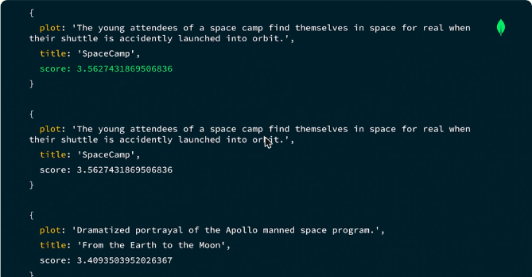
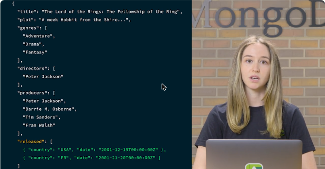
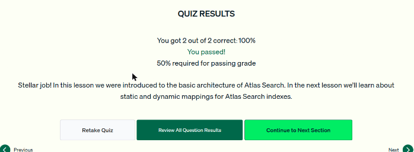
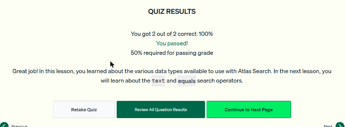

# 12.1 · Fundamentos de Atlas Search, mapeos y tipos de datos

## Cómo funciona Atlas Search

- Atlas Search usa su propia tecnología de índices, basada en **Apache Lucene**.
- El proceso **`mongot`** es la capa que incluye Lucene: crea los **índices de búsqueda** según la definición del índice y ejecuta las consultas. Mantiene los índices al día con **Change Streams**.
- Antes de buscar hay que **crear un índice de Atlas Search**. Un índice de texto o un índice compuesto normales no sirven para esto.

```javascript
db.movies.createSearchIndex("plotIndex", {
  mappings: { fields: { plot: { type: "string" } } }
})
```

- Las consultas se hacen con el aggregation framework y las etapas **`$search`** o **`$searchMeta`**, que tienen que ser **la primera etapa** del pipeline. Un `$match` antes daría error, porque el nuevo conjunto de datos ya no tiene acceso al índice.
- **Puntaje de relevancia:** sube si el término aparece mucho en el documento y baja si aparece en muchos documentos de la colección. Se ve con `{ $meta: "searchScore" }` en un `$project`.
- **`$searchMeta`** devuelve un **resumen** (por ejemplo, el conteo). Es más eficiente que poner un `$count` al final de un `$search`.


*Figura: el índice de búsqueda `plotIndex` indexa el campo `plot` como string.*



*Figura: los resultados de buscar "space" en `plot`, ordenados por puntaje de relevancia.*

## Mapeos dinámicos y estáticos

| | Dinámico (`dynamic: true`) | Estático (`dynamic: false` + `fields`) |
|---|---|---|
| Qué indexa | **Todos** los campos con tipos soportados | Solo los campos que se indican |
| Cuándo usarlo | Campos desconocidos o que cambian, o para experimentar | Forma de documento conocida y estable |
| Costo | Índices **más grandes** y más cómputo para mantenerlos | Índices más pequeños, mejor rendimiento al actualizar |

```javascript
db.movies.createSearchIndex({ mappings: { dynamic: true } })        // nombre "default"

db.movies.createSearchIndex("plotReleasedIndex", {
  mappings: { dynamic: false,
              fields: { plot: { type: "string" }, released: { type: "date" } } }
})
```

- Se pueden **combinar**: un índice estático con un campo `embeddedDocuments` que sea dinámico por dentro.
- Si un documento trae un campo con un tipo distinto al definido en el índice, ese documento **no se indexa**.


*Figura: el índice `plotReleasedIndex` con `dynamic: false`, `plot` como string y `released` como date.*



*Figura: un documento de `movies` con arreglos (genres, directors, producers) y `released` como arreglo de subdocumentos.*

## Tipos de datos

- Comunes: **string, number** (double, int32, int64), **boolean, date, objectId**.
- Para la forma de los documentos: **arreglos** (se indexan con el tipo de sus elementos), **document** (un subdocumento) y **embeddedDocuments** (un **arreglo de subdocumentos**).
- `embeddedDocuments` se indexa aparte del documento padre (hay más documentos en el índice). Tiene un máximo de **5 niveles** de anidamiento, no admite facets de fecha o número y no admite resaltado.
- Un campo puede tener **varios tipos** si se define como un arreglo de tipos (por ejemplo, string u objectId).
- Los facets (`stringFacet`, `dateFacet`, `numberFacet`) no se permiten dentro de arreglos.


*Figura: `released` como `embeddedDocuments` con mapeo estático del subcampo `date`.*

!!! tip "Para recordar"
    - Proceso de Atlas Search: **`mongot`** (Apache Lucene). Primero se crea el **índice de búsqueda**.
    - `$search` / `$searchMeta` siempre van **en la primera etapa**.
    - Para indexar **todos** los campos se usa el mapeo **dinámico**. `dynamic: false` con `fields` es **estático**.
    - Arreglo de subdocumentos → **`embeddedDocuments`**. Un solo subdocumento → `document`.
    - Tipos soportados: string, number, boolean, date, objectId… **CHAR no existe**.

## Cuestionarios

Lecciones 1 a 3: **2/2 correctas (100 %) en cada una**. Cubrieron el proceso de Atlas Search y el requisito del índice, cómo identificar un mapeo estático y cuándo usar uno dinámico, y los tipos de datos soportados.



*Figura: cuestionario de la lección 1 aprobado.*



*Figura: cuestionario de la lección 3 aprobado.*
