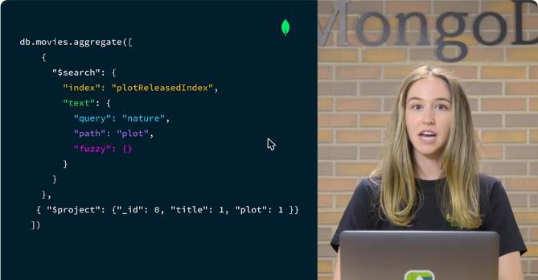
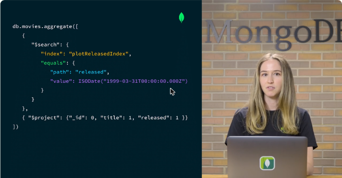
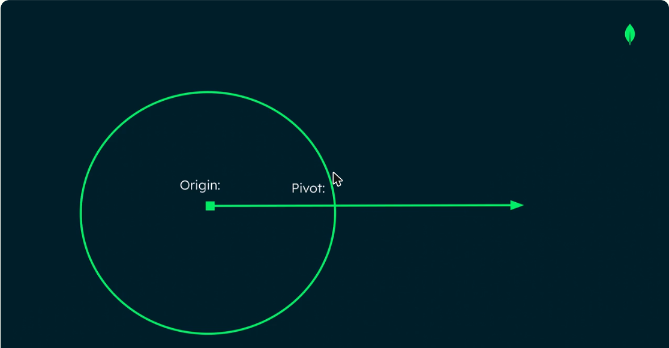
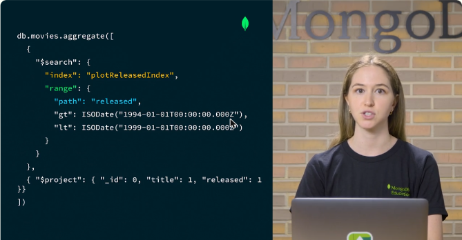
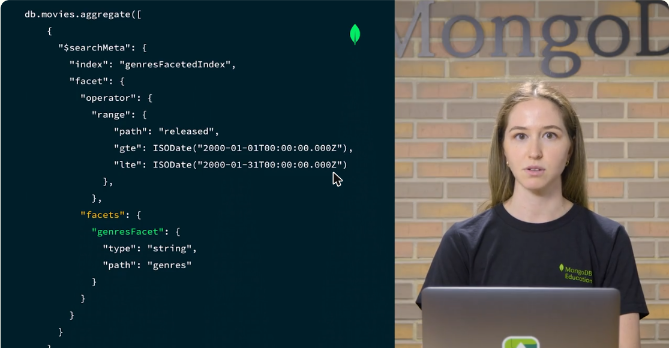
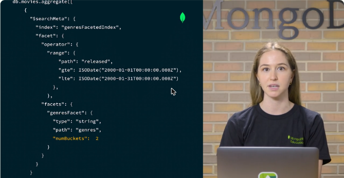
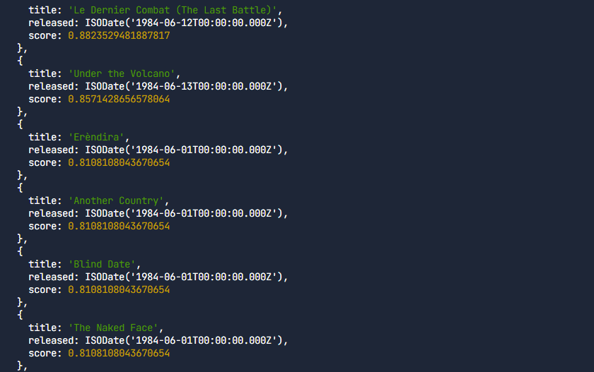
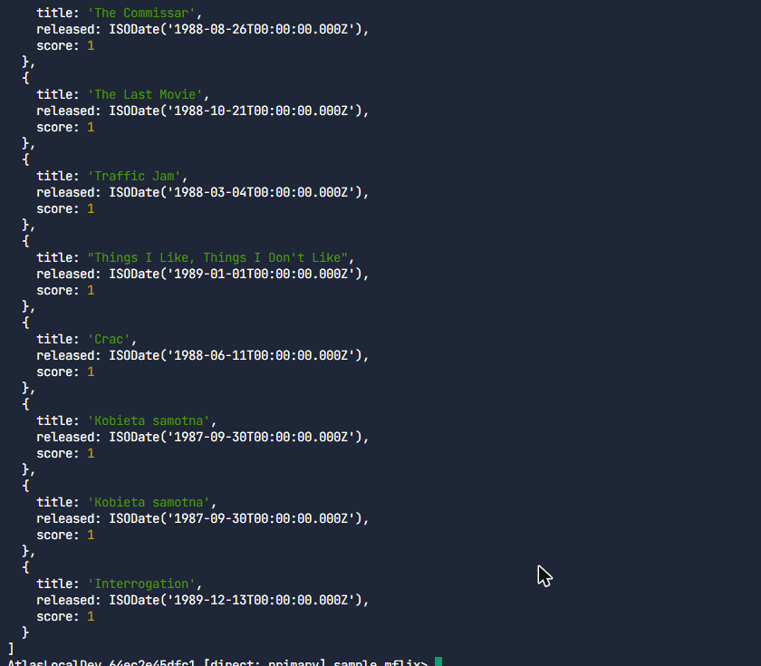
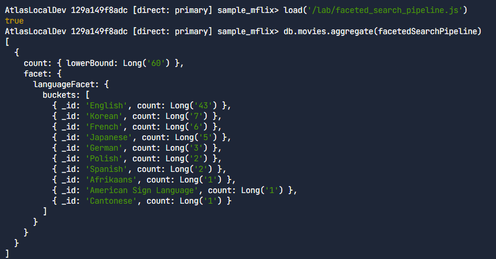

# 12.2 · Operadores de `$search` y facets

## `text` y `equals`

```javascript
db.movies.aggregate([
  { $search: { index: "plotReleasedIndex",
               text: { query: "nature", path: "plot", fuzzy: {} } } },
  { $project: { _id: 0, title: 1, plot: 1 } }
])

db.movies.aggregate([
  { $search: { index: "plotReleasedIndex",
               equals: { path: "released", value: ISODate("1999-03-31T00:00:00.000Z") } } },
  { $project: { _id: 0, title: 1, released: 1 } }
])
```

| Operador | Uso |
|---|---|
| **`text`** | Búsqueda de **texto completo** en campos `string`. Con `fuzzy` tolera errores de tipeo (*natrue* → *nature*) |
| **`equals`** | Coincidencia **exacta** de un valor. Sirve para boolean, date, objectId, number, texto indexado como *token* y arreglos de esos tipos |



*Figura: `$search` con `text` sobre `plot` y `fuzzy` activado.*



*Figura: `equals` sobre `released` para una fecha exacta.*

## `near` y `range`

```javascript
// near: ordena TODOS los documentos por cercanía al origen
{ $search: { index: "plotReleasedIndex",
             near: { path: "released", origin: ISODate("1999-05-17"), pivot: 2629746000 } } }

// range: solo los documentos dentro del rango (sin $ en gt/lt)
{ $search: { index: "plotReleasedIndex",
             range: { path: "released", gt: ISODate("1994-01-01"), lt: ISODate("1999-01-01") } } }
```

- **`near`** busca fechas, números o ubicaciones **más cercanos** a un origen y devuelve **todos** los documentos ordenados por cercanía.
    - **pivot:** la distancia a la que el puntaje vale **0.5**. Puntaje = `pivot / (pivot + distancia)`. Distancia 0 da puntaje **1**. Más allá del pivote, el puntaje es **menor que 0.5**.
    - Para fechas el pivote va en **milisegundos** (30 días ≈ 2 600 millones de ms). Para números es un entero y para GeoJSON va en **metros**. No puede ser 0.
- **`range`** devuelve solo los documentos dentro del rango, con `gt`, `gte`, `lt` y `lte` **sin `$`**.



*Figura: el origen y el pivote. A la distancia del pivote, el puntaje es 0.5.*



*Figura: `range` sobre `released` entre 1994 y 1999.*

## Facets con `$searchMeta`

Los **facets** agrupan los resultados por categoría o rango y devuelven el **conteo de cada grupo (*bucket*)**, como los filtros laterales por marca de una tienda.

1. Índice **estático** (los facets necesitan un tipo especial) con el campo como **`stringFacet`**, **`dateFacet`** o **`numberFacet`**:

```javascript
db.movies.createSearchIndex("genresFacetedIndex", {
  mappings: { dynamic: false,
              fields: { genres: { type: "stringFacet" }, released: { type: "date" } } }
})
```

2. Consulta con **`$searchMeta`** y el colector `facet` (operador más facets):

```javascript
db.movies.aggregate([{ $searchMeta: { index: "genresFacetedIndex",
  facet: {
    operator: { range: { path: "released", gte: ISODate("2000-01-01"), lte: ISODate("2000-01-31") } },
    facets: { genresFacet: { type: "string", path: "genres", numBuckets: 2 } }
  } } }])
```

- `numBuckets` limita la cantidad de grupos y deja los de mayor conteo (en el ejemplo, Drama y Comedy).



*Figura: `$searchMeta` con un operador `range` y el facet `genresFacet` sobre `genres`.*



*Figura: `numBuckets: 2` deja solo los dos géneros con más películas.*

!!! tip "Para recordar"
    - Buscar una palabra en un texto: **`text`**. Valor exacto (fecha, número, booleano): **`equals`**.
    - `near` devuelve **todos** los documentos por cercanía. Un puntaje **menor que 0.5** significa que está **más allá del pivote**.
    - `range` usa gt, gte, lt y lte **sin `$`**.
    - Facets: índice estático con **stringFacet, dateFacet o numberFacet** (no existe geoFacet) y la etapa **`$searchMeta`**.

## Cuestionarios y laboratorios

- Lecciones 4 a 6: **2/2 correctas (100 %) en cada una**. Cubrieron cuándo usar `text` o `equals`, el comportamiento y el puntaje de `near`, y los tipos para facets.
- Laboratorios prácticos de las lecciones 5 y 6: **Completado** (ver la sección *Laboratorio*).


*Figura: cuestionario de la lección 4 aprobado.*


*Figura: cuestionario de la lección 5 aprobado.*


*Figura: cuestionario de la lección 6 aprobado.*

## Laboratorio

Se trabajó sobre `sample_mflix.movies` en una implementación local de Atlas, completando archivos en el editor y ejecutándolos en mongosh.

**Lección 5: `near` y `range`** con el índice `released_index` (campo `released` de tipo `date`):

```javascript
// near: películas estrenadas cerca del 1984-06-08; pivot de 30 días en milisegundos
const searchStage = {
  $search: {
    index: "released_index",
    near: { path: "released", origin: ISODate("1984-06-08T00:00:00.000Z"), pivot: 2592000000 },
  },
};
const projectStage = { $project: { _id: 0, title: 1, released: 1, score: { $meta: "searchScore" } } };
const limitStage = { $limit: 10 };
db.movies.aggregate([searchStage, projectStage, limitStage])   // el score baja al alejarse de la fecha

// range: estrenos entre 1987-01-01 y antes de 1990-01-01 (gt / lt, sin $)
const searchStage = {
  $search: {
    index: "released_index",
    range: { path: "released", gt: ISODate("1987-01-01T00:00:00.000Z"), lt: ISODate("1990-01-01T00:00:00.000Z") },
  },
};
```

**Lección 6: facets.** Primero un índice con `languages` como `stringFacet` y `released` como `date`; luego `$searchMeta` con el colector `facet`:

```json
{ "name": "language_facet_idx", "collectionName": "movies", "database": "sample_mflix",
  "definition": { "mappings": { "dynamic": false, "fields": {
    "languages": { "type": "stringFacet" }, "released": { "type": "date" } } } } }
```

```javascript
const facetedSearchPipeline = [{
  $searchMeta: {
    index: "language_facet_idx",
    facet: {
      operator: { range: { path: "released",
        gte: ISODate("2000-01-01T00:00:00.000Z"), lte: ISODate("2000-01-31T00:00:00.000Z") } },
      facets: { languageFacet: { type: "string", path: "languages" } },
    },
  },
}];
db.movies.aggregate(facetedSearchPipeline)
// count.lowerBound: 60; buckets: English 43, Korean 7, French 6, Japanese 5, ...
```







## Fuentes y aviso legal

- **Fuente:** cursos de MongoDB University. Sitios oficiales: [learn.mongodb.com](https://learn.mongodb.com) · [mongodb.com/docs](https://www.mongodb.com/docs).
- **Uso:** apuntes personales de estudio, sin fines comerciales y con redacción propia. Las imágenes del curso son fragmentos breves citados con fines educativos; sus derechos son de sus titulares.
- **Sin afiliación:** sitio no oficial, no afiliado ni respaldado por MongoDB. Las marcas pertenecen a sus dueños.
- Más detalles y cómo pedir el retiro de contenido en el [aviso legal](../../../aviso-legal.md).
