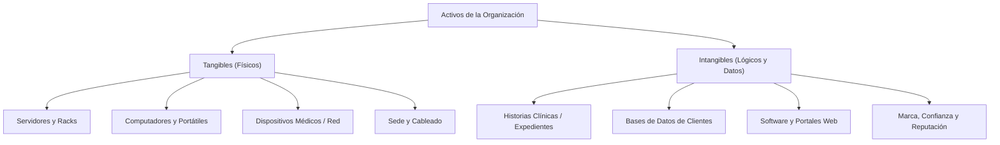

!!! info "Curso SENA · Ciberseguridad"
    Apropiación de los conceptos en ciberseguridad · Programa 23310008 · Ficha 3640188 · Centro de Comercio y Turismo, Regional Quindío

# AA1-EV01 · Informe de Análisis y Valuación de Activos

[:material-file-pdf-box: Descargar Informe Oficial en PDF (Formato APA)](archivos/AA1_EV01_Informe_analisis_valuacion_activos.pdf){ .md-button .md-button--primary }

> **Evidencia calificada con A (Aprobado)** el 19 de octubre de 2026. Documento de investigación estructurado bajo normas APA que resuelve la valuación de activos para dos organizaciones: **Clínica Veterinaria Huellitas S.A.S.** y el **Proyecto ASEGURA**.

---

## 1. Fundamentos: ¿Qué es un Activo de Información?

Un activo de información es todo recurso tecnológico, humano, físico o lógico que posee valor para la organización y que interviene en el ciclo de vida del dato (creación, procesamiento, almacenamiento, transmisión o destrucción).

Los activos se clasifican en dos grandes familias:

---

## 2. Escala de Clasificación de la Información (4 Niveles)

Alineada con la **Guía 5 del Modelo de Seguridad y Privacidad de la Información (MinTIC)** y la **Ley 1581 de 2012 (Protección de Datos Personales en Colombia)**:

| Nivel | Definición | Ejemplos en Huellitas | Impacto en caso de fuga |
|---|---|---|---|
| **Pública** | Información accesible sin restricciones | Portafolio de servicios, horarios, publicaciones en redes sociales | Ninguno o irrelevante |
| **Uso Interno** | Exclusiva para colaboradores | Turnos de trabajo, protocolos médicos internos, inventario comercial | Daño menor operativo |
| **Confidencial** | Datos personales sensibles y médicos | Historias clínicas veterinarias, base de datos de propietarios (cédula, celular, dirección) | Sanciones legales (Superintendencia de Industria y Comercio), pérdida de clientes |
| **Restringida** | Acceso ultra-restringido a Dirección | Credenciales de bases de datos, copias de seguridad maestras, registros tributarios | Daño catastrófico / parálisis total |

---

## 3. Valuación de Activos: Caso Clínica Veterinaria Huellitas

Para la clínica se aplicó una escala cualitativa de 1 (Muy Bajo) a 5 (Muy Alto) en **Confidencialidad (C)**, **Integridad (I)** y **Disponibilidad (D)**. La suma ponderada (máximo 15 puntos) determina el nivel de criticidad:

* **Crítico:** 13 a 15 puntos.
* **Alto:** 10 a 12 puntos.
* **Medio:** 7 a 9 puntos.
* **Bajo:** $\le$ 6 puntos.

| Activo de Información | C | I | D | Valor CID | Nivel | Clasificación | Justificación de Criticidad |
|---|:---:|:---:|:---:|:---:|:---:|:---:|---|
| **Software de gestión veterinaria en la nube** | 5 | 5 | 5 | **15** | 🔴 Crítico | Restringida | Núcleo de la operación clínica y registro de citas |
| **Historias clínicas de pacientes** | 5 | 5 | 4 | **14** | 🔴 Crítico | Confidencial | Una alteración induce a errores fatales de medicación |
| **Base de datos de propietarios** | 5 | 4 | 4 | **13** | 🔴 Crítico | Confidencial | Sujeta a Ley 1581; riesgo de extorsión o suplantación |
| **Facturación y registros contables** | 4 | 5 | 4 | **13** | 🔴 Crítico | Restringida | Requisito tributario DIAN; fiscalización legal |
| **Disco externo de copias de seguridad** | 5 | 5 | 3 | **13** | 🔴 Crítico | Restringida | Última línea de defensa ante desastres o ransomware |
| **Conexión a internet y router principal** | 3 | 4 | 5 | **12** | 🟠 Alto | Uso interno | Si cae, incomunica el datáfono y el sistema web |
| **Inventario de medicamentos de control** | 4 | 5 | 3 | **12** | 🟠 Alto | Restringida | Regulado por Fondo Nacional de Estupefacientes |
| **Computadores de consultorio y recepción** | 4 | 4 | 4 | **12** | 🟠 Alto | Uso interno | Terminales de captura de información sensible |
| **Equipo de rayos X digital y analizador** | 3 | 5 | 4 | **12** | 🟠 Alto | Uso interno | Diagnóstico veterinario inmediato |
| **Marca, reputación y confianza** | 1 | 5 | 4 | **10** | 🟠 Alto | Pública | La credibilidad perdida destruye el negocio |
| **Página web y formulario de citas** | 2 | 4 | 3 | **9** | 🟡 Medio | Pública | Canal comercial complementario |
| **Impresora multifuncional** | 3 | 2 | 2 | **7** | 🟡 Medio | Uso interno | Puede retener copias de documentos en memoria |

---

## 4. Valuación de Activos: Caso Proyecto ASEGURA (Unidad Pública)

El proyecto oficial del componente formativo del SENA analizó una unidad de tramitación de expedientes que atiende tanto de forma presencial como virtual:

| Categoría | Activo | C | I | D | Total CID | Criticidad |
|---|---|:---:|:---:|:---:|:---:|:---:|
| **Esencial** | Expedientes en trámite | 5 | 5 | 4 | **14** | 🔴 Crítico |
| **Esencial** | Expedientes cerrados (archivo central) | 5 | 5 | 3 | **13** | 🔴 Crítico |
| **Esencial** | Servicio de tramitación electrónica (web) | 4 | 5 | 5 | **14** | 🔴 Crítico |
| **Esencial** | Servicio de tramitación presencial | 4 | 5 | 4 | **13** | 🔴 Crítico |
| **Aplicaciones** | Software de tramitación y base de datos | 5 | 5 | 5 | **15** | 🔴 Crítico |
| **Aplicaciones** | Portal web de administración electrónica | 4 | 5 | 5 | **14** | 🔴 Crítico |
| **Aplicaciones** | Correo electrónico institucional | 4 | 3 | 3 | **10** | 🟠 Alto |
| **Equipamiento**| Servidor principal de aplicaciones | 5 | 5 | 5 | **15** | 🔴 Crítico |
| **Equipamiento**| Equipos de red (router, cortafuegos) | 4 | 5 | 5 | **14** | 🔴 Crítico |
| **Equipamiento**| Computadores de escritorio de funcionarios | 4 | 4 | 3 | **11** | 🟠 Alto |
| **Equipamiento**| Impresora y escáner de expedientes | 3 | 1 | 1 | **5** | 🟢 Bajo |
| **Equipamiento**| Fotocopiadora | 1 | 1 | 1 | **3** | 🟢 Bajo |
| **Comunicaciones**| Conexión a internet fibra óptica | 3 | 4 | 5 | **12** | 🟠 Alto |
| **Comunicaciones**| Enlace seguro con el archivo central | 4 | 5 | 3 | **12** | 🟠 Alto |
| **Comunicaciones**| Red local (LAN interna) | 3 | 4 | 4 | **11** | 🟠 Alto |
| **Instalaciones** | Edificio y sala de servidores | 2 | 3 | 4 | **9** | 🟡 Medio |
| **Personal** | Funcionario de ventanilla / atención | 3 | 4 | 4 | **11** | 🟠 Alto |

---

## 5. Marco Metodológico Seleccionado: MAGERIT v3 + ISO 27001

Para el caso ASEGURA se seleccionó formalmente **MAGERIT v3** complementado con **ISO/IEC 27001 e ISO/IEC 27005**:

* **¿Por qué MAGERIT?** Porque fue diseñada específicamente para administraciones públicas y servicios de administración electrónica. Permite modelar dependencias entre activos esenciales (información y servicios) y activos de soporte (servidor, red, edificio).
* **Propagación del valor:** El servidor en sí mismo no tiene valor intrínseco, pero al sostener los expedientes legales, hereda el valor crítico de la información que procesa.
* **NIST SP 800-30:** Se conserva como la guía de pasos secuenciales para ejecutar las fases prácticas de evaluación.
