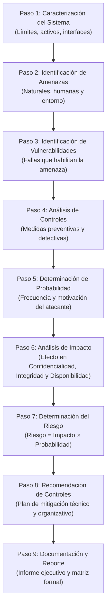
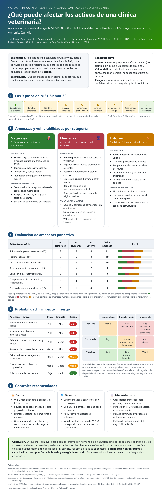

!!! info "Curso SENA · Ciberseguridad"
    Apropiación de los conceptos en ciberseguridad · Programa 23310008 · Ficha 3640188 · Centro de Comercio y Turismo, Regional Quindío

# AA2-EV01 · Mapa de Amenazas y Vulnerabilidades (NIST SP 800-30)

[:material-file-pdf-box: Descargar Infografía Oficial en PDF](archivos/AA2_EV01_Infografia_amenazas_vulnerabilidades.pdf){ .md-button .md-button--primary }

> **Evidencia enviada el 24 de octubre de 2026.** Desarrolla la clasificación sistemática de amenazas y vulnerabilidades que acechan a los activos críticos identificados en la AA1, siguiendo los lineamientos del estándar **NIST SP 800-30**.

---

## 1. La Metodología NIST SP 800-30 en 9 Pasos

El Instituto Nacional de Estándares y Tecnología (NIST) establece una secuencia lógica e iterativa para evaluar los riesgos en sistemas de información:

---

## 2. Las Tres Categorías de Amenazas

La guía de aprendizaje exige clasificar todas las amenazas en tres grupos fundamentales:

  

    

      🌿
      <h3>1. Amenazas Naturales</h3>
    

    
Fenómenos de la naturaleza impredecibles en su ocurrencia exacta pero modelables por ubicación geográfica.

    <ul>
      <li><strong>Terremotos y sismos:</strong> Alto riesgo en Armenia (Quindío, zona de amenaza sísmica alta).</li>
      <li><strong>Inundaciones y tormentas eléctricas:</strong> Descargas atmosféricas que dañan componentes electrónicos y routers.</li>
      <li><strong>Vendavales:</strong> Destrucción de cableado aéreo de fibra óptica.</li>
    </ul>
    
<strong>Impacto principal:</strong> Destrucción física total y pérdida de Disponibilidad.

  

  

    

      👤
      <h3>2. Amenazas Humanas</h3>
    

    
Acciones deliberadas o accidentales originadas por personas internas o atacantes externos.

    <ul>
      <li><strong>Ransomware y malware:</strong> Cifrado de datos y extorsión por rescate financiero.</li>
      <li><strong>Phishing e ingeniería social:</strong> Engaño a empleados para robar contraseñas.</li>
      <li><strong>Errores de operación:</strong> Borrado accidental de tablas o sobreescritura de archivos sin copia.</li>
      <li><strong>Fuga o espionaje interno:</strong> Extracción de bases de datos de clientes en dispositivos USB.</li>
    </ul>
    
<strong>Impacto principal:</strong> Ruptura de Confidencialidad e Integridad.

  

  

    

      ⚙️
      <h3>3. Amenazas del Entorno</h3>
    

    
Fallas en los servicios de soporte, infraestructura física y suministros básicos del edificio.

    <ul>
      <li><strong>Cortes y sobretensiones eléctricas:</strong> Apagones súbitos que corrompen bases de datos.</li>
      <li><strong>Fugas de agua y humedad:</strong> Tuberías rotas cercanas al rack de comunicaciones.</li>
      <li><strong>Temperatura excesiva y polvo:</strong> Falta de climatización en el cuarto del servidor.</li>
      <li><strong>Incendios estructurales:</strong> Cortocircuitos en cableado desordenado.</li>
    </ul>
    
<strong>Impacto principal:</strong> Degradación de equipos y caída de Disponibilidad.

  

---

## 3. Visualización Completa de la Infografía

A continuación se presenta la infografía oficial desarrollada para la entrega del SENA:

---

## 4. Matriz de Tratamiento de Amenazas Críticas

Resumen de las amenazas de mayor severidad detectadas y los controles implementados en Huellitas:

| Amenaza Evaluada | Categoría | Vulnerabilidad Asociada | Prob. | Impacto | Nivel | Control de Mitigación Obligatorio |
|---|:---:|---|:---:|:---:|:---:|---|
| **Cifrado por Ransomware** | Humana | Copia de respaldo conectada a la red; falta de filtrado EDR | 3 | 5 | 🔴 **Crítico** | Desconexión física de copias (regla 3-2-1) + Antivirus EDR con detección de comportamiento |
| **Phishing a personal** | Humana | Falta de cultura de seguridad; no se usa MFA | 4 | 4 | 🔴 **Crítico** | Capacitación obligatoria + Doble factor de autenticación (TOTP/Google Authenticator) |
| **Sismo de alta magnitud** | Natural | Sede en zona sísmica de Quindío; sin respaldo en la nube | 2 | 5 | 🟠 **Alto** | Backup automatizado en la nube (AWS S3 cifrado) para recuperación remota |
| **Falla de energía prolongada** | Entorno | Servidor sin UPS con autonomía suficiente | 4 | 3 | 🟠 **Alto** | Instalación de UPS inteligente de 2 KVA con apagado automático ordenado |
| **Extracción no autorizada USB** | Humana | Puertos USB habilitados sin bloqueo por políticas de grupo | 3 | 4 | 🟠 **Alto** | Bloqueo físico y lógico de almacenamiento USB + Firma de cláusulas de confidencialidad |

## Fuentes y aviso legal

- **Fuente:** formación del SENA en la plataforma Zajuna; las evidencias son trabajos propios del aprendiz. Sitios oficiales: [sena.edu.co](https://www.sena.edu.co).
- **Uso:** apuntes personales de estudio, sin fines comerciales y con redacción propia. Las imágenes del curso son fragmentos breves citados con fines educativos; sus derechos son de sus titulares.
- **Sin afiliación:** sitio no oficial, no afiliado ni respaldado por el SENA. Las marcas pertenecen a sus dueños.
- Más detalles y cómo pedir el retiro de contenido en el [aviso legal](../../aviso-legal.md).
