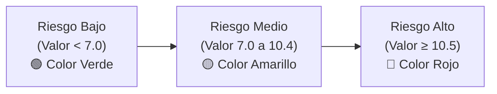

!!! info "Curso SENA · Ciberseguridad"
    Apropiación de los conceptos en ciberseguridad · Programa 23310008 · Ficha 3640188 · Centro de Comercio y Turismo, Regional Quindío

# AA3-EV01 · Matriz de Riesgos de la Organización (ISO 27001)

[:material-file-excel: Descargar Matriz de Riesgos Oficial (.xlsx)](archivos/AA3_EV01_Formato_matriz_de_riesgo.xlsx){ .md-button .md-button--primary }
[:material-language-python: Ver Script de Automatización (.py)](archivos/generar_formato_oficial.py){ .md-button }

> **Evidencia enviada el 29 de octubre de 2026.** Diligenciamiento formal del formato institucional del SENA (**Anexo 1 · Matriz de Análisis de Riesgo**) utilizando como insumo los 17 activos del **Proyecto ASEGURA** (punto 6 del componente formativo) cruzados con 35 amenazas y vulnerabilidades.

---

## 1. Estructura y Metodología de la Matriz

El formato oficial de la matriz en Excel calcula el **Riesgo Inherente** mediante la multiplicación entre el **Nivel de Impacto** del activo y la **Probabilidad de Ocurrencia** de la amenaza:

$$\text{Nivel de Riesgo} = \text{Impacto} \times \text{Probabilidad}$$

### Escala de Impacto (1 a 4)
Derivada directamente del valor CID (Confidencialidad + Integridad + Disponibilidad) de la evidencia AA1:
* **4 - Crítico:** Activos con valor CID entre 13 y 15 (Expedientes, Servidor, Software de tramitación).
* **3 - Alto:** Activos con valor CID entre 10 y 12 (Equipos de red, Computadores, Enlace central).
* **2 - Medio:** Activos con valor CID entre 7 y 9 (Edificio de la unidad, Portal de citas).
* **1 - Bajo:** Activos con valor CID $\le$ 6 (Fotocopiadora, Impresora secundaria).

### Escala de Probabilidad (1 a 4)
* **1 - Insignificante / Rara:** Amenazas naturales atípicas, sustancias químicas.
* **2 - Baja:** Fallas eléctricas ocasionales, sismos, temperatura.
* **3 - Media:** Explotación de errores, ingeniería social, malware común.
* **4 - Alta:** Acceso no autorizado a interfaces web expuestas, carencia de políticas formales.

---

## 2. Umbrales y Semáforo de Riesgo (Hoja Fuente del SENA)

El formato oficial preestablecido por el SENA define tres umbrales de severidad:



| Nivel de Riesgo | Rango Numérico | Criterio de Tratamiento ISO 27001 | Acción Inmediata |
|:---:|:---:|---|---|
| 🟢 **Bajo** | $1.0 - 6.9$ | **Aceptar el riesgo:** Costo del control supera el impacto | Monitoreo y revisiones anuales rutinarias |
| 🟡 **Medio** | $7.0 - 10.4$ | **Mitigar / Transferir:** Aplicar controles de buenas prácticas | Implementación en ciclo ordinario (< 60 días) |
| 🔴 **Alto** | $\ge 10.5$ | **Mitigación Obligatoria:** Inadmisible para la continuidad | Plan de contingencia urgente (< 30 días) |

---

## 3. Catálogo de Amenazas y Vulnerabilidades Evaluadas (35 Factores)

La matriz cruza los activos contra las 35 amenazas estandarizadas del Anexo 1:

1. **Amenazas Humanas (8):** Acceso no autorizado, Explotación de errores, Ingeniería social, Hackers externos, Interceptación de datos en tránsito, Código malicioso, Abuso informático interno, Virus informáticos.
2. **Amenazas del Entorno (13):** Polución, Fallas eléctricas, Sustancias químicas, Fugas de líquido, Temperatura inadecuada, Incendios, Humedad, Edificaciones cercanas, Protección física deficiente, Fuentes de potencia inestables, Cableado expuesto, Ingreso físico no autorizado, Fallas de hardware.
3. **Amenazas Naturales (4):** Terremotos / sismos, Inundaciones, Tormentas eléctricas, Vendavales y tormentas de viento.
4. **Vulnerabilidades Estructurales (10):** Falta de documentación en servidores, Manuales y procedimientos desactualizados, Listado y control de usuarios deficiente, Copias de seguridad inconsistentes, Carencia de políticas de seguridad SGSI, Ausencia de control de cambios, Carencia de Fail-over / Alta disponibilidad, Falta de Plan de Recuperación de Desastres (DRP), Monitoreo deficiente, Carencia de auditorías periódicas.

---

## 4. Automatización con Python y `openpyxl`

Para garantizar total precisión en las 595 celdas calculadas, se desarrolló el script `generar_formato_oficial.py`. El script:

1. Construye el libro de trabajo con la cabecera institucional del SENA y datos del aprendiz.
2. Inyecta los 17 activos y sus valores de impacto CID.
3. Aplica **fórmulas nativas de Excel** (`=Impacto*Probabilidad`) para que los cálculos sean dinámicos y auditables.
4. Aplica **reglas de formato condicional** de Excel con la paleta oficial (Rojo `#FF5B5B`, Amarillo `#FFFF99`, Verde `#92D050`).

```python
# Fragmento del cálculo de riesgo automatizado en generar_formato_oficial.py
for row_idx, (cat, activo, c, i, d, es_critico) in enumerate(ACTIVOS, start=10):
    val_cid = c + i + d
    impacto = 4 if val_cid >= 13 else 3 if val_cid >= 10 else 2 if val_cid >= 7 else 1
    # Se multiplica cada amenaza por el impacto asignado
```

## Fuentes y aviso legal

- **Fuente:** formación del SENA en la plataforma Zajuna; las evidencias son trabajos propios del aprendiz. Sitios oficiales: [sena.edu.co](https://www.sena.edu.co).
- **Uso:** apuntes personales de estudio, sin fines comerciales y con redacción propia. Las imágenes del curso son fragmentos breves citados con fines educativos; sus derechos son de sus titulares.
- **Sin afiliación:** sitio no oficial, no afiliado ni respaldado por el SENA. Las marcas pertenecen a sus dueños.
- Más detalles y cómo pedir el retiro de contenido en el [aviso legal](../../aviso-legal.md).
