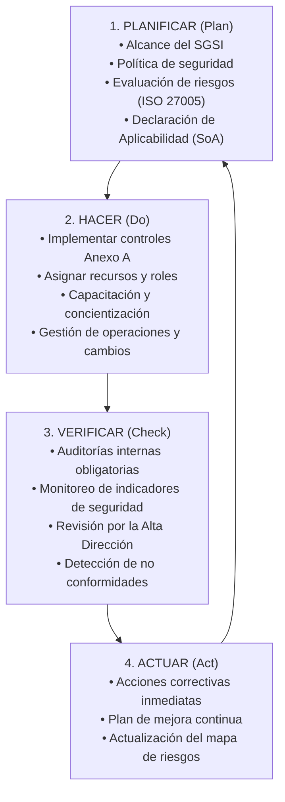

!!! info "Curso SENA · Ciberseguridad"
    Apropiación de los conceptos en ciberseguridad · Programa 23310008 · Ficha 3640188 · Centro de Comercio y Turismo, Regional Quindío

# AA4-EV01 · Sistema de Gestión de Seguridad de la Información (ISO/IEC 27001)

> **Evidencia en preparación / desarrollo.** Marco integral sobre la implementación de un SGSI bajo la norma internacional **ISO/IEC 27001:2022**, el ciclo de mejora continua PHVA y la aplicación de los controles del Anexo A en organizaciones modernas.

---

## 1. ¿Qué es un SGSI?

Un **Sistema de Gestión de Seguridad de la Información (SGSI)** es un conjunto sistemático de políticas, procesos, procedimientos, estructuras organizacionales y funciones de software y hardware diseñados para salvaguardar los activos de información críticos de una entidad.

Su objetivo no es eliminar el riesgo al 100% (lo cual es técnicamente imposible), sino **conocerlo, medirlo y mantenerlo dentro del apetito de riesgo aceptable** para la dirección.

---

## 2. El Ciclo PHVA / Deming en ISO 27001

La norma estructura todo el sistema bajo el ciclo iterativo de calidad:

---

## 3. Los 4 Dominios de Controles del Anexo A (ISO/IEC 27001:2022)

La versión 2022 simplificó los antiguos 14 dominios en **4 grandes categorías temáticas** que suman 93 controles de seguridad:

| Dominio | Controles | Enfoque Principal | Ejemplos de Controles Clave |
|---|:---:|---|---|
| **A.5 Organizacionales** | 37 controles | Políticas, gobierno y gestión del negocio | Política de seguridad (5.1), Inventario de activos (5.9), Clasificación de información (5.12), Trabajo remoto (5.14) |
| **A.6 De Personas** | 8 controles | Talento humano antes, durante y después | Verificación de antecedentes (6.1), Términos contractuales (6.2), Concientización y formación continua (6.3) |
| **A.7 Físicos** | 14 controles | Perímetros físicos, oficinas e instalaciones | Perímetro de seguridad física (7.1), Protección contra amenazas externas (7.4), Escritorio y pantalla limpia (7.7) |
| **A.8 Tecnológicos** | 34 controles | Software, redes, autenticación y cifrado | Control de acceso (8.2), Criptografía (8.24), Copias de seguridad (8.13), Gestión de vulnerabilidades técnicas (8.8) |

---

## 4. Hoja de Ruta para Pequeñas y Medianas Empresas (Pymes)

Para organizaciones como la Clínica Huellitas, la adopción de ISO 27001 debe ser escalonada para no ahogar la operación con burocracia excesiva:

1. **Fase 1 (Semanas 1–4):** Inventario de activos críticos y política básica de contraseñas y respaldos.
2. **Fase 2 (Semanas 5–8):** Implementación de la regla 3-2-1 en copias de seguridad y doble factor (MFA) en correos y accesos remotos.
3. **Fase 3 (Semanas 9–12):** Firma de acuerdos de confidencialidad (NDA) con empleados y proveedores de software.
4. **Fase 4 (Continuo):** Simulacros de restauración de copias y talleres de detección de correos de phishing.

## Fuentes y aviso legal

- **Fuente:** formación del SENA en la plataforma Zajuna; las evidencias son trabajos propios del aprendiz. Sitios oficiales: [sena.edu.co](https://www.sena.edu.co).
- **Uso:** apuntes personales de estudio, sin fines comerciales y con redacción propia. Las imágenes del curso son fragmentos breves citados con fines educativos; sus derechos son de sus titulares.
- **Sin afiliación:** sitio no oficial, no afiliado ni respaldado por el SENA. Las marcas pertenecen a sus dueños.
- Más detalles y cómo pedir el retiro de contenido en el [aviso legal](../../aviso-legal.md).
