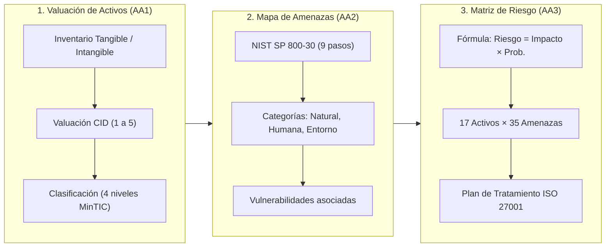

!!! info "Curso SENA · Ciberseguridad"
    Apropiación de los conceptos en ciberseguridad · Programa 23310008 · Ficha 3640188 · Centro de Comercio y Turismo, Regional Quindío

# Apropiación de los conceptos en ciberseguridad (SENA)

  
PROGRAMA SENA 23310008 · FICHA 3640188 · 48 HORAS

  <h2>Gestión Integral de Seguridad de la Información, Activos y Riesgos</h2>
  
Diagnóstico de seguridad técnica, mapa de amenazas según NIST SP 800-30, valoración de activos MAGERIT v3 y matriz formal de riesgos bajo ISO/IEC 27001.

  

    🛡️ Tríada CID
    📋 MAGERIT v3
    🔍 NIST SP 800-30
    📊 ISO/IEC 27001:2022
    ⚖️ Ley 1581 (Habeas Data)
  

---

## 📌 Contexto del Programa

Curso virtual de formación integral del SENA impartido por el **Centro de Comercio y Turismo (Regional Quindío)**, bajo la instrucción de la docente **Luz Dary Bautista Parra**. Desarrolla la competencia laboral **220501108: Diagnosticar la seguridad de la información de acuerdo con métodos de análisis y normativa técnica**.

Aquí documento todo el compendio de evidencias, metodologías, formatos oficiales y un **tablero interactivo de ciberdefensa** desarrollado para reforzar el aprendizaje práctico.

---

## 🧭 Flujo Metodológico Integrado

El proceso de diagnóstico y tratamiento del riesgo se estructuró conectando las tres evidencias en un ciclo de mejora continuo:

---

## 🏢 Casos de Estudio Desarrollados

Las evidencias se construyeron sobre dos escenarios complementarios de alta relevancia:

1. **Clínica Veterinaria Huellitas S.A.S. (Pyme Sector Salud/Comercial en Armenia):**
    - Enfoque en protección de historias clínicas de pacientes, datos personales de clientes (Ley 1581 de 2012), facturación electrónica ante DIAN y continuidad operativa ante cortes eléctricos o ciberataques.
2. **Proyecto ASEGURA (Unidad Pública de Tramitación de Expedientes):**
    - Caso oficial del componente formativo del SENA. Analiza la digitalización de expedientes con validez legal, disponibilidad del portal web para ciudadanos y hardening del servidor central.

---

## 📋 Evidencias y Contenidos del Curso

| Evidencia | Estado | Tema Central y Enfoque | Entregable Oficial |
|---|:---:|---|---|
| [**Tablero Interactivo & Simulador**](tablero-interactivo.md) | 🟢 **Activo** | Simulador de ataques vs defensas, calculadora dinámica 5x5 y flashcards 3D | Herramienta Web |
| [**Trucos, Tips & Cheat Sheet**](trucos-tips-cheatsheet.md) | 🟢 **Activo** | Comandos reales de Hardening Linux, Nmap, Wireshark, UFW e iptables | Guía Técnica |
| [**AA1-EV01 · Valuación de Activos**](aa1-ev01-informe-activos.md) | 🟢 **Calificado A** | Inventario tangible/intangible, escala 4 niveles y valuación CID | [PDF APA](archivos/AA1_EV01_Informe_analisis_valuacion_activos.pdf) |
| [**AA2-EV01 · Mapa de Amenazas**](aa2-ev01-infografia-amenazas.md) | 🟢 **Enviado** | Metodología NIST SP 800-30, 3 categorías de amenazas y vulnerabilidades | [PDF Infografía](archivos/AA2_EV01_Infografia_amenazas_vulnerabilidades.pdf) |
| [**AA3-EV01 · Matriz de Riesgos**](aa3-ev01-matriz-riesgos.md) | 🟢 **Enviado** | Matriz formal en Excel (Anexo 1 SENA), 17 activos × 35 amenazas y fórmulas | [Excel XLSX](archivos/AA3_EV01_Formato_matriz_de_riesgo.xlsx) |
| [**AA4-EV01 · Norma ISO 27001**](aa4-ev01-iso27001-sgsi.md) | 🟢 **En Ruta** | Estructura del SGSI, ciclo PHVA y controles del Anexo A (ISO 27001:2022) | Mapa & Resumen |

---

## ⚡ Enlaces Rápidos a Herramientas de Refuerzo

  <a href="tablero-interactivo/" class="cyber-quick-card">
    
🎮

    

      <strong>Simulador de Ciberincidentes</strong>
      
Evalúa en vivo el impacto en CID de Ransomware, Phishing, SQLi y DDoS.

    

  </a>
  <a href="tablero-interactivo/#calculadora-interactiva-de-nivel-de-riesgo-5x5" class="cyber-quick-card">
    
🧮

    

      <strong>Calculadora de Riesgo 5×5</strong>
      
Calcula probabilidad × impacto en tiempo real y obtén SLA de respuesta.

    

  </a>
  <a href="trucos-tips-cheatsheet/" class="cyber-quick-card">
    
💻

    

      <strong>Cheat Sheet de Auditoría & Hardening</strong>
      
Comandos listos para copiar: permisos Linux, análisis de logs y firewall.

    

  </a>

## Fuentes y aviso legal

- **Fuente:** formación del SENA en la plataforma Zajuna; las evidencias son trabajos propios del aprendiz. Sitios oficiales: [sena.edu.co](https://www.sena.edu.co).
- **Uso:** apuntes personales de estudio, sin fines comerciales y con redacción propia. Las imágenes del curso son fragmentos breves citados con fines educativos; sus derechos son de sus titulares.
- **Sin afiliación:** sitio no oficial, no afiliado ni respaldado por el SENA. Las marcas pertenecen a sus dueños.
- Más detalles y cómo pedir el retiro de contenido en el [aviso legal](../../aviso-legal.md).
