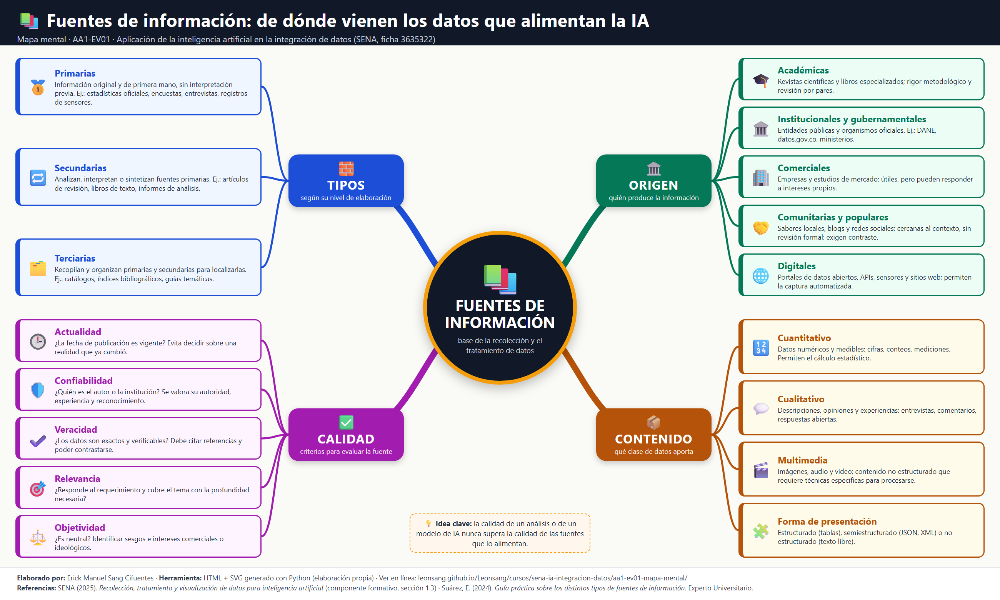

!!! info "Curso SENA"
    Aplicación de la inteligencia artificial en la integración de datos · ficha 3635322 · octubre de 2026

# AA1-EV01 · Mapa mental: fuentes de información

Mapa centrado en las **fuentes de información** que alimentan los procesos de recolección y tratamiento de datos
para IA, con las cuatro ramas que pide la guía: tipos, origen, contenido y criterios de calidad.

[:material-file-pdf-box: Descargar en PDF](archivos/AA1-EV01_Mapa_mental.pdf){ .md-button }

## Estructura

| Rama | Nodos |
|---|---|
| Tipos (nivel de elaboración) | Primarias · Secundarias · Terciarias |
| Origen (quién la produce) | Académicas · Institucionales y gubernamentales · Comerciales · Comunitarias y populares · Digitales |
| Contenido (qué aporta) | Cuantitativo · Cualitativo · Multimedia · Forma de presentación (estructurado, semiestructurado, no estructurado) |
| Calidad (criterios) | Actualidad · Confiabilidad · Veracidad · Relevancia · Objetividad |

**Idea clave:** la calidad de un análisis o de un modelo de IA nunca supera la calidad de las fuentes que lo alimentan.

El mapa se generó con código (HTML + SVG desde Python), lo que lo hace versionable y reproducible.

## Fuentes y aviso legal

- **Fuente:** formación del SENA en la plataforma Zajuna; las evidencias son trabajos propios del aprendiz. Sitios oficiales: [sena.edu.co](https://www.sena.edu.co).
- **Uso:** apuntes personales de estudio, sin fines comerciales y con redacción propia. Las imágenes del curso son fragmentos breves citados con fines educativos; sus derechos son de sus titulares.
- **Sin afiliación:** sitio no oficial, no afiliado ni respaldado por el SENA. Las marcas pertenecen a sus dueños.
- Más detalles y cómo pedir el retiro de contenido en el [aviso legal](../../aviso-legal.md).
