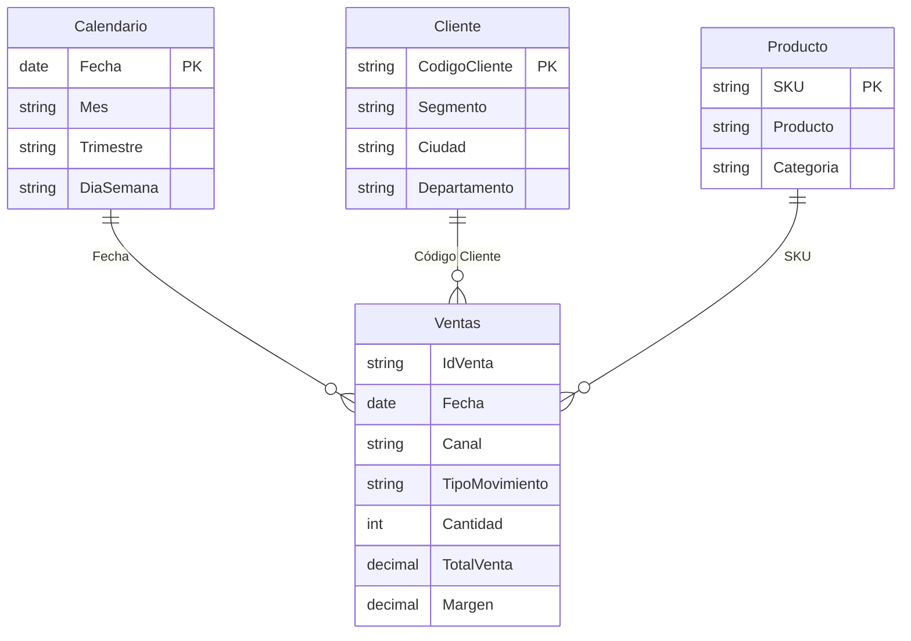
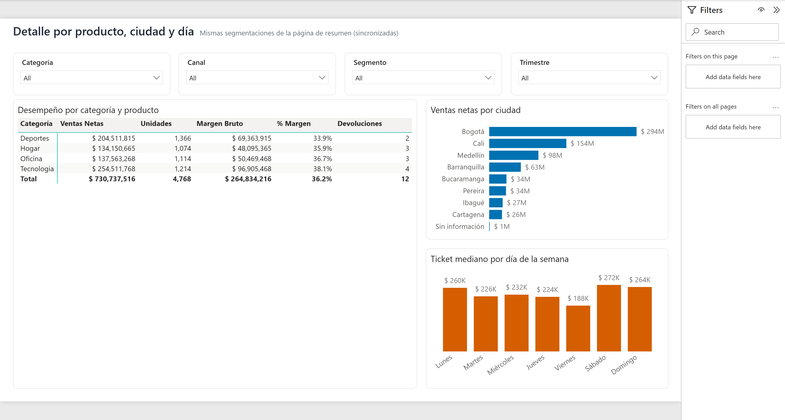
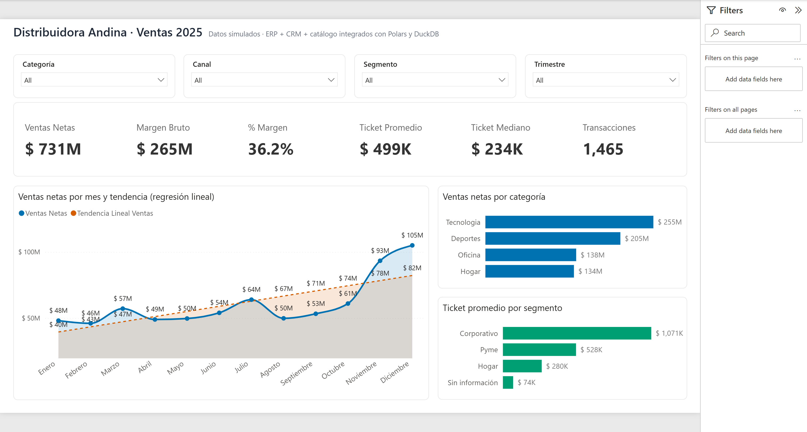

!!! info "Curso SENA"
    Aplicación de la inteligencia artificial en la integración de datos · ficha 3635322 · octubre de 2026


# AA2-EV03 · Configuración de analítica de datos en Power BI

Tablero de ventas construido como **proyecto de Power BI (PBIP)**: el modelo semántico está en TMDL y el reporte
en PBIR, ambos como texto versionable. Los datos llegan en Parquet desde el pipeline de Polars y DuckDB.

[:material-folder-zip: Descargar el proyecto PBIP](archivos/VentasAndina_PBIP.zip){ .md-button }

## ¿Por qué Power BI?

- Lee Parquet de forma nativa y Power Query permite documentar la limpieza paso a paso.
- Su motor tabular comprime bien un modelo en estrella y DAX permite medidas estadísticas (media, mediana, regresión).
- Es la herramienta de BI más extendida en las empresas y se publica en la nube.
- Con PBIP el proyecto se versiona en Git como cualquier código.

## Modelo semántico



Limpieza en Power Query (tabla *Ventas*): tipos de dato con decimal fijo para importes, filtrado de filas sin
identificador, recorte de espacios en el canal, banderas convertidas en etiquetas legibles y eliminación de
columnas que no se usan. Columnas técnicas ocultas, *Mes* ordenado por *Mes Número* y relaciones uno a varios
con filtro en una sola dirección.

## Medidas y técnicas

| Medida | Técnica |
|---|---|
| Ventas Netas, Margen Bruto, Unidades | Sumas (las devoluciones restan porque su cantidad es negativa) |
| % Margen | Razón `DIVIDE([Margen Bruto], [Ventas Netas])` |
| Ticket Promedio vs. Ticket Mediano | Media frente a mediana: la media ($498.797) duplica a la mediana ($234.433) por unas pocas ventas corporativas grandes |
| Tendencia Lineal Ventas | **Regresión lineal por mínimos cuadrados** con `LINESTX` sobre las ventas mensuales |
| Crecimiento Mensual Estimado | Pendiente de la regresión: ≈ $3,9 millones por mes (R² = 0,55) |

```dax
Tendencia Lineal Ventas =
VAR Meses =
    ADDCOLUMNS(
        ALLSELECTED(Calendario[Mes Número], Calendario[Mes]),
        "@Ventas", [Ventas Netas]
    )
VAR Regresion = LINESTX(Meses, [@Ventas], Calendario[Mes Número])
VAR Pendiente = SELECTCOLUMNS(Regresion, "@Pendiente", [Slope1])
VAR Intercepto = SELECTCOLUMNS(Regresion, "@Intercepto", [Intercept])
VAR MesActual = SELECTEDVALUE(Calendario[Mes Número])
RETURN
    IF(NOT ISBLANK(MesActual), Intercepto + Pendiente * MesActual)
```

## Tablero

Dos páginas con segmentaciones sincronizadas (categoría, canal, segmento y trimestre): un resumen con KPI,
ventas mensuales con la recta de tendencia y barras por categoría y segmento, y una página de detalle con una
matriz por producto, ventas por ciudad y ticket mediano por día de la semana.





## Hallazgos

- **Tecnología** es la categoría con más ventas ($254,5 millones) y mejor margen (38,1 %).
- Las ventas crecen hacia fin de año: noviembre y diciembre superan entre 50 % y 70 % el promedio mensual.
- El segmento **Corporativo** compra con menos frecuencia, pero con el ticket más alto.
