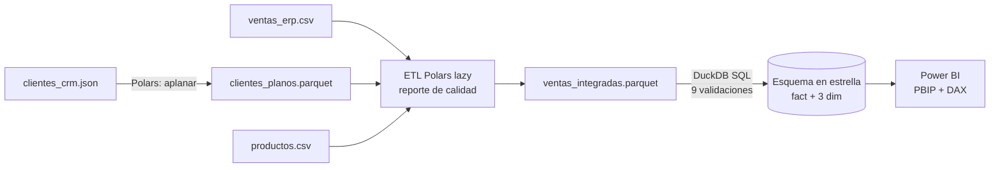

# Aplicación de la IA en la integración de datos (SENA)

Curso virtual del SENA (programa 21720207, 48 horas) sobre captura, tratamiento y análisis de datos con
herramientas de inteligencia artificial generativa y técnicas estadísticas. Aquí documento las evidencias que
desarrollé, construidas sobre un mismo caso integrador con datos simulados.

## Caso integrador: Distribuidora Andina

Una distribuidora ficticia necesita analizar sus ventas de 2025, repartidas en tres fuentes con problemas de calidad:
un ERP (CSV en latin-1 con duplicados, fechas en dos formatos y coma decimal), un CRM (JSON anidado) y un catálogo.

| Evidencia | Qué contiene |
|---|---|
| [AA1-EV01 · Mapa mental](aa1-ev01-mapa-mental.md) | Fuentes de información: tipos, origen, contenido y criterios de calidad |
| [AA1-EV02 · Guía de estudio](aa1-ev02-guia-estudio.md) | Resumen del componente formativo para el cuestionario |
| [AA2-EV01 · Informe de prompts](aa2-ev01-informe-prompts.md) | Cuatro prompts (básico vs. refinado) con el código generado por la IA ejecutado y verificado |
| [AA2-EV02 · Foro de modelado](aa2-ev02-foro-modelado.md) | Criterios para elegir metodología de modelado y herramienta de analítica |
| [AA2-EV03 · Analítica en Power BI](aa2-ev03-powerbi.md) | Modelo en estrella, medidas DAX con regresión lineal y tablero |

**Stack:** Polars 2.0 · DuckDB 1.5 · Parquet · Power BI (PBIP/TMDL/PBIR) · Claude como IA generativa evaluada.
