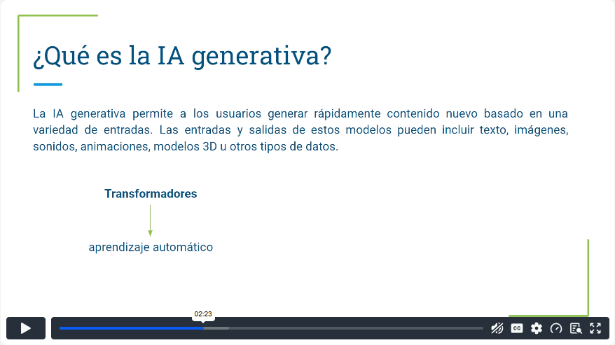
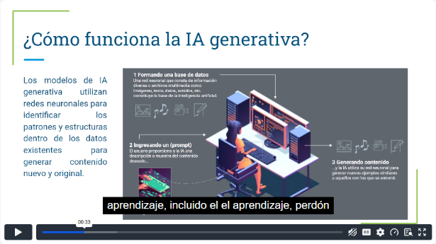
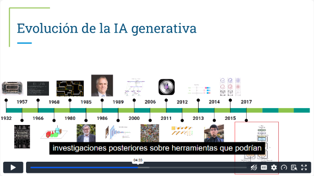
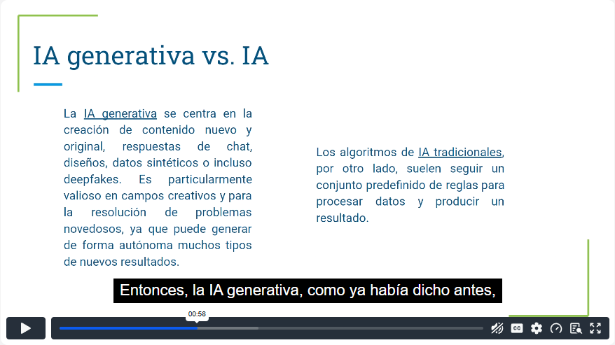
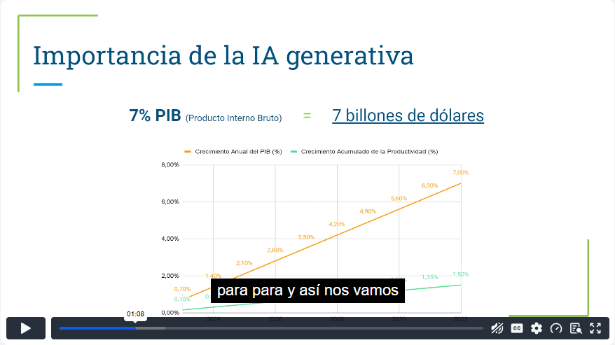
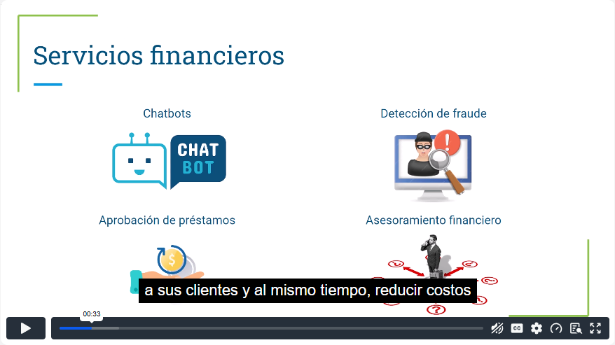
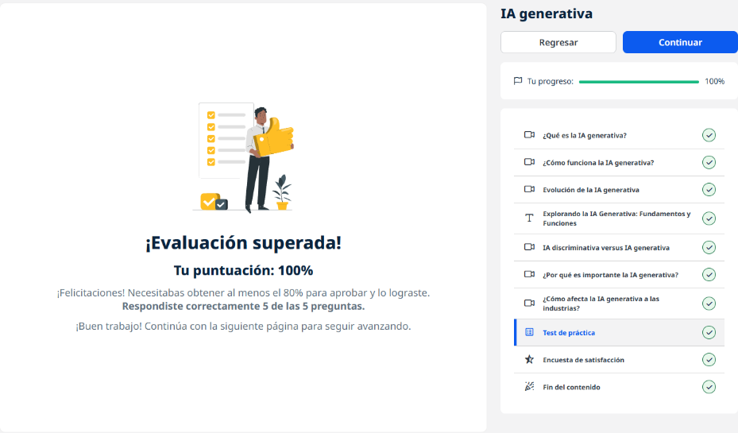
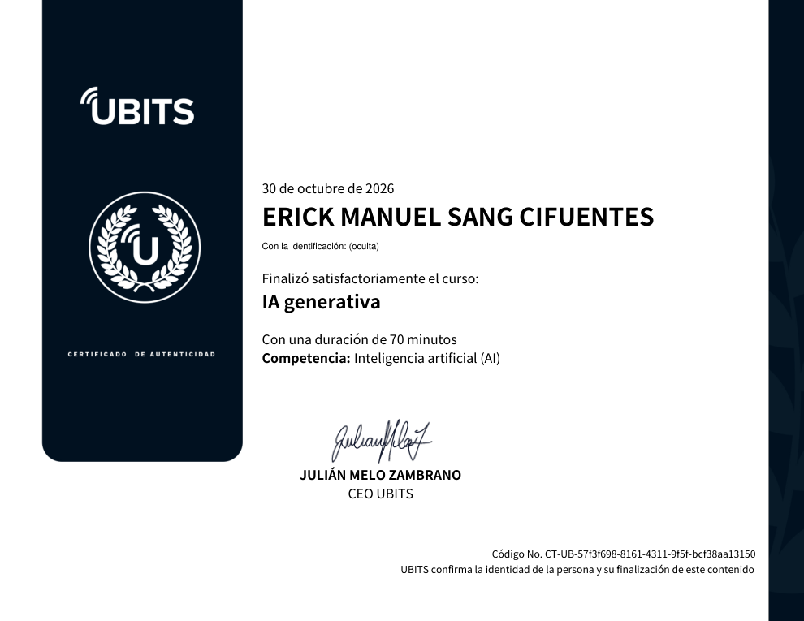

# 01 · IA generativa

**Plataforma:** UBITS · **Duración:** 70 min · **Nivel:** básico · **Resultado:** test aprobado con 5/5 (100 %)

Curso de base: qué es la IA generativa, cómo funciona, de dónde viene, en qué se diferencia de la IA tradicional y qué impacto tiene en las industrias. Son 6 videos (unos 37 min) y una lectura. Cada idea clave lleva la captura del minuto del video donde aparece.

## 1. Qué es la IA generativa

La IA generativa crea **contenido nuevo** a partir de una entrada (el *prompt*). Entrada y salida pueden ser texto, imagen, audio, video, modelos 3D o datos sintéticos. Por ejemplo, de un texto puede salir una imagen o un video.

*Video 1, min 2:20: definición y el papel de los transformadores.*

**Avances que la hicieron posible:**

- **Transformadores:**
    - pueden entrenarse con enormes cantidades de texto **sin etiquetarlo** a mano;
    - introducen la **atención**, que permite seguir las relaciones entre palabras a lo largo de páginas o libros enteros, no solo dentro de una frase.
- **LLM (modelos de lenguaje grande):** tienen miles de millones de parámetros y por eso escriben texto convincente, resumen, traducen o generan código.
- **GAN (redes generativas adversarias):** permitieron imágenes, video y audio muy realistas. Eso abre usos creativos, pero también *deepfakes* y suplantaciones, como imitar la voz de un jefe para estafar.

**Límites actuales:** precisión, sesgos y respuestas inventadas. Aun así, ya cambia cómo se programa, se diseña o se crea contenido.

## 2. Cómo funciona

Los modelos usan **redes neuronales** que aprenden los patrones y la estructura de grandes volúmenes de datos. Después generan contenido nuevo que se parece a lo que aprendieron.

*Video 2, min 0:33: (1) se forma una base de datos de entrenamiento, (2) el usuario da un prompt, (3) la IA genera contenido nuevo.*

- **Modelos base (*foundation models*):** se entrenan una vez con muchísimos datos y sirven para muchas tareas. Ejemplos: GPT-3, origen de ChatGPT, y Stability AI para imágenes.
- **Antes y ahora:**
    - antes había que usar APIs y herramientas especiales;
    - hoy basta con escribir en lenguaje natural y refinar el resultado con indicaciones de estilo, tono o formato.

## 3. Evolución

*Video 3, min 4:30: línea de tiempo desde 1932 hasta los transformadores (2017).*

**Hitos que vale la pena recordar:**

| Año | Hito |
|---|---|
| 1966 | **ELIZA**, el primer chatbot (simulaba un psicoterapeuta) |
| 1980s | Redes neuronales recurrentes y redes convolucionales (CNN) |
| 2014 | **GAN** (Ian Goodfellow): dos redes compiten para generar contenido cada vez más realista |
| 2015 | **Modelos de difusión** |
| 2017 | **«Attention is all you need»**: nacen los transformadores |
| 2018 | Primera versión de GPT |
| 2021–2022 | DALL·E y Stable Diffusion (imágenes a partir de texto); **ChatGPT** (nov 2022) supera los 100 millones de usuarios en unos 2 meses |
| 2023 | Bing integra ChatGPT; Google responde con sus propios modelos; demandas por derechos de autor |

## 4. IA generativa frente a IA tradicional

| | IA generativa | IA tradicional |
|---|---|---|
| **Objetivo** | Crear contenido nuevo y original | Clasificar, predecir o decidir con reglas o patrones |
| **Técnicas** | Transformadores, GAN, VAE | Redes convolucionales y recurrentes, aprendizaje por refuerzo |
| **Mejor para** | Tareas creativas y de lenguaje natural | Análisis, predicción y datos estructurados |

*Video 4, min 0:55: comparación entre ambos enfoques.*

La **IA conversacional** es la que permite a chatbots y asistentes virtuales hablar con las personas de forma natural. Puede usar o no IA generativa.

## 5. Por qué importa

*Video 5, min 1:05: proyección de un aumento del PIB mundial de ~7 % en 10 años gracias a la IA generativa.*

**Cuatro aportes:**

1. **Acelera la investigación.** Por ejemplo, diseña secuencias de proteínas para nuevos fármacos.
2. **Mejora la experiencia del cliente** con chatbots más precisos y ofertas personalizadas.
3. **Optimiza procesos:** resume información, evalúa escenarios para reducir costos y genera código o diseños.
4. **Aumenta la productividad:** funciona como asistente para cualquier persona de la organización.

## 6. Impacto por industria

*Video 6, min 0:30: usos en servicios financieros (chatbots, fraude, préstamos, asesoría).*

| Industria | Usos |
|---|---|
| **Finanzas** | Chatbots, detección de fraude, aprobación de préstamos, asesoría |
| **Salud y farma** | Diseño de proteínas y fármacos; **datos sintéticos** de pacientes para entrenar modelos o simular ensayos |
| **Automotriz y manufactura** | Diseño de piezas (aerodinámica), atención al cliente, datos sintéticos de defectos para pruebas |
| **Medios y entretenimiento** | Animación, música, guiones, avatares que presentan noticias, contenido personalizado |
| **Telecomunicaciones** | Agentes conversacionales, optimización de la red |
| **Energía** | Patrones de consumo, ofertas a la medida, gestión de la red |

## Lectura: fundamentos y funciones

- **Diferencia clave:** la IA generativa no solo clasifica o predice. Aprende la estructura de los datos para **generar ejemplos nuevos coherentes** con ella.
- **Transformadores:** arquitectura de red neuronal que convierte una secuencia de entrada en una de salida. Es la base del procesamiento del lenguaje natural (PLN) moderno.
- **LLM:**
    - modelos de cientos o miles de millones de parámetros entrenados con enormes corpus de texto;
    - sirven para asistentes, chatbots, recomendadores y análisis de sentimiento.

## Evidencia

*Curso completado al 100 % y test superado con 5 de 5.*

## Fuentes y aviso legal

- **Fuente:** curso «IA generativa» de la plataforma [UBITS](https://www.ubits.com), asignado dentro de un plan de formación empresarial.
- **Uso:** apuntes personales de estudio, sin fines comerciales y con redacción propia. Las capturas son fragmentos breves citados con fines educativos; sus derechos son de sus titulares.
- **Sin afiliación:** sitio no oficial, no afiliado ni respaldado por UBITS ni por los aliados del curso. Las marcas pertenecen a sus dueños.
- Más detalles y cómo pedir el retiro de contenido en el [aviso legal](../../aviso-legal.md).
