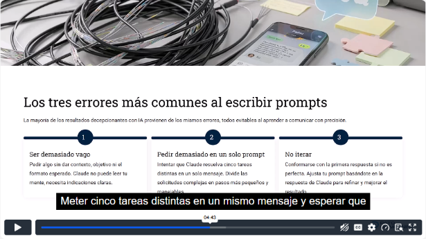
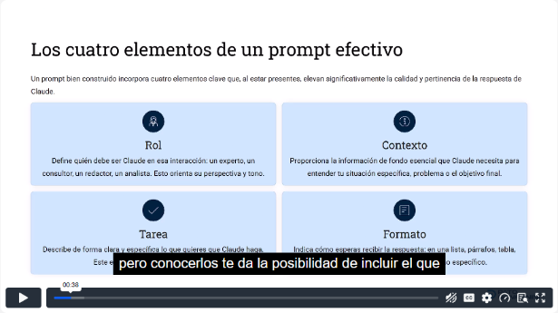
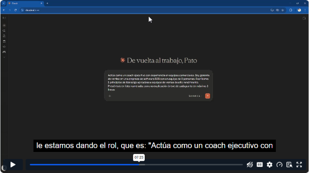
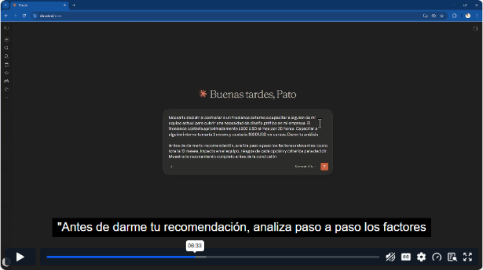
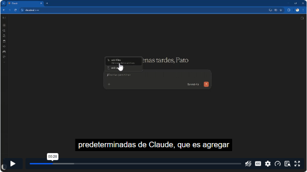
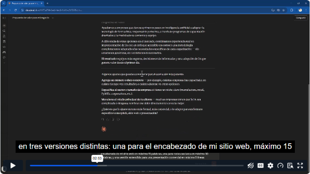
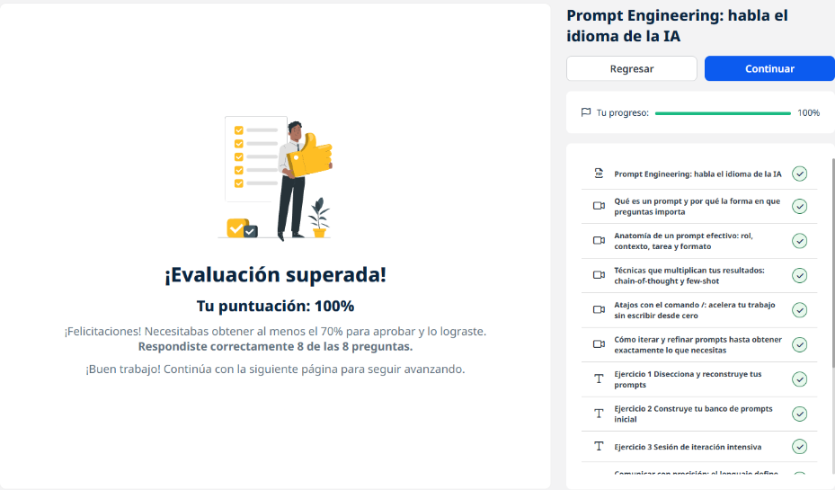
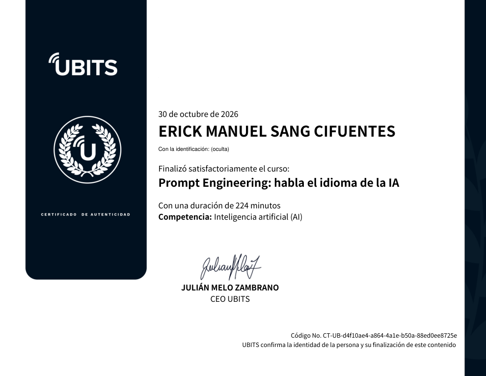

# 02 · Prompt Engineering: habla el idioma de la IA

**Plataforma:** UBITS · **Duración:** 224 min · **Nivel:** básico-intermedio · **Resultado:** test aprobado con 8/8 (100 %)

El curso enseña a escribir *prompts* que den resultados útiles a la primera y a mejorarlos iterando. Los ejemplos se hacen en **Claude**, pero los principios sirven para cualquier asistente de IA. Son 5 videos (unos 51 min), 3 ejercicios y 2 lecturas largas.

## 1. Qué es un prompt y por qué importa

- **Qué es:** un *prompt* es cualquier mensaje, instrucción o pregunta que le escribes a la IA.
- **Por qué importa tanto:** la IA no adivina. Solo trabaja con lo que le das; no ve tu contexto, tu cara ni lo que tienes en mente. Si el prompt es ambiguo, responde lo más probable para un usuario promedio.
- **No es un buscador:** escribir dos o tres palabras clave, como en Google, da respuestas genéricas.

*Video 1, min 4:40: los tres errores más comunes al escribir prompts.*

**Los tres errores más comunes:**

1. **Ser demasiado vago:** sin contexto, sin objetivo y sin formato.
2. **Pedir demasiado en un solo prompt:** cinco tareas juntas dan respuestas superficiales en cada una. Es mejor dividir.
3. **No iterar:** quedarse con la primera respuesta. La conversación tiene varios turnos y se puede retomar después.

## 2. Anatomía de un prompt efectivo: rol, contexto, tarea y formato

*Video 2, min 0:35: los cuatro elementos.*

| Elemento | Para qué sirve | Ejemplo |
|---|---|---|
| **Rol** | Le pone un "sombrero" a la IA: ajusta el vocabulario, la profundidad y el tipo de recomendaciones. Debe ser relevante para la tarea | «Actúa como un coach ejecutivo con experiencia en equipos comerciales» |
| **Contexto** | Hace que resuelva *tu* problema y no el caso genérico. Solo lo que cambia la respuesta, no una novela | «Soy gerente de ventas en una empresa de software B2B con 8 personas» |
| **Tarea** | Verbo de acción y objeto concreto | «Escríbeme 5 principios de liderazgo para equipos de alto rendimiento» |
| **Formato** | Cómo quieres la respuesta: longitud, lista o párrafos, tono, idioma, nivel de detalle | «Lista numerada, explicación breve de máximo 3 frases» |

*Video 2, min 7:20: el prompt reconstruido con rol, contexto, tarea y formato.*

**Ejemplos de prompts incompletos:**

- «Escríbeme algo sobre liderazgo»: solo tiene tarea.
- «Analiza los pros y los contras»: ni siquiera dice de qué.

**Ejemplo de mejora:** una presentación trimestral ante un comité de 5 directivos que valoran la brevedad. Al darle ese contexto, Claude dio consejos específicos, por ejemplo: 15 minutos equivalen a unas 10 diapositivas o menos.

## 3. Chain-of-thought y few-shot

**Chain-of-thought (cadena de pensamiento):** se le pide razonar **paso a paso antes de concluir**. Sirve para:

- decisiones con muchas variables;
- comparar opciones;
- problemas donde el proceso importa;
- casos en que debes justificar la respuesta ante otros.

*Video 3, min 6:30: «Antes de darme tu recomendación, analiza paso a paso los factores…».*

- **Ejemplo:** contratar a un freelance (USD 500 al mes) o capacitar a alguien interno (USD 800 una vez y 3 meses de menos disponibilidad).
- **Pasos pedidos:** costo a 12 meses, impacto en el equipo, riesgos y criterios. El resultado es una recomendación justificada y con preguntas que podrían cambiarla.

**Few-shot (con ejemplos):** le das uno o varios ejemplos del resultado que quieres. La IA reconoce el patrón de estilo, tono y estructura y lo replica sin copiarlo.

- **Ejemplo 1:** describir un maletín de viaje con el mismo estilo que otra descripción de producto.
- **Ejemplo 2:** convertir notas de reunión al formato de acta de una reunión anterior, con acuerdos y próximos pasos con responsable y fecha.

## 4. Atajos con el comando «/»

Al escribir **/** en el chat aparecen comandos predefinidos:

- adjuntar archivos;
- limpiar el contexto para empezar de cero en el mismo chat;
- resumir la conversación;
- `/help` para ver qué puede hacer.

*Video 4, min 0:25: menú de comandos al escribir «/».*

Los comandos cambian según la versión y el plan.

## 5. Iterar y refinar

La iteración avanza en pasos:

1. **Prompt genérico:** «Escríbeme una propuesta de valor» da algo plano.
2. **Añadir contexto:** sector, cliente ideal y diferenciadores.
3. **Pedir variantes:** tres versiones de la misma propuesta (encabezado web de 15 palabras, redes de 30 palabras y versión extendida para presentación comercial).
4. **Ajustar el tono** sin empezar de cero. Por ejemplo, un correo a un proveedor retrasado: firme pero no amenazante, con fecha límite y escalamiento.

*Video 5, min 2:50: se pide la misma propuesta en tres formatos.*

**Banco de prompts:** guarda los que funcionan, ordenados por secciones (redacción, análisis, investigación, decisiones, contenido). Pruébalos en conversaciones nuevas cambiando solo los datos.

## Ejercicios prácticos

1. **Diseccionar y reconstruir:** escribir 3 prompts "instintivos" para tareas reales, marcar qué elemento falta en cada uno y reconstruirlos con los cuatro elementos. Luego comparar ambos resultados en conversaciones nuevas.
2. **Banco de prompts inicial:** crear al menos 8 prompts probados, organizados en redacción, análisis, investigación, decisiones, contenido y otros.
3. **Iteración intensiva:** definir antes qué es un resultado exitoso, iterar al menos 4 veces evaluando qué está bien y qué cambiar, y registrar el aprendizaje.

## Lecturas

### Comunicar con precisión

- **De dónde viene la vaguedad:** entre colegas funciona porque comparten contexto. La IA empieza cada conversación de cero, y por eso las primeras respuestas se sienten genéricas.
- **El cambio clave:** **hacer explícito lo implícito**. Eso además obliga a aclarar el propio pensamiento.
- **Obstáculos para ser precisos:**
    1. **la maldición del conocimiento:** cuesta imaginar no saber lo que uno sabe;
    2. **la ilusión de transparencia:** creer que lo que uno quiere es obvio para otros;
    3. **la satisfacción prematura:** aceptar lo "suficientemente bueno";
    4. **el miedo a parecer poco sofisticado** por dar muchas instrucciones.
- **La iteración:** es el proceso normal, como los borradores, pero debe ser sistemática: evaluar, decidir qué cambiar y qué mantener.
- **Una habilidad transferible:** escribir prompts es comunicarse con precisión. Mejora los *briefs*, los correos y las instrucciones a otras personas.

### Técnicas avanzadas

| Técnica | En qué consiste |
|---|---|
| **Restricción creativa** | Límites reales de longitud, audiencia, tono o qué no incluir. Suelen *mejorar* el resultado |
| **Contraste** | Pedir dos versiones opuestas (formal y cercana, a favor y en contra) y cuándo conviene cada una |
| **Experto interno** | Decir tu nivel de experiencia y el de la audiencia para calibrar la explicación |
| **Socrático** | Pedir que la IA haga las preguntas necesarias antes de responder. A veces el resultado es un problema mejor definido |
| **Revisión adversarial** | Pedir que critique su propio resultado como un evaluador exigente, o que construya el mejor argumento en contra (*steelmanning*) |
| **Encadenamiento** | Dividir una tarea compleja en etapas: la salida de una es la entrada de la siguiente, con puntos de control |
| **Personalización** | Banco de prompts anotado, instrucciones y proyectos configurados, y criterio para saber cuándo vale la pena un prompt elaborado |

## Evidencia

*Curso al 100 % y test superado con 8 de 8.*

## Fuentes y aviso legal

- **Fuente:** curso «Prompt Engineering: habla el idioma de la IA» de la plataforma [UBITS](https://www.ubits.com), asignado dentro de un plan de formación empresarial.
- **Uso:** apuntes personales de estudio, sin fines comerciales y con redacción propia. Las capturas son fragmentos breves citados con fines educativos; sus derechos son de sus titulares.
- **Sin afiliación:** sitio no oficial, no afiliado ni respaldado por UBITS, Anthropic ni los aliados del curso. Las marcas pertenecen a sus dueños.
- Más detalles y cómo pedir el retiro de contenido en el [aviso legal](../../aviso-legal.md).
