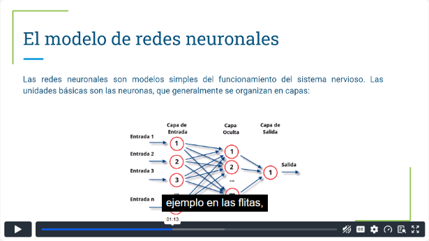
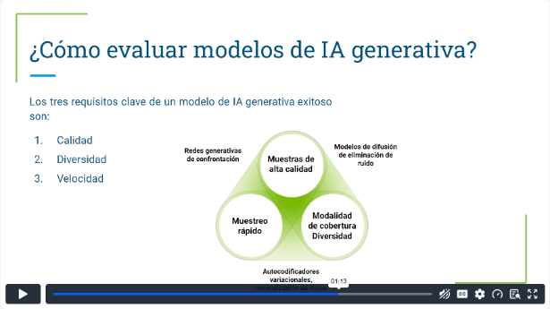
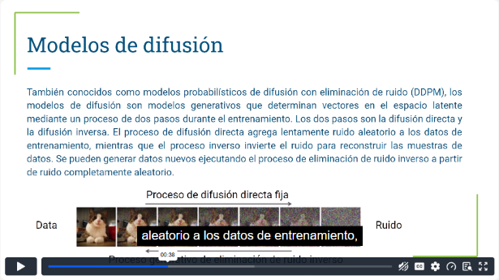
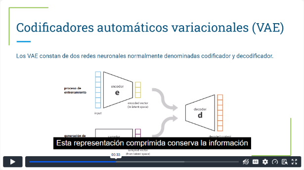
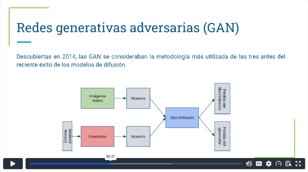
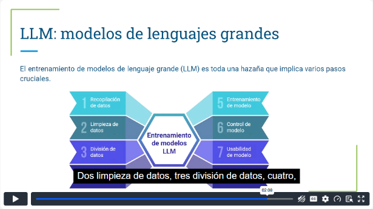
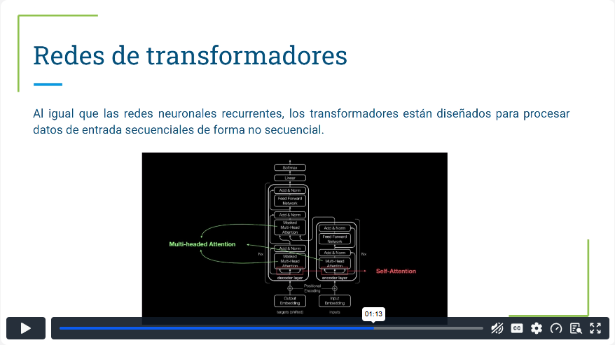
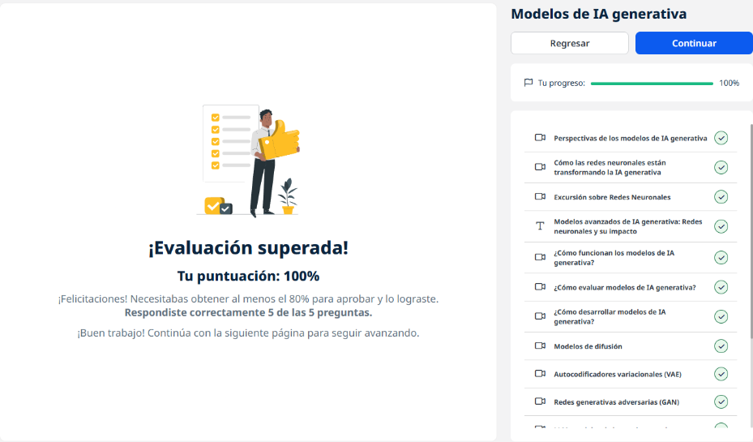
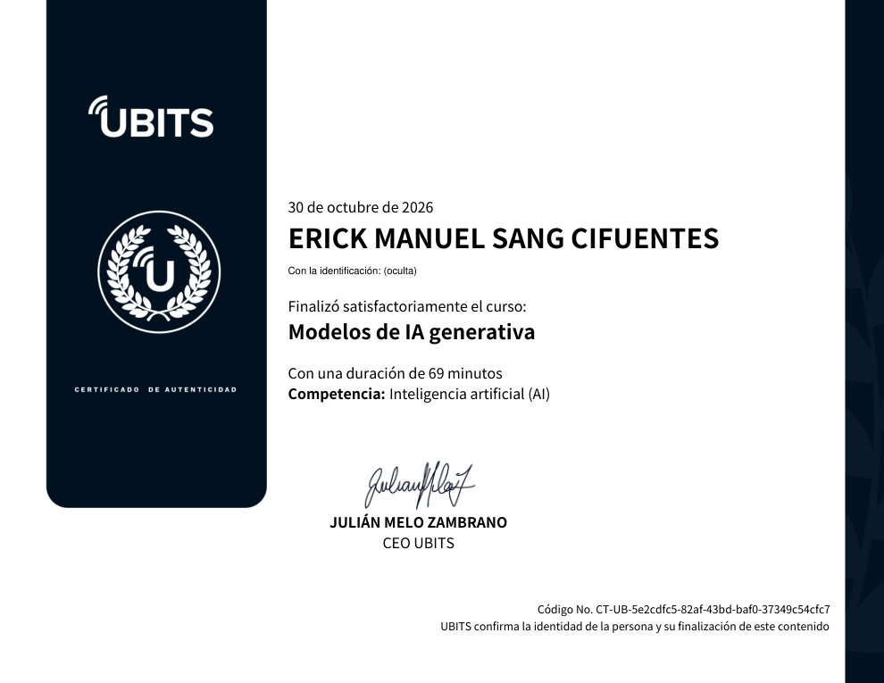

# 03 · Modelos de IA generativa

**Plataforma:** UBITS · **Duración:** 69 min · **Nivel:** básico · **Resultado:** test aprobado con 5/5 (100 %)

Es el módulo técnico de la ruta: cómo funcionan por dentro los modelos que generan contenido, cómo se evalúan y en qué se diferencian las familias principales (difusión, VAE, GAN, LLM y transformadores). Son 11 videos cortos (unos 33 min) y una lectura de síntesis.

## 1. Perspectivas: oportunidades y riesgos

El primer video es de contexto y no técnico:

- **Opiniones de figuras públicas:** unas son entusiastas y otras piden frenar o regular la IA.
- **Riesgos ya presentes:**
    - estafas con voces clonadas de familiares;
    - *deepfakes* y noticias falsas con políticos o famosos;
    - perfiles publicitarios muy detallados en redes sociales.
- **Postura del curso:** la IA comercial de hoy funciona **por instrucciones del usuario**. Su impacto depende del uso que se le dé, y por eso hace falta regularla sin frenar la innovación.

## 2. Redes neuronales: la base

**De las reglas a los patrones:**

- **Antes:** sistemas basados en reglas y **sistemas expertos**, con reglas escritas a mano.
- **Ahora:** las **redes neuronales** invierten el enfoque y aprenden las reglas encontrando patrones en los datos.
- **Por qué hasta ahora:** existen desde los años 50 y 60, pero solo fueron prácticas con el **big data** y el hardware moderno.

*Video 3, min 1:10: capas de entrada, ocultas y de salida.*

**Cómo aprende una red neuronal:**

- **Estructura:** las neuronas se organizan en **capas**: de entrada, ocultas y de salida.
- **Entrenamiento:**
    1. la red procesa ejemplos;
    2. compara su predicción con el resultado conocido;
    3. envía el error **hacia atrás** (*backpropagation*);
    4. ajusta poco a poco los **pesos** de las conexiones.
- **Resultado:** con muchas repeticiones, la red predice cada vez mejor.

## 3. Cómo funcionan, cómo se evalúan y cómo se desarrollan

**Cómo funcionan:**

1. Entra un *prompt*.
2. El modelo aplica lo que aprendió (aprendizaje profundo, análisis predictivo y computación cognitiva).
3. Sale un contenido nuevo.

*Video 5, min 1:10: los tres requisitos y qué familia de modelos destaca en cada uno.*

**Los tres requisitos de un buen modelo generativo:**

| Requisito | Por qué importa |
|---|---|
| **Calidad** | Una voz poco clara o una imagen que no parece natural arruinan la experiencia |
| **Diversidad** | Cubrir también los casos minoritarios de los datos reduce los sesgos |
| **Velocidad** | Las aplicaciones interactivas, como editar imágenes en tiempo real, necesitan generar rápido |

**Cómo se desarrollan:**

- **Representar el contenido:**
    - el texto se convierte en vectores con técnicas de procesamiento de lenguaje natural;
    - las imágenes se convierten en vectores a partir de sus elementos visuales.
- **Entrenar para un caso de uso concreto.** Los LLM sirven como punto de partida que luego se personaliza.
- **Cuidar los datos de entrenamiento:** si incluyen sesgos o contenido dañino de internet, el modelo los repite.

## 4. Las familias de modelos

### Modelos de difusión

- **Entrenamiento en dos pasos:**
    1. **difusión directa:** se agrega ruido poco a poco a una imagen;
    2. **difusión inversa:** se aprende a quitarlo.
- **Para generar:** se parte de ruido puro y se "limpia" hasta obtener una imagen nueva.
- **Ventajas:** dan la **mejor calidad**, son flexibles y sirven para usos generales; se consideran modelos base.
- **Desventajas:** el entrenamiento y la generación son **lentos**.

*Video 7, min 0:35: difusión directa (de imagen a ruido) e inversa (de ruido a imagen).*

### Autocodificadores variacionales (VAE)

- **Estructura:** dos redes, un **codificador** que comprime los datos en un espacio latente y un **decodificador** que los reconstruye o genera variantes.
- **Ventaja:** generan rápido.
- **Desventaja:** las imágenes salen menos detalladas que con difusión.

*Video 8, min 0:30: el codificador comprime y el decodificador genera.*

### Redes generativas adversarias (GAN, 2014)

- **Estructura:** dos redes que compiten:
    - un **generador** que crea ejemplos;
    - un **discriminador** que intenta distinguir lo real de lo generado.
- **Entrenamiento:** ambas mejoran juntas hasta que lo generado no se distingue de lo real.
- **Ventajas:** alta calidad y rapidez.
- **Desventaja:** poca diversidad. Por eso sirven más para dominios específicos.

*Video 9, min 0:35: generador contra discriminador.*

### Comparación rápida

| Familia | Calidad | Diversidad | Velocidad |
|---|---|---|---|
| Difusión | Muy alta | Alta | Lenta |
| VAE | Media | Alta | Rápida |
| GAN | Alta | Baja | Rápida |

### Modelos de lenguaje grande (LLM)

- **Qué son:** sistemas que procesan, comprenden y generan texto parecido al humano.
- **Cómo se entrenan:** con miles de millones de palabras de sitios web, libros y artículos, usando **transformadores**.
- **Qué hacen:** responden preguntas, resumen, traducen, generan contenido y conversan.
- **Riesgos:** sesgos y mal uso.

*Video 10, min 2:05: los 8 pasos del entrenamiento de un LLM.*

**Los 8 pasos del entrenamiento:**

1. recopilación de datos;
2. limpieza;
3. división;
4. configuración del modelo;
5. entrenamiento;
6. control;
7. usabilidad;
8. mejora.

### Redes de transformadores

- **Qué hacen:** procesan secuencias, como las redes recurrentes, pero **no en orden estricto**. Pueden mirar toda la secuencia a la vez.
- **Estructura:** varios bloques con capas de **autoatención**, *feed-forward* y normalización.
- **Por qué importa la autoatención:** le da al modelo el contexto de cada palabra según su relación con las demás.

*Video 11, min 1:10: arquitectura con atención de múltiples cabezas (multi-head) y autoatención (self-attention).*

## Lectura: modelos generativos

Resume las cuatro familias:

- **Difusión:** ruido directo e inverso; identifica la información esencial en el espacio latente.
- **VAE:** aprende distribuciones probabilísticas y permite pasar suavemente de una muestra a otra.
- **GAN:** el entrenamiento adversarial mejora al generador y al discriminador a la vez.
- **LLM:** texto coherente, traducción, resumen, respuestas y análisis de sentimiento. Son la base de asistentes, recomendadores y sistemas conversacionales.

## Evidencia

*Curso al 100 % y test superado con 5 de 5.*

## Fuentes y aviso legal

- **Fuente:** curso «Modelos de IA generativa» de la plataforma [UBITS](https://www.ubits.com), asignado dentro de un plan de formación empresarial.
- **Uso:** apuntes personales de estudio, sin fines comerciales y con redacción propia. Las capturas son fragmentos breves citados con fines educativos; sus derechos son de sus titulares.
- **Sin afiliación:** sitio no oficial, no afiliado ni respaldado por UBITS ni por los aliados del curso. Las marcas pertenecen a sus dueños.
- Más detalles y cómo pedir el retiro de contenido en el [aviso legal](../../aviso-legal.md).
