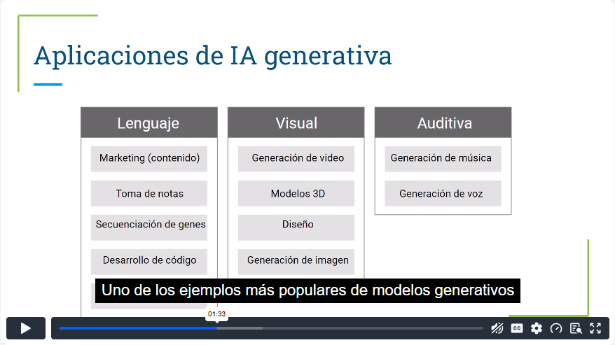
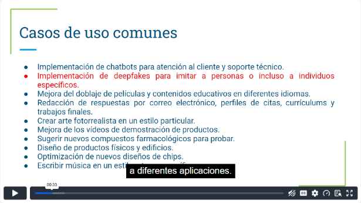
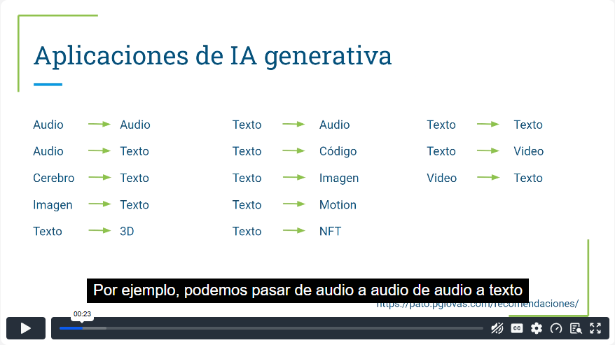
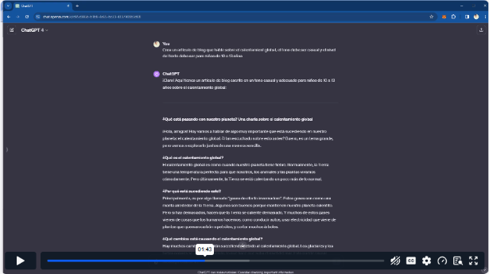
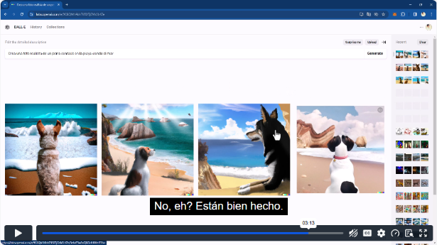
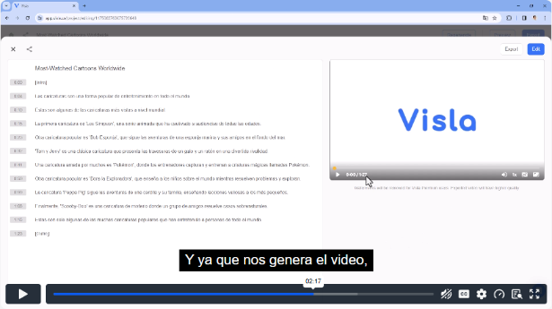
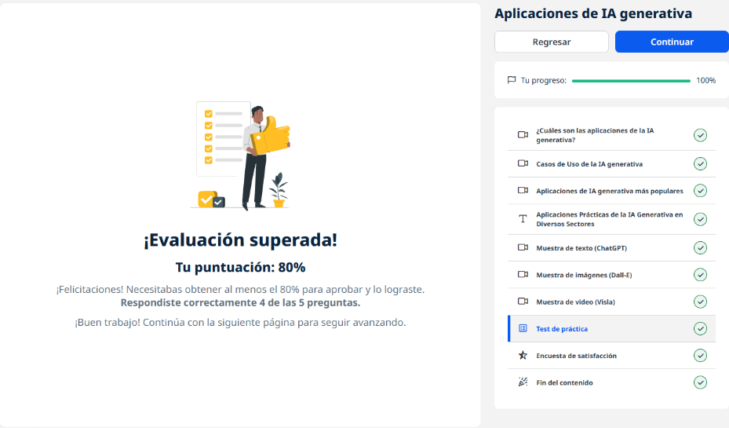
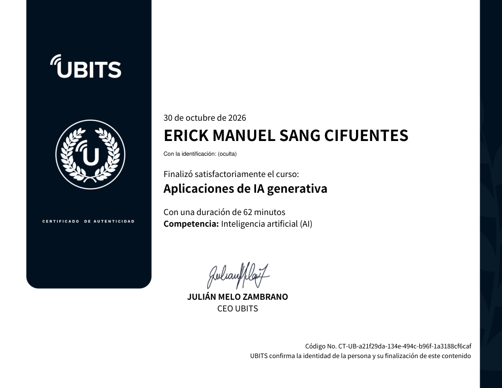

# 04 · Aplicaciones de IA generativa

**Plataforma:** UBITS · **Duración:** 62 min · **Nivel:** básico · **Resultado:** test aprobado con 4/5 (80 %)

Es el módulo práctico de la ruta: cómo se agrupan las aplicaciones de la IA generativa, en qué casos ya se usan, qué herramientas son las más conocidas y tres demostraciones (texto, imagen y video). Son 6 videos (unos 30 min).

## 1. Cómo se clasifican las aplicaciones

Los modelos generativos aceptan como entrada texto, imagen, audio, video o código, y pueden convertir entre ellos. Por ejemplo, de texto a imagen o de video a texto.

*Video 1, min 1:30: las tres grandes áreas (lenguaje, visual y auditiva).*

| Área | Ejemplos |
|---|---|
| **Lenguaje** (la más madura; base de los LLM) | Contenido de marketing, toma de notas, desarrollo de código, traducción, incluso secuenciación genética |
| **Visual** | Imágenes, video, modelos 3D, diseño, avatares, logotipos, imágenes para realidad virtual y aumentada, moléculas para fármacos |
| **Auditiva** | Música, voz, efectos y ambientación para video |

Hay otro uso que destaca: los **datos sintéticos**. Sirven para entrenar modelos cuando faltan datos reales o etiquetarlos cuesta mucho.

## 2. Casos de uso actuales

*Video 2, min 0:30: casos de uso comunes. El de los *deepfakes* aparece en rojo como recordatorio de mal uso.*

**Usos que ya se ven hoy:**

- **Atención y comunicación:**
    - chatbots de atención y soporte técnico;
    - doblaje y subtítulos en varios idiomas;
    - redacción de correos, currículums y trabajos.
- **Creatividad y producto:**
    - arte con un estilo definido y videos de demostración de productos;
    - diseño de productos físicos, edificios y chips;
    - música en un estilo o tono específico.
- **Ciencia:** sugerir compuestos farmacológicos para probar.
- **Uso dudoso:** los **deepfakes** para imitar a personas. Tienen usos legítimos, como completar escenas en cine, pero también se prestan al engaño.

**Una tecnología de propósito general:** la IA generativa se compara con el vapor, la electricidad o la informática. Su valor llega cuando se **rediseñan los flujos de trabajo** completos, no cuando solo se acelera una parte del flujo actual.

## 3. Herramientas más populares

*Video 3, min 0:20: combinaciones de entrada y salida (audio→texto, texto→imagen, texto→código, video→texto, etc.).*

| Tipo | Herramientas mencionadas |
|---|---|
| **Texto** | ChatGPT, Copy.ai (textos publicitarios y de blog), Jasper (contenido rápido), Shortly (contra el bloqueo del escritor) |
| **Imagen** | DALL·E (OpenAI), Midjourney (funciona desde Discord), Stable Diffusion |
| **Audio y voz** | Herramientas de texto a voz con voces realistas en varios idiomas, edición de podcasts como si fuera texto |
| **Video** | Wonder Studio (personajes CGI en un video), Runway (video desde texto o imagen), Synthesia y similares (avatares que presentan) |

## 4. Demostraciones

### Texto con ChatGPT

**El prompt:** «Crea un artículo de blog sobre el calentamiento global, tono casual, para niños de 10 a 13 años».

**Lo que se aprende:**

- El resultado se ajusta al **público** y al **tono** que se le pidieron.
- Responde en el idioma en que se le escribe, aunque la interfaz esté en inglés.

*Video 4, min 1:40: el artículo generado para niños.*

### Imagen con DALL·E

**La galería:** muestra ejemplos con el prompt que se usó en cada uno, como un pez tropical en 3D o una silla con forma de aguacate.

**La prueba:** pedir una foto realista de un perro sentado en la playa, junto al mar, genera **cuatro variantes**.

**Lo que se aprende:**

- Con el mismo prompt salen resultados distintos.
- Algunos detalles salen poco realistas, así que siempre hay que revisar.

*Video 5, min 3:10: cuatro variantes generadas a partir del mismo prompt.*

### Video con Visla

**Plan gratuito:** 50 minutos de publicación al mes.

**Cómo funciona:** a partir de una idea o un guion, arma un video con escenas, narración y subtítulos, en horizontal o vertical.

**Flujo completo de producción:**

1. guion con ChatGPT;
2. miniatura con DALL·E;
3. video con Visla;
4. descripción y palabras clave con ChatGPT para publicarlo.

*Video 6, min 2:15: el guion convertido en escenas con su duración y la vista previa del video.*

## Evidencia

*Curso al 100 % y test superado con 4 de 5 (mínimo exigido: 80 %).*

## Fuentes y aviso legal

- **Fuente:** curso «Aplicaciones de IA generativa» de la plataforma [UBITS](https://www.ubits.com), asignado dentro de un plan de formación empresarial.
- **Uso:** apuntes personales de estudio, sin fines comerciales y con redacción propia. Las capturas son fragmentos breves citados con fines educativos; sus derechos son de sus titulares.
- **Sin afiliación:** sitio no oficial, no afiliado ni respaldado por UBITS ni por los aliados del curso. Las marcas pertenecen a sus dueños.
- Más detalles y cómo pedir el retiro de contenido en el [aviso legal](../../aviso-legal.md).
