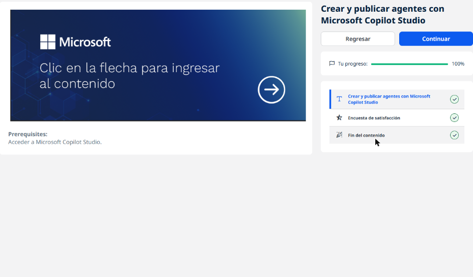
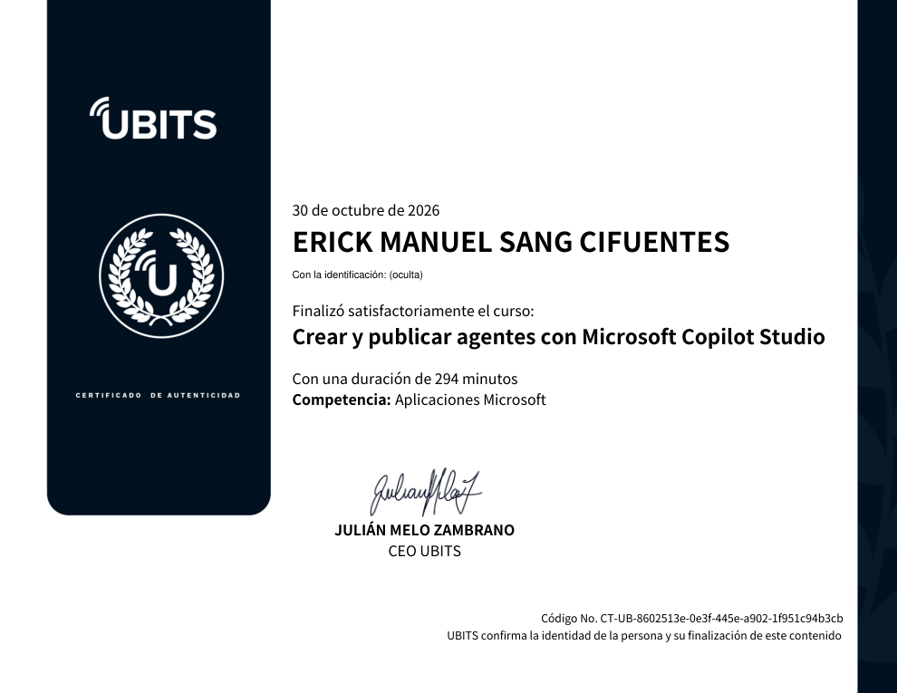

# 05 · Crear y publicar agentes con Microsoft Copilot Studio

**Plataforma:** UBITS, con contenido de Microsoft Learn · **Duración:** 294 min · **Nivel:** intermedio · **Resultado:** completado al 100 %

Este curso no tiene videos propios. UBITS enlaza a la ruta de aprendizaje **«Crear y publicar agentes con Microsoft Copilot Studio»** de Microsoft Learn, de 6 módulos. Estos apuntes resumen esa ruta.

*El curso en UBITS: acceso a la ruta de Microsoft Learn y progreso al 100 %.*

## 1. Qué es Copilot Studio

Es un estudio **gráfico y de poco código** para crear y administrar **agentes** (antes llamados bots) y flujos de trabajo.

**Ciclo de vida de un agente:**

1. crear;
2. configurar temas y conocimiento;
3. probar en el panel de prueba;
4. publicar en un canal;
5. analizar el rendimiento.

**Formas de crear un agente:**

- **Generador de conversaciones:** describes en lenguaje natural lo que quieres y el estudio arma la configuración inicial.
- **Configuración manual:** nombre, descripción, instrucciones y fuentes de conocimiento.

**Experiencias de creación ("arneses"):**

- el arnés estándar, que es la experiencia clásica;
- una experiencia asistida por GitHub Copilot;
- los agentes declarativos de Microsoft 365 Copilot.

## 2. Respuestas generativas y conocimiento

**Respuestas generativas:** el agente responde desde **fuentes de conocimiento** sin necesidad de crear un tema para cada pregunta. Puede ser su comportamiento principal o un respaldo cuando ningún tema coincide.

**Fuentes de conocimiento:**

- sitios web públicos;
- archivos cargados, como PDF;
- SharePoint y OneDrive;
- tablas de Dataverse.

**Conocimiento general:** si el agente solo debe responder con *tu* información, hay que **desactivar** «permitir que la IA use su conocimiento general».

**Acelerador de conversación:** es un tema del sistema que se activa cuando la intención es desconocida. Contiene el nodo **Crear respuestas generativas**, donde se eligen las fuentes y el nivel de moderación de contenido. Las respuestas salen **con cita** de la fuente.

### Orquestación clásica y generativa

| | Clásica | Generativa |
|---|---|---|
| Cómo elige qué hacer | Por **frases desencadenadoras** que coinciden con lo que escribe el usuario | Por la **descripción** de cada tema, acción o fuente; el agente decide qué combinar |
| Disparador del tema | Nodo de frases | Nodo «Desencadenado por agente» |
| Acciones | Se llaman desde un tema | **Acciones generativas** que el agente invoca solo. Ejemplo: el conector de MSN El Tiempo pide la ciudad y devuelve el pronóstico |

## 3. Temas: las rutas de conversación

Un **tema** es una pequeña conversación sobre un asunto. Tiene dos partes:

- **frases desencadenadoras:**
    - empezar con 5 a 10 frases cortas, como las diría el cliente;
    - hacerlas lo más **exclusivas** posible, para que no choquen con las de otro tema.
- **nodos de conversación**, que definen qué responde y hace el agente.

Un agente admite **hasta 1000 temas**.

**Tipos de nodo:**

| Nodo | Para qué sirve |
|---|---|
| **Enviar un mensaje** | Texto con formato, variaciones aleatorias, imágenes, video, tarjetas básicas o **adaptables** (en JSON y válidas en varias plataformas), carrusel o lista, respuestas rápidas |
| **Formular una pregunta** | Captura un dato: qué identificar (una entidad) y dónde guardarlo (una variable). Su comportamiento permite omitirla si ya hay valor, reintentar o seguir sin respuesta |
| **Condición** | Divide la conversación en ramas según una regla |
| **Administración de variables** | Fija o borra valores |
| **Administración de temas** | Ir a otro tema, ir a un paso, finalizar el tema o la conversación, **transferir a una persona** |
| **Llamar a una acción** | Ejecuta un flujo de Power Automate o una acción generativa |
| **Avanzado** | Respuestas generativas, solicitudes HTTP, eventos, autenticación |

**Desencadenadores de eventos:** además de frases, un tema puede activarse por un **evento**. Ejemplos: un elemento nuevo en SharePoint, un correo en Outlook, un archivo en OneDrive o una fila en Dataverse.

**Temas del sistema:**

- **Tema alternativo** (*fallback*):
    - se activa cuando la intención es desconocida y guarda el texto en `UnrecognizedTriggerPhrase`;
    - por defecto pregunta de nuevo y, tras **dos intentos fallidos**, pasa al tema **Remitir**;
    - se puede personalizar, por ejemplo con un menú de Ventas, Servicio o General.
- **Finalizar conversación:** puede lanzar una **encuesta de satisfacción** (CSAT).

## 4. Entidades y variables

**Entidad:** una unidad de información del mundo real, como una ciudad, un correo, una fecha, un teléfono o un nombre.

- **Predefinidas:** edad, color, número, ciudad, etc. Por ejemplo, de «nuestra sede está en Seattle» se extrae *Seattle* como ciudad.
- **Personalizadas:**
    - de **lista cerrada**, con sinónimos;
    - de **expresión regular**, para formatos como códigos o números de pedido.

**Variables:** guardan lo que dijo el usuario para personalizar mensajes, elegir ramas o pasar datos a flujos.

- **Creación:** se crean solas al añadir una pregunta. Conviene renombrarlas, porque por defecto se llaman `Var1`, `Var2`…
- **Entre temas:**
    - **recibir valores de otros temas**, para no repetir preguntas;
    - **devolver valores** al tema que redirigió.
- **Alcance:**
    - **variables de tema:** solo existen dentro de su tema;
    - **variables globales:** sirven en todo el agente;
    - **variables del sistema:** las crea el propio agente.

## 5. Mejorar el agente

- **Power Automate:** desde un tema se llama a un flujo para consultar o escribir en sistemas externos. Por ejemplo, con el número de pedido se traen el producto y la fecha.
- **Transferir a una persona** (nodo **Transferir conversación** o tema **Remitir**):
    - pasa **todo el historial y las variables**, así que el agente humano no vuelve a preguntar;
    - destinos posibles: Dynamics 365 Customer Service, Genesys, LivePerson, Salesforce, ServiceNow, Zendesk o un centro personalizado;
    - se necesita un registro de aplicación en Microsoft Entra ID y el agente debe estar **publicado**.
- **Voz (IVR):**
    - optimización para voz: tonos del teclado (DTMF), detección de silencio, mensajes mientras espera, SSML;
    - respuestas generativas por teléfono.
- **Temas desde contenido existente:** se pueden crear a partir de páginas de soporte.
- **Análisis:** el rendimiento del agente se mide para mejorarlo.

## 6. Diseño de agentes eficaces

**Planificación:**

1. **Empezar por lo que más impacta:** por ejemplo, si el 40 % de las consultas son devoluciones, ese tema va primero.
2. **Ponerse en el lugar del cliente:** por qué contacta, qué pregunta, en qué estado de ánimo llega y qué sería una buena solución para él.
3. **Mapear escenarios:**
    - antes de la venta;
    - en el pago (envío, precio, impuestos, dirección);
    - después de la venta (reembolso, garantía, estado del pedido).

**Árbol de conversación:**

- Para cada tema, separar si el cliente necesita **información**, **completar una tarea** o **resolver un problema**.
- Hacer el **menor número de preguntas** posible; 10 preguntas frustran al cliente.
- Traer datos automáticamente con Power Automate para no pedirlos.

**Iterar:** validar con las analíticas y mejorar.

## Evidencia

## Fuentes y aviso legal

- **Fuente:** curso «Crear y publicar agentes con Microsoft Copilot Studio» asignado en [UBITS](https://www.ubits.com) dentro de un plan de formación empresarial, basado en la ruta homónima de [Microsoft Learn](https://learn.microsoft.com/es-es/training/paths/work-power-virtual-agents/).
- **Uso:** apuntes personales de estudio, sin fines comerciales y con redacción propia. Las capturas son fragmentos breves citados con fines educativos; sus derechos son de sus titulares.
- **Sin afiliación:** sitio no oficial, no afiliado ni respaldado por UBITS ni por Microsoft. Las marcas pertenecen a sus dueños.
- Más detalles y cómo pedir el retiro de contenido en el [aviso legal](../../aviso-legal.md).
