# 06 · Creación de GPT sin programación (ruta de 7 cursos)

**Plataforma:** UBITS · **Duración:** 249 min · **Nivel:** intermedio · **Resultado:** ruta completada, con un certificado por cada curso

La ruta enseña a crear **GPT personalizados** (asistentes hechos a la medida dentro de ChatGPT) **sin escribir código**, usando el **GPT Builder**. Empieza con los fundamentos y luego construye seis GPT completos. Son 23 videos (unos 2,5 horas), lecturas y una actividad práctica por proyecto.

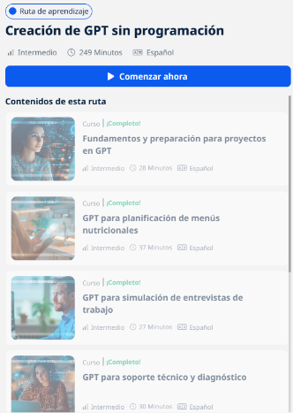
*La ruta en UBITS con sus cursos marcados como completos.*

## 1. Fundamentos y preparación

### GPT frente a un chat normal

- **GPT** significa *Generative Pre-trained Transformer* (transformador generativo **preentrenado**). Aprende patrones del lenguaje de un gran volumen de texto y después se ajusta a tareas concretas.
- **Chat normal:** una conversación general que se va guiando tema a tema.
- **GPT personalizado:** tiene un **propósito fijo**. Ya sabe cómo comportarse, qué fuentes usar y qué formato entregar, así que no hay que repetir instrucciones en cada chat.
- **Dónde se encuentran:** en *Explorar GPT* (los más usados, por categoría o creados por la comunidad).

### Entorno de trabajo

Para **crear** GPT se necesita **ChatGPT Plus**. Dentro se usa el **GPT Builder**, que tiene dos pestañas:

- **Create:** conversas con el asistente y él arma la configuración.
- **Configure:** llenas tú cada campo directamente.

El Builder responde en inglés, pero si las instrucciones van en español, el GPT funciona en español.

### Qué necesita un GPT

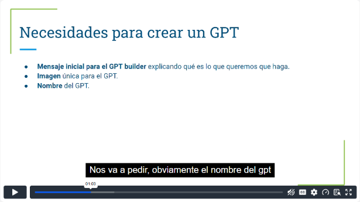
*Curso 1, video 4, min 1:00: lo que pide el GPT Builder.*

| Elemento | Para qué sirve |
|---|---|
| **Mensaje inicial** | Explica brevemente qué debe hacer; el Builder parte de ahí |
| **Imagen** y **nombre** | Identidad propia. Hay que revisar que no existan ya |
| **Descripción** | Le dice al usuario qué hace el GPT |
| **Instrucciones** | El prompt detallado: rol, objetivo, funciones, formato, límites |
| **Iniciadores de conversación** | Botones listos para que el usuario solo dé clic |
| **Conocimiento** | Archivos propios (PDF, Excel…) como fuente |
| **Capacidades** | Activar o desactivar la búsqueda web, la generación de imágenes y el intérprete de código |

**Publicación:** solo para mí, para quien tenga el enlace o en la tienda de GPT. Antes de publicar se prueba en la vista previa y se ajusta.

## 2. Proyecto: planificador de menús nutricionales

- **Objetivo:** con **un solo clic**, un menú semanal según la meta: mantener, subir o bajar de peso, o ganar masa muscular.
- **Prompt:** «Actúa como un nutriólogo experto…».
    - comidas de preparación corta (15–20 min);
    - colaciones;
    - tiempos entre comidas;
    - **tabla** con los horarios en las filas y los días en las columnas.
- **Decisiones de diseño:**
    - sin preguntas iniciales, solo elegir el tipo de menú con los botones;
    - más adelante, limitarlo a los alimentos de un archivo Excel cargado como conocimiento.

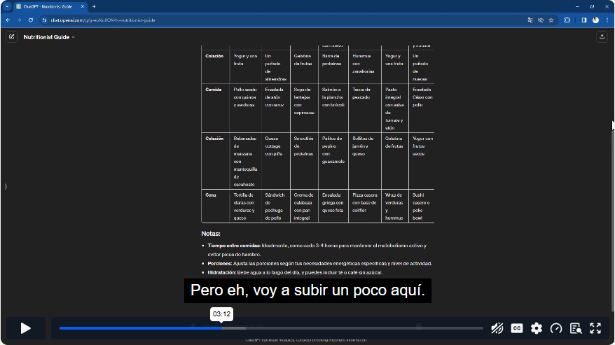
*Curso 2, video 3, min 3:10: el GPT entrega el menú semanal en tabla con notas de hidratación y porciones.*

**Lección:** un GPT de salud debe dejar claro que es orientativo. El instructor evitó dar cantidades sin tener ese conocimiento experto.

## 3. Proyecto: simulador de entrevistas de trabajo

- **Para quién:** reclutadores que preparan preguntas y candidatos que practican.
- **Funciones:**
    - búsqueda en tiempo real de tendencias por puesto;
    - preguntas por industria y nivel;
    - retroalimentación sobre las respuestas.
- **Cómo se construyó:** con la pestaña **Create**. El Builder propone el nombre y la imagen, y pregunta el alcance (todas las industrias) y el tono (formal o cercano).

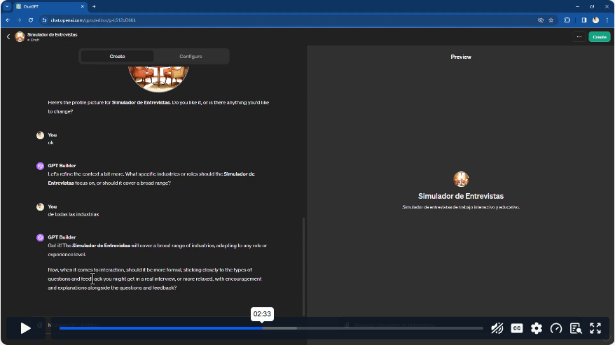
*Curso 3, video 2, min 2:30: conversación con el GPT Builder (izquierda) y vista previa (derecha).*

**Ajustes tras probar:** acortar el texto de los botones, que salían cortados, y revisar que los iniciadores sí hagan lo que prometen.

## 4. Proyecto: soporte técnico y diagnóstico

**Características deseadas:**

- comprensión de lenguaje técnico;
- diagnóstico paso a paso;
- soporte en varios idiomas;
- pedir al usuario el sistema operativo, el modelo y los mensajes de error.

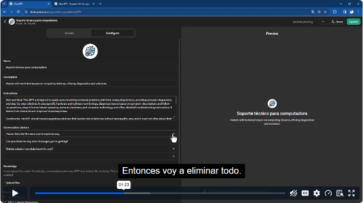
*Curso 4, video 3, min 1:20: ajuste directo en Configure (nombre, descripción, instrucciones, iniciadores).*

**Ajuste en la prueba:** los iniciadores salieron en inglés y se corrigieron a mano en **Configure**.

## 5. Proyecto: notas de blog con SEO

- **Objetivo:** notas atractivas para personas **y** optimizadas para buscadores.
- **Funciones clave del prompt:**
    - contenido optimizado y estructura con encabezados;
    - investigación de palabras clave;
    - metadescripciones;
    - sugerencias de imágenes con texto alternativo;
    - adaptarse a los cambios de algoritmo.
- **Conocimiento:** se carga un PDF de referencia.

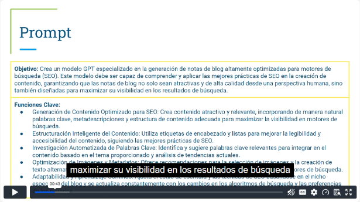
*Curso 5, video 2, min 0:40: objetivo y funciones clave del prompt.*

## 6. Proyecto: asistente de recursos humanos

- **Objetivo:** apoyar al reclutamiento:
    - evaluar CV según experiencia, habilidades y educación;
    - redactar vacantes;
    - preparar comunicaciones.
- **Cómo se construyó:** esta vez **directo en Configure**, pegando el prompt ya preparado.
- **Prueba:** una vacante de diseñador gráfico con descripción, responsabilidades, requisitos, salario y beneficios.

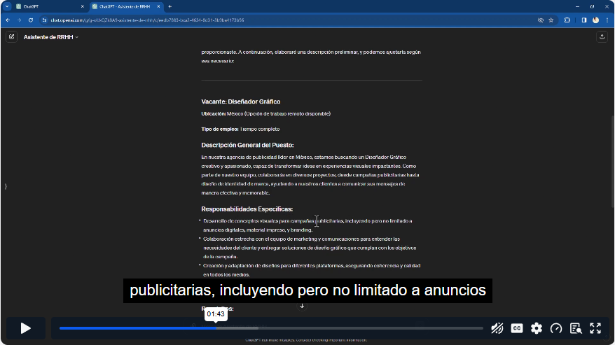
*Curso 6, video 3, min 1:40: la vacante generada por el asistente.*

## 7. Proyecto: web scraping

- **Qué es el web scraping:** extraer datos de sitios web de forma automática.
- **El prompt:**
    - interpretar órdenes en lenguaje natural;
    - entender HTML y JavaScript;
    - adaptarse a cambios en las páginas;
    - manejar paginación y formularios.
- **Prueba:**
    - un botón genérico fue rechazado por políticas de uso;
    - al indicar un sitio concreto y qué dato extraer (información de contacto), sí funcionó.

**Lección:** respetar los términos de los sitios y la privacidad.

## Conclusiones de la ruta

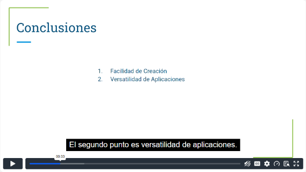
*Curso 7, video 4, min 0:30: conclusiones.*

1. **Facilidad:** el GPT Builder permite crear sin saber programar.
2. **Versatilidad:** sirve para nutrición, entrevistas, soporte, SEO, recursos humanos o extracción de datos.
3. **Personalización** con instrucciones, conocimiento y capacidades.
4. **Integración** de búsqueda web, imágenes y análisis de datos.
5. **Interacción** que se adapta al usuario.
6. Hay que entender lo básico de la IA para diseñar bien.

**Siguientes pasos:**

- proyectos piloto reales;
- retroalimentación de los usuarios;
- integración con un CRM o con analítica;
- varios idiomas;
- **seguridad y privacidad**.

## Actividades prácticas

| Curso | Reto |
|---|---|
| Menús | GPT que genere recetas a partir de una lista de ingredientes |
| Entrevistas | GPT que redacte descripciones detalladas para generar ilustraciones con DALL·E |
| Soporte | GPT que resuma artículos largos en 3–4 frases, con calificación del usuario |
| SEO | GPT que busque en internet, responda y **cite fuentes** |
| Recursos humanos | GPT que analice archivos CSV y explique tendencias con gráficos |
| Web scraping | GPT multilingüe (inglés, español y francés) que responda en el idioma de entrada |

## Evidencia

Certificados de los 7 cursos de la ruta:

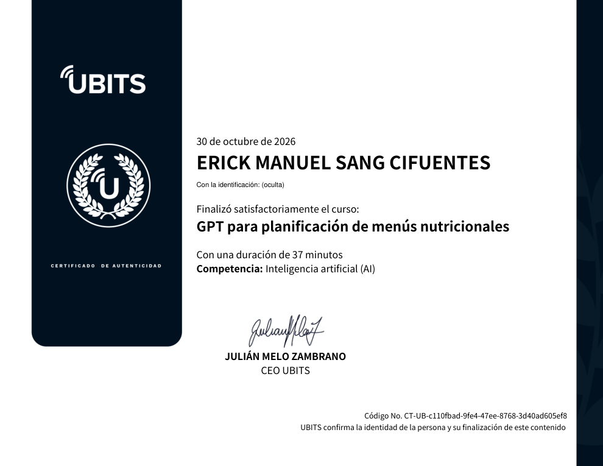

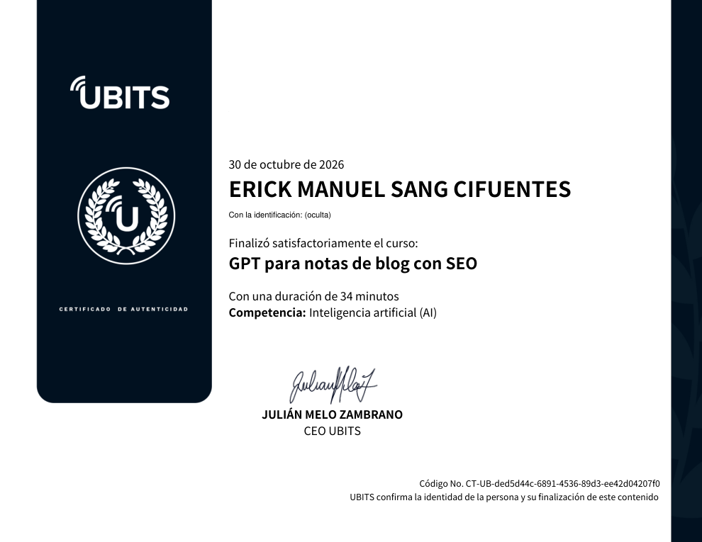

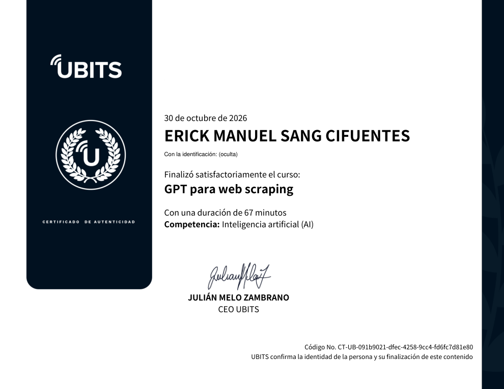

## Fuentes y aviso legal

- **Fuente:** ruta «Creación de GPT sin programación» de la plataforma [UBITS](https://www.ubits.com), asignada dentro de un plan de formación empresarial.
- **Uso:** apuntes personales de estudio, sin fines comerciales y con redacción propia. Las capturas son fragmentos breves citados con fines educativos; sus derechos son de sus titulares.
- **Sin afiliación:** sitio no oficial, no afiliado ni respaldado por UBITS, OpenAI ni los aliados del curso. Las marcas pertenecen a sus dueños.
- Más detalles y cómo pedir el retiro de contenido en el [aviso legal](../../aviso-legal.md).
