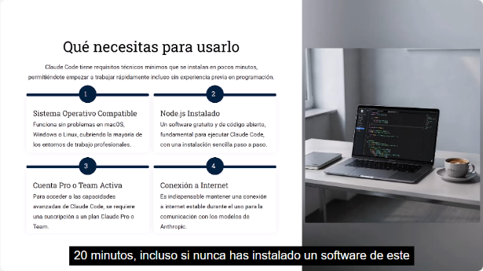
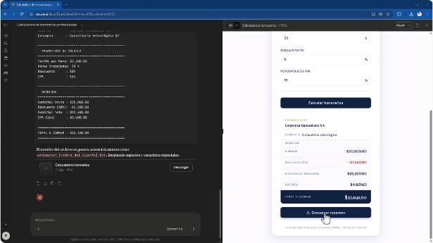
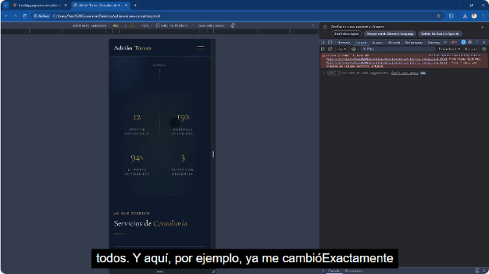
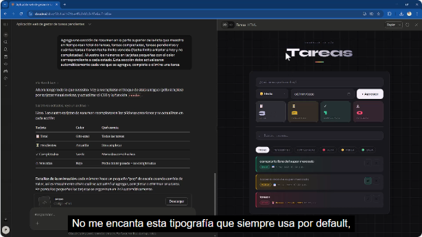
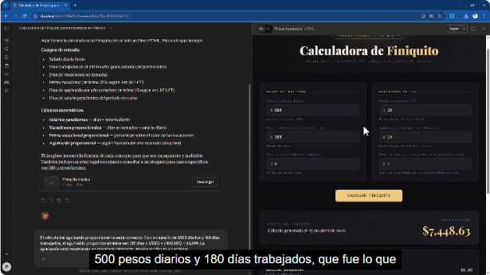
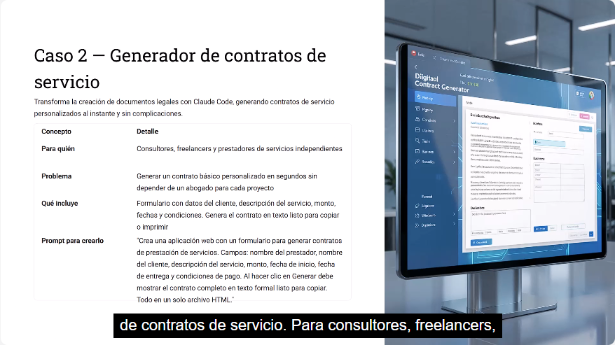
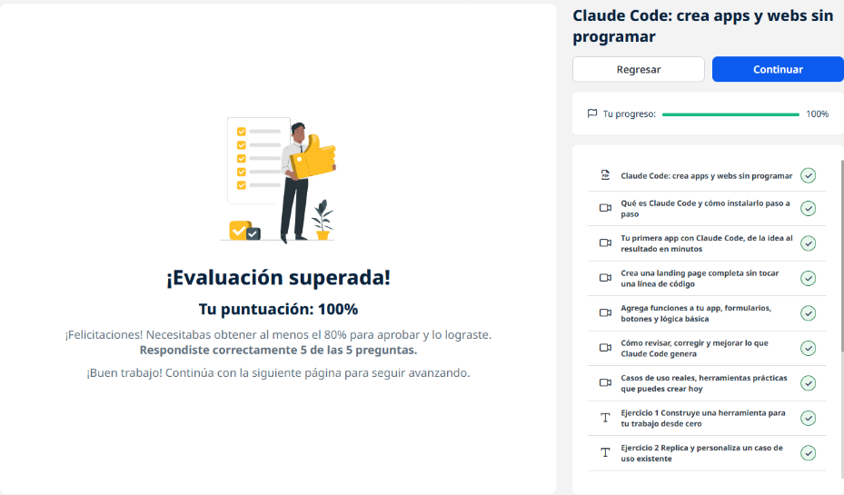
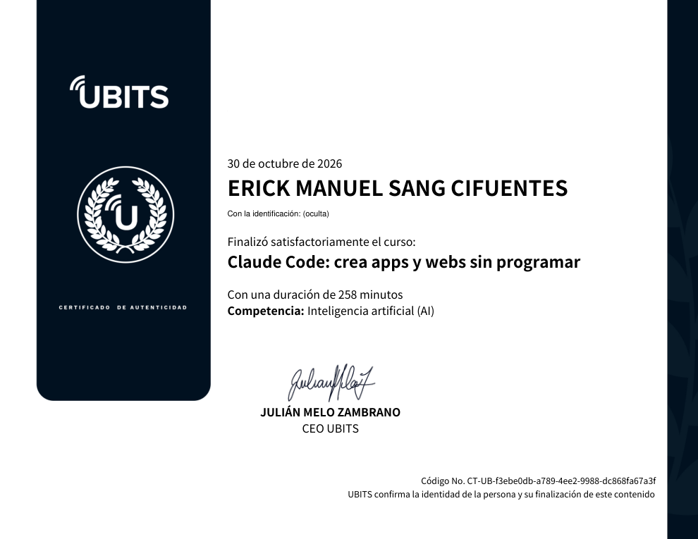

# 07 · Claude Code: crea apps y webs sin programar

**Plataforma:** UBITS · **Duración:** 258 min · **Nivel:** básico-intermedio · **Resultado:** test aprobado con 5/5 (100 %)

El curso muestra cómo una persona **que no programa** puede construir herramientas funcionales describiéndolas en lenguaje natural:

- **Claude Code**, en la computadora o en la web;
- los **Artefactos** del chat de Claude.

Son 6 videos (unos 90 min), 3 ejercicios y 2 lecturas.

## 1. Qué es Claude Code y cómo empezar

- **Chat frente a Claude Code:**
    - con un chat, la IA te da código y tú lo copias, lo pegas, lo ejecutas e interpretas los errores;
    - Claude Code **construye la aplicación completa, la prueba y la deja funcionando**, con mucha menos intervención.
- **No reemplaza a los programadores:** sirve para herramientas sencillas del día a día. Los sistemas complejos, la base de datos, el despliegue y la seguridad siguen necesitando experiencia técnica.

*Video 1, min 4:30: los cuatro requisitos.*

**Requisitos:**

1. macOS, Windows o Linux;
2. **Node.js**;
3. una cuenta **Pro o Team**;
4. conexión a internet.

**Instalación y primera prueba:**

- La instalación toma de 10 a 20 minutos. Si algo cambió, la guía actualizada está en la documentación oficial de Anthropic.
- Primera prueba: pedir que cree un archivo `bienvenida.txt` y comprobar que aparece en la carpeta del proyecto.
- **Buena práctica:** leer siempre los términos que se aceptan al instalar.

## 2. Primera app: calculadora de honorarios

**Claude Code en la web:**

- crea un **entorno en la nube**, sin instalar nada;
- deja elegir el acceso a la red, por ejemplo bloquear internet para mayor seguridad.

**Cómo creció la app, de prompt en prompt:**

1. Una calculadora con tarifa por hora, horas, descuento e IVA que muestra subtotal, IVA y total.
2. **Campos de cliente y concepto**, que no afectan el cálculo pero salen en el resumen.
3. Un botón **«Descargar resumen»** que genera un TXT con fecha, cliente, parámetros y desglose.

*Video 2, min 12:00: la calculadora terminada y el resumen descargable.*

**Consejos:**

- esperar a que termine antes de probar;
- descargar el HTML y abrirlo en local;
- seguir iterando, porque una minicalculadora puede convertirse en un cotizador con lista de precios.

## 3. Landing page sin tocar código

**El prompt inicial:** una landing para el consultor ficticio «Adrián Torres», con encabezado y eslogan, 3 tarjetas de servicios, sobre mí, testimonios y contacto.

**Iteraciones:**

- **Íconos:** con Font Awesome desde CDN. Como no se veían en la vista previa, se pidió cambiarlos por imágenes.
- **Sección de métricas:** 12 años, 150 empresas, 94 % de satisfacción y 3 países, sobre fondo azul marino.
- **Versión móvil:** menú hamburguesa y métricas en **2 columnas** en lugar de 4.
- **Interactividad:** scroll suave, efecto de elevación al pasar el cursor y validación del formulario.

*Video 3, min 12:20: prueba en vista móvil con las herramientas de desarrollador (F12).*

**Truco:** con **F12** se simulan distintos teléfonos y tabletas para revisar el diseño adaptable.

## 4. Formularios, botones y lógica

**La base:** una lista de tareas con prioridad alta, media o baja (por colores), completar, eliminar y contadores.

**Lo que se le agregó:**

- **Fecha límite con validación:** no puede quedar vacía ni ser una fecha pasada, con mensajes de error claros.
- **Buscador en tiempo real** y filtros.
- **Panel de resumen:** total, completadas, pendientes y **vencidas**, en tarjetas.

*Video 4, min 8:00: la app de tareas con panel de resumen y filtros.*

**Límite técnico:** sin base de datos, las tareas se pierden al recargar. Guardarlas exige almacenamiento local o un servidor, y ahí hace falta más experiencia.

## 5. Revisar, corregir y mejorar

**El caso:** una calculadora de finiquito en México.

**Cómo se corrige un cálculo:** describir el error con datos concretos. Por ejemplo: «Con salario de 500 y 180 días, el aguinaldo proporcional debería ser 15 × 500 × 180/365 = 3698,63».

**Qué hace Claude:**

- revisa el orden de las operaciones y corrige;
- explica en qué se equivocó.

*Video 5, min 2:20: la calculadora con los datos de prueba y el mensaje que describe el error.*

**Prompts útiles para revisar:**

- «Revisa todos los cálculos uno por uno y verifica cada fórmula según la ley.»
- «Revisa la aplicación visualmente y propone mejoras de diseño.»
- «Simula qué pasaría si el usuario comete estos errores y muéstrame los ejemplos.»

**Regla:** en temas legales o fiscales, el resultado es **referencial**. Lo valida un profesional.

## 6. Casos de uso reales

*Video 6, min 1:15: el generador de contratos de servicio, con para quién, problema, qué incluye y prompt.*

| Herramienta | Para quién |
|---|---|
| Calculadora de ROI de campañas | Marketing y publicidad |
| Generador de contratos de servicio (solo básicos y de bajo riesgo) | Consultores y freelancers |
| Dashboard de seguimiento de ventas con las etapas propias | Equipos comerciales |
| Calculadora de nómina básica (estimaciones referenciales) | Dueños de negocio y contadores |
| Seguimiento de prospectos | Ventas |

**El caso del instructor:**

- Construye una plataforma interna para su agencia: usuarios y permisos, clientes, proyectos, tareas, reportes automáticos en PDF, presupuestos, prospectos y vencimientos.
- Calcula un ahorro de unos **USD 500 al mes** frente a pagar varias aplicaciones, con unos USD 100 de suscripción durante 4–5 meses de desarrollo.

**Tres preguntas para encontrar tu herramienta:**

1. ¿Qué cálculo haces a mano una y otra vez?
2. ¿Qué información sigues en Excel o en varias apps?
3. ¿Qué documento generas siempre igual, cambiando solo algunos datos?

## Ejercicios prácticos

1. **Herramienta desde cero:**
    - definir antes el problema, el usuario, las entradas y las salidas;
    - empezar por la función principal;
    - iterar **al menos 4 veces**: funcionalidad, validaciones, diseño y experiencia de uso;
    - descargar el HTML y probarlo fuera de Claude.
2. **Replicar un caso de uso:** adaptar uno de los cinco casos a tu contexto real.
3. **Proyecto documentado:** algo más ambicioso (landing propia o dashboard), con un registro de los prompts, las decisiones y los problemas resueltos.

## Lecturas

### Democratización del software

- **Antes:** programar era cosa de una minoría técnica.
- **Ahora:** la IA genera código funcional desde lenguaje natural, con límites claros en lo complejo, la seguridad y el mantenimiento.
- **Lo que cambia:** la relación entre los profesionales y los desarrolladores.
- **Habilidades que ganan valor:** definir bien el problema, evaluar resultados e iterar.

### Pensamiento computacional para no programadores

| Habilidad | En la práctica |
|---|---|
| **Descomposición** | Dividir un problema grande en partes que se piden por separado |
| **Reconocimiento de patrones** | Ver lo que se repite para reutilizar soluciones |
| **Abstracción** | Quedarse con lo esencial e ignorar lo accesorio |
| **Pensamiento algorítmico** | Definir los pasos antes de pedirlos |
| **Casos extremos** | Anticipar qué puede salir mal: campos vacíos, fechas inválidas, valores negativos |

## Evidencia

*Curso al 100 % y test superado con 5 de 5.*

## Fuentes y aviso legal

- **Fuente:** curso «Claude Code: crea apps y webs sin programar» de la plataforma [UBITS](https://www.ubits.com), asignado dentro de un plan de formación empresarial.
- **Uso:** apuntes personales de estudio, sin fines comerciales y con redacción propia. Las capturas son fragmentos breves citados con fines educativos; sus derechos son de sus titulares.
- **Sin afiliación:** sitio no oficial, no afiliado ni respaldado por UBITS, Anthropic ni los aliados del curso. Las marcas pertenecen a sus dueños.
- Más detalles y cómo pedir el retiro de contenido en el [aviso legal](../../aviso-legal.md).
