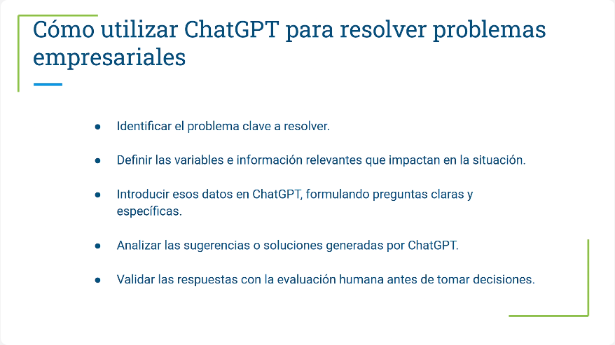
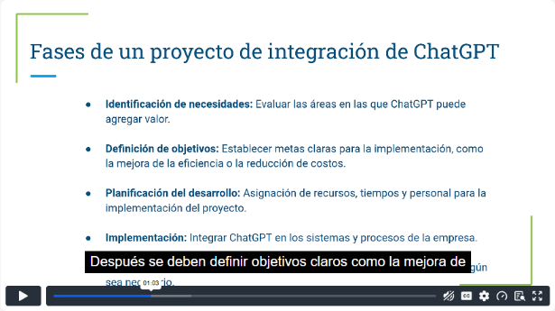
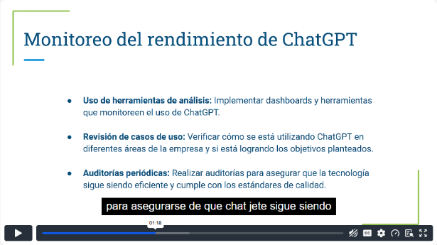
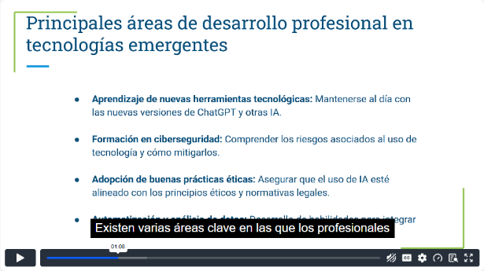
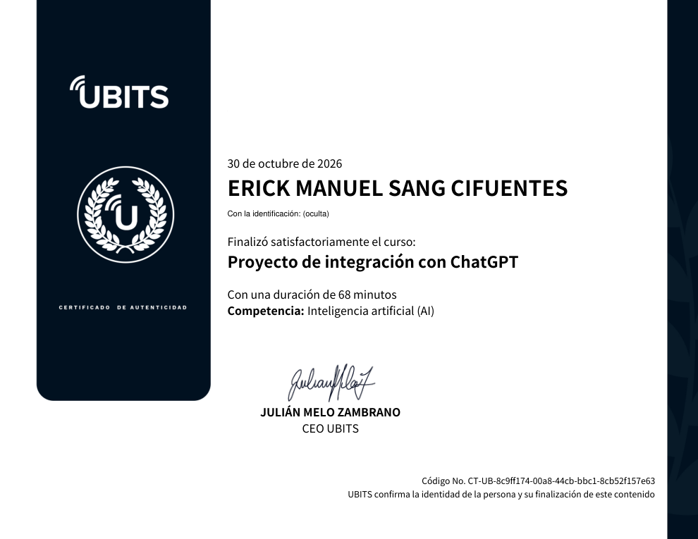

# 08 · Proyecto de integración con ChatGPT

**Plataforma:** UBITS · **Duración:** 68 min · **Nivel:** intermedio · **Resultado:** completado al 100 %, con proyecto final

Es la unidad de cierre de una ruta sobre ChatGPT. Recoge todo en un proyecto: cómo resolver casos empresariales con ChatGPT, cómo planear e implementar su integración, cómo darle seguimiento y cómo seguir formándose. Son 4 videos (unos 17 min), una lectura y el **proyecto final**.

## 1. Resolver problemas empresariales con ChatGPT

**Beneficios:**

- automatiza tareas repetitivas y libera tiempo para lo estratégico;
- analiza mucha información para decidir más rápido;
- propone soluciones creativas.

*Video 1, min 1:40: el método en cinco pasos.*

**Método en cinco pasos:**

1. **Identificar** el problema clave.
2. **Definir** las variables y la información relevante.
3. **Introducir** esos datos con preguntas claras y específicas.
4. **Analizar** las soluciones propuestas.
5. **Validar con criterio humano** antes de decidir.

**Límites:**

- No conoce la información interna de la empresa, salvo la que le compartes. Eso también protege los datos.
- La calidad de su respuesta depende de los datos que recibe.
- Funciona mejor **integrado con otras herramientas**, como el CRM, las hojas de cálculo o el ticketing.

## 2. Planificar y desarrollar la integración

*Video 2, min 1:00: las fases del proyecto.*

**Fases del proyecto:**

1. **Identificar necesidades:** en qué áreas aporta más.
2. **Definir objetivos:** eficiencia, reducción de costos o experiencia del cliente.
3. **Planificar:** recursos, tiempos y personas.
4. **Implementar:** integrarlo con los sistemas y procesos.
5. **Evaluar y ajustar.**

**Áreas de mayor impacto:**

- atención al cliente: preguntas frecuentes y menos tiempo de espera;
- tareas administrativas: informes y solicitudes;
- recomendaciones estratégicas a partir de datos.

**Métricas de éxito:**

- tiempo de respuesta;
- reducción de costos;
- satisfacción del cliente.

## 3. Seguimiento continuo

Las necesidades de la empresa cambian, así que la integración también debe cambiar.

*Video 3, min 1:15: herramientas para monitorear el rendimiento.*

| Elemento del plan | Cómo |
|---|---|
| **Monitoreo** | Dashboards con tiempo de respuesta, número de interacciones y satisfacción |
| **Revisión de casos de uso** | Comprobar en cada área si se cumplen los objetivos |
| **Auditorías periódicas** | Verificar que siga cumpliendo los estándares de calidad |
| **Retroalimentación** | Opiniones de empleados y usuarios, y patrones de uso ineficientes |
| **Capacitación** | Cada función nueva viene con su formación |

El impacto se evalúa en el **corto y en el largo plazo**.

## 4. Desarrollo profesional continuo

La IA generativa avanza más rápido que cualquier tecnología anterior, así que actualizarse se vuelve obligatorio.

*Video 4, min 1:05: las áreas clave de formación.*

**Qué aprender:**

- herramientas nuevas y versiones de ChatGPT;
- **ciberseguridad**;
- **ética** y normativa;
- **análisis de datos y automatización**.

**Cómo aprenderlo:**

- webinars y cursos en línea;
- documentación oficial;
- conferencias;
- redes y comunidades de práctica.

**Qué hace la empresa:**

- programas internos de formación;
- tiempo dentro del horario para aprender;
- reconocer a quien adopta lo nuevo;
- introducir las funciones nuevas de forma gradual.

## Lectura: desarrollo profesional continuo en la era de la IA

- **Qué es:** aprendizaje constante a lo largo de la carrera, no solo la formación inicial.
- **Por qué importa con IA:**
    - mejora la eficiencia;
    - facilita la innovación;
    - **reduce riesgos** de privacidad, de mala interpretación de datos y de errores de implementación;
    - mejora la toma de decisiones.
- **Estrategias:**
    - formación interna;
    - cursos y certificaciones en línea;
    - eventos tecnológicos;
    - **comunidades de práctica** dentro de la empresa.
- **Cultura de aprendizaje:** tiempo asignado, apoyo de los líderes y reconocimiento.

## Proyecto final: ChatGPT en un flujo de trabajo real

**1. Elegir y describir el flujo:**

- Áreas posibles: atención al cliente, recursos humanos, proyectos, ventas y *leads*, soporte técnico, gestión documental o análisis y reportes.
- Describir cómo se hace hoy y qué tareas son repetitivas.
- Fijar los objetivos. Ejemplos: responder preguntas frecuentes, reducir el tiempo de resolución de tickets o automatizar reportes.

**2. Fase de planificación:**

- **Diseñar el flujo:** qué pasos cambian.
- **Elegir herramientas:**
    - soporte: Zendesk, HubSpot, Freshdesk;
    - datos: Google Sheets, Excel, Power BI;
    - proyectos: Slack, Trello, Asana;
    - comunicación: Gmail, Mailchimp.
- **Lógica de integración.** Ejemplos:
    - responder preguntas frecuentes en Zendesk;
    - actualizar una hoja con el estado de las consultas;
    - enviar un correo al cerrar una tarea.
- **Prompts personalizados.** Ejemplos:
    - «Crea un reporte semanal de ventas a partir de esta hoja»;
    - «Genera un seguimiento para los *leads* sin respuesta en más de 7 días».

**3. Fase de implementación:**

- configurar ChatGPT con el tono de la empresa;
- probar el flujo y documentar los ajustes;
- evaluar la eficiencia, los tiempos y la precisión.

**4. Fase de documentación:**

- explicar el flujo final con un **diagrama**;
- reportar los resultados con métricas.

## Evidencia

*Curso completado al 100 %.*

## Fuentes y aviso legal

- **Fuente:** curso «Proyecto de integración con ChatGPT» de la plataforma [UBITS](https://www.ubits.com), asignado dentro de un plan de formación empresarial.
- **Uso:** apuntes personales de estudio, sin fines comerciales y con redacción propia. Las capturas son fragmentos breves citados con fines educativos; sus derechos son de sus titulares.
- **Sin afiliación:** sitio no oficial, no afiliado ni respaldado por UBITS, OpenAI ni los aliados del curso. Las marcas pertenecen a sus dueños.
- Más detalles y cómo pedir el retiro de contenido en el [aviso legal](../../aviso-legal.md).
