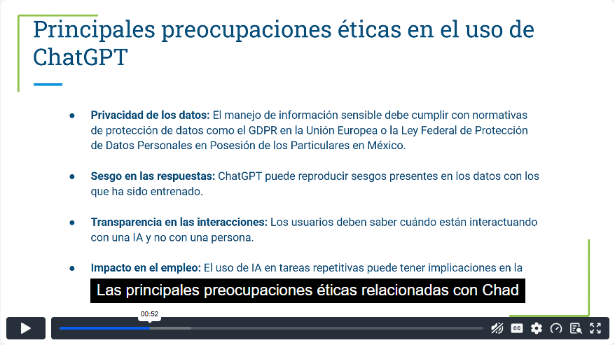
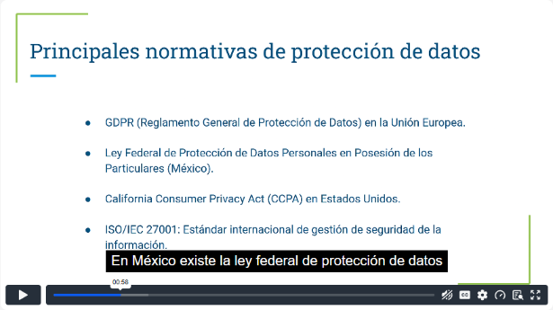
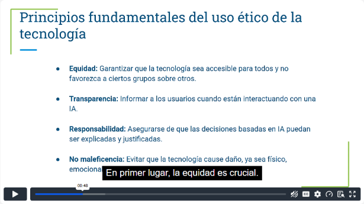
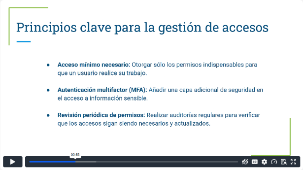
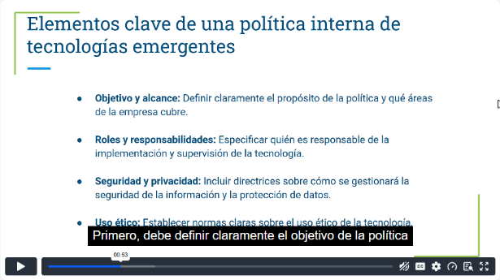
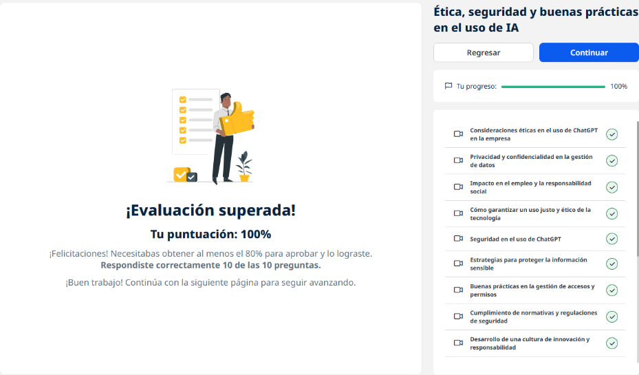
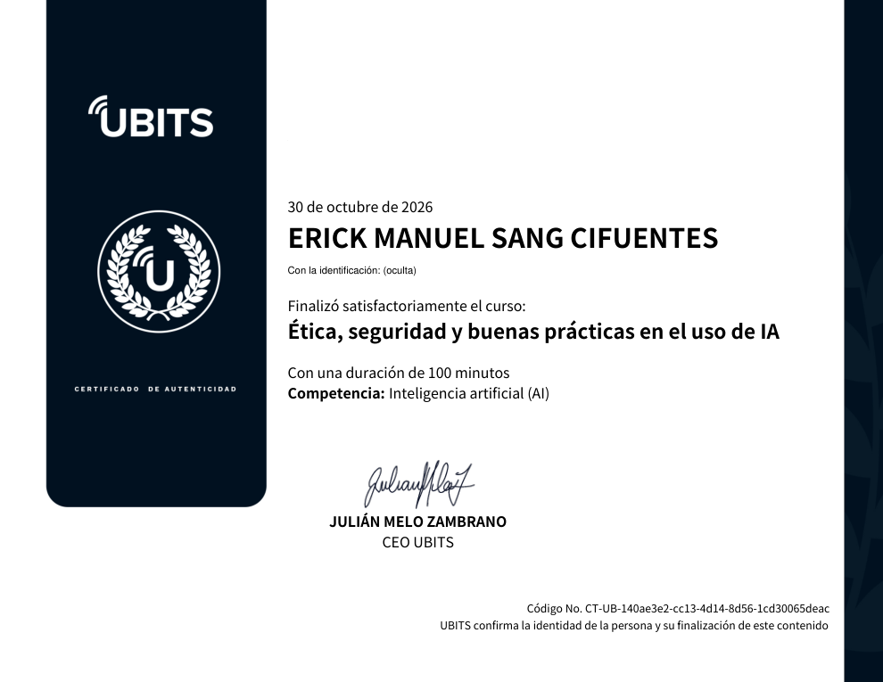

# 09 · Ética, seguridad y buenas prácticas en el uso de IA

**Plataforma:** UBITS · **Duración:** 100 min · **Nivel:** intermedio · **Resultado:** test aprobado con 10/10 (100 %)

Cómo usar ChatGPT y otras IA en la empresa de forma **ética, segura y conforme a la ley**. Son 12 videos cortos (unos 50 min), una lectura sobre seguridad y 3 ejercicios.

## 1. Consideraciones éticas

*Video 1, min 0:50: las cuatro preocupaciones principales.*

| Preocupación | Qué implica |
|---|---|
| **Privacidad de los datos** | La información sensible debe tratarse conforme a normas como el GDPR o la ley mexicana de protección de datos |
| **Sesgo en las respuestas** | El modelo puede repetir sesgos de sus datos de entrenamiento |
| **Transparencia** | El usuario debe saber si habla con una IA o con una persona |
| **Impacto en el empleo** | La automatización de tareas repetitivas afecta algunos puestos |

## 2. Privacidad y confidencialidad

**Por qué importa:**

- un mal manejo de datos trae **sanciones legales** y daña la reputación;
- cumplir la ley también es una responsabilidad ética con clientes, empleados y socios.

*Video 2, min 0:55: las normativas de referencia.*

**Normativas de referencia:**

- **GDPR**, en la Unión Europea;
- la **Ley Federal de Protección de Datos Personales en Posesión de los Particulares**, en México;
- la **CCPA**, en California;
- **ISO/IEC 27001**, el estándar de gestión de seguridad de la información.

**Buenas prácticas:**

- recoger solo los datos necesarios;
- pedir consentimiento;
- cifrar;
- restringir el acceso;
- **anonimizar** o seudonimizar antes de pasar datos a la IA.

## 3. Impacto en el empleo y responsabilidad social

- **Áreas más expuestas:** tareas administrativas, atención al cliente, y partes de marketing, ventas y finanzas.
- **Lo que sigue haciendo falta:** la IA reduce la intervención humana en esas tareas, pero no la elimina, porque alguien debe revisar.
- **Beneficios:** **reasignar** a las personas a trabajo estratégico (análisis, decisiones, supervisión) y ganar productividad.
- **Responsabilidad de la empresa:**
    - programas de **capacitación y reciclaje** para una transición justa;
    - comunicar con claridad qué cambia.

## 4. Uso justo y ético

*Video 4, min 0:45: los principios fundamentales.*

**Principios:**

- **Equidad:** accesible para todos, sin favorecer a ningún grupo.
- **Transparencia:** avisar cuando interviene una IA.
- **Responsabilidad:** las decisiones basadas en IA deben poder **explicarse y justificarse**.
- **No maleficencia:** evitar daños físicos, emocionales o económicos.

**Cómo llevarlos a la práctica:**

- auditar sesgos;
- mantener supervisión humana;
- crear canales para que los usuarios reporten problemas.

## 5. Seguridad en el uso de ChatGPT

**Riesgos:**

- acceso no autorizado;
- fugas por falta de cifrado;
- mal uso de datos personales;
- exposición de **propiedad intelectual y secretos comerciales**.

**Medidas:**

- **cifrado en tránsito** (TLS) **y en reposo**;
- acceso **basado en roles**;
- **autenticación multifactor**;
- revisión periódica de permisos;
- anonimización y seudonimización.

## 6. Proteger la información sensible

**Qué cuenta como sensible:** datos de empleados y clientes, información financiera, propiedad intelectual, comportamiento de clientes.

**Los tres pilares:**

| Pilar | Cómo se protege |
|---|---|
| **Confidencialidad** | Cifrado, acceso solo a autorizados, clasificación de datos por nivel de sensibilidad |
| **Integridad** | Control de cambios documentado, validación antes de ingresar datos, protocolos seguros en las transferencias |
| **Disponibilidad** | Copias de seguridad y planes de recuperación |

## 7. Gestión de accesos y permisos

*Video 7, min 0:50: los principios de gestión de accesos.*

1. **Acceso mínimo necesario:** solo los permisos indispensables para el trabajo.
2. **Autenticación multifactor (MFA)** para la información sensible.
3. **Revisión periódica de permisos:** quitar los accesos que ya no se necesitan, por ejemplo cuando alguien cambia de puesto o deja la empresa.

## 8. Cumplimiento normativo

**Consecuencias de no cumplir:**

- multas, que son altas bajo el GDPR;
- pérdida de confianza;
- demandas.

**Cómo cumplir:**

- **auditorías** periódicas;
- un **oficial de protección de datos (DPO)**;
- capacitación;
- **documentación** de quién accede a qué y con qué medidas;
- informes periódicos;
- un **protocolo para reportar incidentes** a las autoridades a tiempo.

## 9. Cultura de innovación responsable

**Pilares:**

- **Colaboración:** espacios para compartir y experimentar.
- **Transparencia:** que todos entiendan cómo se usa la tecnología.
- **Ética:** que respete los valores de la organización.

**Cómo fomentarla:**

- laboratorios de innovación;
- reconocer las ideas creativas;
- evaluar el impacto social antes de adoptar;
- **involucrar a los empleados** desde el inicio.

## 10. Adopción responsable de la IA

**Principios:** ética, transparencia, **justicia** (sin sesgos contra ciertos grupos) y seguridad.

**Evaluar el impacto en tres niveles:**

- **empleados:** que la IA complemente sus habilidades y no las reemplace;
- **clientes:** que mejore la experiencia sin generar desconfianza;
- **sociedad:** que no perjudique a los sectores vulnerables.

**Requisitos:** un **marco ético** claro y capacitación.

## 11. Educación continua

**Cómo actualizarse:**

- capacitación interna combinada con cursos externos;
- comunidades donde compartir buenas prácticas;
- acceso a plataformas de aprendizaje.

**Para seguir siendo competitivos:**

- seguir las **nuevas versiones** de ChatGPT y otras IA;
- incorporar rápido las funciones útiles;
- auditar el uso para encontrar mejoras.

## 12. Políticas internas para tecnologías emergentes

*Video 12, min 0:50: los elementos clave de la política.*

**Qué debe incluir la política:**

- **objetivo y alcance**;
- **roles y responsabilidades**;
- **seguridad y privacidad**;
- **normas de uso ético**.

**Usos permitidos y prohibidos:**

- **Permitido:** la atención al cliente.
- **Prohibido:** las decisiones sensibles sin supervisión humana, o redactar contratos o documentos legales sin un abogado.

**Mantenimiento de la política:**

- supervisión y auditoría;
- revisión periódica;
- alineación con el GDPR y la ley local;
- **exigir lo mismo a los proveedores**.

## Lectura: seguridad en la adopción de tecnologías emergentes

- **Las amenazas evolucionan** con la tecnología, así que la prevención debe ser proactiva.
- **Tríada CIA:**
    - **confidencialidad:** controles de acceso y MFA;
    - **integridad:** firmas digitales y cifrado;
    - **disponibilidad:** copias de seguridad y planes de contingencia.
- **Privacidad:** cifrado de extremo a extremo, control de acceso y anonimización.
- **Políticas de ciberseguridad para la IA:** monitoreo constante, **parches al día** y formación (*phishing*, contraseñas).
- **Ejemplos:** grandes tecnológicas combinan cifrado, automatización y **monitoreo humano**.
- **Retos:** falta de recursos y de talento especializado.

## Ejercicios prácticos

1. **Política interna de uso de ChatGPT:**
    - objetivo, roles y reglas éticas de protección de datos;
    - consecuencias del incumplimiento;
    - resumen para difundir.
2. **Auditoría de seguridad:**
    - inventario de los datos sensibles procesados con IA;
    - revisión del cifrado, la MFA y los accesos;
    - brechas detectadas y recomendaciones.
3. **Evaluación del impacto ético** en un área concreta:
    - beneficios;
    - riesgos de empleo, sesgo y privacidad;
    - plan de mitigación alineado con los valores de la empresa.

## Evidencia

*Curso al 100 % y test superado con 10 de 10.*

## Fuentes y aviso legal

- **Fuente:** curso «Ética, seguridad y buenas prácticas en el uso de IA» de la plataforma [UBITS](https://www.ubits.com), asignado dentro de un plan de formación empresarial.
- **Uso:** apuntes personales de estudio, sin fines comerciales y con redacción propia. Las capturas son fragmentos breves citados con fines educativos; sus derechos son de sus titulares.
- **Sin afiliación:** sitio no oficial, no afiliado ni respaldado por UBITS, OpenAI ni los aliados del curso. Las marcas pertenecen a sus dueños. Estos apuntes no son asesoría legal.
- Más detalles y cómo pedir el retiro de contenido en el [aviso legal](../../aviso-legal.md).
