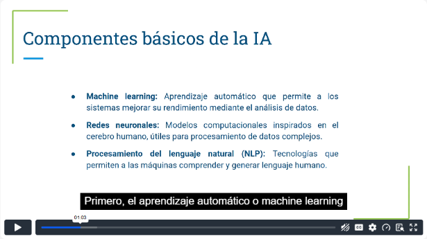
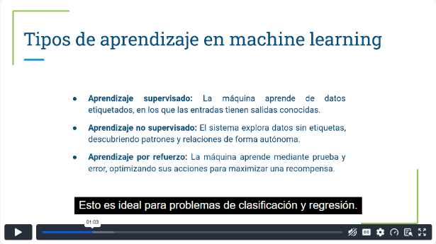
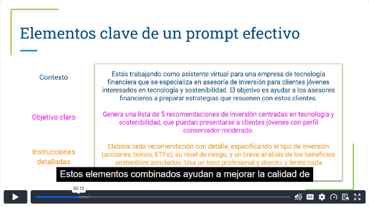
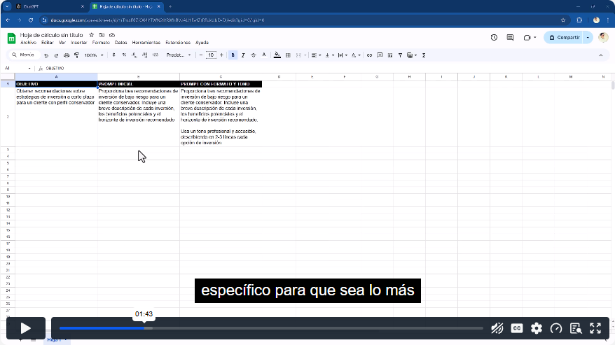
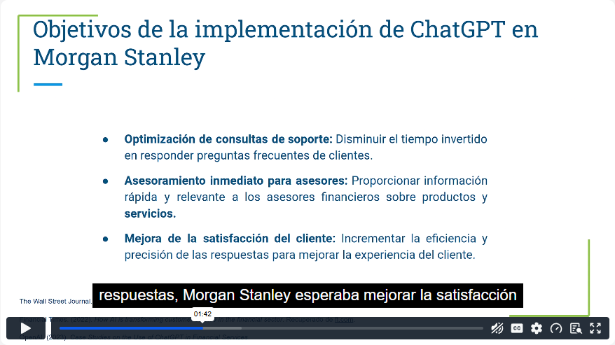
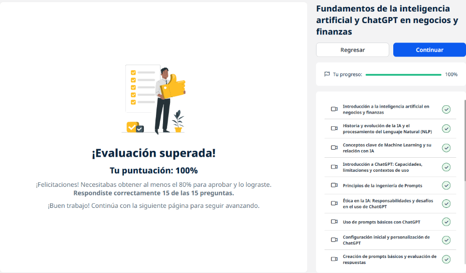
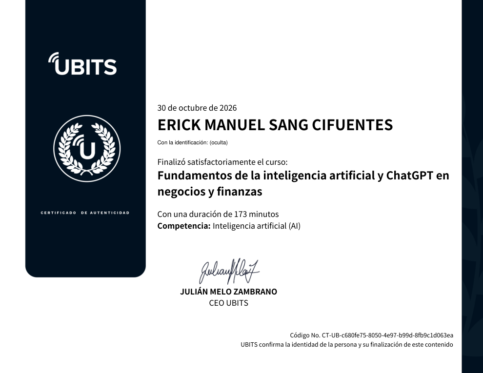

# 10 · Fundamentos de la IA y ChatGPT en negocios y finanzas

**Plataforma:** UBITS · **Duración:** 173 min · **Nivel:** básico · **Resultado:** test aprobado con 15/15 (100 %)

Es la unidad 1 de la serie sobre ChatGPT aplicado a negocios. Cubre la IA y sus componentes, la historia, el machine learning, las capacidades y límites de ChatGPT, la ingeniería de prompts, la ética, el uso práctico y un caso real en banca. Son 10 videos (unos 98 min), 3 ejercicios y 2 lecturas.

## 1. La IA en negocios y finanzas

**Qué es:** la rama de la informática que crea sistemas capaces de **aprender, interpretar y decidir**, imitando capacidades humanas.

*Video 1, min 1:00: los componentes básicos.*

**Sus componentes:**

| Componente | Qué hace |
|---|---|
| **Machine learning** | Mejora su rendimiento con la experiencia, sin reprogramarlo |
| **Redes neuronales** | Inspiradas en el cerebro; procesan datos complejos como imágenes y voz |
| **Procesamiento del lenguaje natural (PLN)** | Comprende y genera lenguaje humano; base de chatbots y asistentes |

**Para qué sirve en la empresa:**

- optimizar procesos y reducir costos;
- decidir con datos en tiempo real;
- reducir errores;
- personalizar la atención.

**En finanzas en particular:**

- **detectar fraudes**: monitorea transacciones y encuentra patrones sospechosos;
- análisis de riesgo;
- predicciones.

## 2. Historia de la IA y del PLN

| Época | Hito |
|---|---|
| **Años 50** | Alan Turing plantea máquinas que imiten la inteligencia humana; primeros programas de lógica y juegos |
| **Años 60** | **ELIZA**, primer sistema de PLN que simula una conversación |
| **Años 80** | Redes neuronales y el algoritmo de **backpropagation**; reconocimiento de patrones |
| **Años 2000** | Internet y el big data impulsan el **aprendizaje profundo**: reconocimiento facial y de voz, recomendadores, asistentes de voz |
| **Hoy** | Transformadores y modelos como ChatGPT |

## 3. Machine learning y su relación con la IA

**Qué es:** las máquinas aprenden **de los datos** sin que se programe cada tarea.

*Video 3, min 1:00: los tres tipos de aprendizaje.*

**Los tres tipos de aprendizaje:**

- **Supervisado:** datos **etiquetados**, para clasificación y regresión.
- **No supervisado:** datos sin etiquetas; encuentra grupos y patrones ocultos (*clusters*).
- **Por refuerzo:** prueba y error con **recompensas y castigos**.

**Algoritmos:**

- regresión lineal, para predecir valores numéricos;
- árboles de decisión, que crean reglas jerárquicas;
- redes neuronales, para imágenes y texto.

**IA y ML no son lo mismo:** la IA abarca cualquier sistema que simule inteligencia, incluidos los basados en reglas. El ML es **una subcategoría**.

## 4. ChatGPT: capacidades y límites

**Qué es:** un modelo de lenguaje de OpenAI basado en GPT y entrenado con enormes cantidades de texto.

**Capacidades:**

- responde preguntas y redacta contenido;
- adapta el tono, de formal a casual;
- hace informes y resúmenes.

**Límites:**

- su conocimiento llega hasta la fecha de entrenamiento;
- con búsqueda web depende de lo que haya en internet: si abundan las noticias falsas sobre un tema, puede repetirlas;
- puede dar **respuestas que suenan bien pero son incorrectas**;
- es limitado en consultas **muy especializadas**;
- no reemplaza al asesor experto.

## 5. Ingeniería de prompts

**Qué es:** diseñar entradas que guíen la respuesta del modelo. En negocios aporta precisión y ahorra recursos.

*Video 5, min 2:10: contexto, objetivo e instrucciones de un prompt financiero.*

**Los tres elementos clave:**

1. **Contexto:** por ejemplo, «asistente de una fintech que asesora a jóvenes interesados en tecnología y sostenibilidad».
2. **Objetivo claro:** «5 recomendaciones de inversión para un perfil conservador-moderado».
3. **Instrucciones detalladas:** tipo de inversión, nivel de riesgo, beneficios sostenibles, tono profesional y extensión.

## 6. Ética en la IA

**Por qué importa:** la IA influye en decisiones de **empleo, crédito o justicia**, así que un mal uso causa daños reales.

**Principios:**

- transparencia;
- responsabilidad: supervisar y corregir los efectos negativos;
- **no discriminación**: evitar sesgos.

**Riesgos:**

- uso indebido de datos personales;
- información inexacta que lleva a malas decisiones;
- **automatización sin supervisión humana**.

## 7. Uso práctico y configuración

- **Interfaz:**
    - campo de texto, adjuntar archivos y búsqueda web;
    - historial de chats para retomar trabajo;
    - selección de modelo **antes** del primer prompt.
- **Planes:** el gratuito requiere registro; Plus cuesta USD 20 al mes.
- **Primer ejemplo:** el contexto «Trabajas en marketing de una marca de belleza…» se combina con el objetivo «ideas de campaña para jóvenes interesados en productos ecológicos».
- **Personalización:** instrucciones personalizadas y configuración de privacidad.

## 8. Crear y evaluar prompts

**Cómo evoluciona un prompt:**

1. **Definir el objetivo:** por ejemplo, recomendaciones de inversión a corto plazo para un cliente conservador.
2. **Prompt inicial:** «Proporciona tres recomendaciones de inversión de bajo riesgo…».
3. **Agregar detalle:** descripción, beneficios y horizonte de inversión.
4. **Agregar formato y tono:** «tono profesional y accesible, 2–3 líneas por opción».

*Video 9, min 1:40: tabla con el objetivo, el prompt inicial y el prompt con formato y tono.*

**Cómo evaluar cada respuesta:** relevancia, precisión, claridad y formato. Luego se ajusta y se repite.

## 9. Caso de estudio: Morgan Stanley

*Video 10, min 1:40: los objetivos de la implementación.*

**Qué hizo:** integró ChatGPT en la atención al cliente y en el soporte interno de sus asesores.

**Objetivos:**

- responder rápido las consultas frecuentes;
- dar a los asesores **información precisa al instante**;
- mejorar la satisfacción del cliente.

**Resultados:**

- menos tiempo de respuesta;
- personal enfocado en casos complejos;
- menos errores;
- una experiencia más consistente.

## Ejercicios prácticos

1. **Prompts para atención al cliente** de una empresa financiera:
    - casos: inversiones, apertura de cuenta, tasas y cargos;
    - cada prompt con contexto, tono, nivel de detalle y formato.
2. **Evaluar las respuestas** por relevancia, claridad y formato; ajustar el contexto, el formato o los términos técnicos y volver a probar.
3. **Personalizar ChatGPT** como asesor de inversiones conservadoras: propósito, tono consultivo, nivel de detalle y prompt base.

## Lecturas

- **Fundamentos:**
    - subcategorías de la IA: ML, PLN, visión por computadora;
    - aplicaciones y beneficios en finanzas;
    - retos de **privacidad**, sesgo y costos;
    - futuro.
- **Teoría:**
    - ML, PLN, deep learning;
    - **visión por computadora**: interpretar imágenes y video, por ejemplo para control de calidad;
    - ética;
    - **modelos explicables**, que permiten entender cómo decide la IA;
    - algoritmos de recomendación en finanzas.

## Evaluación (15/15)

1. Cómo ayuda la IA contra el fraude → **monitorea transacciones y detecta patrones sospechosos**.
2. Qué es la IA → **la capacidad de las máquinas para hacer tareas que requieren inteligencia humana**.
3. Una subcategoría de la IA → **la visión por computadora**.
4. Un uso común de ChatGPT en negocios → **la atención al cliente automatizada**.
5. Qué permite el PLN → **comprender y generar lenguaje humano**.
6. El aprendizaje automático permite que las máquinas → **aprendan de los datos y mejoren con el tiempo**.
7. En finanzas, el ML se usa sobre todo para → **analizar patrones y hacer predicciones**.
8. Un beneficio de la IA en finanzas → **decisiones basadas en datos**.
9. El aprendizaje supervisado usa → **datos etiquetados**.
10. La visión por computadora sirve para → **interpretar imágenes y video, por ejemplo en control de calidad**.
11. La ética en IA busca → **que opere de forma justa y transparente**.
12. Un límite de ChatGPT → **su capacidad en consultas muy especializadas es limitada**.
13. Los modelos explicables importan porque → **facilitan entender cómo se toman las decisiones**.
14. El aprendizaje con recompensas y castigos → **por refuerzo**.
15. Un reto de la IA en la empresa → **la privacidad y el manejo de datos sensibles**.

## Evidencia

*Curso al 100 % y test superado con 15 de 15.*

## Fuentes y aviso legal

- **Fuente:** curso «Fundamentos de la inteligencia artificial y ChatGPT en negocios y finanzas» de la plataforma [UBITS](https://www.ubits.com), asignado dentro de un plan de formación empresarial.
- **Uso:** apuntes personales de estudio, sin fines comerciales y con redacción propia. Las capturas son fragmentos breves citados con fines educativos; sus derechos son de sus titulares.
- **Sin afiliación:** sitio no oficial, no afiliado ni respaldado por UBITS, OpenAI ni las empresas mencionadas. Las marcas pertenecen a sus dueños. No es asesoría financiera.
- Más detalles y cómo pedir el retiro de contenido en el [aviso legal](../../aviso-legal.md).
