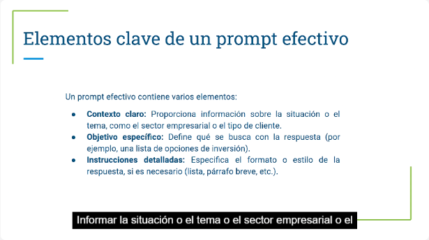
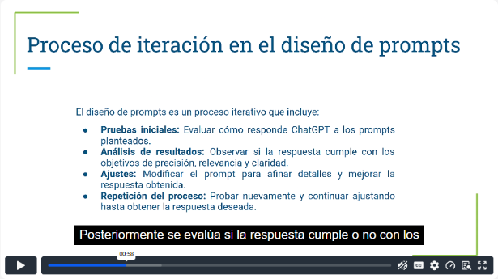
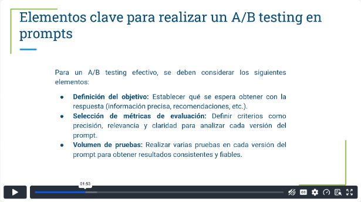
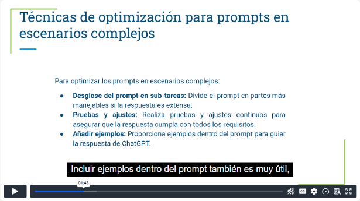
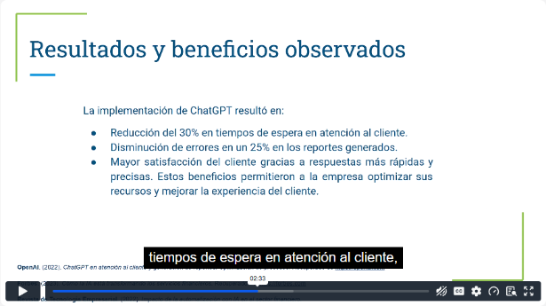
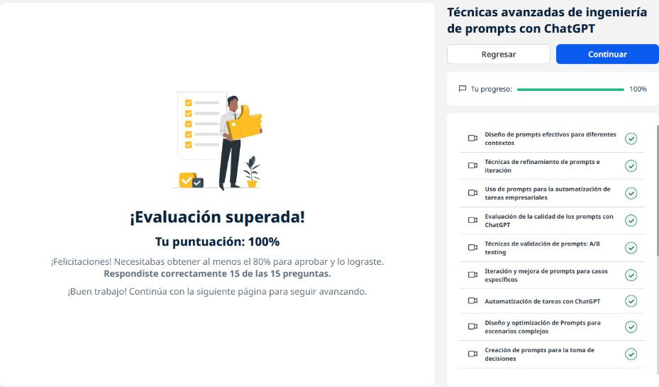
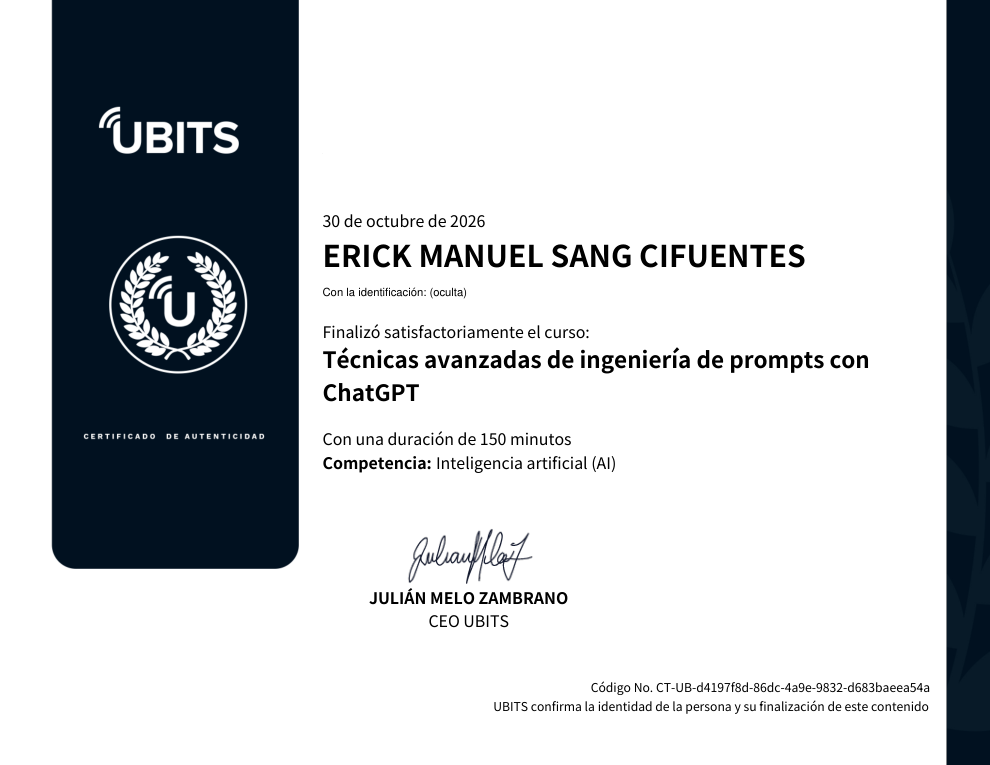

# 11 · Técnicas avanzadas de ingeniería de prompts con ChatGPT

**Plataforma:** UBITS · **Duración:** 150 min · **Nivel:** intermedio · **Resultado:** test aprobado con 15/15 (100 %)

Es la unidad 2 de la serie de ChatGPT para negocios. Lleva los prompts al nivel profesional:

- diseñarlos por contexto;
- refinarlos e iterar;
- usarlos para automatizar tareas;
- evaluar su calidad;
- validarlos con **pruebas A/B**;
- aplicarlos a escenarios complejos y a decisiones.

Son 10 videos (unos 74 min), 3 ejercicios y 2 lecturas.

## 1. Diseño de prompts por contexto

Un prompt mal diseñado da respuestas generales o inexactas.

*Video 1, min 1:30: los tres elementos de un prompt efectivo.*

**Los tres elementos:**

1. **Contexto claro:** el sector, el tipo de cliente o la situación. Es «ponerle el sombrero» correcto: financiero, *content manager*, servicio al cliente…
2. **Objetivo específico:** qué se busca, por ejemplo una lista de opciones de inversión.
3. **Instrucciones detalladas:** formato y estilo, como lista o párrafo breve.

## 2. Refinamiento e iteración

*Video 2, min 0:55: el ciclo de iteración.*

**El ciclo:**

1. **prueba inicial;**
2. **análisis** de precisión, relevancia y claridad;
3. **ajuste;**
4. **repetir** hasta obtener la respuesta deseada.

**Técnicas de refinamiento:**

- agregar contexto;
- fijar el tono y el formato;
- acotar el objetivo;
- poner límites, como no usar términos técnicos.

## 3. Prompts para automatizar tareas

**Ventajas:**

- menos costo por menos intervención en procesos básicos;
- respuestas casi instantáneas;
- disponibilidad **24/7**;
- menos errores humanos.

**Qué se automatiza:**

- **Atención al cliente:** preguntas frecuentes, soporte básico y derivar lo complejo a especialistas.
- **Reportes:** resúmenes de datos y análisis básicos.
- **Soporte interno:** preguntas de empleados sobre políticas, beneficios y procedimientos.

**Cómo debe ser el prompt:** rol, tarea, formato y **reglas o límites**, como el tono según el usuario o evitar tecnicismos.

## 4. Evaluar la calidad de un prompt

**Criterios:**

- **precisión:** exactitud;
- **relevancia:** cumple el objetivo sin desviarse;
- **claridad:** se entiende sin ser experto;
- **formato adecuado:** listas, secciones, subtítulos.

**Ejemplo de mejora:**

- **Antes:** «Describe tres opciones de inversión», demasiado general.
- **Después:** «Proporciona tres opciones de inversión de bajo riesgo para un cliente conservador, explicando los beneficios de cada una».

**Idea útil:** el mismo contenido puede explicarse automáticamente a **distintas audiencias** cambiando solo el perfil en el prompt.

## 5. Validación con pruebas A/B

**Qué es:** comparar **dos versiones** de un prompt para quedarse con la más efectiva.

*Video 5, min 1:50: los elementos de una prueba A/B.*

**Qué se necesita:**

- definir el **objetivo**;
- elegir las **métricas** (precisión, relevancia, claridad);
- hacer un **volumen de pruebas** suficiente para que el resultado sea fiable.

**El proceso:**

1. diseñar la versión A y la versión B, que difieren en tono, nivel de detalle o criterios;
2. probar ambas;
3. evaluar y elegir;
4. repetir periódicamente, porque los modelos cambian.

## 6. Iterar en casos específicos

**El ciclo:** prueba, evaluación, ajuste y nueva prueba, centrando el prompt en el objetivo.

**Para un caso concreto:**

- agregar contexto específico;
- dar ejemplos;
- **documentar** lo que funciona para crear buenas prácticas reutilizables.

## 7. Escenarios complejos

**Qué los hace complejos:** análisis detallados con muchos factores.

*Video 8, min 1:40: técnicas para escenarios complejos.*

**Técnicas:**

- **Dividir en subtareas:** el modelo maneja la información por partes y no se dispersa.
- **Probar y ajustar** de forma continua.
- **Añadir ejemplos** que guíen la respuesta.
- **Pedir el formato** por secciones o listas.

## 8. Prompts para tomar decisiones

**Para qué sirven:** evaluar inversiones, elegir socios o proveedores, planear estrategias.

**Qué deben incluir:**

- **contexto;**
- **criterios de evaluación** (costo, tiempo, calidad);
- **formato de la recomendación;**
- una **conclusión clara** al final.

**Ejemplo:**

- **Prompt débil:** «Analiza las opciones de proveedores».
- **Prompt optimizado:** «Analiza las opciones de proveedores según costo, calidad y tiempos de entrega. Recomienda una opción con base en los tres factores, en lista y con una breve conclusión». Además, hay que darle los datos de cada proveedor.

## 9. Caso de estudio: empresa de servicios financieros

**Antes:**

- largas esperas en atención al cliente;
- reportes manuales con errores y sin estándar;
- poca personalización.

*Video 10, min 2:30: los resultados observados.*

**Resultados:**

- **−30 %** en tiempos de espera;
- **−25 %** de errores en reportes;
- mayor satisfacción del cliente.

## Ejercicios prácticos

1. **Automatización:**
    - prompt con contexto, objetivo y formato para una tarea repetitiva;
    - probarlo y ajustarlo;
    - documentar la versión final y los cambios.
2. **Refinar y evaluar** un prompt de un caso real con los criterios de calidad.
3. **Prueba A/B.** Ejemplo:
    - versión A: «Evalúa tres opciones de inversión según retorno y riesgo, en lista breve»;
    - versión B: con más criterios o detalle;
    - comparar precisión, relevancia, claridad y organización, y anotar lo aprendido.

## Lecturas

- **Técnicas avanzadas:**
    - los elementos esenciales: contexto, objetivo, formato, tono y estilo;
    - iteración, subtareas y ejemplos;
    - la prueba A/B.
- **Personalización:**
    - definir el **perfil del usuario o audiencia**;
    - un contexto específico;
    - **los resultados y métricas** esperados.
    - **Casos:**
        - atención al cliente: guiar de forma comprensible;
        - marketing: alinear con el tono y los objetivos de la marca;
        - análisis de mercado: organizar en torno a indicadores clave.

## Evaluación (15/15)

1. El objetivo de la ingeniería avanzada de prompts → **adaptar las respuestas a necesidades empresariales específicas**.
2. Lo que define el contexto empresarial → **el contexto detallado**.
3. La iteración consiste en → **probar y ajustar el prompt de forma continua**.
4. Dividir en subtareas → **ayuda a enfocarse en cada aspecto relevante**.
5. Incluir ejemplos sirve para → **guiar la respuesta hacia los factores clave**.
6. Qué es una prueba A/B → **comparar dos versiones de un prompt**.
7. Lo clave para personalizar la atención al cliente → **un perfil de usuario claro**.
8. Cómo optimizar prompts de análisis de mercado → **incluyendo métricas clave**.
9. El desafío de los escenarios complejos → **lograr una respuesta relevante y clara**.
10. La ventaja de las pruebas A/B → **elegir la versión más efectiva**.
11. Cómo organizar un análisis de datos complejo → **en secciones o subtareas**.
12. Qué especificar en prompts de decisión → **el contexto y los criterios de evaluación**.
13. La personalización en contenido permite → **alinearlo con el tono y los objetivos de la marca**.
14. Por qué documentar la optimización → **para crear buenas prácticas y patrones exitosos**.
15. Qué mejora la claridad en decisiones estratégicas → **la iteración y el ajuste continuo**.

## Evidencia

*Curso al 100 % y test superado con 15 de 15.*

## Fuentes y aviso legal

- **Fuente:** curso «Técnicas avanzadas de ingeniería de prompts con ChatGPT» de la plataforma [UBITS](https://www.ubits.com), asignado dentro de un plan de formación empresarial.
- **Uso:** apuntes personales de estudio, sin fines comerciales y con redacción propia. Las capturas son fragmentos breves citados con fines educativos; sus derechos son de sus titulares.
- **Sin afiliación:** sitio no oficial, no afiliado ni respaldado por UBITS ni por OpenAI. Las marcas pertenecen a sus dueños.
- Más detalles y cómo pedir el retiro de contenido en el [aviso legal](../../aviso-legal.md).
