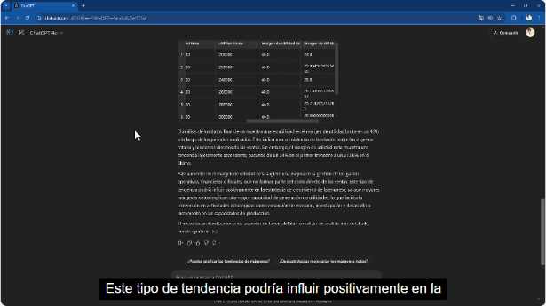
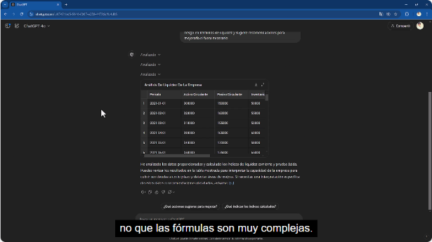
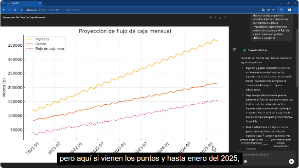
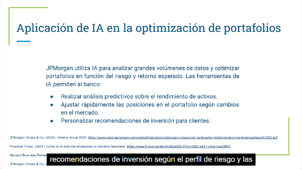
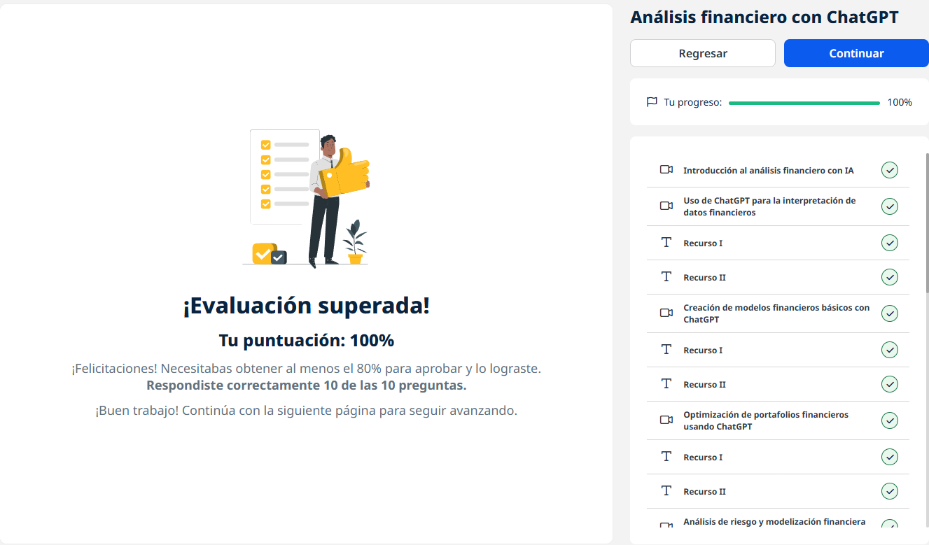
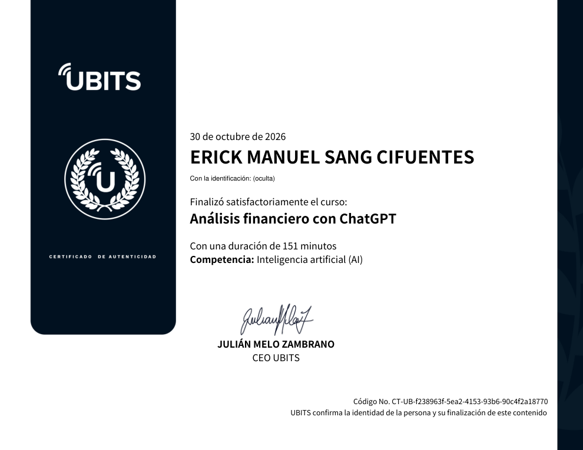

# 12 · Análisis financiero con ChatGPT

**Plataforma:** UBITS · **Duración:** 151 min · **Nivel:** intermedio · **Resultado:** test aprobado con 10/10 (100 %)

Es la unidad 3 de la serie. Es la más práctica: se le dan a ChatGPT **archivos de Excel con datos financieros ficticios** y se le pide calcular, interpretar y proyectar. Son 10 videos (unos 76 min), recursos descargables, 3 ejercicios y 2 lecturas.

## 1. La IA en el análisis financiero

**Qué es el análisis financiero:** revisar la **liquidez, la rentabilidad y la solvencia** de la empresa para decidir con base sólida.

**Qué aporta la IA:**

- procesa grandes volúmenes en tiempo real;
- detecta tendencias y proyecta resultados;
- anticipa problemas.

**Cómo trabaja ChatGPT con archivos:**

- lee la hoja y la muestra en una vista previa;
- calcula con **Python**: el código se puede ver o minimizar;
- entrega tablas descargables.

## 2. Interpretar datos financieros: márgenes

**Los datos:** 8 trimestres de ventas, costo de ventas y utilidad neta.

**El prompt:** calcular el **margen bruto** y el **margen neto** por periodo, describir las tendencias y explicar su impacto en la estrategia de crecimiento.

*Video 2, min 4:00: márgenes por trimestre con la interpretación y las preguntas sugeridas para seguir.*

**Truco:** se puede pedir el **Excel con las fórmulas** en lugar de los valores calculados, para reutilizarlo.

## 3. Modelos financieros básicos

**Proyección de flujo de caja:**

- con ingresos y gastos mensuales de 2021 a 2025, proyecta 12 meses;
- marca los meses con **déficit o superávit**;
- recomienda cómo manejarlos.

**Proyección de ingresos con crecimiento compuesto:**

- ejemplo: USD 500 000 que crecen al 10 % anual durante 5 años;
- el crecimiento se acumula sobre una base cada vez mayor;
- hay que **ajustar la tasa al mercado**: una optimista crea expectativas irreales y una muy conservadora subestima las oportunidades.

**Depreciación en línea recta:**

- ejemplo: un equipo de USD 100 000, con 5 años de vida y USD 10 000 de valor de rescate, se deprecia **USD 18 000 por año**;
- se acompaña de la tabla del valor en libros.

## 4. Optimización de portafolios

**Diversificación:**

- con 50 activos con rendimiento histórico y riesgo (desviación estándar), ordena por la relación **rendimiento/riesgo**;
- propone proporciones para bajar el riesgo sin sacrificar demasiado rendimiento.

**Modelo de media-varianza:**

- con tres activos con retorno y riesgo dados, calcula la **proporción óptima** de cada uno;
- la suma de los pesos es 1;
- muestra las fórmulas de varianza y retorno esperado.

**Lección:** combinar activos de menor riesgo equilibra a los más riesgosos.

## 5. Análisis de riesgo y escenarios

**Riesgos de una inversión** en bonos corporativos tecnológicos de largo plazo:

- **riesgo de mercado;**
- **riesgo de crédito;**
- **riesgo de liquidez.**

ChatGPT da tres medidas de mitigación para cada uno.

**Simulación de escenarios** para un portafolio de acciones energéticas y bonos:

- crecimiento;
- estancamiento;
- recesión.

Para cada escenario se analiza cómo la diversificación estabiliza el portafolio.

## 6. Estados financieros

**Liquidez:**

- con el activo circulante, el pasivo circulante y los inventarios, calcula:
    - la **razón corriente:** activo circulante ÷ pasivo circulante;
    - la **prueba ácida:** (activo circulante − inventarios) ÷ pasivo circulante.
- interpreta si la empresa puede cubrir sus deudas de corto plazo.

*Video 6, min 2:10: tabla de liquidez generada a partir del Excel.*

**Rentabilidad:** a partir del estado de resultados.

## 7. Modelo de flujo de caja

**Proyección mensual:**

- flujo neto por mes;
- **patrones estacionales**;
- recomendaciones para los meses con déficit o superávit.

*Video 7, min 1:40: ingresos, gastos y flujo de caja neto proyectados.*

## 8. Caso de estudio: JPMorgan Chase

*Video 10, min 1:15: cómo usa la IA el banco.*

**Qué hace con la IA:**

- **análisis predictivo** del rendimiento de los activos;
- **ajuste rápido** de posiciones según el mercado;
- **recomendaciones personalizadas** según el perfil de riesgo de cada cliente;
- gestión de riesgos.

**Aclaración del curso:** esto se hace con infraestructura propia y especializada. ChatGPT sirve para análisis exploratorios, no sustituye esos sistemas.

## Ejercicios prácticos

1. **Automatizar tareas:**
    - prompt para un informe de desempeño del equipo de ventas, con métricas de productividad y logros;
    - ajustarlo en tono y nivel de detalle.
2. **Refinar con un caso real:**
    - análisis de clientes de una tienda en línea (conversión, productos más vistos);
    - mejorarlo con el periodo y los canales de marketing.
3. **Optimizar procesos:**
    - mejoras en atención al cliente;
    - **cuellos de botella** en la producción de una manufacturera;
    - recomendaciones factibles según el tamaño y los recursos de la empresa.

## Lecturas

- **Creación y refinamiento de prompts para negocios:**
    - elementos clave: contexto, objetivo, formato y audiencia;
    - iteración;
    - validación con **pruebas A/B**.
- **Estrategias de diseño:**
    - adaptar el prompt al tipo de tarea;
    - personalizar el tono;
    - automatizar;
    - **ética** en el diseño de prompts y la automatización.

## Evaluación (10/10)

1. Lo que **no** es esencial en un prompt → **la repetición constante**.
2. Qué busca la automatización con prompts → **optimizar y reducir las tareas manuales**.
3. Por qué incluir el objetivo → **para indicar con claridad lo que se espera**.
4. El propósito de una prueba A/B → **evaluar dos versiones y elegir la más efectiva**.
5. Personalizar el tono significa → **adaptar el lenguaje al nivel de conocimiento del receptor**.
6. Qué se puede automatizar → **tareas repetitivas y basadas en análisis de datos**.
7. Por qué iterar → **para ajustar el prompt y obtener respuestas más precisas**.
8. La ventaja en atención al cliente → **respuestas consistentes y rápidas a preguntas comunes**.
9. Qué evitar → **contexto innecesario y lenguaje ambiguo**.
10. Un aspecto ético fundamental → **la transparencia y la protección de datos**.

## Evidencia

*Curso al 100 % y test superado con 10 de 10.*

## Fuentes y aviso legal

- **Fuente:** curso «Análisis financiero con ChatGPT» de la plataforma [UBITS](https://www.ubits.com), asignado dentro de un plan de formación empresarial. Los datos de los ejercicios son ficticios.
- **Uso:** apuntes personales de estudio, sin fines comerciales y con redacción propia. Las capturas son fragmentos breves citados con fines educativos; sus derechos son de sus titulares.
- **Sin afiliación:** sitio no oficial, no afiliado ni respaldado por UBITS, OpenAI ni las entidades mencionadas. Las marcas pertenecen a sus dueños. No es asesoría financiera.
- Más detalles y cómo pedir el retiro de contenido en el [aviso legal](../../aviso-legal.md).
