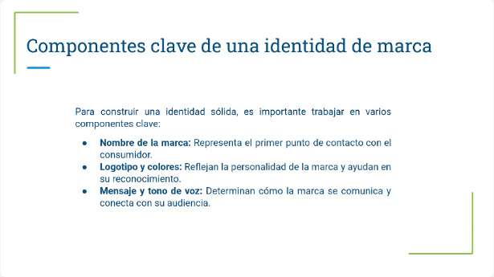
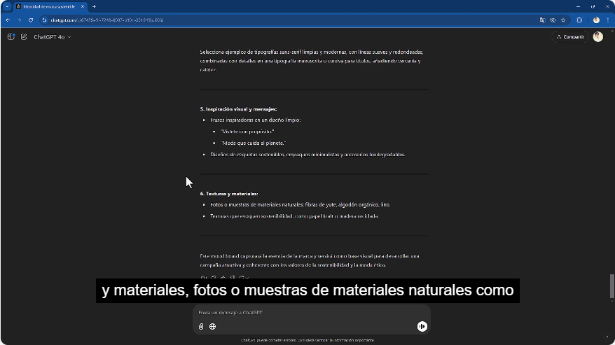
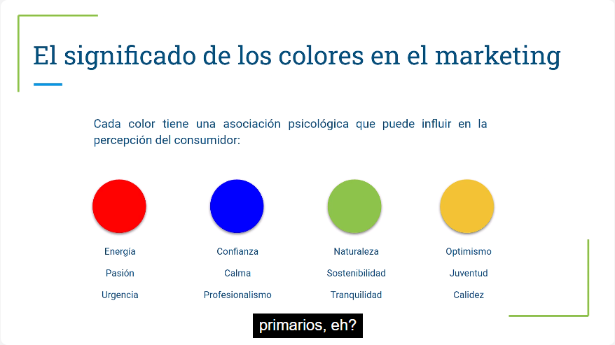
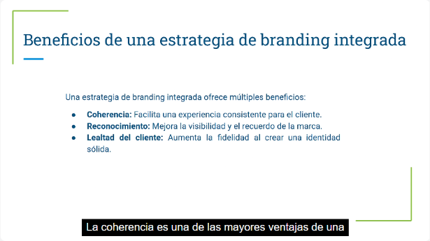
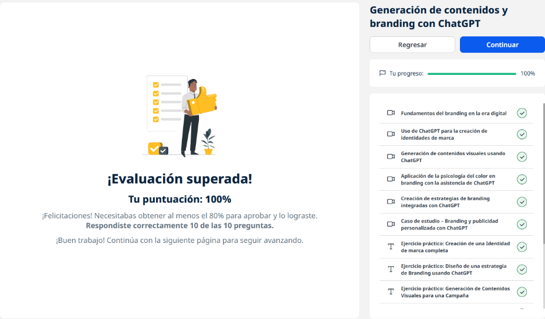
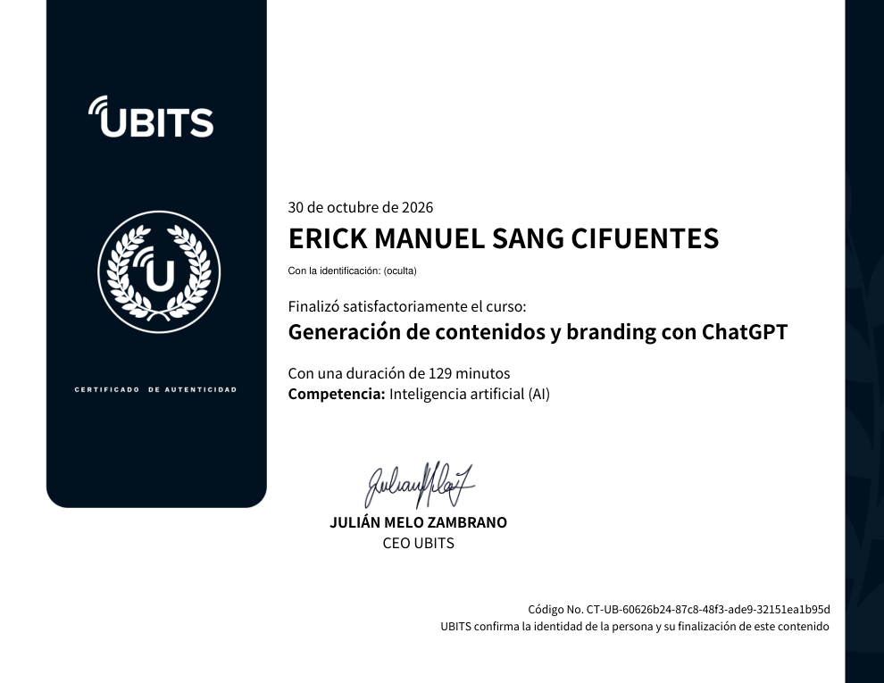

# 13 · Generación de contenidos y branding con ChatGPT

**Plataforma:** UBITS · **Duración:** 129 min · **Nivel:** intermedio · **Resultado:** test aprobado con 10/10 (100 %)

Es la unidad 4 de la serie. Construye la marca de una **ropa sostenible para jóvenes** de principio a fin con ChatGPT:

- identidad;
- contenido visual;
- psicología del color;
- estrategia integrada;
- un caso real de personalización.

Todo se trabaja **en el mismo chat**, para que el modelo conserve el contexto. Son 6 videos (unos 52 min), 3 ejercicios y 2 lecturas.

## 1. Branding en la era digital

**Qué es el branding:** mucho más que un logo. Es cómo una marca construye su identidad en la mente del consumidor para ser **reconocida, recordada y preferida**.

**Del modelo tradicional al digital:**

- **Antes:** televisión y medios impresos.
- **Ahora:** redes sociales, marketing de contenidos y anuncios en línea, con interacción constante y en tiempo real.

*Video 1, min 1:50: los componentes clave de una identidad de marca.*

**Componentes:**

- **nombre:** el primer contacto, fácil de recordar;
- **logotipo y colores:** la personalidad de la marca;
- **mensaje y tono de voz.**

**Principios:**

- **coherencia** en todos los puntos de contacto;
- **conexión emocional:** genera lealtad y recomendación;
- **autenticidad:** el consumidor actual busca marcas genuinas.

## 2. Identidad de marca con ChatGPT

**Paso 1: misión, visión y valores.**

- El prompt pide la identidad de una marca de ropa sostenible para jóvenes conscientes, con lenguaje positivo y accesible.
- **Valores obtenidos:** sostenibilidad auténtica, transparencia ética y creatividad con propósito.

*Video 2, min 1:20: la misión, la visión y los valores generados.*

**Paso 2: eslogan.**

- Se piden **tres opciones** breves, memorables y con propósito.
- Ejemplos: «Vístete de conciencia», «Moda que cuida el planeta y tu estilo», «El futuro se lleva puesto».

**Paso 3: guía de tono y voz.**

- Formal o informal, según el canal: redes, correo y sitio web.
- Ejemplos de frases con empatía, cercanía y autenticidad.

## 3. Contenido visual

**Concepto de un anuncio para redes:**

- **Colores:** naturales (verde musgo, beige, blanco roto, toques de azul cielo).
- **Fotografía:** jóvenes en la naturaleza, con luz suave y cálida. Sirve de guía para la sesión de fotos o video.
- **Elementos gráficos:** líneas orgánicas, hojas y textura de papel reciclado.
- **Composición:** frase arriba, imagen central y llamado a la acción abajo.

**Llamado a la acción para jóvenes:** «Descubre más» funciona mejor que «Haz clic aquí».

*Video 3, min 10:00: tipografía, inspiración visual y texturas propuestas para la campaña.*

**Logotipo:** ChatGPT, con generación de imágenes integrada, sirve para explorar ideas. El logotipo final conviene encargarlo a un **diseñador**.

## 4. Psicología del color

*Video 4, min 1:15: asociaciones de los colores principales.*

| Color | Asociación | Uso típico |
|---|---|---|
| **Rojo** | Energía, pasión, urgencia | Coca-Cola, promociones |
| **Azul** | Confianza, calma, profesionalismo | Finanzas, tecnología, salud (Facebook) |
| **Verde** | Naturaleza, sostenibilidad, tranquilidad | Starbucks, marcas ecológicas |
| **Amarillo / naranja** | Optimismo, juventud, calidez; el naranja **abre el apetito** | Restaurantes, alimentos |

**Uso con ChatGPT:**

- generar una paleta desde cero;
- o **evaluar la efectividad** de la paleta existente para una campaña y un público concretos.

**Por industria:**

- tecnología: azul y gris (innovación, seguridad);
- alimentos: colores cálidos.

## 5. Estrategia de branding integrada

**Qué es:** una imagen **unificada** en todos los puntos de contacto, en lugar de piezas sueltas.

*Video 5, min 1:10: los beneficios de una estrategia integrada.*

**Elementos:**

- identidad visual (logo, colores, tipografía);
- mensaje central;
- experiencia del cliente.

**Beneficios:**

- **coherencia;**
- **reconocimiento;**
- **lealtad.**

**Pasos:**

1. definir la identidad (misión, visión, valores);
2. crear el mensaje;
3. fijar directrices de comunicación y experiencia;
4. aplicar todo con consistencia en cada canal.

**Experiencia por punto de contacto:**

- ChatGPT describe el tono, el estilo visual y el tipo de contenido para redes, sitio web y tienda en línea;
- incluso para la tienda física, como guía para capacitar al personal.

**Ejemplos de marcas integradas:**

- Apple: minimalismo e innovación;
- Nike: motivación;
- Amazon: rapidez y conveniencia.

## 6. Caso de estudio: L'Oréal

**Qué hace:** usa IA para analizar el comportamiento, las preferencias y las necesidades de cada cliente, y **personaliza los mensajes y las recomendaciones**.

**Resultados:**

- más satisfacción y fidelidad;
- campañas personalizadas con mejor retorno;
- posicionamiento como marca innovadora.

**Lección:** la personalización fortalece la relación marca-cliente, siempre con **transparencia en el uso de datos** para no resultar invasiva.

## Ejercicios prácticos

1. **Identidad completa** de una marca ficticia de cuidado personal ecológico:
    - misión y visión;
    - 3 valores;
    - estilo visual (paleta, logo y tipografía, con un prompt);
    - eslogan.
2. **Estrategia de branding** con ChatGPT: mensaje, directrices y experiencia por canal.
3. **Campaña visual** con prompts en ChatGPT y DALL·E para generar ideas y piezas gráficas.

## Evaluación (10/10)

1. Lo que **no** forma parte de una estrategia integrada → **las promociones de descuento constantes**.
2. Un beneficio de la estrategia integrada → **mayor coherencia en la imagen de marca**.
3. La función de la personalización → **adaptar la experiencia a las preferencias de cada cliente**.
4. La IA que personaliza en tiempo real → **los motores de recomendación de productos**.
5. Para qué sirve el análisis de sentimiento en redes → **ajustar el tono según la respuesta de la audiencia**.
6. La ventaja de los chatbots en atención → **respuestas rápidas y personalizadas**.
7. Qué es la coherencia en la personalización → **alinearla con los valores y el mensaje de la marca**.
8. Personalizar en redes → **adaptar el contenido a segmentos específicos de seguidores**.
9. Cómo evitar que la personalización sea invasiva → **con transparencia en el uso de datos**.
10. La ventaja de los anuncios personalizados en tiempo real → **adaptarse al contexto actual del usuario**.

## Evidencia

*Curso al 100 % y test superado con 10 de 10.*

## Fuentes y aviso legal

- **Fuente:** curso «Generación de contenidos y branding con ChatGPT» de la plataforma [UBITS](https://www.ubits.com), asignado dentro de un plan de formación empresarial.
- **Uso:** apuntes personales de estudio, sin fines comerciales y con redacción propia. Las capturas son fragmentos breves citados con fines educativos; sus derechos son de sus titulares.
- **Sin afiliación:** sitio no oficial, no afiliado ni respaldado por UBITS, OpenAI ni las marcas mencionadas. Las marcas pertenecen a sus dueños.
- Más detalles y cómo pedir el retiro de contenido en el [aviso legal](../../aviso-legal.md).
