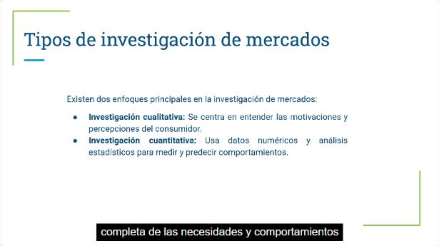
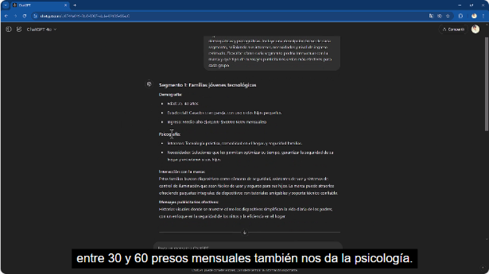
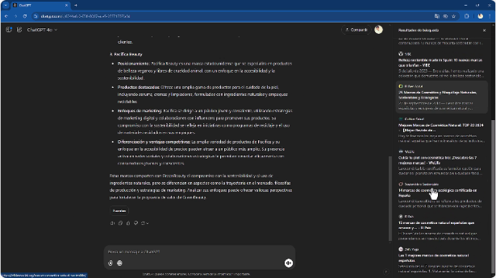
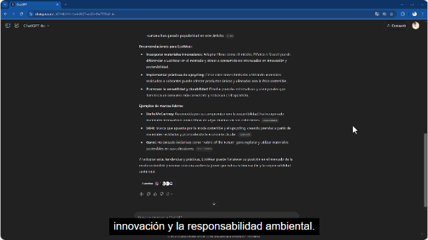
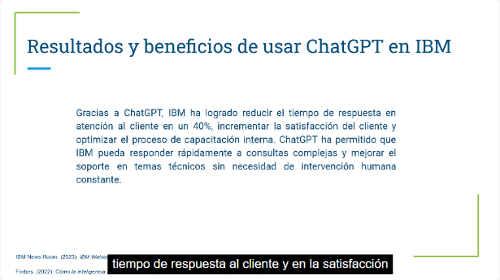
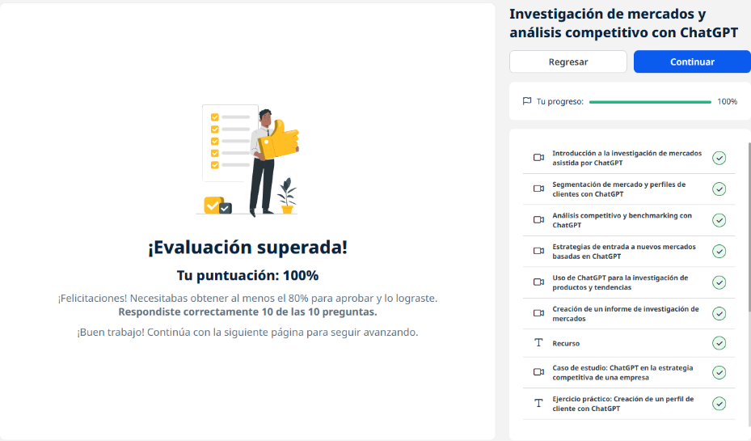
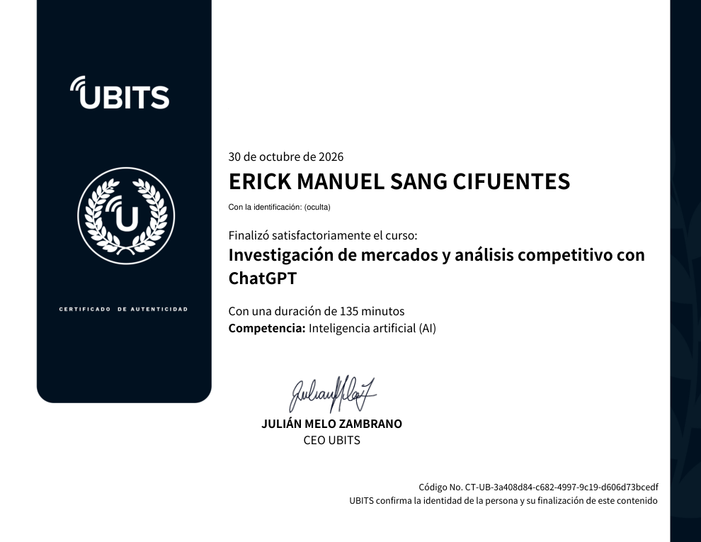

# 14 · Investigación de mercados y análisis competitivo con ChatGPT

**Plataforma:** UBITS · **Duración:** 135 min · **Nivel:** intermedio · **Resultado:** test aprobado con 10/10 (100 %)

Es la unidad 5 de la serie. Usa ChatGPT, con **búsqueda web y fuentes citadas**, para investigar mercados:

- segmentar y perfilar clientes;
- analizar la competencia;
- evaluar la entrada a otro país;
- detectar tendencias;
- redactar un informe.

Son 7 videos (unos 50 min), un recurso en Excel, 3 ejercicios y 2 lecturas.

## 1. Introducción a la investigación de mercados

**Para qué sirve:** entender necesidades y deseos, encontrar oportunidades y ajustar productos y estrategias. Sin ella, las decisiones son más riesgosas.

*Video 1, min 1:40: los dos enfoques.*

**Los dos enfoques**, que se complementan:

- **cualitativo:** motivaciones y percepciones;
- **cuantitativo:** datos numéricos para medir y predecir.

**Qué cambia la IA:**

- **Antes:** encuestas, entrevistas y grupos focales.
- **Ahora:** análisis de grandes volúmenes **en tiempo real**.
- **Cómo ayuda ChatGPT:**
    - diseñar encuestas;
    - analizar opiniones y comentarios (**datos cualitativos**);
    - encontrar patrones;
    - crear perfiles.

## 2. Segmentación y perfil de cliente

**Segmentos para una marca de hogar inteligente:**

- **Variables:** demográficas y **psicográficas**.
- **Para cada segmento:** intereses, necesidades, ingreso estimado, cómo interactúa con la marca y qué mensaje publicitario funciona.
- **Los segmentos:**
    - familias jóvenes tecnológicas;
    - profesionales solteros digitales;
    - adultos mayores independientes.

*Video 2, min 1:15: el primer segmento con su demografía, psicografía, interacción y mensajes.*

**Truco:** pedir una **lista larga de intereses** para cargarla a mano en el administrador de anuncios.

**Perfil de cliente ideal (moda ecológica):**

- 28–45 años, profesionales creativos o tecnológicos;
- **intereses:** sostenibilidad, calidad;
- **hábitos:** compran en línea, leen reseñas, son fieles a marcas con misión y evitan el empaque excesivo;
- **esperan:** transparencia y comunicación personalizada.

## 3. Análisis competitivo y benchmarking

**Identificar competidores** de «Green Beauty», cosmética natural para mujeres de 20 a 35 años:

- ChatGPT **busca en internet** y propone tres competidores reales;
- de cada uno da posicionamiento, productos estrella, marketing, diferencias y ventajas;
- **cita las fuentes**, y se puede acotar por país o ciudad.

*Video 3, min 2:20: el análisis de un competidor con el panel de fuentes consultadas.*

**Fortalezas y debilidades frente a competidores conocidos:**

- **Áreas:** calidad, precio, alcance, reputación y sostenibilidad.
- **Con ejemplo en el prompt:** «si un competidor es caro, ¿cómo comunicamos nuestro valor?».

**Benchmarking:** comparar el rendimiento propio con el de los competidores.

## 4. Entrada a nuevos mercados

**Caso:** «EcoWear», moda sostenible con presencia en EE. UU. y Canadá, evalúa **entrar a Alemania**.

**Método del prompt:** primero un párrafo de **contexto**; luego, la **instrucción**.

**Qué analizó:**

- la demanda;
- los competidores locales;
- las barreras regulatorias y culturales;
- los hábitos de consumo.

**Recomendaciones:**

- obtener **certificaciones locales** de sostenibilidad, algo que no era obvio;
- adaptar las campañas;
- aliarse con organizaciones locales;
- ser transparente en la cadena de suministro.

**Segundo ejercicio:** adaptar el mensaje de la marca al nuevo mercado.

## 5. Productos y tendencias

**Tendencias en moda sostenible:**

- **materiales:** micelio, piña, algas, cáñamo y lino;
- **estilos:** *upcycling*, minimalismo, economía circular.

*Video 5, min 2:50: recomendaciones para la marca y ejemplos de marcas líderes, con sus fuentes.*

**Recomendaciones para la marca:**

- incorporar materiales nuevos;
- crear líneas de *upcycling*;
- promover la durabilidad.

## 6. Informe de investigación de mercados

**Resumen ejecutivo:**

- hallazgos: tendencias, segmentos y preferencias de compra;
- oportunidades;
- recomendaciones: digital, diversificación, transparencia, fidelización verde y alianzas.

**Análisis con datos propios:**

- se carga un Excel de consumidores, **anonimizado**, con edad, género, ubicación, frecuencia, material, estilo, interés en sostenibilidad y canal;
- se pide el análisis de tendencias con estadísticas.

## 7. Caso de estudio: IBM

**Estrategia:**

- la IA como pilar competitivo;
- Watson con un enfoque de **IA explicable**, que aumenta la confianza.

**Uso de ChatGPT:**

- creación de contenido;
- respuestas técnicas;
- capacitación;
- documentación;
- atención al cliente.

*Video 7, min 2:10: resultados reportados.*

**Resultados:** respuesta al cliente **40 % más rápida**, más satisfacción y una capacitación interna optimizada.

## Herramientas complementarias

| Herramienta | Uso |
|---|---|
| **SimilarWeb** | Tráfico web de los competidores |
| **SEMrush** | Palabras clave que atraen tráfico a los competidores |
| **Brandwatch / Sprout Social** | Escucha social y menciones de marca |
| **Análisis de sentimiento** | Emociones y opiniones del consumidor en tiempo real |
| **Análisis predictivo** | Anticipar las necesidades del consumidor |

## Ejercicios prácticos

1. **Perfil de cliente con ChatGPT.**
2. **Informe de investigación de mercados.**
3. **Análisis competitivo.**

## Evaluación (10/10)

1. La segmentación impulsada por IA → **es en tiempo real e incluye factores psicográficos y de comportamiento**.
2. La técnica para anticiparse al consumidor → **el análisis predictivo**.
3. La ventaja de la IA en menciones sociales → **analiza el sentimiento en tiempo real**.
4. Qué es el benchmarking → **comparar el rendimiento propio con el de los competidores**.
5. La herramienta para el tráfico web de competidores → **SimilarWeb**.
6. El análisis de palabras clave (SEMrush) → **identifica las palabras que atraen tráfico a los competidores**.
7. La ventaja de segmentar en tiempo real → **la segmentación se actualiza sola según el comportamiento**.
8. Para qué sirve el análisis de sentimiento → **entender emociones y opiniones sobre la marca**.
9. El propósito de ChatGPT en la investigación → **analizar datos cualitativos como opiniones y comentarios**.
10. Un desafío ético → **la recolección de datos que puede comprometer la privacidad**.

## Evidencia

*Curso al 100 % y test superado con 10 de 10.*

## Fuentes y aviso legal

- **Fuente:** curso «Investigación de mercados y análisis competitivo con ChatGPT» de la plataforma [UBITS](https://www.ubits.com), asignado dentro de un plan de formación empresarial. Las marcas de los ejercicios son ficticias.
- **Uso:** apuntes personales de estudio, sin fines comerciales y con redacción propia. Las capturas son fragmentos breves citados con fines educativos; sus derechos son de sus titulares.
- **Sin afiliación:** sitio no oficial, no afiliado ni respaldado por UBITS, OpenAI ni las empresas mencionadas. Las marcas pertenecen a sus dueños.
- Más detalles y cómo pedir el retiro de contenido en el [aviso legal](../../aviso-legal.md).
