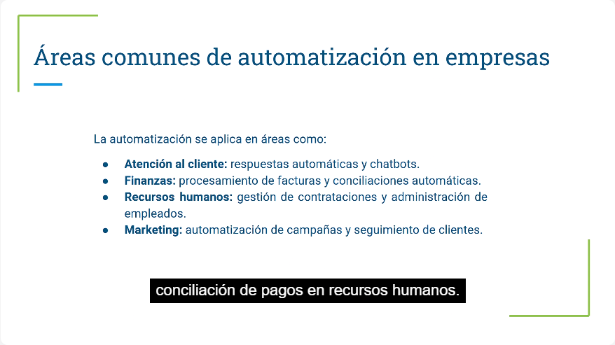
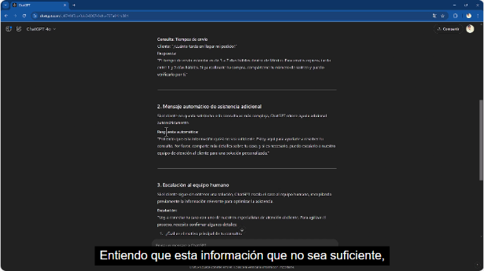
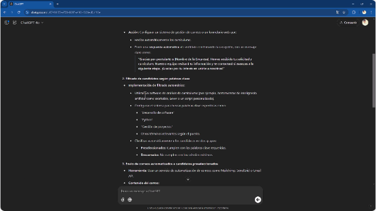
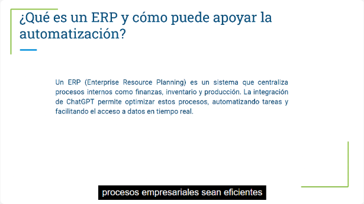
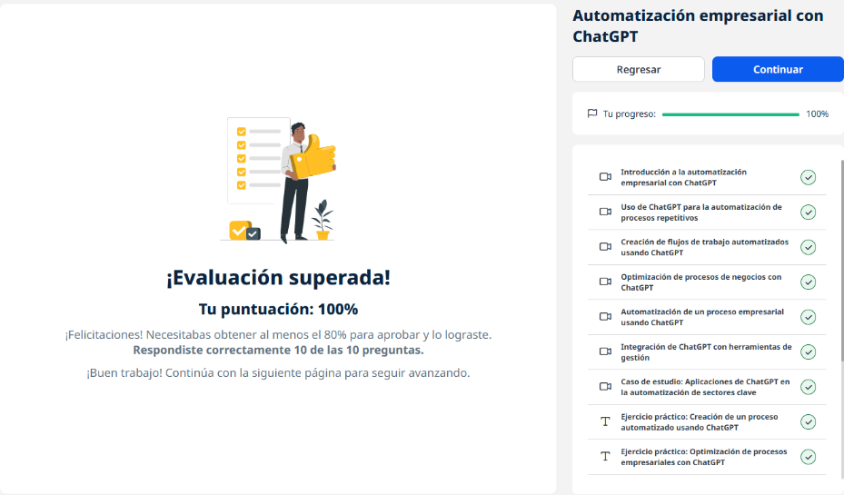
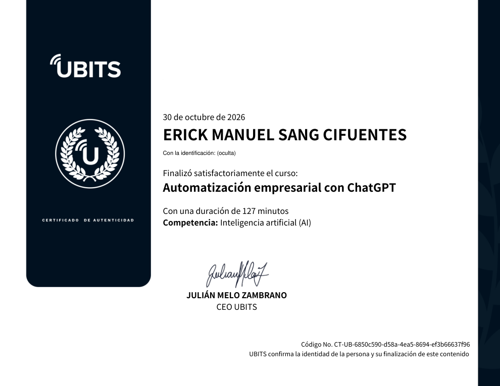

# 15 · Automatización empresarial con ChatGPT

**Plataforma:** UBITS · **Duración:** 127 min · **Nivel:** intermedio · **Resultado:** test aprobado con 10/10 (100 %)

Es la unidad 6 de la serie. Muestra cómo usar ChatGPT para **diseñar** automatizaciones:

- respuestas a preguntas frecuentes;
- flujos con escalamiento a una persona;
- optimización de procesos;
- contratación;
- integración con CRM y ERP.

**Aclaración del instructor:** el curso trabaja la parte de ingeniería de prompts, es decir, generar el contenido y el diseño del flujo. La conexión técnica entre sistemas es otro paso.

Son 7 videos (unos 55 min), 3 ejercicios y 2 lecturas.

## 1. Qué es la automatización empresarial

**Qué es:** usar tecnología para ejecutar tareas que de otro modo requieren intervención humana, desde un recordatorio hasta procesos entre varias áreas.

**Beneficios:**

- menos costos operativos;
- **menos errores**;
- más consistencia;
- tiempo libre para el trabajo estratégico.

*Video 1, min 2:10: dónde se aplica la automatización.*

| Área | Ejemplos |
|---|---|
| **Atención al cliente** | Respuestas automáticas y chatbots |
| **Finanzas** | Procesar facturas y conciliar pagos |
| **Recursos humanos** | Contrataciones y administración de empleados |
| **Marketing** | Campañas programadas y seguimiento personalizado |

**Límites de ChatGPT:**

- la precisión depende de los datos que recibe;
- no hace tareas físicas;
- es limitado en decisiones complejas;
- **siempre requiere supervisión**.

## 2. Procesos repetitivos: preguntas frecuentes

**El caso:** una tienda en línea quiere respuestas automáticas sobre **métodos de pago, devoluciones y tiempos de envío**.

**Lo que entrega ChatGPT:** una **plantilla**.

**Lo que hay que hacer:** **editarla con los datos reales** del negocio. Si no se acepta American Express o no hay pago en efectivo, se corrige. Sin ese paso, el chatbot daría información falsa.

## 3. Flujos de trabajo automatizados

**El caso:** atención al cliente de una tienda de moda en tres niveles.

*Video 3, min 2:30: mensaje de asistencia adicional y escalamiento al equipo humano.*

1. **Respuesta inicial** a las consultas comunes: productos, devoluciones, envíos.
2. **Mensaje de asistencia adicional** si el cliente no quedó satisfecho.
3. **Escalamiento a una persona**, con la información relevante ya reunida.

**Regla:** las respuestas deben ser claras y breves, y **escalar solo cuando hace falta**.

## 4. Optimizar procesos de negocio

**El caso:** una tienda de tecnología pierde ventas por respuestas lentas y faltantes de inventario.

| Ineficiencia | Recomendación |
|---|---|
| Respuestas lentas | Chat en vivo, mejor posventa |
| Productos agotados | **Alertas de inventario** y avisos de reposición al cliente |
| Sin seguimiento a prospectos | Correos de **carrito abandonado**, segmentación |
| Pago complejo | Simplificarlo y optimizarlo para móvil |
| Sin estado del pedido | Seguimiento en tiempo real y notificaciones |

**Consejos:**

- con el **paso a paso real** del proceso de ventas, el análisis es mucho más preciso;
- ChatGPT a veces ofrece **dos respuestas** para elegir la mejor.

## 5. Automatizar la contratación

*Video 5, min 2:20: recepción, filtrado por palabras clave y correos automatizados.*

1. **Recepción:** formulario o correo dedicado, con **acuse automático**.
2. **Filtrado** por palabras clave del CV (desarrollo de software, Python, gestión de proyectos): candidatos preseleccionados y descartados.
3. **Invitación** por correo automatizado, con enlace para agendar.
4. **Confirmación** automática de la entrevista con herramientas de agenda como Calendly o Microsoft Bookings.
5. **Evaluación y retroalimentación.**

## 6. Integración con herramientas de gestión

| Sistema | Qué es | Qué aporta ChatGPT |
|---|---|---|
| **CRM** | Información y relación con los clientes: historial, preferencias, comunicaciones | Notificaciones y respuestas **personalizadas según el historial**, pedir opinión después de la compra |
| **ERP** | Procesos internos: finanzas, inventario, recursos humanos, producción | Reportes de inventario, disponibilidad en tiempo real, **pedidos de reposición automáticos** |

*Video 6, min 1:40: el ERP y cómo apoya la automatización.*

## 7. Casos por sector

*Video 7, min 1:00: el ejemplo de comercio electrónico.*

| Empresa | Sector | Uso |
|---|---|---|
| **H&M** | Retail y atención | Devoluciones, horarios, disponibilidad; menos espera |
| **Shopify** | Comercio electrónico | Recomendaciones y asistencia en la compra: **más conversión, menos carritos abandonados** |
| **American Express** | Finanzas | Saldos, transacciones, recompensas; el personal se enfoca en lo complejo |

## Buenas prácticas y riesgos

- **IA colaborativa:** ChatGPT **complementa** el trabajo humano, no lo sustituye.
- **Probar y ajustar** los flujos antes de implementarlos del todo.
- **Supervisar** los resultados.
- **Riesgos:**
    - **dependencia de datos precisos y actualizados;**
    - automatizar de más **frustra** a los clientes que necesitan una respuesta personalizada.
- **Privacidad y protección de datos** del cliente.

## Ejercicios prácticos

1. **Proceso automatizado** con ChatGPT.
2. **Optimizar** un proceso empresarial.
3. **Flujo de trabajo** diseñado con su ayuda.

## Evaluación (10/10)

1. Un beneficio clave → **menos errores humanos**.
2. El área donde más se automatizan las preguntas frecuentes → **atención al cliente**.
3. Un desafío de la automatización avanzada → **la dependencia de datos precisos y en tiempo real**.
4. Qué permite la integración con un CRM → **personalizar la interacción con los clientes**.
5. Un caso de automatización en recursos humanos → **responder consultas sobre beneficios**.
6. Qué es la «IA colaborativa» → **complementa el trabajo humano en flujos complejos**.
7. Una buena práctica → **probar y ajustar los flujos antes de implementarlos del todo**.
8. El sector que la usa para inventario y disponibilidad → **comercio electrónico**.
9. Un límite de la automatización excesiva → **frustra a quien necesita una respuesta personalizada**.
10. La clave de seguridad → **la privacidad y protección de los datos del cliente**.

## Evidencia

*Curso al 100 % y test superado con 10 de 10.*

## Fuentes y aviso legal

- **Fuente:** curso «Automatización empresarial con ChatGPT» de la plataforma [UBITS](https://www.ubits.com), asignado dentro de un plan de formación empresarial.
- **Uso:** apuntes personales de estudio, sin fines comerciales y con redacción propia. Las capturas son fragmentos breves citados con fines educativos; sus derechos son de sus titulares.
- **Sin afiliación:** sitio no oficial, no afiliado ni respaldado por UBITS, OpenAI ni las empresas mencionadas. Las marcas pertenecen a sus dueños.
- Más detalles y cómo pedir el retiro de contenido en el [aviso legal](../../aviso-legal.md).
