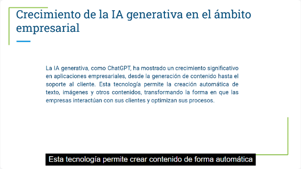
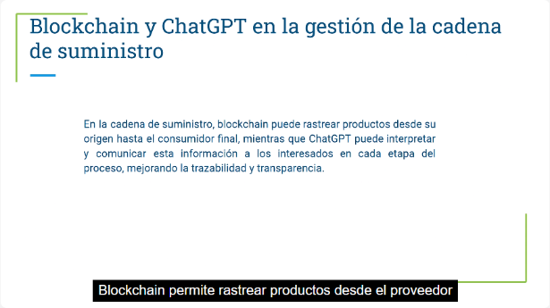
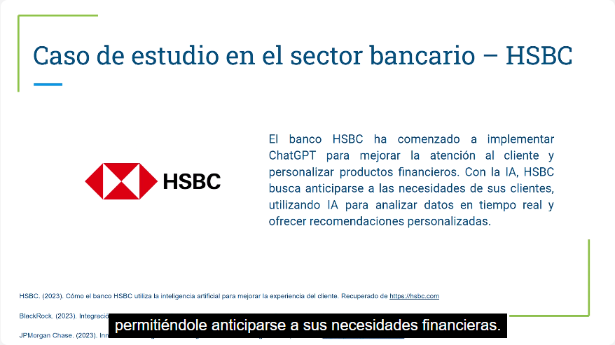
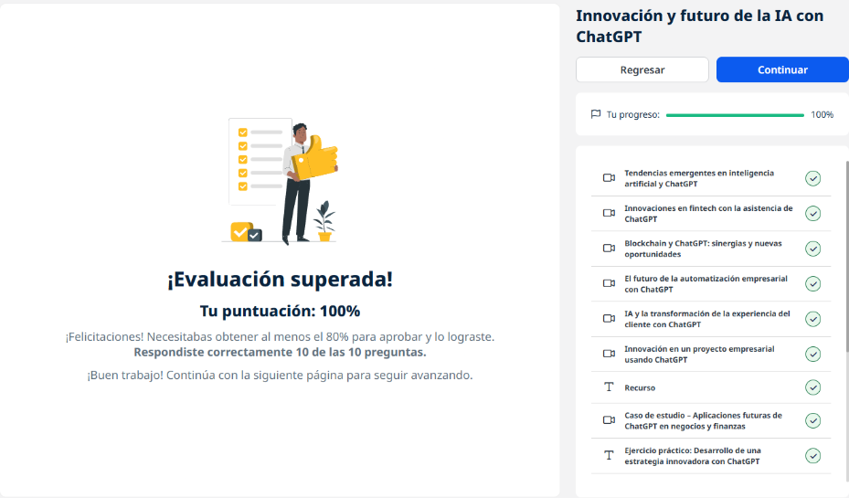
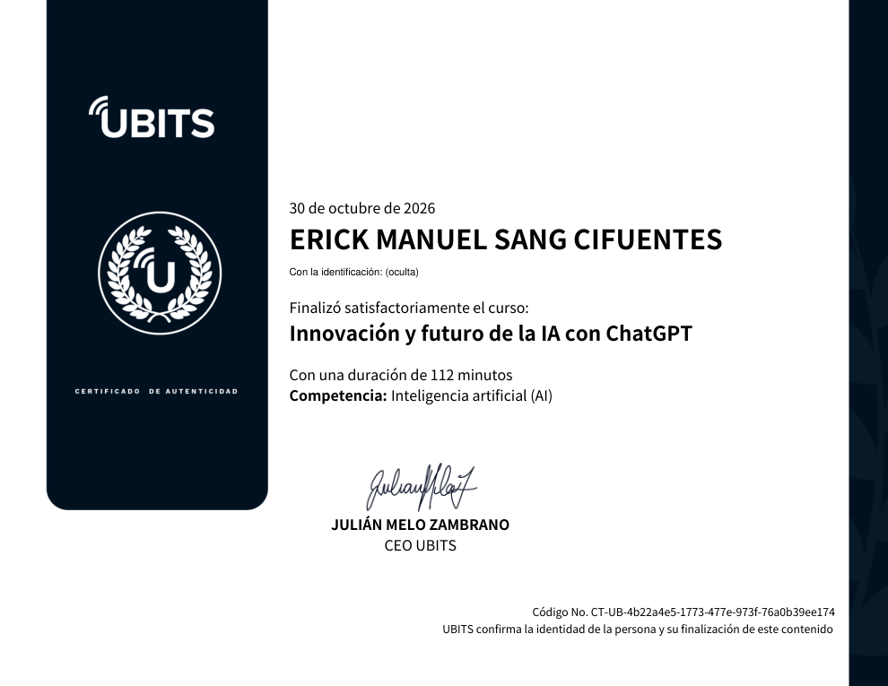

# 16 · Innovación y futuro de la IA con ChatGPT

**Plataforma:** UBITS · **Duración:** 112 min · **Nivel:** intermedio · **Resultado:** test aprobado con 10/10 (100 %)

Es la unidad 7 de la serie. Mira hacia adelante: tendencias de la IA, fintech, la sinergia con **blockchain**, el futuro de la automatización, la experiencia del cliente y cómo usar ChatGPT para **generar y evaluar ideas de innovación**. Son 7 videos (unos 40 min), un recurso, 3 ejercicios y 2 lecturas.

## 1. Tendencias emergentes

*Video 1, min 1:00: crecimiento de la IA generativa en las empresas.*

**Las tendencias:**

- **IA generativa:** crea texto, imágenes y otros contenidos; cambia la comunicación, el servicio al cliente y el marketing.
- **Personalización:** ajusta el tono y la información según el historial de cada cliente, y eso genera fidelidad.
- **Análisis de datos en tiempo real:** decisiones más rápidas.
- **Automatización de tareas rutinarias:** menos costo y más foco en lo valioso.
- **Decisiones con análisis predictivo:** ChatGPT explica escenarios y recomendaciones.

**El contrapeso:** **ética**, privacidad y transparencia en las decisiones automatizadas, con políticas claras.

## 2. Innovación en fintech

- **Soporte automatizado 24/7:** cuentas, transacciones y preguntas frecuentes.
- **Recomendaciones personalizadas** según el comportamiento financiero: más satisfacción y más conversión.
- **Análisis predictivo del riesgo crediticio** con datos históricos, explicado de forma comprensible, lo que da más transparencia.
- **Gestión de cuentas automatizada:** alertas, presupuestos y recordatorios.

## 3. Blockchain y ChatGPT

**Qué aporta cada uno:**

- **Blockchain:** registros **inmutables y transparentes**, cada transacción verificable y menos fraude.
- **ChatGPT:** **traduce** esos registros complejos a lenguaje comprensible, sin necesidad de saber de tecnología.

**Dónde se combinan:**

- **Contratos inteligentes:** se ejecutan al cumplirse condiciones. ChatGPT notifica su estado y explica cada etapa.
- **Cadena de suministro:** blockchain rastrea el producto desde el proveedor hasta el consumidor, y ChatGPT comunica esa trazabilidad a cada actor.

*Video 3, min 2:10: trazabilidad con blockchain, interpretada por ChatGPT.*

## 4. El futuro de la automatización

**La evolución:** de tareas repetitivas a **procesos complejos** con lenguaje natural, grandes volúmenes de datos y adaptación al usuario.

**Personalización:** va más allá de lo básico y crea relaciones más cercanas.

**Optimización continua:** los flujos se ajustan **en tiempo real** cuando cambia la operación.

**IA colaborativa:**

- automatizar no significa eliminar a las personas;
- los empleados delegan lo repetitivo y se enfocan en lo estratégico.

## 5. Experiencia del cliente

**Cómo la mejora ChatGPT:**

- **Personalización** según el historial: recomienda según compras e intereses previos.
- **Velocidad:** respuestas casi instantáneas y muchas consultas a la vez.
- **Atención inmediata:** horarios, devoluciones y productos, con **paso a una persona** cuando el caso es complejo.
- **Omnicanalidad:** sitio web, redes y apps con soporte consistente.

**Resultado:** atención rápida, personalizada y efectiva, que hace que el cliente vuelva.

## 6. Innovación en un proyecto empresarial

**Generar ideas:**

- **El prompt:** «Eres consultor de innovación en electrónicos…» pide cinco ideas con su implementación e impacto.
- **Ideas obtenidas:**
    - IA para personalización avanzada;
    - electrónicos modulares y reparables;
    - energía sustentable integrada;
    - mantenimiento predictivo;
    - realidad aumentada.

**Uso recomendado:** como punto de partida de una sesión de lluvia de ideas con el equipo.

**Evaluar la viabilidad:**

- Se carga un Excel con las ideas del equipo: idea, objetivo y área.
- ChatGPT estima para cada una el **costo**, el **tiempo**, los **recursos** y el **impacto** en la satisfacción y los ingresos.
- **Por qué importa:** muchas ideas brillantes no caben en el presupuesto.

**Ojo con el contexto:** ChatGPT arrastra instrucciones de chats previos (por ejemplo, «solo cinco ideas»). Hay que aclarárselo para que analice todas.

## 7. Caso de estudio: aplicaciones futuras en finanzas

*Video 7, min 1:00: HSBC y la personalización con IA.*

| Empresa | Uso |
|---|---|
| **HSBC** | Analiza datos del cliente en tiempo real para **anticiparse a sus necesidades** y personalizar productos |
| **BlackRock** | Análisis rápido de precios y cambios económicos para ajustar estrategias de inversión |
| **JPMorgan** | **Detección temprana de riesgos** con datos históricos y eventos globales |

## Ejercicios prácticos

1. **Estrategia innovadora** con ChatGPT.
2. **Implementar ChatGPT** en un proyecto innovador.
3. **Evaluar nuevas oportunidades** con ChatGPT.

## Evaluación (10/10)

1. Una aplicación principal en finanzas → **personalizar servicios y la atención al cliente**.
2. Qué optimiza la experiencia del cliente → **personalizar según el historial**.
3. El sector que la usa para citas y síntomas comunes → **salud**.
4. La ventaja de automatizar lo repetitivo → **libera tiempo para lo estratégico**.
5. Qué permite el análisis predictivo en finanzas → **prever cambios en el comportamiento del cliente**.
6. Un reto ético → **la transparencia y el manejo ético de los datos**.
7. Qué permite el PLN → **interacciones que simulan una conversación humana**.
8. Una tendencia futura → **la colaboración entre personas e IA**.
9. Su beneficio en el desarrollo de productos → **analizar datos de clientes para diseñar productos**.
10. Lo clave en la experiencia del cliente → **respuestas personalizadas y relevantes en tiempo real**.

## Evidencia

*Curso al 100 % y test superado con 10 de 10.*

## Fuentes y aviso legal

- **Fuente:** curso «Innovación y futuro de la IA con ChatGPT» de la plataforma [UBITS](https://www.ubits.com), asignado dentro de un plan de formación empresarial.
- **Uso:** apuntes personales de estudio, sin fines comerciales y con redacción propia. Las capturas son fragmentos breves citados con fines educativos; sus derechos son de sus titulares.
- **Sin afiliación:** sitio no oficial, no afiliado ni respaldado por UBITS, OpenAI ni las entidades mencionadas. Las marcas pertenecen a sus dueños. No es asesoría financiera.
- Más detalles y cómo pedir el retiro de contenido en el [aviso legal](../../aviso-legal.md).
