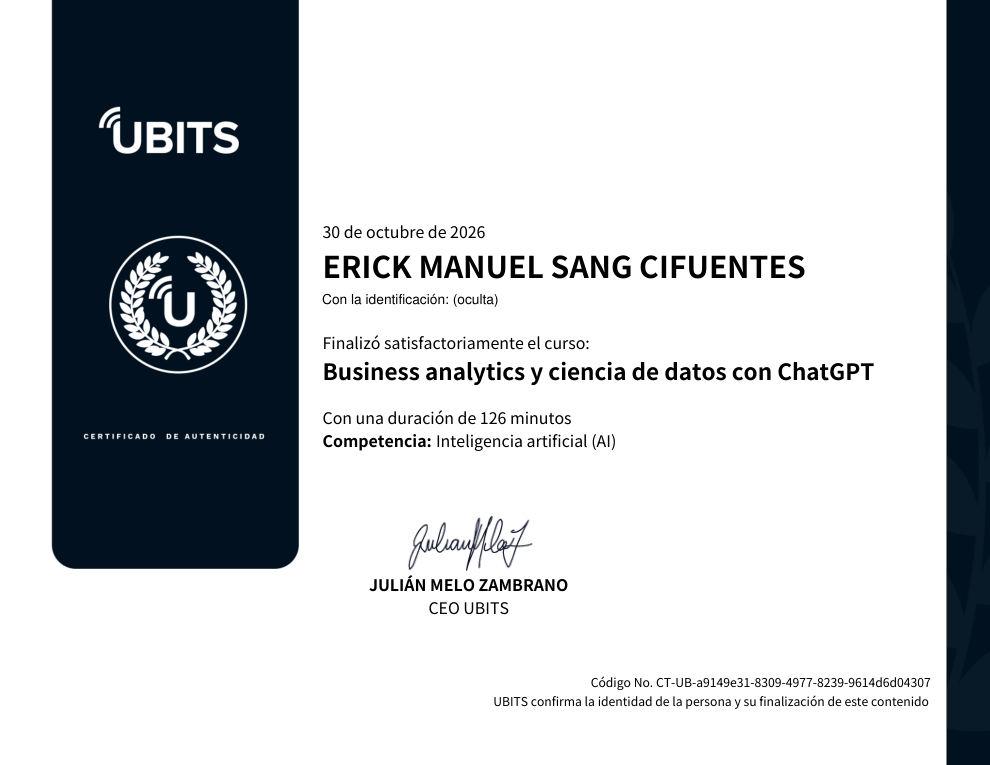

# 17 · Business analytics y ciencia de datos con ChatGPT

**Plataforma:** UBITS · **Duración:** 126 min · **Nivel:** intermedio · **Resultado:** test aprobado con 10/10 (100 %) · **Fecha:** 30 oct 2026

Vi los 8 videos completos (unos 54 min de video) y hice los 3 ejercicios prácticos y las 2 lecturas. Estos son mis apuntes.

## 1. Business analytics asistido por ChatGPT

El análisis de datos tiene tres niveles. Cada uno responde a una pregunta distinta:

| Nivel | Pregunta | Ejemplo |
|---|---|---|
| **Descriptivo** | ¿Qué pasó? | Reporte de ventas del trimestre |
| **Predictivo** | ¿Qué va a pasar? | Proyección de demanda a 6 meses |
| **Prescriptivo** | ¿Qué debo hacer? | Recomendación de ajustar el inventario |

**Qué aporta ChatGPT:**

- **Accesibilidad:** explica métricas complejas en lenguaje sencillo, también para equipos no técnicos.
- **Velocidad:** produce análisis iniciales y reportes en minutos.
- **Flexibilidad:** se adapta a ventas, demanda, costos o clientes con solo cambiar el prompt.

**Límites:**

- No reemplaza al analista; lo apoya.
- Rinde peor con datos muy complejos, no estructurados o de mala calidad.
- Antes de pedirle algo, hay que preparar los datos: quitar duplicados, tratar los vacíos y dar una estructura clara.

## 2. Técnicas de análisis predictivo

- **Pronóstico de demanda:** a partir de las ventas históricas se le pide una proyección a 6 meses y los factores que más influyen.
- **Comportamiento de clientes:** busca patrones de recompra y propone estrategias de retención:
    - segmentación;
    - programas de fidelización;
    - venta cruzada (*cross-selling*, otro producto complementario) frente a venta adicional (*upselling*, una versión mejor del mismo).
- **Riesgo financiero:** interpreta el flujo de caja y los indicadores de liquidez y endeudamiento.
- **Regla clave:** las predicciones de ChatGPT son *insights* iniciales. Hay que contrastarlas con modelos estadísticos y con criterio de negocio.

## 3. Series temporales

Una serie temporal es un dato medido en el tiempo. Hay que separar dos cosas:

- **Tendencia:** la dirección general, que sube o baja.
- **Estacionalidad:** patrones que se repiten. Por ejemplo, el pico de diciembre.

**Usos que vi:**

- **Planear inventario** antes de los picos estacionales.
- **Proyectar fluctuaciones de precio** de insumos o productos.

## 4. Segmentación y clustering

- **Segmentación simple** por frecuencia de compra: clientes frecuentes, moderados y ocasionales.
- **Clustering** con varias variables a la vez: categoría preferida, valor promedio de compra y frecuencia.
- **Perfil por grupo:** con cada grupo se arma un perfil detallado y se diseña una campaña específica.

## 5. ChatGPT dentro de un flujo de machine learning

ChatGPT puede apoyar cada etapa del flujo:

1. **Preparación de datos:** sugiere limpiezas y transformaciones.
2. **Ingeniería de variables (*features*)** y **análisis exploratorio (EDA)**.
3. **Entrenamiento y optimización:** propone algoritmos e hiperparámetros.
4. **Evaluación y presentación** de resultados.

Se integra por la **API de OpenAI** junto con librerías como **scikit-learn** o **TensorFlow**. Sus salidas siempre se validan.

## 6. Visualización de datos empresariales

| Necesidad | Gráfico sugerido |
|---|---|
| Evolución en el tiempo | Líneas |
| Comparar categorías o regiones | Barras agrupadas |
| Participación de un total | Torta (pocas categorías) |
| Relación entre dos variables | Dispersión |

- **Dashboards:** ChatGPT puede proponer su estructura en **Power BI** o **Tableau**, con filtros por región, periodo y categoría.
- **Narrativa:** también redacta un texto corto para cada gráfico, pensado para directivos: qué muestra y qué decisión sugiere.

## 7. Estrategias de negocio basadas en datos

**Ciclo en tres pasos:**

1. **Recolectar** datos de fuentes confiables y relevantes, como ventas históricas o comportamiento de clientes.
2. **Analizar patrones:** picos de demanda, segmentos de mercado.
3. **Traducir a estrategia** medible: ajustar el inventario, lanzar campañas personalizadas o definir KPIs claros.

**Estrategias frecuentes:**

- Enfocar el marketing en los clientes con más probabilidad de compra.
- Optimizar el inventario con la demanda prevista.
- Hacer campañas personalizadas según el comportamiento de cada cliente.

**Retos:**

- **Datos incompletos o desestructurados:** ChatGPT ayuda a plantear hipótesis iniciales.
- **Sesgo en los datos:** obliga a validar y ajustar continuamente. Esa revisión la hacen las personas, no la IA.

## 8. Caso de estudio: empresa minorista

| | Detalle |
|---|---|
| **Problemas** | Datos desorganizados, reportes que los equipos no técnicos no entendían, reportes clave que llegaban tarde |
| **Solución** | Prompts diseñados para interpretar métricas y dar recomendaciones accionables, y reportes automáticos en lenguaje natural. ChatGPT **complementó** las herramientas analíticas existentes, no las reemplazó |
| **Resultados** | Reportes más rápidos, **30 % menos errores** de interpretación y mejor colaboración entre equipos técnicos y no técnicos |
| **Lecciones** | Prompts claros y específicos, combinar con herramientas tradicionales y validar los resultados de forma continua |

## Ejercicios prácticos

1. **Modelo predictivo:** con ventas históricas por región y categoría, identificar los factores que más influyen, elegir las variables y métricas, y proyectar seis meses. Luego ajustar el modelo e interpretar qué significa para la estrategia.
2. **Segmentación de clientes:** con frecuencia de compra, categoría preferida y valor promedio, definir tres segmentos y una estrategia de retención y ventas para cada uno, con un reporte breve del impacto esperado.
3. **Dashboard:** pedir la estructura de un tablero con ventas totales, margen de utilidad y frecuencia de compra por región, implementarlo en Power BI o Tableau y acompañar cada gráfico con una narración corta.

## Lecturas

- **Business analytics y ChatGPT como catalizador:**
    - repasa los tres niveles de análisis;
    - muestra a ChatGPT como puente entre los datos y quienes deciden, porque interpreta, automatiza reportes y personaliza estrategias.
- **IA generativa en la ciencia de datos empresarial:**
    - la IA generativa apoya cada etapa: preparación, exploración, modelado y comunicación;
    - abre oportunidades, pero tiene retos de calidad de datos, sesgo y supervisión humana.

## Evaluación (10/10)

1. Un beneficio clave de ChatGPT en business analytics → **explicar datos complejos de forma clara y accesible**.
2. El modelo que prevé eventos futuros → **predictivo**.
3. Qué debe tener un buen prompt → **instrucciones claras y específicas**.
4. Herramientas de visualización que se complementan con ChatGPT → **Power BI, Tableau y Excel (todas)**.
5. La técnica que agrupa clientes con comportamientos similares → **segmentación**.
6. Cómo asegurar la precisión → **comparar con análisis tradicionales**.
7. Qué afecta negativamente los resultados → **datos incompletos o inconsistentes**.
8. El análisis que sugiere acciones → **prescriptivo**.
9. La ventaja en reportes → **automatizarlos en lenguaje claro**.
10. Una estrategia para el inventario → **proyectar la demanda con patrones históricos**.

## Evidencia

## Fuentes y aviso legal

- **Fuente:** curso «Business analytics y ciencia de datos con ChatGPT» de la plataforma [UBITS](https://www.ubits.com), asignado dentro de un plan de formación empresarial.
- **Uso:** apuntes personales de estudio, sin fines comerciales y con redacción propia. Las capturas son fragmentos breves citados con fines educativos; sus derechos son de sus titulares.
- **Sin afiliación:** sitio no oficial, no afiliado ni respaldado por UBITS ni por los aliados del curso. Las marcas pertenecen a sus dueños.
- Más detalles y cómo pedir el retiro de contenido en el [aviso legal](../../aviso-legal.md).
