# 18 · Implementación de proyectos de IA con ChatGPT

**Plataforma:** UBITS · **Duración:** 142 min · **Nivel:** intermedio · **Resultado:** test aprobado con 10/10 (100 %) · **Fecha:** 30 oct 2026

Son 10 videos (unos 70 min), 3 ejercicios y 2 lecturas. Casi todo el curso sigue un mismo caso: **TechDistribution S.A.**, una empresa ficticia mediana de logística. Con prompts a ChatGPT recorre un proyecto de IA de principio a fin, desde la idea hasta la presentación de resultados. Cada sección indica el minuto del video donde está la idea clave.

## 1. Gestión de proyectos de IA

Un proyecto de IA combina la gestión de proyectos tradicional con lo propio de una tecnología nueva. Su meta es resolver un problema concreto del negocio, no "usar IA" por usarla.

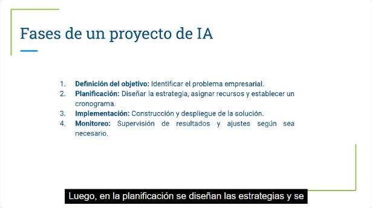
*Video 1, min 1:30: las cuatro fases del ciclo de vida.*

**Fases del ciclo de vida:**

1. **Definición del objetivo:** qué problema del negocio se va a resolver.
2. **Planificación:** estrategia, recursos y cronograma.
3. **Implementación:** construir y desplegar la solución.
4. **Monitoreo:** revisar resultados y ajustar.

**Claves de éxito:**

- datos de calidad;
- un equipo multidisciplinario;
- objetivos medibles.

**Obstáculos típicos:**

- **Pocos datos o datos sesgados.**
- **Expectativas irreales:** lo que se ve en redes sociales suele exagerar lo que la IA hace.
- **Resistencia al cambio:** pesa sobre todo por el miedo a ser reemplazado.

**Papel de ChatGPT:** acelera la estrategia, documenta, resume y traduce lo técnico para los equipos no técnicos.

## 2. Identificar y priorizar oportunidades

El método va en tres pasos:

1. **Pedir ideas por área:** ventas, atención al cliente y logística.
2. **Evaluar cada idea:** costo inicial, tiempo de implementación, recursos e impacto. Los plazos son corto (1–3 meses), mediano (3–6) o largo (más de 6).
3. **Puntuar la viabilidad** de 1 a 5.

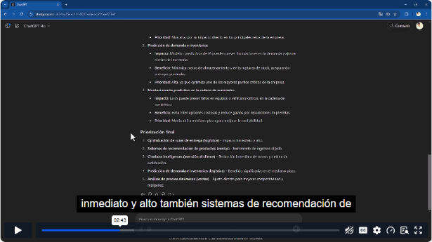
*Video 2, min 2:40: ChatGPT ordena las oportunidades por impacto. Primero va la optimización de rutas, luego los recomendadores de productos y los chatbots.*

**Lección:** el criterio humano sigue siendo necesario. ChatGPT no conoce, por ejemplo, los bloqueos de carreteras que paralizan la logística real, así que su priorización hay que contrastarla con la experiencia del equipo.

## 3. Plan del proyecto

Se construye en tres pasos:

- **Objetivos SMART:**
    - entregas un 20 % más rápidas;
    - menos costo de almacenamiento;
    - mayor satisfacción del cliente.

    Cada objetivo se alinea con la estrategia de la empresa.
- **Recursos:**
    - técnicos: plataformas y nube;
    - humanos: científico de datos, ingeniero de software y gerente de logística;
    - financieros: estimación de la inversión y de la capacitación.
- **Cronograma por etapas:**
    1. definición;
    2. datos;
    3. desarrollo;
    4. piloto;
    5. implementación completa;
    6. monitoreo.

    Cada etapa lleva sus entregables, plazos y riesgos.

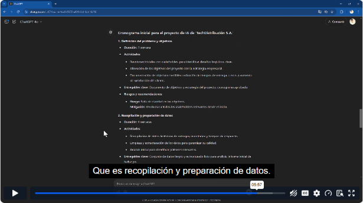
*Video 3, min 5:55: el cronograma por etapas, con actividades, entregables y riesgos.*

## 4. Equipos multidisciplinarios

**Roles clave:**

| Rol | Aporte principal |
|---|---|
| **Analista de negocio** | Define objetivos y hace el análisis inicial |
| **Científico de datos** | Desarrolla y valida el modelo |
| **Ingeniero de software** | Integra el modelo con los sistemas existentes |
| **Gerente de proyecto** | Coordina etapas, supervisa y ajusta |

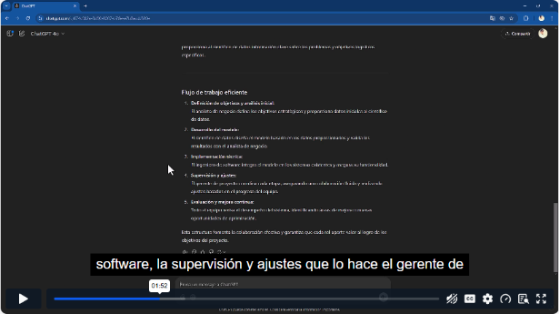
*Video 4, min 1:50: el flujo de trabajo y qué rol lidera cada etapa.*

- **Coordinación:** ChatGPT también propone un flujo colaborativo con herramientas de gestión de proyectos y reportes semanales.
- **Conflictos entre áreas:** ChatGPT ordena las estrategias para resolverlos y las convierte en pasos prácticos, pero las estrategias vienen de la experiencia del equipo.

## 5. Metodologías ágiles

**Scrum adaptado a IA:**

- **Roles:** *Product Owner*, *Scrum Master* y equipo de desarrollo.
- **Sprints:**
    1. limpieza de datos (2 semanas);
    2. modelo predictivo (3 semanas);
    3. pruebas piloto (3 semanas).

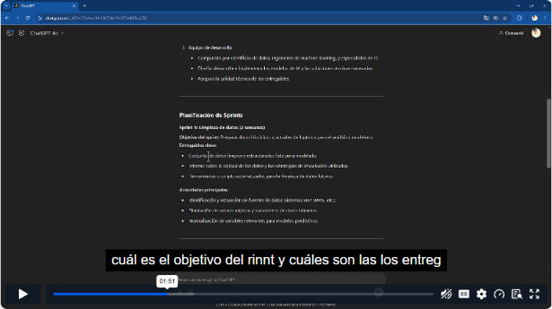
*Video 5, min 1:50: el sprint 1 con su objetivo, entregables y actividades.*

**Backlog:**

- Se organiza en **épicas**: recolección de datos, modelo y despliegue.
- Cada épica tiene historias de usuario con prioridad y criterios de aceptación.
- Con eso se planifica un sprint de 2 semanas con tareas, métricas de éxito y un calendario por responsable.

## 6. Factibilidad y ROI

**Factibilidad:**

- Se revisan cuatro frentes: **datos**, **infraestructura**, **habilidades del equipo** y **plazos**. En cada uno se pesan fortalezas y riesgos.
- Si aparecen brechas grandes, se ajusta el alcance antes de avanzar.

**ROI:**

- **Fórmula:** ROI = (beneficio − costo) ÷ costo.
- **Al primer año:** el ejemplo da **−12 %**, porque la inversión inicial supera los beneficios de ese año.
- **A largo plazo:** como los beneficios se repiten cada año, el ROI a 2 y 5 años es positivo. Por eso un ROI se analiza con horizonte y *payback*, no solo a un año.

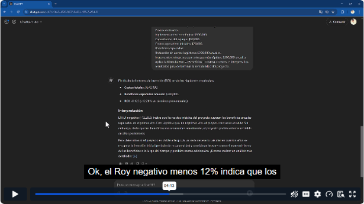
*Video 6, min 4:13: ROI negativo el primer año y su interpretación.*

**Riesgos y cómo mitigarlos:**

- pruebas piloto;
- capacitación continua;
- calidad de datos desde el inicio.

## 7. Gestión del cambio

**El plan de cambio incluye cuatro partes:**

- **Análisis de impacto:** procesos y grupos afectados.
- **Comunicación en tres fases:** primero sensibilizar, luego recoger retroalimentación y al final motivar la adopción.
- **Capacitación:** distinta para el equipo técnico y el no técnico.
- **Métricas de aceptación.**

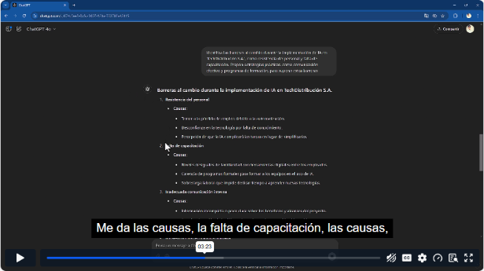
*Video 7, min 3:20: barreras al cambio con sus causas (resistencia, falta de capacitación, mala comunicación interna).*

**Cómo impulsar la adopción:**

- liderazgo que dé el ejemplo;
- incentivos, como días extra de vacaciones para quienes terminen primero la capacitación;
- una cultura de experimentación.

## 8. Monitoreo y mejora continua

**KPIs:**

- tiempos de entrega;
- costos operativos;
- precisión de la predicción;
- uso de la flota;
- satisfacción del cliente;
- eficiencia del algoritmo.

**Frecuencia de revisión:**

| Frecuencia | Qué se revisa |
|---|---|
| **Diaria** | Tiempos de entrega y precisión de las rutas |
| **Semanal** | Costos, flota y quejas |
| **Mensual** | Satisfacción del cliente y desempeño del modelo |

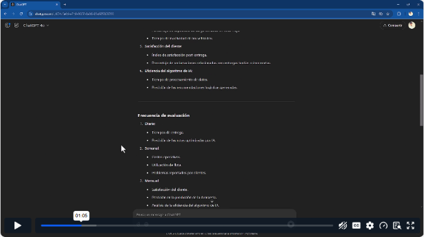
*Video 8, min 1:05: KPIs y frecuencia de evaluación.*

**Mejora:**

- Con resultados reales (por ejemplo, un modelo con 85 % de precisión), ChatGPT propone mejoras y proyecta subir al 90 %.
- **Atención al contexto:** en un chat nuevo o sin memoria, ChatGPT no conoce los objetivos originales. Hay que dárselos para que compare contra la línea base.

## 9. Presentar el proyecto completo

ChatGPT ayuda a armar tres entregables:

1. **Estructura del proyecto:** objetivos, etapas, recursos y resultados esperados.
2. **Presentación ejecutiva para *stakeholders*:**
    1. introducción;
    2. propuesta;
    3. etapas;
    4. recursos;
    5. impacto;
    6. plan;
    7. llamado a la acción.
3. **Reporte final:**
    - problema;
    - metodología;
    - resultados, como un 15 % menos en tiempos de entrega;
    - lecciones aprendidas;
    - recomendaciones.

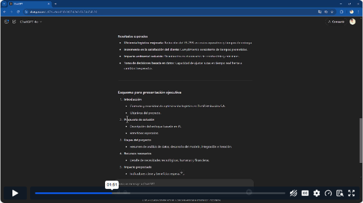
*Video 9, min 1:50: esquema de la presentación ejecutiva.*

## 10. Caso de estudio: tres sectores

| Sector | Problema | Solución con IA | Resultado |
|---|---|---|---|
| **Retail** | Promociones genéricas | Ofertas personalizadas por segmento a partir del historial de compras | Más retención y mayor venta por cliente |
| **Salud** | Agenda de citas saturada | Reasignación automática de citas canceladas | Menos espera y mejor uso de recursos |
| **Manufactura** | Fallas de maquinaria | Mantenimiento predictivo con datos en tiempo real | −20 % tiempo de inactividad, −15 % costo de mantenimiento |

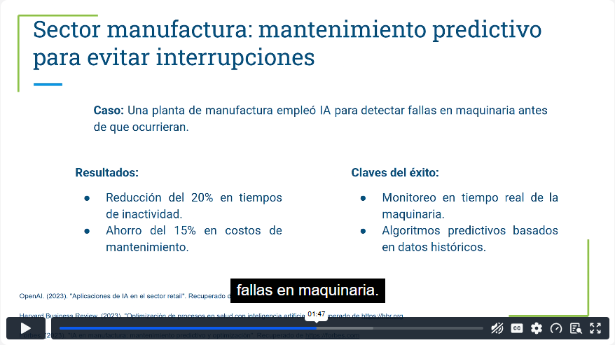
*Video 10, min 1:45: caso de mantenimiento predictivo en manufactura.*

**Factores comunes de éxito:**

- datos confiables;
- colaboración entre las áreas técnicas y de negocio;
- validación y ajuste continuos.

## Ejercicios prácticos

1. **Plan de proyecto:** IA en atención al cliente para automatizar respuestas frecuentes. Incluye objetivos, etapas, recursos, métricas y riesgos con su mitigación en cada etapa.
2. **Evaluación de riesgos:** proyecto de inventarios. Cubre riesgos de calidad de datos, de tecnología y de resistencia al cambio, priorizados por impacto y con un reporte de recomendaciones.
3. **Presentación de un caso de éxito:** ventas con +20 % en ingresos y −15 % en costos. Recoge objetivos, metodología, resultados y lecciones, y cómo replicarlo en otras áreas.

## Lecturas

- **Pilares para implementar proyectos de IA:**
    - planificación estratégica: objetivos medibles, casos de uso y datos preparados;
    - gestión del cambio;
    - evaluación de riesgos;
    - mejora continua.
- **Metodologías y herramientas:**

    | Enfoque | Para qué sirve |
    |---|---|
    | **Scrum** | Sprints cortos con entregas incrementales |
    | **Kanban** | Visualizar el flujo y detectar cuellos de botella |
    | **CRISP-DM** | Proceso estándar para minería de datos, en 6 etapas: negocio, datos, preparación, modelado, evaluación y despliegue |
    | **Design Thinking** | Centrado en empatizar con el usuario final |
    | **OpenRefine** | Limpiar y transformar datos |
    | **MLflow** | Gestionar y monitorear modelos en producción |

## Evaluación (10/10)

1. El primer paso al gestionar un proyecto de IA → **definir objetivos claros y alcanzables**.
2. La metodología de sprints cortos e iterativos → **Scrum**.
3. La herramienta para limpiar y transformar datos → **OpenRefine**.
4. La herramienta para monitorear modelos en producción → **MLflow**.
5. Un desafío común → **la resistencia al cambio en la organización**.
6. Qué es CRISP-DM → **el proceso estándar de minería de datos para distintos sectores**.
7. El enfoque centrado en empatizar con el usuario → **Design Thinking**.
8. Qué asegura la aceptación → **comunicación interna efectiva y capacitación**.
9. La ventaja del monitoreo continuo → **mantener los modelos alineados con los objetivos a largo plazo**.
10. Una tendencia emergente → **IA explicable (XAI)**.

## Evidencia

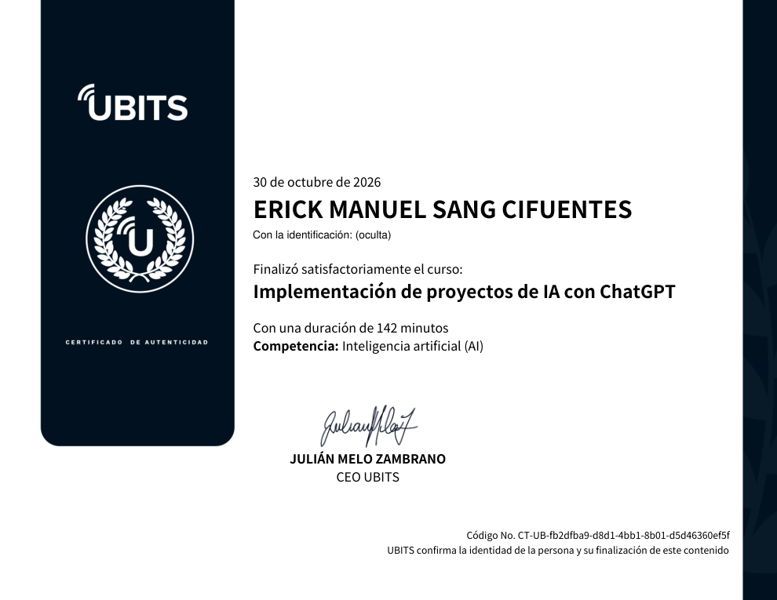

## Fuentes y aviso legal

- **Fuente:** curso «Implementación de proyectos de IA con ChatGPT» de la plataforma [UBITS](https://www.ubits.com), asignado dentro de un plan de formación empresarial.
- **Uso:** apuntes personales de estudio, sin fines comerciales y con redacción propia. Las capturas son fragmentos breves citados con fines educativos; sus derechos son de sus titulares.
- **Sin afiliación:** sitio no oficial, no afiliado ni respaldado por UBITS ni por los aliados del curso. Las marcas pertenecen a sus dueños.
- Más detalles y cómo pedir el retiro de contenido en el [aviso legal](../../aviso-legal.md).
