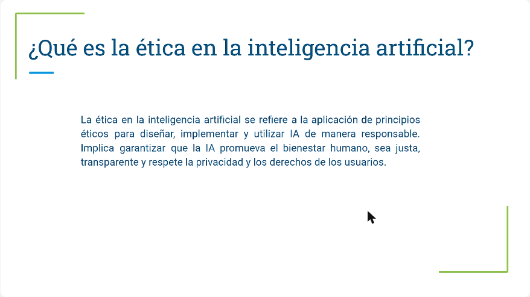
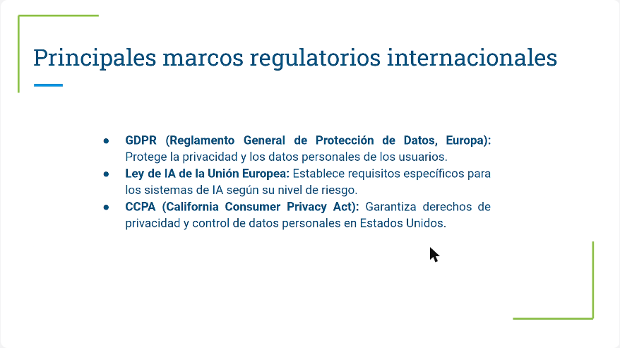
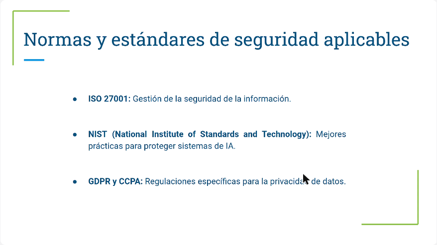
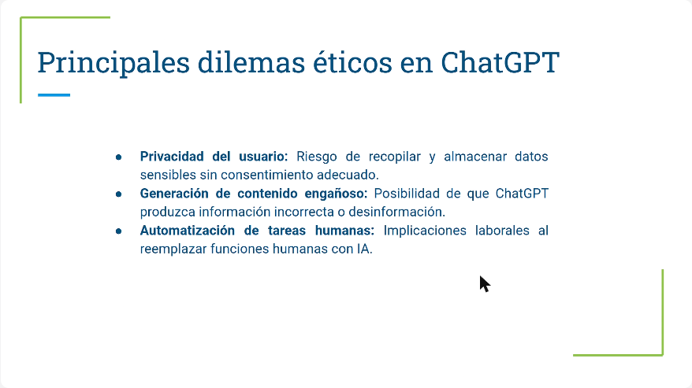
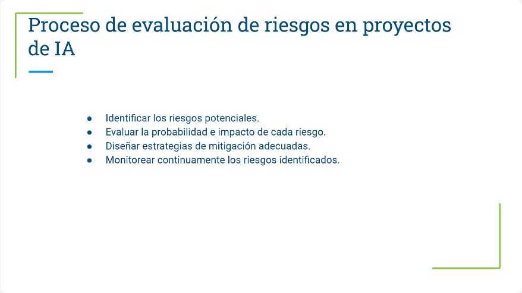
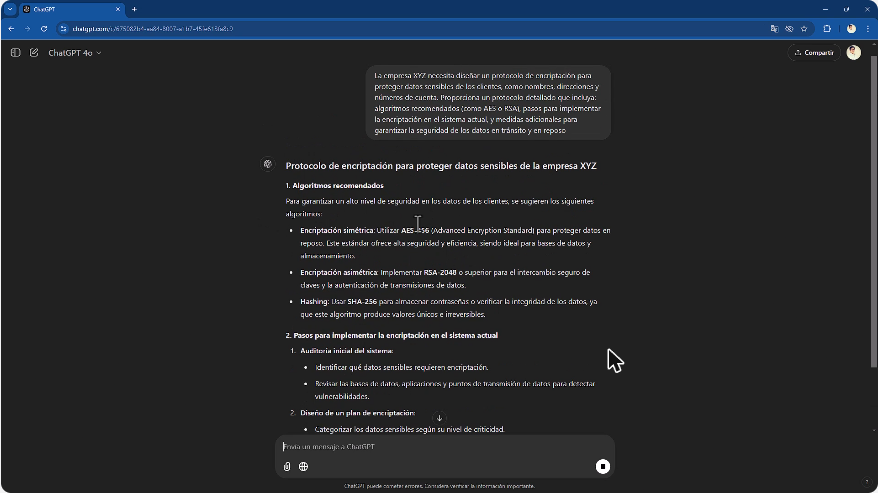
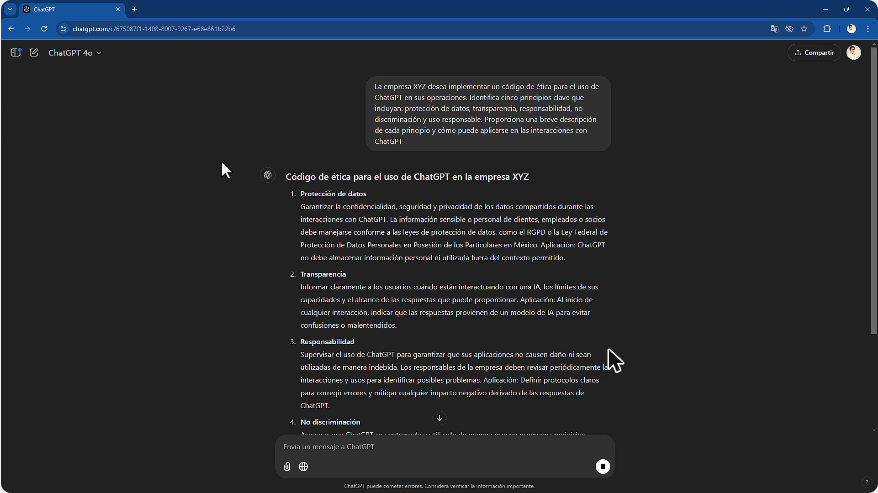
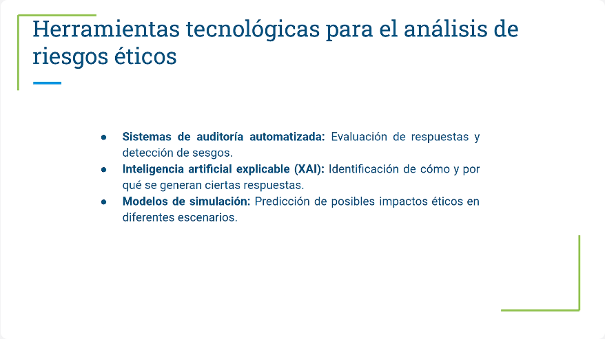
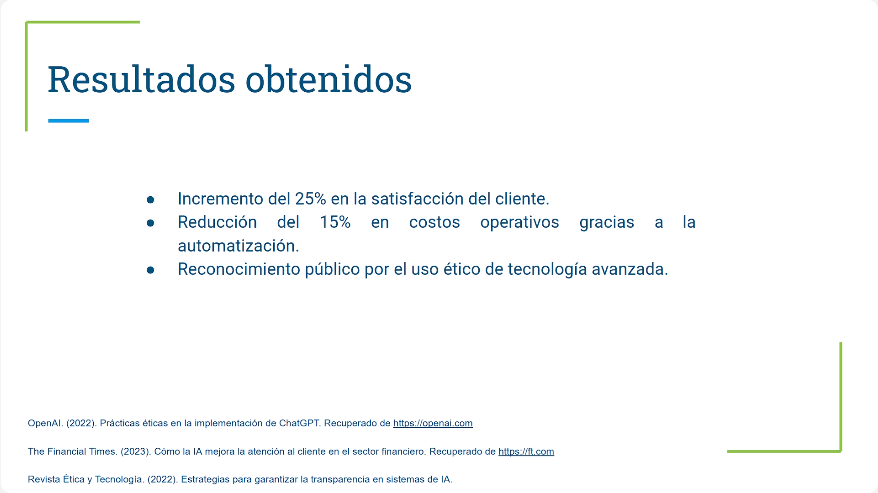
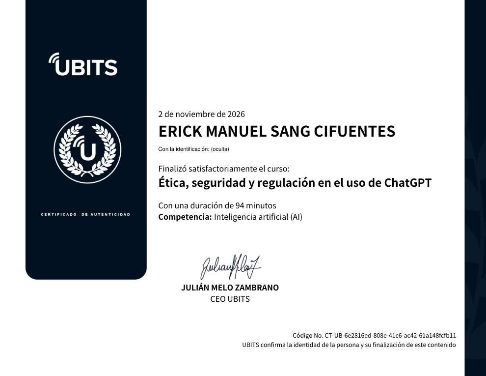

# 19 · Ética, seguridad y regulación en el uso de ChatGPT

**Plataforma:** UBITS · **Duración:** 94 min · **Nivel:** intermedio · **Resultado:** test aprobado con 10/10 (100 %) · **Fecha:** 2 nov 2026

The course has 9 videos (about 39 min), 3 exercises and 2 readings. The first 5 videos are theory and cover ethics, regulation, security, dilemmas and risks. Videos 6 and 7 are hands-on with ChatGPT: a security protocol and a code of ethics for a fictional company called "XYZ". The last two cover risk analysis and a case from the financial sector. Each section gives the video minute where the key idea appears.

## 1. Fundamentos de ética en la IA

La ética en la IA es el marco de principios que guía cómo se diseña y se usa la tecnología, para que beneficie a la sociedad y evite daños.

*Video 1, min 0:40: la ética busca una IA justa, transparente y que respete la privacidad.*

**Cuatro pilares:**

| Pilar | Qué exige |
|---|---|
| **Justicia** | Sistemas equitativos que no discriminen |
| **Transparencia** | Decisiones comprensibles, aun en modelos complejos |
| **Privacidad** | Respetar los derechos de las personas sobre sus datos |
| **Responsabilidad** | Quien diseña o usa la IA responde por sus resultados |

**Desafíos:**

- **Sesgos** en los datos que llevan a resultados injustos. Ejemplo: algoritmos de contratación que discriminaban a ciertos grupos.
- **Opacidad** de los modelos complejos.
- **Desigualdad de acceso**, que puede ampliar brechas sociales.
- **Desinformación:** si en los datos de entrenamiento abundan los datos falsos, el modelo los aprende.

**Recomendaciones de la instructora:**

- No compartir datos sensibles con ChatGPT.
- Mantener supervisión humana sobre las decisiones automatizadas.
- Recordar que la IA en sí todavía no está bien regulada. Lo que sí existe es la protección de datos.

## 2. Regulaciones y normativas

*Video 2, min 0:45: GDPR, Ley de IA de la UE y CCPA.*

| Norma | Alcance |
|---|---|
| **GDPR** (Europa) | Privacidad y datos personales; exige informar el uso de los datos y pedir consentimiento explícito |
| **Ley de IA de la Unión Europea** | Clasifica los sistemas de IA por **nivel de riesgo**; más requisitos para los de alto impacto, como decisiones automatizadas |
| **CCPA** (California) | Derechos de privacidad y control de datos personales en EE. UU. |

- **Obligaciones prácticas:**
    - avisar al usuario cuando habla con una IA;
    - pedir consentimiento antes de usar sus datos para entrenar;
    - **minimizar** los datos recogidos y **anonimizarlos**.
- **Caso:** una empresa en Europa fue multada por no informar que su atención al cliente usaba IA.
- **Cumplir genera confianza:** las empresas transparentes ganan ventaja competitiva.
- **Desafío:** las leyes cambian rápido y varían por país; hay que hacer auditorías internas, contar con asesoría legal y capacitar a los equipos.

## 3. Seguridad de datos y privacidad

**Riesgos:**

- accesos no autorizados;
- fugas de datos;
- uso indebido de la información.

*Video 3, min 1:02: ISO 27001, NIST, GDPR y CCPA.*

- **Estándares:**
    - **ISO 27001:** gestión de la seguridad de la información;
    - **NIST:** buenas prácticas para proteger sistemas.
- **Medidas técnicas:**
    - **cifrado** en tránsito y en reposo;
    - acceso solo para usuarios autorizados;
    - auditorías periódicas.
- **Privacidad en las conversaciones:**
    - anonimizar;
    - pedir **consentimiento informado**;
    - fijar cuánto tiempo se guardan los datos.
- **Herramientas:**
    - **IDS:** detección de intrusos;
    - **DLP:** prevención de pérdida de datos;
    - enfoque **Zero Trust**, en el que ninguna entidad se considera confiable por defecto.
- **Amenazas reales:**
    - chatbots con configuraciones inseguras;
    - errores humanos en la gestión de accesos;
    - ataques de **inyección de datos** que manipulan el modelo.

## 4. Dilemas éticos en las empresas

*Video 4, min 0:40: privacidad, contenido engañoso y automatización de tareas humanas.*

**Los tres dilemas:**

1. Recoger datos sensibles **sin consentimiento**.
2. Que ChatGPT produzca **contenido engañoso** que dañe la reputación.
3. **Automatizar tareas humanas**, con su efecto sobre el empleo.

**Sesgos:** el modelo refleja sus datos de entrenamiento. Ejemplo: un chatbot financiero, un GPT a la medida entrenado con datos insuficientes, recomendó productos sesgados.

**Cómo abordarlos:**

- revisar los datos de entrenamiento;
- tener políticas claras de uso de datos;
- crear canales de retroalimentación;
- usar **XAI** (IA explicable) para entender las decisiones;
- auditar y monitorear de forma continua.

## 5. Evaluación de riesgos y mitigación

*Video 5, min 1:06: identificar, evaluar probabilidad e impacto, mitigar y monitorear.*

**Tipos de riesgo:**

- **de privacidad:** accesos no autorizados;
- **tecnológicos:** respuestas inexactas;
- **éticos y reputacionales:** contenido sesgado.

**Herramientas de evaluación:**

- **matrices de riesgo** (probabilidad × impacto) para priorizar;
- **simulaciones de escenarios**;
- **auditorías del sistema**.

**Mitigación:**

| Riesgo | Cómo se mitiga |
|---|---|
| **Privacidad** | Cifrado, control estricto de accesos y datos anonimizados para entrenar |
| **Tecnológico** | Validar el modelo de forma constante, actualizar los algoritmos y corregir errores en tiempo real |
| **Ético** | Capacitar en ética, revisar los datos de entrenamiento y tener retroalimentación |

**Desafío:** el entorno tecnológico y normativo cambia tan rápido que no se pueden prever todos los riesgos.

## 6. Práctica: protocolos de seguridad con ChatGPT

Tres prompts para la empresa ficticia XYZ.

*Video 6, min 1:15: ChatGPT propone AES-256 para datos en reposo, RSA-2048 para intercambio de claves y SHA-256 para verificar integridad.*

1. **Protocolo de cifrado** para nombres, direcciones y números de cuenta:
    - algoritmos recomendados;
    - auditoría inicial;
    - plan de cifrado en reposo y en tránsito;
    - gestión de claves;
    - pruebas;
    - medidas extra: control de acceso, registros, copias cifradas y capacitación.
2. **Control de acceso:**
    - roles de administrador, analista y operador;
    - **2FA** para quien toca datos sensibles;
    - un **registro de actividades** con usuario, rol, fecha, hora, IP y ubicación, para auditar.
3. **Respuesta a incidentes:**
    1. detección y análisis: clasificar en crítico, alto, medio o bajo, y análisis forense;
    2. contención y mitigación: aislar, mitigar y avisar dentro de la empresa;
    3. comunicación interna y externa;
    4. recuperación: evaluar el daño, restaurar, probar y reiniciar;
    5. lecciones aprendidas.

    La instructora lo relaciona con el *ransomware*: los secuestros de información pasan en empresas reales, no solo en series.

**Lección:** sin el contexto real de la empresa, ChatGPT da una guía general. Sirve para saber por dónde empezar y luego se adapta.

## 7. Práctica: código de ética para ChatGPT

*Video 7, min 1:10: los cinco principios del código de ética de XYZ.*

1. **Protección de datos:** confidencialidad según el GDPR o la ley local. La mejor prevención es **no darle datos personales a ChatGPT**.
2. **Transparencia:** avisar al usuario que habla con una IA. Por ejemplo, poner en el nombre del agente de soporte que es un asistente virtual.
3. **Responsabilidad:** supervisar los usos y tener protocolos para corregir errores.
4. **No discriminación:** revisar las respuestas para detectar sesgos. Cuando se crea un GPT propio, sí se puede ajustar su configuración.
5. **Uso responsable:** no reemplazar el juicio humano en decisiones críticas ni dejar a ChatGPT funcionando en automático.

**Después del código:**

- lineamientos de privacidad, transparencia, revisión de contenido y capacitación;
- un mecanismo de mejora continua con métricas, por ejemplo el % de interacciones que cumplen la anonimización y los incidentes de privacidad;
- canales de retroalimentación para empleados y clientes;
- revisión periódica del código cuando cambien las leyes.

**Recomendación:** al entregar accesos a ChatGPT, capacitar al equipo y hacer firmar el código de ética.

## 8. Análisis de riesgos éticos

**Riesgos:**

- reproducir sesgos;
- exponer información sensible;
- dar respuestas inexactas que lleven a decisiones equivocadas.

**Detección:**

- auditorías periódicas de las respuestas;
- monitoreo de las interacciones;
- revisión de los datos de entrenamiento.

*Video 8, min 3:15: auditoría automatizada, XAI y modelos de simulación.*

**Consecuencias si no se gestionan:**

- pérdida de confianza;
- multas;
- daño reputacional.

**Mayor desafío:** las normas aún se están escribiendo y en datos complejos es difícil encontrar todos los sesgos.

## 9. Caso de estudio: empresa financiera

- **Problema:** alta demanda en atención al cliente.
- **Solución:** ChatGPT para preguntas frecuentes, con tres cuidados:
    - privacidad;
    - evitar sesgos contra ciertos perfiles;
    - transparencia: el usuario sabe que habla con una IA.
- **Estrategias:**
    - cifrado y anonimización;
    - auditorías de los datos de entrenamiento;
    - capacitación del equipo en ética.

*Video 9, min 1:45: +25 % en satisfacción, −15 % en costos operativos y reconocimiento público por el uso ético.*

## Ejercicios prácticos

1. **Política de seguridad** para la empresa XYZ: protección de datos sensibles, control de acceso y respuesta a incidentes, con ejemplos. Se revisa contra las normas locales e internacionales.
2. **Riesgos éticos** de la empresa ABC, que automatiza su atención al cliente: tres riesgos con su mitigación, clasificados por probabilidad e impacto, en un informe breve.
3. **Código de ética** para una empresa de tecnología: transparencia, privacidad, responsabilidad y equidad, con encabezados y un ejemplo por principio.

## Lecturas

- **Seguridad y privacidad en entornos empresariales:**
    - cifrado AES-256 de datos almacenados y transmitidos;
    - control de acceso por roles con MFA y auditorías;
    - protocolo de incidentes: identificar, contener y comunicar;
    - consentimiento explícito. Un banco, por ejemplo, avisa al inicio de cada conversación que puede analizarse.
- **Dilemas éticos y estrategias:** un dilema aparece cuando chocan principios como justicia, transparencia y responsabilidad. Los cuatro dilemas son:
    - sesgos;
    - privacidad;
    - contenido inexacto, como un banco que dio información errónea sobre inversiones;
    - desplazamiento laboral.

## Evaluación (10/10)

1. Objetivo del cifrado → **evitar el acceso no autorizado a la información**.
2. Consentimiento informado → **dar información clara sobre el uso de los datos**.
3. Estándar internacional de seguridad de la información → **ISO 27001**.
4. Para qué sirven las auditorías → **identificar vulnerabilidades y sesgos**.
5. Ejemplo de sesgo → **reproducir prejuicios presentes en los datos de entrenamiento**.
6. Herramienta para entender las decisiones de la IA → **XAI (IA explicable)**.
7. Gran desafío de los riesgos éticos → **la dificultad de identificar todos los sesgos en datos complejos**.
8. Estrategia de equidad → **datos representativos y diversos en el entrenamiento**.
9. Práctica de privacidad → **eliminar identificadores personales de los datos**.
10. Ventaja de la auditoría automatizada → **más transparencia al detectar problemas en tiempo real**.

## Evidencia

## Fuentes y aviso legal

- **Fuente:** curso «Ética, seguridad y regulación en el uso de ChatGPT» de la plataforma [UBITS](https://www.ubits.com), asignado dentro de un plan de formación empresarial.
- **Uso:** apuntes personales de estudio, sin fines comerciales y con redacción propia. Las capturas son fragmentos breves citados con fines educativos; sus derechos son de sus titulares.
- **Sin afiliación:** sitio no oficial, no afiliado ni respaldado por UBITS ni por los aliados del curso. Las marcas pertenecen a sus dueños.
- Más detalles y cómo pedir el retiro de contenido en el [aviso legal](../../aviso-legal.md).
