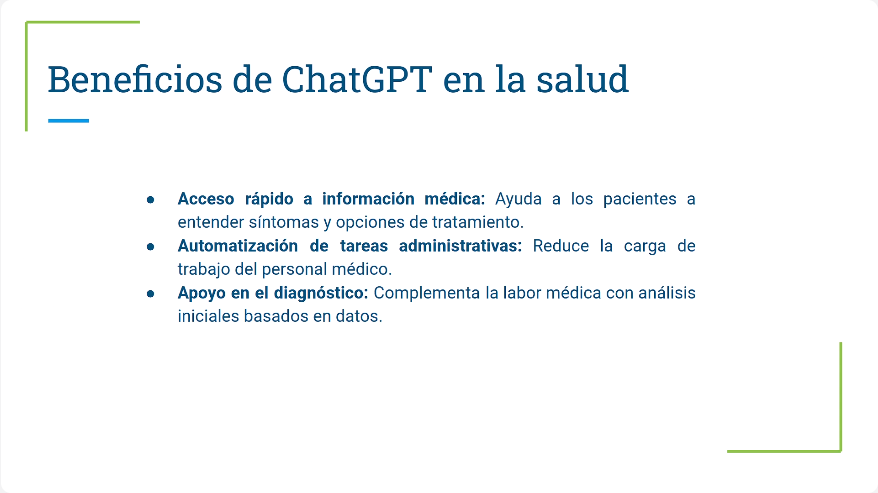
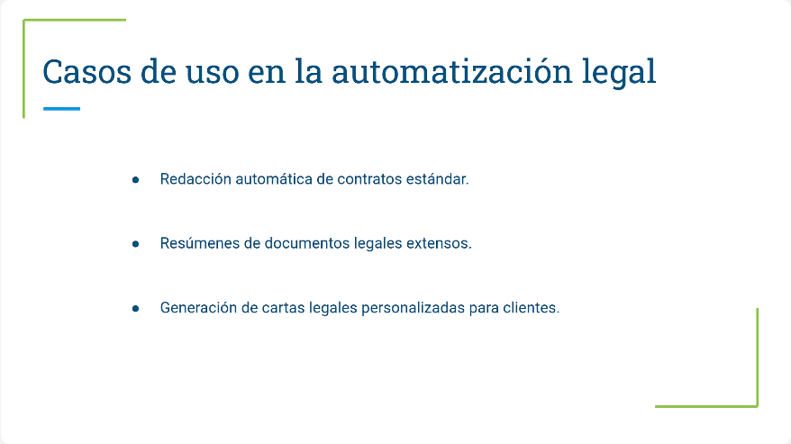
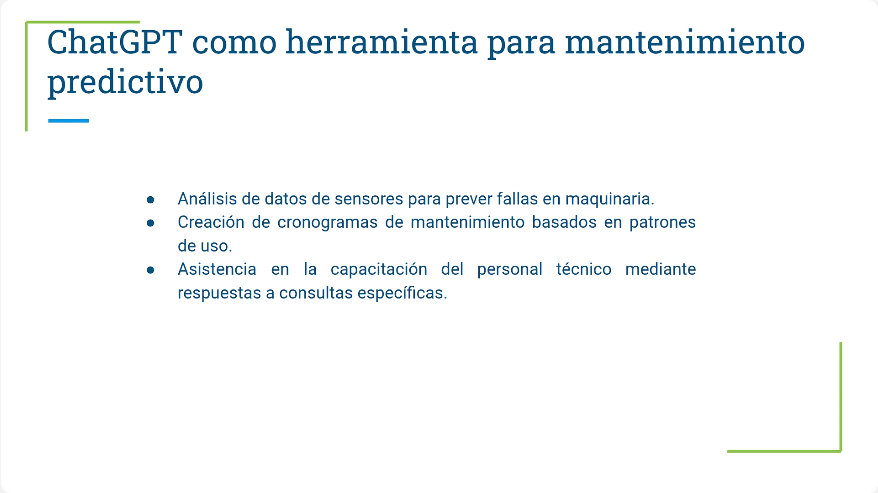
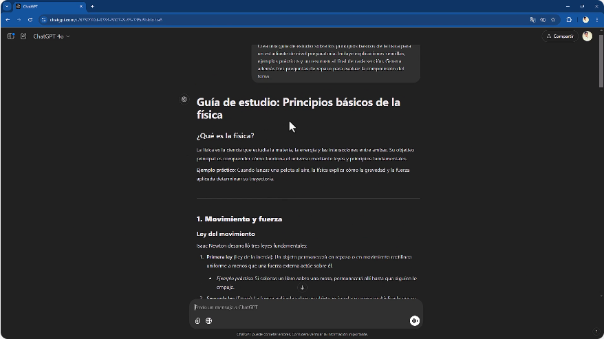
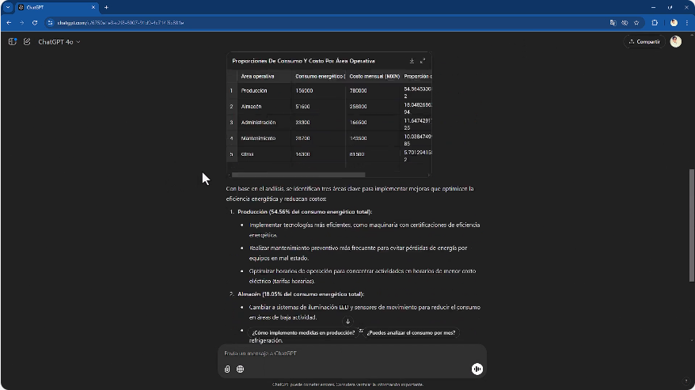
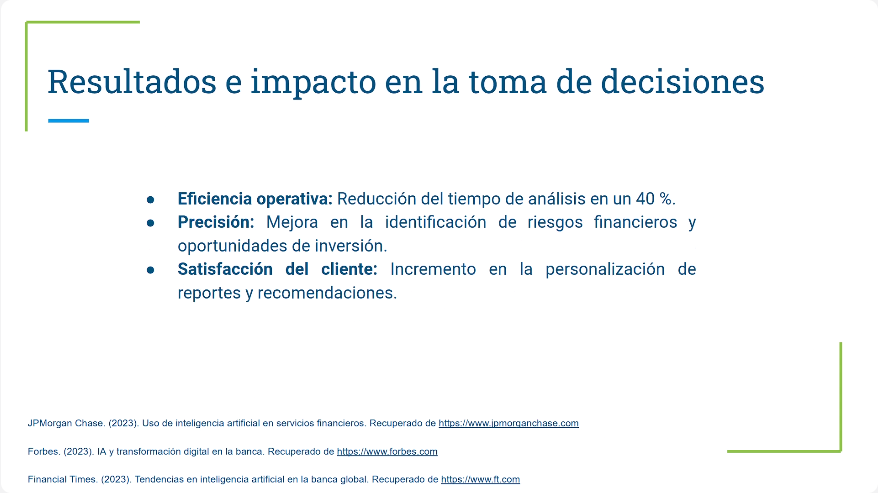
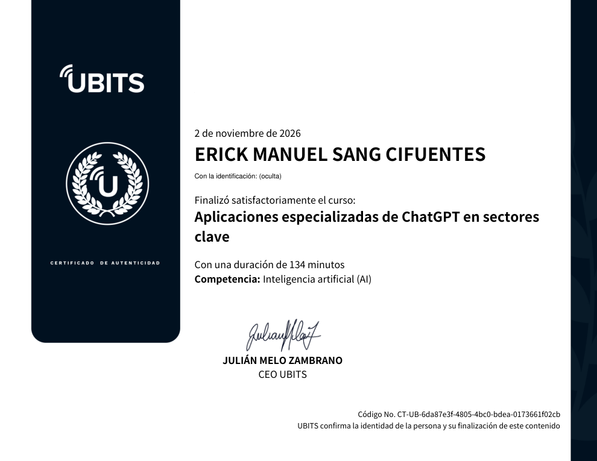

# 20 · Aplicaciones especializadas de ChatGPT en sectores clave

**Plataforma:** UBITS · **Duración:** 137 min · **Nivel:** intermedio · **Resultado:** test aprobado con 10/10 (100 %) · **Fecha:** 2 nov 2026

Último curso técnico del plan. Tiene 7 videos (unos 32 min), 3 ejercicios, 2 lecturas y un archivo de datos de consumo energético para practicar. Recorre seis sectores: salud, legal, manufactura, educación, energía y finanzas. Cada sección indica el minuto del video donde está la idea clave.

## 1. Salud: diagnóstico y gestión de pacientes

*Video 1, min 0:50: acceso rápido a información médica, tareas administrativas y apoyo al diagnóstico.*

**Usos:**

- responder dudas sobre medicamentos, efectos secundarios y cuidados posteriores;
- recordatorios de citas y de medicación;
- resúmenes de historias clínicas;
- clasificar síntomas para **priorizar casos por urgencia**.

**Cuidado con el diagnóstico:**

- ChatGPT advierte que no es médico.
- Su papel es complementar al profesional, **nunca reemplazarlo**.
- Las decisiones críticas las supervisa siempre un médico.

**Normas de privacidad:** HIPAA (EE. UU.), GDPR (Europa), ISO 27001 y las leyes locales sobre la propiedad del expediente.

**Retos:**

- la precisión en temas críticos;
- la resistencia del personal médico;
- la integración con los expedientes electrónicos. Conectar ChatGPT a los expedientes expone datos confidenciales.

## 2. Legal: automatización y análisis de casos

*Video 2, min 1:05: contratos estándar, resúmenes de documentos extensos y cartas personalizadas.*

- **Análisis:**
    - buscar jurisprudencia y ordenarla por relevancia;
    - encontrar patrones en casos similares para anticipar los argumentos de la contraparte.
- **Ética:**
    - confidencialidad;
    - precisión, porque una mala interpretación de la ley tiene consecuencias graves;
    - supervisión humana obligatoria.
- **Buenas prácticas:**
    - validar las respuestas;
    - capacitar al despacho;
    - integrarlo con el gestor documental.
- **Retos:**
    - entrenar con datos legales específicos;
    - manejar las diferencias entre jurisdicciones.
- **Futuro:** democratizar el acceso a la justicia al bajar costos.

## 3. Manufactura: procesos y mantenimiento predictivo

*Video 3, min 1:30: datos de sensores para prever fallas, cronogramas de mantenimiento y capacitación técnica.*

- **Optimización:**
    - analizar datos operativos para encontrar **cuellos de botella**;
    - reducir desperdicios;
    - automatizar inventarios y reportes.
- **Normas:**
    - **ISO 9001** para la calidad;
    - **ISO 27001** para la información de la operación;
    - reglas locales de seguridad en planta.
- **Retos:**
    - integrarlo con el **MES** (sistema de gestión de manufactura);
    - manejar el volumen de datos de los sensores en tiempo real;
    - la resistencia al cambio.

    La recomendación es implementar de forma **gradual**.
- **Futuro:** fábricas inteligentes que combinan IA y automatización.

## 4. Educación: enseñanza y aprendizaje

**Beneficios:**

- tutorías adaptadas al nivel de cada estudiante;
- materiales actualizados;
- resúmenes de temas complejos;
- automatizar calificaciones y reportes.

**Retos:**

- supervisar la precisión;
- capacitar a docentes y estudiantes;
- la **brecha tecnológica** de las comunidades con menos recursos.

*Video 4, min 4:25: guía de física para preparatoria, con explicación, ejemplo práctico, resumen y preguntas de repaso por sección.*

**Tres prácticas:**

1. Una guía de estudio de física.
2. Una actividad interactiva sobre energías renovables: introducción, quiz y tarea práctica.
3. Una evaluación de 5 preguntas sobre la Revolución Industrial, con respuestas justificadas.

**Consejo:** darle a ChatGPT el contenido real de la clase. Si no, puede preguntar temas que no se vieron.

## 5. Energía: eficiencia y gestión de recursos

Con un Excel de consumo mensual por área de una planta (enero a octubre 2023), ChatGPT analiza los patrones y propone tres áreas de mejora.

*Video 5, min 2:15: proporción de consumo y costo por área. Producción es el 54,6 % del consumo total.*

**Recomendaciones:**

- maquinaria eficiente y mantenimiento preventivo en producción;
- iluminación LED con sensores de movimiento en almacén;
- aislamiento térmico;
- gestión energética en tiempo real.

**Plan de energías renovables en tres fases:**

| Fase | Duración | Qué incluye |
|---|---|---|
| **Inicial** | 1–3 meses | Auditoría energética, viabilidad y selección de proveedores |
| **Intermedia** | 4–8 meses | Piloto, capacitación y permisos |
| **Final** | 9–18 meses | Expansión completa |

La proyección de ChatGPT es de unos 4 millones de pesos de ahorro al año.

## 6. Caso de estudio: JPMorgan Chase

- **Reto:**
    - analizar grandes volúmenes de datos financieros para detectar riesgos de crédito y oportunidades;
    - los clientes institucionales pedían reportes personalizados.
- **Solución:**
    - reportes dinámicos con datos de mercado en tiempo real;
    - análisis de tendencias para predecir escenarios;
    - automatización de contratos y alertas de riesgo.

*Video 6, min 1:35: −40 % de tiempo de análisis, mejor precisión en riesgos y oportunidades, y reportes más personalizados.*

**Lección:** el modelo se entrena con datos del sector, y la revisión humana sigue siendo indispensable en las decisiones críticas.

## 7. Conclusiones del curso

El video de cierre, que aparece después del test, repasa el plan completo:

- prompts precisos;
- automatización de tareas repetitivas;
- análisis financiero;
- aplicaciones por sector.

Los dos riesgos que se repiten son la **privacidad de los datos**, sobre todo en salud y finanzas, y la necesidad de **revisión humana** contra errores y sesgos.

## Ejercicios prácticos

1. **Salud:** prompt de diagnóstico preliminar a partir de una historia clínica, con contexto de hospital y tres posibles diagnósticos con su descripción. Se compara la consistencia de los resultados.
2. **Retail:** un Excel con el comportamiento de clientes y dos estrategias de retención, una para clientes frecuentes y otra para ocasionales, con mensajes, canales y recomendaciones.
3. **Industria:** un archivo de tiempos y costos de una línea de producción, para encontrar cuellos de botella y proponer tres soluciones.

## Lecturas

- **Salud, legal y manufactura:**
    - **salud:** diagnósticos preliminares, expedientes digitales, informes clínicos y recordatorios;
    - **legal:** contratos y memorandos desde plantillas, detección de cláusulas en conflicto e investigación jurídica;
    - **manufactura:** cuellos de botella, mantenimiento predictivo y capacitación técnica.
- **Retail, educación y energía:**
    - **retail:** recomendaciones según el comportamiento de compra, predicción de demanda por temporada y campañas para fechas como el Buen Fin o Navidad;
    - **educación:** guías, evaluaciones y reportes escolares;
    - **energía:** eficiencia, equilibrio entre oferta y demanda, y mantenimiento predictivo.

## Evaluación (10/10)

1. Aplicación principal en salud → **diagnósticos preliminares basados en datos médicos**.
2. Tarea que automatiza en el sector legal → **redacción de contratos y memorandos**.
3. Cómo optimiza líneas de producción → **analiza datos operativos para identificar cuellos de botella**.
4. Personalización en retail → **identificar patrones de consumo y recomendar productos**.
5. Mantenimiento predictivo en energía → **analizar datos de consumo para anticipar fallos**.
6. Reto común en cualquier sector → **garantizar la calidad y actualización de los datos**.
7. Tarea que automatiza en educación → **diseñar guías de estudio personalizadas**.
8. Sector que equilibra oferta y demanda de energía → **energético**.
9. Estrategia para el Buen Fin → **campañas promocionales basadas en datos históricos**.
10. Automatización administrativa en educación → **generar informes escolares**.

## Evidencia

## Fuentes y aviso legal

- **Fuente:** curso «Aplicaciones especializadas de ChatGPT en sectores clave» de la plataforma [UBITS](https://www.ubits.com), asignado dentro de un plan de formación empresarial.
- **Uso:** apuntes personales de estudio, sin fines comerciales y con redacción propia. Las capturas son fragmentos breves citados con fines educativos; sus derechos son de sus titulares.
- **Sin afiliación:** sitio no oficial, no afiliado ni respaldado por UBITS ni por los aliados del curso. Las marcas pertenecen a sus dueños.
- Más detalles y cómo pedir el retiro de contenido en el [aviso legal](../../aviso-legal.md).
