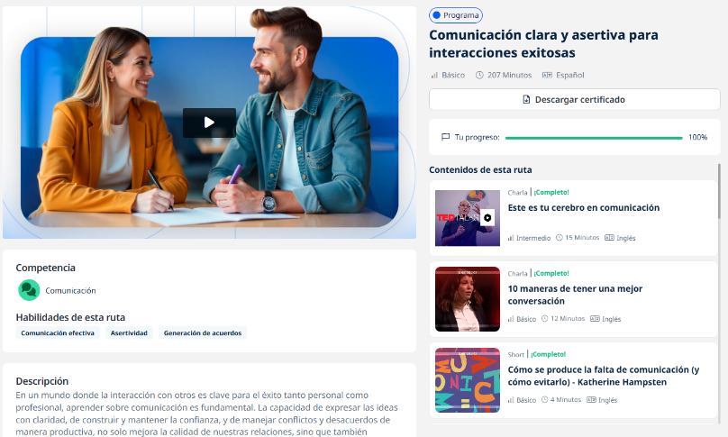
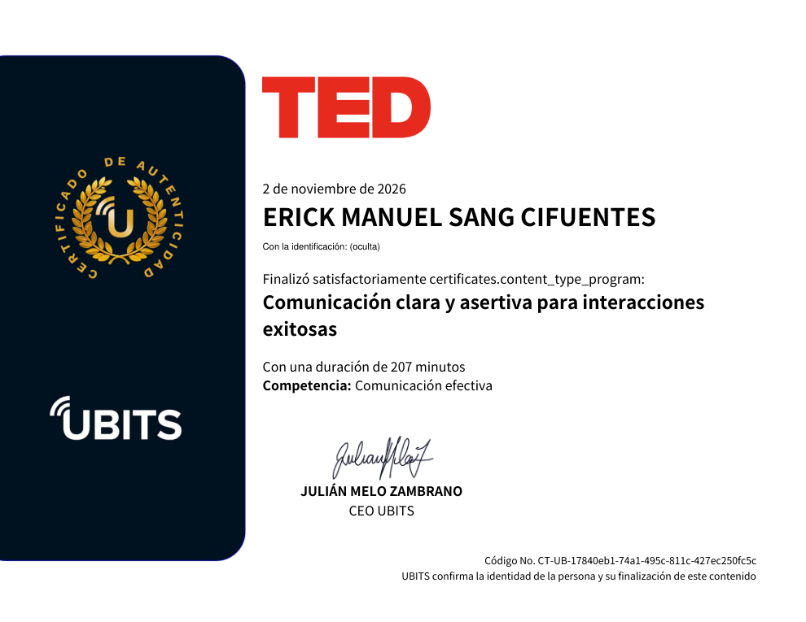

# 21 · Comunicación clara y asertiva para interacciones exitosas

**Plataforma:** UBITS + TED · **Duración:** 207 min · **Nivel:** básico · **Resultado:** prueba final aprobada con 5/5 (100 %) · **Fecha:** 2 nov 2026

Primer curso de habilidades blandas del plan. Es una **ruta de 15 contenidos**: 12 charlas TED (con subtítulos en español), una guía de ejercicios prácticos y la prueba final. Se organiza en tres módulos:

1. Fundamentos de la comunicación y sus desafíos.
2. Comunicación asertiva: confianza y claridad.
3. Interacciones complejas en el trabajo.

Las tres habilidades que trabaja son **comunicación efectiva**, **asertividad** y **generación de acuerdos**.

## Módulo 1 · Fundamentos y desafíos

### Este es tu cerebro en comunicación · Uri Hasson

- **Quién:** neurocientífico de Princeton que estudia cómo interactúan los cerebros en situaciones reales.
- **Idea central:** cuando una historia se entiende de verdad, la actividad cerebral de quien habla y la de quien escucha se **acoplan**, es decir, se sincronizan.
- **Qué rompe el acople:**
    - el desorden;
    - la falta de contexto común.
- **Conclusión:** comunicar es lograr que el otro entienda en el mismo marco, no solo emitir palabras.

### 10 maneras de tener una mejor conversación · Celeste Headlee

Periodista de radio con décadas de entrevistas. Sus reglas, en resumen:

1. No hagas varias cosas a la vez; está presente.
2. No sermonees: entra a aprender.
3. Haz **preguntas abiertas**: quién, qué, cuándo, dónde, por qué, cómo.
4. Sigue el flujo y deja ir los pensamientos que te distraen.
5. Si no sabes, dilo.
6. No equipares tu experiencia con la del otro.
7. No te repitas.
8. Omite los detalles que no aportan, como fechas y nombres.
9. **Escucha**, que es lo más importante y lo más difícil.
10. Sé breve.

### Cómo se produce la falta de comunicación · Katherine Hampsten

**Por qué fallamos:** cada persona interpreta lo que oye a través de su propia percepción, es decir, su experiencia, sus valores y su cultura. Por eso dos personas pueden escuchar lo mismo y entender cosas distintas.

**Qué hacer:**

- asumir que el otro ve diferente;
- escuchar para entender su punto de vista;
- comprobar que se entendió, en lugar de suponerlo.

### ¿Por qué dudamos cuando hablamos? · Lorenzo García-Amaya

- **Muletillas como «eh», «este» o «como que»:** aparecen 2 a 3 veces por minuto en el habla natural.
- **No son simples errores:** marcan que la persona está planeando lo que va a decir y le avisan al oyente que viene algo.
- **Conclusión:** eliminarlas del todo no es realista ni necesario.

## Módulo 2 · Comunicación asertiva: confianza y claridad

### 7 herramientas para generar confianza en los negocios · Marcos Aguiar (BCG)

Aguiar estudió más de 100 ecosistemas de negocio que fracasaron.

- **Hallazgos:**
    - en los que fallaron hubo más de 70 % de comportamientos no cooperativos;
    - casi 9 de cada 10 de los exitosos diseñaron la confianza dentro de la plataforma. Es lo que llama **confianza sistémica**: confiar en el sistema, no en cada persona.
- **Ejemplo:** HopSkipDrive, que transporta niños con conductores desconocidos.

**Las siete herramientas:**

| Herramienta | Ejemplo |
|---|---|
| **Acceso** | Quién entra y a quién se expulsa; HopSkipDrive revisa antecedentes y tiene tolerancia cero |
| **Contratos** | Términos y condiciones que formalizan la relación |
| **Incentivos** | Reputación que permite cobrar más en eBay o Amazon |
| **Control** | Una «mano invisible» que orienta; Uber fija la ruta |
| **Transparencia** | Historial visible en ambos sentidos, como las reseñas de Airbnb |
| **Intermediación** | Taobao retiene el pago hasta que el comprador queda satisfecho |
| **Mitigación** | Programas de protección de pagos ante percances |

**Cómo combinarlas:**

- En promedio, un ecosistema exitoso usa **3,6 herramientas**.
- La combinación depende del tipo de ecosistema.
- 9 de cada 10 de los exitosos son **«biónicos»**: mezclan herramientas digitales con las humanas, como contratos, políticas y gobernanza.

### Cómo construir —y reconstruir— la confianza · Frances Frei (Harvard, Uber)

**El triángulo de la confianza:** la confianza se apoya en tres pilares, y cuando se pierde casi siempre falla uno.

- **Autenticidad:** creo que eres tú de verdad.
- **Lógica:** creo en tu razonamiento y en tu capacidad.
- **Empatía:** creo que te importo.

**Para reconstruirla:**

1. Identificar cuál pilar «tambalea».
2. **Asumir la responsabilidad** del error.
3. Trabajar ese pilar con transparencia.

### Cómo exponer el propio punto de vista · Adam Galinsky

- **El rango de comportamiento aceptable:** cuando tenemos poco poder, ese rango es estrecho y cuesta hacerse oír.
- **Cómo ampliarlo:**
    - abogar por otros, no solo por uno mismo;
    - **ofrecer opciones** en lugar de una sola exigencia;
    - **pedir consejo**, que convierte al otro en aliado;
    - mostrar experiencia y pasión;
    - ponerse en la perspectiva del otro.

### Cómo hacer que tus ideas se difundan · Seth Godin

Con demasiadas opciones y poco tiempo, ignoramos lo ordinario. Lo «seguro» y aburrido es lo más arriesgado. Para difundirse, una idea tiene que ser **notable**, algo digno de comentarse. Se dirige a quienes de verdad la quieren, los primeros en adoptarla, y ellos la difunden.

### Cómo sacar las tonterías del lenguaje empresarial · Bob Wiltfong

Llama «LE» al lenguaje empresarial: siglas y frases como EBITDA, *ASAP*, «hervir el océano» o «cambio de paradigma».

- **El problema:** no es un lenguaje común. Cuando pidió a la audiencia elegir, el término explicado en palabras sencillas fue el que más gente entendió.
- **La «maldición del conocimiento»:** quien domina una jerga olvida lo que es no conocerla.

**Tres lecciones:**

1. **Usar el lenguaje para incluir, no para excluir.** Dar a los empleados nuevos un glosario de los términos internos y explicar en palabras simples.
2. **Expresar ideas nuevas sin clichés ni palabras rebuscadas.** Un contador decía «de minimis» porque «sonaba bien». Una colega jugaba «bingo de clichés» en las videollamadas.
3. **Recordar que mucho se pierde en la traducción.** Muchas expresiones dependen de la cultura: béisbol, la Biblia, «beber Kool-Aid». Cada país tiene las suyas.

### El lenguaje de la mentira · Noah Zandan

- **Contexto:** escuchamos entre 10 y 200 mentiras al día, y las señales físicas no son fiables.
- **Qué hace el lenguaje del mentiroso:**
    - menos referencias a sí mismo («yo»), para tomar distancia;
    - más lenguaje negativo;
    - **explicaciones simplificadas acompañadas de oraciones largas y enrevesadas.**

### Atrévase a disentir · Margaret Heffernan

- **Idea central:** la mayoría evita el conflicto, pero el **buen desacuerdo es necesario para avanzar**.
- **Los mejores socios no son eco uno del otro.** Ejemplo: la médica Alice Stewart y el estadístico George Kneale; él buscaba demostrar que ella estaba equivocada, y así la investigación se volvía más sólida.
- **En las organizaciones:** muchos ven problemas y no los dicen. Disentir bien es una forma de pensar.

### El secreto para dar una gran retroalimentación · LeeAnn Renninger

Una fórmula en cuatro pasos:

1. **Microsí:** preguntar si la persona tiene un momento para recibir comentarios.
2. **Dato concreto:** lo que se vio o se oyó, sin palabras vagas.
3. **Impacto:** cómo afectó ese dato.
4. **Pregunta:** cerrar invitando a la otra persona a dar su visión.

### No llames a la gente, llámalos · Loretta J. Ross

Contrasta la **«cultura de la denuncia»** (*call-out*), que es la vergüenza pública, con el ***call-in***, que invita a la persona a conversar.

| Enfoque | Efecto |
|---|---|
| ***Call-out*** | Provoca defensividad y cierra la conversación |
| ***Call-in*** | Invita al diálogo, corrige sin humillar y deja espacio para crecer |

## Módulo 3 · Retos prácticos

La guía *Mejora tu comunicación en el entorno laboral* tiene ejercicios de autoanálisis para:

- ser más consciente en las interacciones;
- expresar ideas con confianza;
- dar retroalimentación útil.

## Evaluación (5/5)

1. *Call-in* frente a *call-out* (Ross) → **el *call-out* provoca defensividad; el *call-in* invita al diálogo**.
2. Reconstruir la confianza (Frei) → **asumir la responsabilidad y comunicar con transparencia**.
3. Manejar el desacuerdo → **promover el diálogo abierto mientras se gestionan las emociones**.
4. Mejores conversaciones (Headlee) → **preguntas abiertas**.
5. Indicio de mentira (Zandan) → **explicaciones simplificadas con oraciones largas y complicadas**.

## Evidencia

## Fuentes y aviso legal

- **Fuente:** ruta «Comunicación clara y asertiva para interacciones exitosas» de [UBITS](https://www.ubits.com), con charlas de [TED](https://www.ted.com), asignada dentro de un plan de formación empresarial.
- **Uso:** apuntes personales de estudio, sin fines comerciales y con redacción propia.
- **Sin afiliación:** sitio no oficial, no afiliado ni respaldado por UBITS ni por TED. Las marcas pertenecen a sus dueños.
- Más detalles y cómo pedir el retiro de contenido en el [aviso legal](../../aviso-legal.md).
