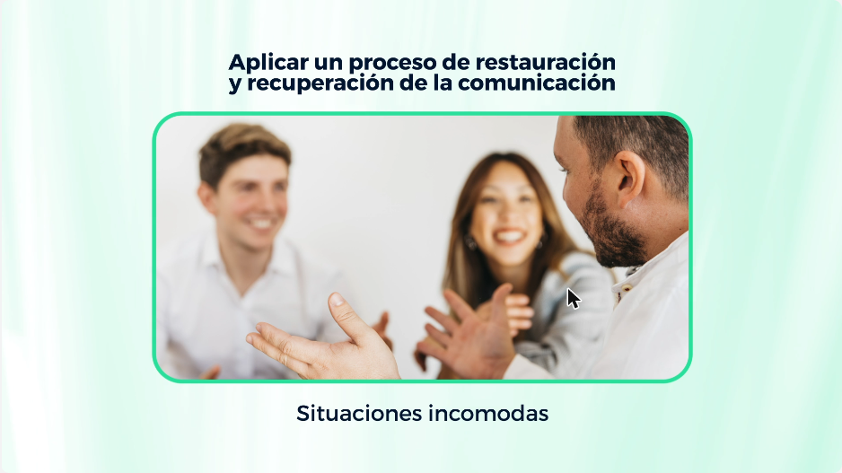
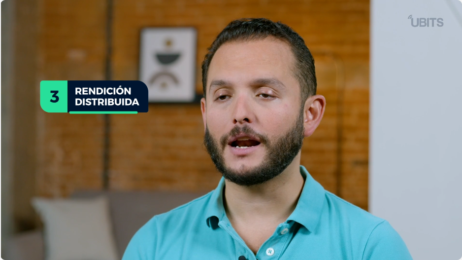
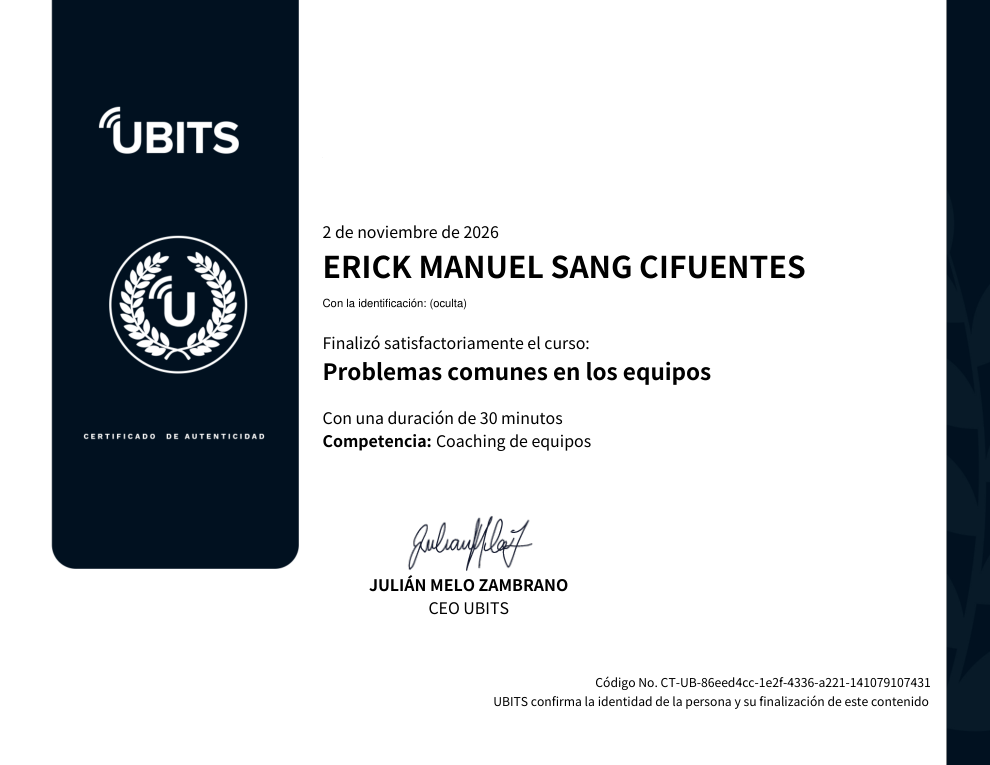

# 22 · Problemas comunes en los equipos

**Plataforma:** UBITS (programa *Equipos efectivos*) · **Experto:** Iván Edwin Rodríguez · **Duración:** 30 min · **Nivel:** avanzado · **Resultado:** 2 quizzes 3/3 y prueba final 6/6 (100 %) · **Fecha:** 2 nov 2026

Último *bit* del programa *Equipos efectivos*. Tiene 5 videos y 3 microbits, y sigue a tres equipos de una empresa ficticia, GreenFoodX:

- **Zenit**, en una etapa de «tormenta» muy intensa;
- **Máxima**, con problemas de desempeño y rendición de cuentas;
- **Supernova**, con conflictos interpersonales.

Los problemas de un equipo se dividen en problemas de **relación** (sobre las personas) y de **desempeño** (sobre el trabajo). Tener problemas es normal; lo que no es aceptable es dejarlos sin resolver.

## Microbit 1 · Gestión de los problemas (la etapa de tormenta)

Tras una integración agradable pero superficial aparecen las primeras diferencias. Hay dos respuestas posibles:

| Respuesta | Qué pasa |
|---|---|
| **Evasión** | Fingir que no pasa nada y callar para no dañar el clima. Es cómoda, pero dañina: el equipo pierde la sinergia que dan las diferencias |
| **Enfrentamiento** | Es incómodo pero más frecuente y más constructivo si se resuelve: las relaciones se vuelven más profundas |

**Habilidad clave: distinguir problema de conflicto.**

- Un **problema o desacuerdo constructivo** trata de la misión, los objetivos, las tareas y las decisiones del equipo.
- Un **conflicto** se aleja del trabajo y se centra en las personas, por ejemplo «veo que eres intransigente».

**Seis principios para reducir conflictos y elevar la expresión de diferencias:**

1. Distinguir los problemas de los conflictos.
2. Aceptar de forma explícita que el debate y los puntos de vista divergentes llevan a mejores decisiones.
3. Practicar la **comunicación asertiva**: clara, directa y sin rodeos, pero con amabilidad.
4. Aplicar un **proceso de restauración y recuperación de la comunicación** después de situaciones incómodas con enojo o tensión.
5. Nombrar roles funcionales para los problemas de relación, como el de **mediador**.
6. Desarrollar habilidades básicas de inteligencia social y emocional, con un proceso paso a paso de gestión de conflictos.

*Microbit 1, min 3:10: el cuarto principio, para cuando surgen situaciones incómodas.*

## Microbit 2 · Problemas de desempeño

El argumento de la «falta de liderazgo» no sirve en equipos autodirigidos: el desempeño del equipo está en manos de sus integrantes.

| Problema | Solución |
|---|---|
| **Objetivos poco claros** | Una planeación robusta, con objetivos específicos, recursos asignados y responsables, que se revisa cada semana y no queda en una «carpeta de recuerdos» |
| **Medición y rendición de cuentas** | Una cultura de rendición de cuentas con cuatro pilares (ver abajo) |
| **Reuniones improductivas** | Reuniones de pie (*stand-up*) y tableros visuales en lugar de diapositivas y minutas |
| **Cargas desequilibradas o ambiguas** | Analizar las cargas y equilibrar las tareas principales con los roles complementarios |

**Los cuatro pilares de la rendición de cuentas:**

1. Orientada a **resultados concluidos**, no a esfuerzos ni actividades.
2. **Frecuente y regular**, con sesiones semanales.
3. **Distribuida:** todo el equipo, por turnos, pide cuentas a los demás.
4. Basada en **hechos e indicadores**.

*Microbit 2, min 2:30: el tercer pilar, rendición de cuentas distribuida.*

## Microbit 3 · Problemas de relación interpersonal

| Problema | Cómo se resuelve |
|---|---|
| **Competencia en lugar de cooperación** | Discrepar manteniendo una actitud cooperativa; competir por imponer los propios argumentos baja la confianza |
| **Pensamiento de grupo** | Promover la expresión de diferencias y celebrar cuando aparecen divergencias; técnicas de negociación ganar-ganar |
| **Individualismo egocéntrico** | Reglas de toma de decisiones y habilidades de inteligencia emocional |
| **Conflictos emocionales** | Aprender a controlar el exceso emocional (ira, ansiedad): que las emociones salgan, pero sin desbordarse |
| **Choque de valores y creencias** | Un **marco de valores compartidos** definido desde la creación del equipo, que se usa como criterio antes de lo técnico y lo económico |

**Cierre del curso:**

- Dedicar unas horas a definir principios y reglas evita desperdiciar tiempo, energía y recursos más adelante.
- Con esto, el equipo puede anticipar la etapa de tormenta e intervenir en problemas de desempeño y de relación en cualquier etapa.

## Evaluación

**Ponte a prueba 1 (3/3):**

1. Conflictos con tensión y enojo → **un proceso de restauración y recuperación de la comunicación**.
2. «Javier genera conflictos por llamar la atención» → **falso**. El que llama la atención es el líder, y el problema es de desempeño, no de relación.
3. El líder acepta el debate y los puntos de vista divergentes → **verdadero**.

**Ponte a prueba 2 (3/3):**

1. «La retroalimentación debería resaltar solo lo positivo» → **falso**.
2. «Extender las reuniones» resuelve las reuniones improductivas → **falso**. La solución son reuniones ágiles y tableros visuales.
3. Analizar y equilibrar las cargas de trabajo → **verdadero**.

**Prueba final (6/6)**, sobre el caso del equipo Zenit:

1. Problema frente a conflicto → **el problema tiene que ver con la misión, los objetivos y el trabajo; el conflicto, con las reacciones emocionales en las relaciones**.
2. Dos habilidades para las prioridades detectadas (comunicación impositiva o ambigua y poca escucha) → **comunicación asertiva y empatía**.
3. Problema de ejecución → **comunicar de forma explícita y recurrente que el equipo tiene facultades para decidir y ejecutar**.
4. Rendición de cuentas → **indicadores, metas y sesiones semanales para rendir cuentas y planear**.
5. Decisiones por valores individuales → **definir los valores compartidos desde la integración del equipo**.
6. Pensamiento de grupo → **promover la expresión de diferencias y celebrar las divergencias**.

## Evidencia

## Fuentes y aviso legal

- **Fuente:** curso «Problemas comunes en los equipos» de la plataforma [UBITS](https://www.ubits.com), asignado dentro de un plan de formación empresarial.
- **Uso:** apuntes personales de estudio, sin fines comerciales y con redacción propia. Las capturas son fragmentos breves citados con fines educativos; sus derechos son de sus titulares.
- **Sin afiliación:** sitio no oficial, no afiliado ni respaldado por UBITS. Las marcas pertenecen a sus dueños.
- Más detalles y cómo pedir el retiro de contenido en el [aviso legal](../../aviso-legal.md).
