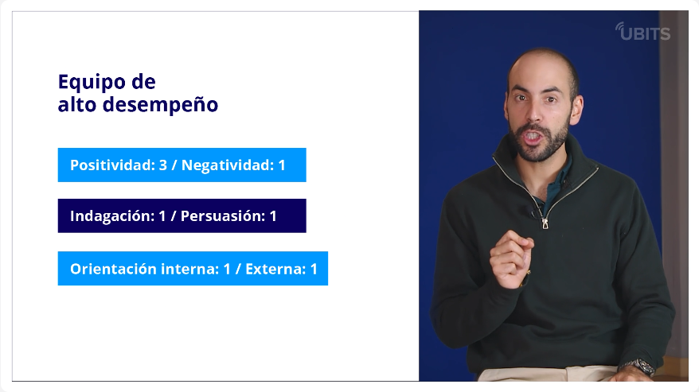
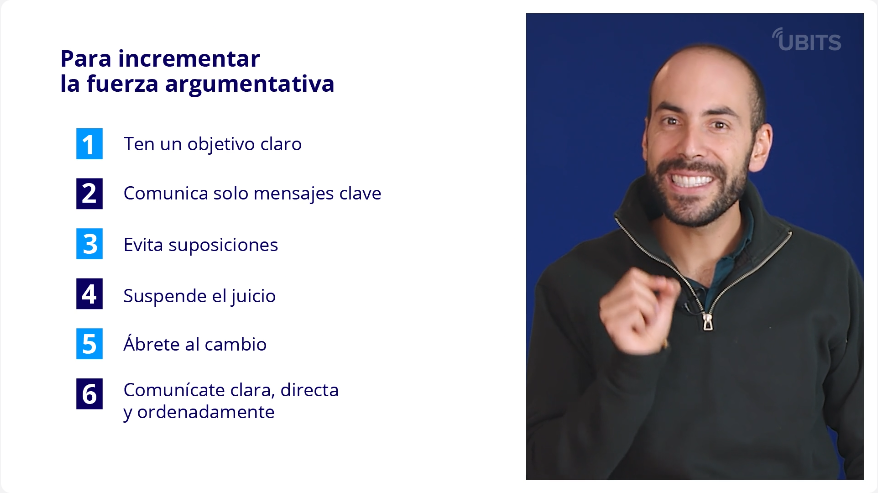
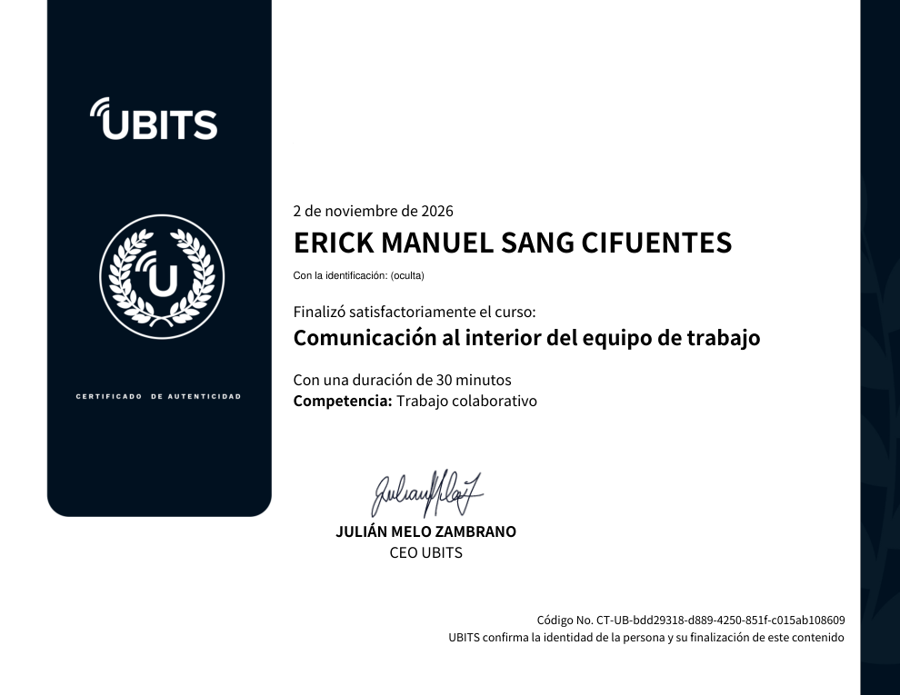

# 23 · Comunicación al interior del equipo de trabajo

**Plataforma:** UBITS · **Duración:** 30 min · **Nivel:** intermedio · **Resultado:** curso completado al 100 % (no tiene prueba) · **Fecha:** 2 nov 2026

3 videos (unos 14 min) y 3 recursos de lectura:

- estrategias de empatía;
- tipos de conflicto en el mundo laboral;
- ¿eres evitador o buscador de conflictos?

La idea que atraviesa el curso: la calidad de un equipo depende de la calidad de sus conversaciones.

## 1. La comunicación en los equipos de alto desempeño

**El trabajo en equipo se aprende.** Para el consultor Tom Peters, los equipos de alto desempeño desarrollan las **5C**:

- coordinación;
- comunicación;
- confianza;
- colaboración;
- compromiso.

**Habilidades blandas que entran en juego:** además de las técnicas, hacen falta escucha activa, cumplimiento de promesas, argumentación, asertividad y empatía, entre otras.

**El *Meta Learning* de Marcial Losada.** Clasifica las interacciones de un equipo en tres dimensiones bipolares:

| Dimensión | Polos | Tasa en equipos de alto desempeño |
|---|---|---|
| **Positividad / negatividad** | Aprobación y reconocimiento frente a desprecio y descalificación | **3 a 1** |
| **Indagación / persuasión** | Explorar lo que dice el otro frente a influir en su punto de vista | **1 a 1** |
| **Orientación interna / externa** | Referencias a lo propio frente a lo de fuera de la organización | **1 a 1** |

*Video 1, min 2:30: proporciones de interacción en un equipo de alto desempeño.*

**Metas claras:** sin comunicación positiva no hay resultados consistentes, y tampoco sin metas **SMART** (George Doran): específicas, medibles, alcanzables, realistas y con plazo.

**Las organizaciones son escenarios interpretativos.** Como dice Rafael Echeverría (*Ontología del lenguaje*): «No sabemos cómo las cosas son; solo cómo las observamos». Cada integrante ve a través de sus propios filtros:

- **emociones**;
- **cuerpo**;
- **lenguaje**.

Para trabajar en equipo hay que cuestionar cómo se observa y escuchar activamente a los demás observadores de la misma realidad.

## 2. Actos del habla y promesas

Vivimos en un mundo conversacional, y cada acto del habla conlleva un compromiso:

| Acto | Compromiso |
|---|---|
| **Afirmación** (describe) | Que sea verdad |
| **Declaración** (crea una realidad) | Que sea válida |
| **Juicio** (interpreta) | Fundamentarlo |
| **Petición, oferta, promesa** | Coordinar acciones y cumplir las condiciones de satisfacción |

**Por qué las promesas cambian la realidad:** quien la recibe empieza a actuar en función de ella. Ejemplo: si te prometen un pago a fin de mes, planeas contando con ese dinero.

**Antes de prometer, pregúntate:**

- ¿Soy sincero?
- ¿Soy competente para hacerlo?
- ¿Estoy en condiciones de cumplir?

**Si no puedes cumplir:** es mejor rechazar, posponer o hacer una contrapropuesta que prometer algo que no vas a entregar. Ser responsable también es cancelar a tiempo y reparar el daño. **La confianza se construye cumpliendo, y también por cómo actúas cuando no puedes.**

## 3. Conversaciones para gestionar conflictos

**Las tres conversaciones que, según Echeverría, necesita un equipo de alto desempeño:**

1. Para **coordinar acciones**: alcanzar objetivos.
2. Para **posibles acciones**: innovar y mejorar.
3. Para **futuras conversaciones**: preparar el terreno.

**La empresa como red de conversaciones:** los equipos efectivos *declaran quiebres*, los enfrentan y arman conversaciones para resolverlos. Por ejemplo, si vas a llegar tarde a una reunión con un cliente, llamas, explicas y pides que te esperen.

Las **conversaciones difíciles** (pedir un aumento, despedir a alguien, un cliente agresivo) se enfrentan con **más fuerza argumentativa y más empatía**.

*Video 3, min 3:25: seis pasos para fortalecer la argumentación.*

| Más fuerza argumentativa | Más empatía |
|---|---|
| 1. Un objetivo claro | 1. **Preconversación:** revisa tu diálogo interior y deja que se enfríe el enojo |
| 2. Solo 2 o 3 mensajes clave | 2. Contacto visual, sin rehuir la mirada |
| 3. Evitar suposiciones: pregunta antes de hablar | 3. Interés genuino, sin interrumpir ni cambiar de tema |
| 4. Suspender el juicio | 4. **Priorizar la relación sobre la razón** |
| 5. Abrirse al cambio de opinión | 5. Un escenario neutral; mejor si es caminando juntos |
| 6. Ser claro, directo y ordenado, con hechos y datos | |

## Evidencia

## Fuentes y aviso legal

- **Fuente:** curso «Comunicación al interior del equipo de trabajo» de la plataforma [UBITS](https://www.ubits.com), asignado dentro de un plan de formación empresarial.
- **Uso:** apuntes personales de estudio, sin fines comerciales y con redacción propia. Las capturas son fragmentos breves citados con fines educativos; sus derechos son de sus titulares.
- **Sin afiliación:** sitio no oficial, no afiliado ni respaldado por UBITS. Las marcas pertenecen a sus dueños.
- Más detalles y cómo pedir el retiro de contenido en el [aviso legal](../../aviso-legal.md).
