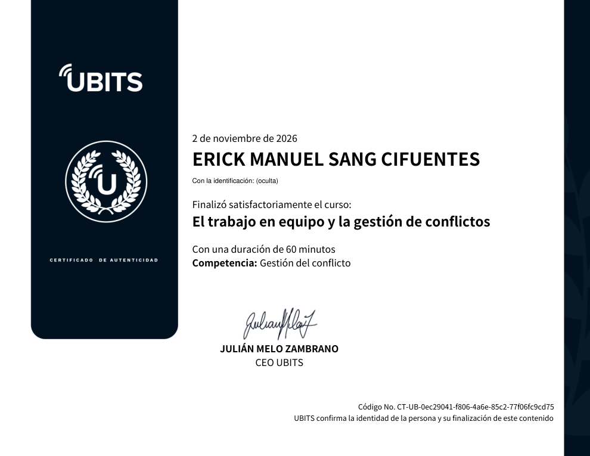

# 24 · El trabajo en equipo y la gestión de conflictos

**Plataforma:** UBITS · **Experto:** José María Vich (ejecutivo global y *coach* corporativo, exdirectivo de American Express y Western Union) · **Duración:** 60 min · **Nivel:** básico · **Resultado:** prueba final 5/5 (100 %) · **Fecha:** 2 nov 2026

El curso tiene 5 videos, una infografía y una lectura. La idea central: **el conflicto es una oportunidad, no un problema**.

**Objetivos:**

- entender las dinámicas de equipo, los roles, las responsabilidades y los objetivos;
- ver el conflicto como una oportunidad;
- saber lidiar con los problemas en una sociedad digitalizada.

## Microbit 1 · El rol del líder y el trabajo en equipo

Abre con el video *Social Media Revolution* y una charla sobre la fuerza detrás de Virgin.

**Ideas para llevar:**

- Las empresas con **estructuras verticales están en vía de extinción**.
- En los equipos deben reinar **la comunicación y la confianza**, no el miedo.
- **El liderazgo nunca puede ser emocional.**
- En el trabajo en equipo, **el tiempo de todos es el recurso más valioso**.
- Las empresas dejan a los trabajadores, no al revés.

## Microbit 2 · Una oportunidad para hacer la diferencia

**Ideas para llevar:**

- Trabajar el perfil de cada integrante evita conflictos desde el inicio.
- **Un líder no es quien habla, sino quien escucha.**
- Haz lo simple, siempre.
- Si algo no está claro, pregunta.
- No hagas lo mismo una y otra vez esperando resultados distintos.

## Microbit 3 · ¿Los conflictos son problemas u oportunidades?

**Ideas para llevar:**

- Trata a los demás como quieres que te traten y da las gracias varias veces al día.
- No te predispongas a lo negativo.
- Elige a la gente adecuada.
- **No juegues con el tiempo de la gente.**
- **Ten objetivos claros** y comparte la información.
- **Felicita en público y corrige en privado.**
- Desarrolla actitud, confianza y firmeza.
- Un reto debe ser **SMART**: específico, medible, alcanzable, relevante y con fecha límite.

## Microbit 4 · Los seres humanos y el liderazgo espiritual

Incluye una lectura sobre la *inteligencia espiritual* de Robert C. Stern.

**Ideas para llevar:**

- **Invierte primero en cultura y luego en tecnología.**
- Los resultados de verdad se consiguen cambiando la mentalidad.
- **Trabaja en el conflicto, no contra él.**

## Evaluación (5/5)

1. «Para decidir bien, el líder debe hacerlo en la soledad de su despacho, pero compartiendo información y estimulando la confianza» → **falso**. Decidir bien es hacerlo con el equipo, no a solas.
2. Para tener equipos efectivos hay que tener claridad en los objetivos → **verdadero**.
3. En el trabajo en equipo, lo más valioso es el tiempo → **verdadero**.
4. «Un buen líder escucha, pero primero habla» → **falso**. El líder es el que escucha.
5. Un reto debe ser específico, medible, alcanzable, relevante y con fecha límite → **verdadero**.

## Evidencia

## Fuentes y aviso legal

- **Fuente:** curso «El trabajo en equipo y la gestión de conflictos» de la plataforma [UBITS](https://www.ubits.com), asignado dentro de un plan de formación empresarial.
- **Uso:** apuntes personales de estudio, sin fines comerciales y con redacción propia.
- **Sin afiliación:** sitio no oficial, no afiliado ni respaldado por UBITS. Las marcas pertenecen a sus dueños.
- Más detalles y cómo pedir el retiro de contenido en el [aviso legal](../../aviso-legal.md).
