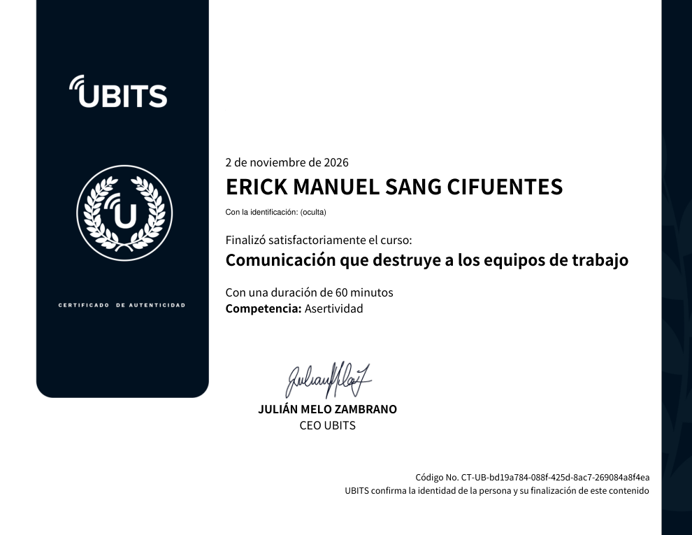

# 25 · Comunicación que destruye a los equipos de trabajo

**Plataforma:** UBITS · **Experto:** Germán Normandía Vélez · **Duración:** 60 min · **Resultado:** prueba final 5/5 (100 %, en el segundo intento) · **Fecha:** 2 nov 2026

The course has 5 videos, 2 infographics and a UBITSLab practice case, split into three micro-modules:

1. Thinking outside the box (collaborative intelligence).
2. Causes of conflict.
3. Value dialogues (metalanguage and active listening).

## Microbit 1 · Piensa fuera de la caja: sumar frente a multiplicar

**The arithmetic of teamwork:**

- **Summing:** three collaborators who each give 5 make **15**. Coaching them all up to 10 makes 30.
- **Multiplying:** if you change the sign, the same people make **125** (5×5×5) or **1,000** (10×10×10).
- **Conclusion:** summing efforts is outdated; today you multiply. You do it by complementing each person's talent and passion through **empathetic leadership**.

> «El talento gana partidos, pero el trabajo en equipo y la inteligencia ganan campeonatos» (Michael Jordan).

**The «where is north?» exercise:** with their eyes closed, each person points north and almost everyone points somewhere different. The same thing happens with goals inside a team.

**Harris Group data:**

| Dato | % |
|---|---|
| Sabían cuáles eran las metas más importantes de la organización | 15 % |
| Estaban comprometidos con ellas | 19 % |
| Dedicaban su tiempo a cosas sin importancia | 49 % |
| No sabían qué hacer para ayudar a lograr las metas | 51 % |

**Suggested test:** ask each collaborator to write down, without talking to anyone or checking anything, the organisation's goals and their area's three priorities. Then compare the answers to see whether everyone is heading the same way.

## Microbit 2 · Las siete causas de los conflictos

A conflict is a difficulty between people with opposing interests, values or thoughts. It can turn into something positive, depending on your ability to understand what's behind it.

| Conflicto | Qué es |
|---|---|
| **De roles** | No está claro quién hace qué, cuándo y hasta dónde; aparecen duplicidades. Es como un equipo de fútbol donde no se sabe quién es el portero |
| **De objetivos** | Áreas con metas aparentemente opuestas, como calidad y producción |
| **Cultural** | Fusiones, adquisiciones, otras nacionalidades, nostalgia por la empresa anterior |
| **De información** | La información no baja, se queda en juntas o se descalifican las fuentes |
| **De distribución** | Sensación de que recursos, cargas o reconocimientos se reparten de forma injusta; genera envidia |
| **Interpersonal** | Personas que no se caen bien o con estilos incompatibles |
| **De poder** | Juegos de ganar-perder, «servirse del poder en vez de servir con el poder» |

All of them are preventable with **clear messages suited to the audience**.

*Video 3, min 1:00: el experto explica los conflictos de roles y de objetivos.*

## Microbit 3 · Diálogos de valor: el metalenguaje

**Value dialogues** are the ability to exchange, complete and secure the flow of meaningful messages. They're called **metalanguage** because they go beyond words.

**The mechanic example:** once he tells you «it's a noise like two spoons knocking together», you can hear it too. Without *distinctions*, we fall into mental traps.

**The three filters of verbal communication:**

| Filtro | Ejemplo | Cómo responder |
|---|---|---|
| **Generalización** | «Todos los jefes son neuróticos» | «¿Todos, todos?»: obliga a precisar |
| **Eliminación** | «Soy incapaz» | «¿Incapaz de qué?»: ayuda a completar lo que falta |
| **Distorsión** | «Conozco tus intenciones» | «¿Cuáles son mis intenciones?»: aclara el significado |

**Active listening:**

- In Zeno's words, we have two ears and one tongue.
- Treat everyone as if they carried a sign saying «quiero sentirme importante».
- Speak only when necessary and ask open questions.
- **Paraphrase** and show openness.

## UBITSLab · El caso de José Luis

**The case:** a centralist supervisor who doesn't share information and goes round in circles. His team is bureaucratic, a client complained, and his emergency meeting ended in mutual blame.

**The expert's answer:**

1. **Make José Luis aware** that the challenge is there and that «the ball is in his court».
2. Once the resistance and blame have passed, work on these points:
    - brief, clear and simple communication, adapted to the audience;
    - acting as a **facilitator** rather than an instructor;
    - backing up messages with facts and evidence, not emotional speeches;
    - using feedback to adjust on time;
    - managing his own emotions and the team's.

## Evaluación (5/5)

The questions come from a random pool; I give the ones from the two attempts.

- **Conflicto de roles** (Gerardo y dos vendedores) → **una reunión que aclare el rol, las funciones y las expectativas de cada uno**.
- **Confusión que lleva a decisiones equivocadas** con un equipo competente → **conflicto de información**.
- **Reestructuración con tareas duplicadas** → **conflicto de roles**.
- **Motivar individualmente sin mejoras** (Fernanda) → **estimular el trabajo en equipo y la inteligencia colaborativa**.
- **Escucha activa** (Fernando) → **parafrasear y mostrar apertura**.
- **Relacionar conflictos:**
    - cultural → valores y estereotipos distintos;
    - interpersonal → no se caen bien;
    - distribución → reparto percibido como injusto.
- **Inteligencia colaborativa** (Juan) → **alinear los objetivos hacia una visión común**.
- **Filtros de la comunicación** (María: «ya saben lo que quiero») → en el primer intento marqué «distorsionó» y fue incorrecto. En el segundo intento esa pregunta no salió, así que la respuesta correcta queda sin confirmar. La otra opción que no probé es «usó palabras poco claras que generan ambigüedad».

## Evidencia

## Fuentes y aviso legal

- **Fuente:** curso «Comunicación que destruye a los equipos de trabajo» de la plataforma [UBITS](https://www.ubits.com), asignado dentro de un plan de formación empresarial.
- **Uso:** apuntes personales de estudio, sin fines comerciales y con redacción propia. Las capturas son fragmentos breves citados con fines educativos; sus derechos son de sus titulares.
- **Sin afiliación:** sitio no oficial, no afiliado ni respaldado por UBITS. Las marcas pertenecen a sus dueños.
- Más detalles y cómo pedir el retiro de contenido en el [aviso legal](../../aviso-legal.md).
