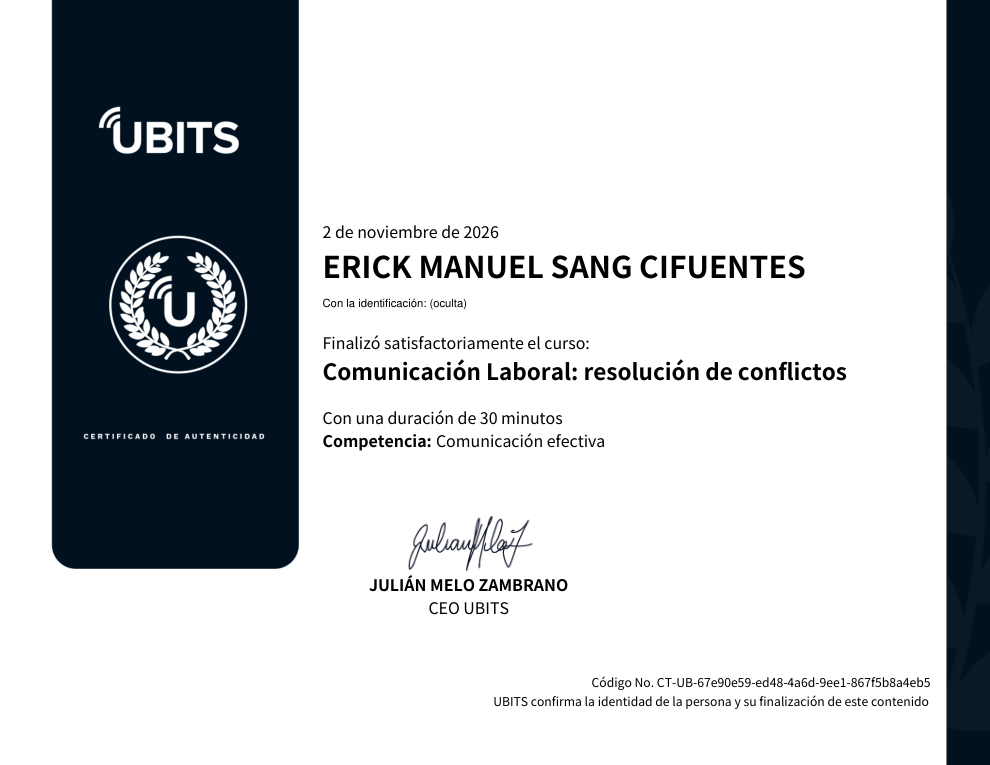

# 26 · Comunicación laboral: resolución de conflictos

**Plataforma:** UBITS · **Presentadora:** Manuela Díaz · **Duración:** 30 min · **Resultado:** prueba final 10/10 (100 %) · **Fecha:** 2 nov 2026

5 videos, 2 lecturas («Planear bien = trabajar bien» y «Comité de convivencia») y dos foros. Va en tres pasos: entender el conflicto, prevenirlo y resolverlo con mediación.

## Microbit 1 · ¿Qué es el conflicto?

- **Definición:** el conflicto no es sinónimo de problema. Es el resultado de poner en común pensamientos, acciones y sentimientos distintos, a veces contradictorios. Evidencia las diferencias entre personas y **puede incitar al diálogo o terminar en disputas**.
- **Requisito:** para que haya conflicto tiene que haber una respuesta emocional o una interacción.
- **Conflicto interno:** también existe; por ejemplo, un conflicto ético cuando los valores de la persona no coinciden con los de la empresa.
- **Dirección:** en las organizaciones se da a nivel **horizontal** (entre compañeros) o **vertical** (líder y colaboradores), e incluso entre **áreas**. Influye también el contexto: la relación persona-empresa y empresa-industria.
- **Clasificación:** se clasifican según las partes implicadas, las causas, la naturaleza y el efecto. Por causas hay, por ejemplo, **estructurales** y **de relación**. Según las partes, el **intragrupal** se da dentro de un mismo grupo o área.
- **Para resolver bien:** comprender el entorno y asumir una actitud proactiva y conciliadora.

## Microbit 2 · Prevenir los conflictos laborales

Cuatro claves para que un conflicto no se vuelva un problema:

1. **Mejorar la comunicación interna:**
    - protocolos de comunicación;
    - empleados escuchados e informados;
    - desmentir rumores;
    - que nadie se entere por terceros de lo que afecta su trabajo.
2. **Definir las reglas de juego:** estructura, objetivos, rol, funciones y alcances claros. Que cada persona sepa qué hace, cómo y con qué.
3. **Liderar con responsabilidad:** el líder gestiona el flujo de trabajo, decide y hace de mediador.
4. **Hacer seguimiento y conocer la empresa:**
    - entender al equipo y no subestimarlo;
    - delegar con responsables claros;
    - como colaborador, apropiarse del trabajo.

**Planear y organizar:** estrategia lista, estructura clara y protocolos preparados, comunicados al trabajador para que se apropie de su labor.

## Microbit 3 · Resolver conflictos: la mediación

**Cómo se llega al acuerdo:** para resolver hace falta un acuerdo, y para el acuerdo, diálogo. Cuando el diálogo directo no es posible, interviene un **mediador**: un tercero neutral que facilita la conversación sin tomar partido.

**Quién media:**

- el líder, si el conflicto es dentro del equipo;
- **Recursos Humanos**, si es entre líderes y colaboradores.

**Los cinco pasos del mediador:**

1. **Conocer la situación:** fuentes del conflicto, repercusiones, roles de las partes.
2. **Dialogar con cada parte por separado:** tomar nota y ubicar coincidencias y diferencias, sin involucrarse.
3. **Facilitar el diálogo entre las partes:** moderar, dar la palabra, hacer preguntas clave y calmar los ánimos.
4. **Orientar conclusiones:** resaltar encuentros y desencuentros y concretar acuerdos firmados, **sin imponerlos**.
5. **Hacer seguimiento:** si los acuerdos no se cumplen, el ciclo vuelve.

**Comité de convivencia:**

- La empresa debe tener un **plan de convivencia**, basado en un diagnóstico de los problemas internos, que incluya un **comité** encargado de la estrategia de convivencia.
- Según la **OIT**, la mayoría de los problemas internos vienen del pago, los beneficios, la seguridad, la salud, los despidos, la discriminación o la violación de derechos de los trabajadores.

## Evaluación (10/10)

1. El conflicto es producto de las relaciones humanas en un contexto y **evidencia las diferencias entre personas: puede incitar el diálogo o resultar en disputas**.
2. Los niveles → **horizontal / vertical / áreas**.
3. Dos tipos según las causas → **estructurales y de relación**.
4. Intragrupal → **dentro de un mismo grupo o área**.
5. Dos claves para evitar conflictos → **mejorar la comunicación interna y liderar con responsabilidad**.
6. Reglas de juego → **que las personas sepan qué, cómo y con qué van a trabajar**.
7. Planear y organizar con estrategia, estructura y protocolos comunicados → **verdadero**.
8. Mediación → **facilitar el diálogo y ayudar a que las partes lleguen a un acuerdo**.
9. Dos pasos de la mediación → **dialogar con cada parte y orientar las conclusiones**.
10. El comité de convivencia surge del plan de convivencia basado en un diagnóstico → **verdadero**.

## Evidencia

## Fuentes y aviso legal

- **Fuente:** curso «Comunicación laboral: resolución de conflictos» de la plataforma [UBITS](https://www.ubits.com), asignado dentro de un plan de formación empresarial.
- **Uso:** apuntes personales de estudio, sin fines comerciales y con redacción propia.
- **Sin afiliación:** sitio no oficial, no afiliado ni respaldado por UBITS. Las marcas pertenecen a sus dueños.
- Más detalles y cómo pedir el retiro de contenido en el [aviso legal](../../aviso-legal.md).
