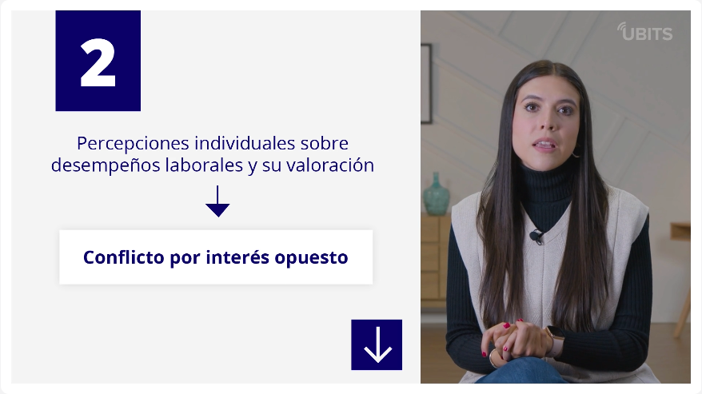
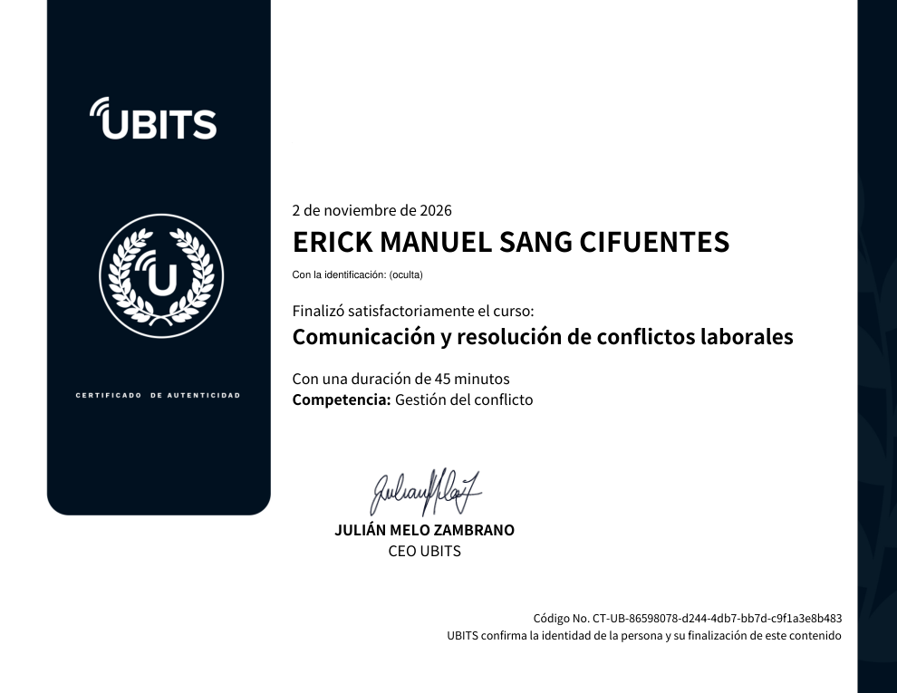

# 27 · Comunicación y resolución de conflictos laborales

**Plataforma:** UBITS · **Duración:** 45 min · **Resultado:** curso completado al 100 % (no tiene prueba) · **Fecha:** 2 nov 2026

3 videos (unos 10 min) y 2 presentaciones: «Lo que todo líder debe comprender y comunicar de manera efectiva» y «Técnicas de comunicación asertiva para resolver conflictos».

## 1. Principios de la comunicación

- **La comunicación es circular, no lineal:** emisor y receptor se intercambian el papel todo el tiempo. **Sin retroalimentación no hay comunicación.**
- **Los tres principios que no cambian, por mucha tecnología que haya:**
    1. **Es imposible no comunicar:** hasta el silencio transmite un mensaje.
    2. **Toda comunicación tiene contenido (QUÉ) y relación (CÓMO).** Por ejemplo, no es igual el «gracias» al taquillero del cine que el que le das a tu pareja.
    3. **Comunicamos de forma digital y analógica.** Lo digital son los signos: palabras, números, símbolos. Lo analógico es lo no verbal y paralingüístico: gestos, tono, entonación, signos de exclamación. **Lo digital expresa sobre todo el contenido; lo analógico, la relación.**
- **Un apretón de manos** puede expresar bienvenida, pero también poder, sumisión o ansiedad. Leer lo analógico depende de la inteligencia emocional.

## 2. Comunicación laboral y conflictos

**Comunicar en el trabajo es hacer equipo.** Para que sea eficaz, todos deben:

- expresar con claridad;
- interpretar con objetividad;
- mantener los acuerdos.

**Barreras:**

- la percepción selectiva por las emociones;
- las jergas regionales o de oficio;
- la sobrecarga de información.

**Elegir el canal:**

| Canal | Ventaja | Cuándo usarlo |
|---|---|---|
| **Cara a cara** | Reduce malentendidos y da retroalimentación directa | Asuntos sensibles |
| **Teléfono** | Tiempo real, con tono y silencios | Ventas y cobranzas; no para temas delicados |
| **Correo** | Indirecto: se puede revisar antes de enviar | Lo formal y lo que debe quedar escrito; se presta a malas interpretaciones |

**Qué es un conflicto:** un estado de tensión entre partes con intereses que ven difícilmente compatibles. Surge de diferencias de criterio, percepciones subjetivas, deseo de imponerse o atribución de malas intenciones.

**Si se gestiona bien,** sobre todo negociando, un conflicto puede ser **funcional**: mejora el rendimiento y la creatividad.

## 3. Técnicas para resolver conflictos

**Técnicas asertivas:**

- **banco de niebla**;
- **aserción negativa**;
- **pregunta asertiva**;
- **DESC**.

**Técnicas clásicas:**

| Técnica | Qué es |
|---|---|
| **Negociación** | Las partes, con voluntad de conciliar, llegan a un acuerdo y preservan la relación |
| **Mediación** | Un tercero ayuda a decidir juntos cuando no hubo acuerdo; evita litigios |
| **Arbitraje** | Un árbitro imparcial da una solución **vinculante** |

**Las cinco fuentes del conflicto organizacional:**

1. Distribución desigual del poder → **conflicto estructural**.
2. Percepciones distintas sobre el desempeño y su valoración → **conflicto de intereses opuestos**.
3. Información limitada → **conflicto por deficiencia de información**.
4. Comunicación ineficaz → **conflicto por malas decisiones interpersonales**.
5. Distinto valor dado a ideas o situaciones → **conflicto por diferencias de criterio**.

*Video 3, min 1:40: la segunda fuente, conflicto de intereses opuestos.*

**Cinco estrategias de gestión, según el caso:**

| Estrategia | Cuándo |
|---|---|
| **Forzar** | Decisiones cruciales y rápidas |
| **Ceder** | Para preservar la armonía, si no implica pérdidas importantes |
| **Evitar** | Conflictos poco relevantes o que otros manejan mejor |
| **Comprometer** | Acuerdos temporales con concesiones mutuas |
| **Colaborar** | Consenso duradero, ganar-ganar |

## Evidencia

## Fuentes y aviso legal

- **Fuente:** curso «Comunicación y resolución de conflictos laborales» de la plataforma [UBITS](https://www.ubits.com), asignado dentro de un plan de formación empresarial.
- **Uso:** apuntes personales de estudio, sin fines comerciales y con redacción propia. Las capturas son fragmentos breves citados con fines educativos; sus derechos son de sus titulares.
- **Sin afiliación:** sitio no oficial, no afiliado ni respaldado por UBITS. Las marcas pertenecen a sus dueños.
- Más detalles y cómo pedir el retiro de contenido en el [aviso legal](../../aviso-legal.md).
