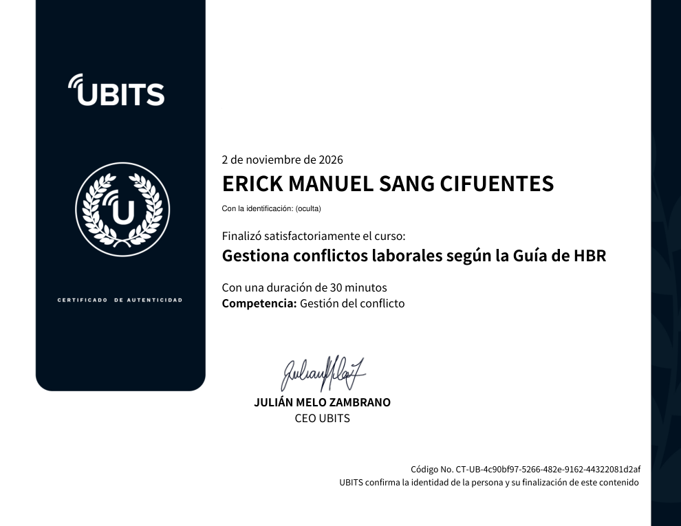

# 28 · Gestiona los conflictos laborales según la Guía de HBR

**Plataforma:** UBITS · **Base:** *HBR Guide to Dealing with Conflict* (Amy Gallo, 2017) · **Duración:** 30 min · **Resultado:** prueba final aprobada, curso al 100 % con certificado · **Fecha:** 2 nov 2026

4 videos, un recurso sobre tipos de conflicto, una reseña del libro y una prueba final de 5 preguntas. La plataforma no muestra la nota de esta prueba, pero el certificado solo se emite si se aprueba. Cada video trata un escenario distinto.

## 1. Conflicto con tu jefe

**El caso:** el jefe se llevó todo el crédito de tu trabajo. La relación con el jefe directo predice buena parte de la experiencia laboral, así que vale la pena manejar bien el conflicto.

**Cuatro pasos:**

1. **Dejar que la mente se enfríe** un par de días.
2. **Mantener los gestos de respeto**, para que te siga viendo ecuánime.
3. **Centrarse en las necesidades del negocio**, no en las propias. Por ejemplo: si no comparte el crédito, el *board* puede cargarle más proyectos y crear un cuello de botella que afecta los indicadores de todo el equipo.
4. **Dejar clara la intención constructiva.** Joseph Grenny propone una fórmula: «Quiero compartirte una preocupación; no dudo de tu liderazgo, pero no sería leal quedarme callado. ¿Podemos hablarlo?».

## 2. Conflicto en el teletrabajo

**Por qué el trabajo remoto agrava algunos conflictos:**

- **Falta de empatía:** no vemos las señales no verbales del día a día.
- **Efecto de desinhibición en línea:** detrás de la pantalla nos moderamos menos.
- **Mucha comunicación por texto:** tendemos a atribuir mal la intención. Un correo que suena autoritario se lee como amenaza, y el sesgo de confirmación construye una historia alrededor.

**Qué hacer:**

- Pensar antes de reaccionar y buscar una **interpretación lógica y generosa**; no tenemos poderes telepáticos.
- Si el problema es real, conversar **centrándose en el problema de negocio**, no en la dinámica personal.
- Subir la fidelidad del canal. **Mejor el teléfono que el video:** hay menos distracciones, como verse a uno mismo, y se escucha mejor.

## 3. Conflicto con una persona pasivo-agresiva

**Rasgos:** expresa el enojo de forma indirecta, con insinuaciones, sarcasmo, procrastinación y errores intencionales, y niega que exista el problema.

**Cuatro claves de Amy Gallo:**

1. **Aceptar** que es así; su comportamiento no tiene que ver contigo.
2. **Despersonalizar:** centrarse en el foco del conflicto (objetivo, proceso, crédito) y no en su comportamiento.
3. **Concentrarse en lo común:** ¿qué queremos los dos?
4. **Apoyarse en el equipo:** que todos expresen requerimientos y compromisos en las reuniones y queden en acta, para que la persona no pueda desligarse después.

## 4. Reconstruir la confianza después de un conflicto

**Después de cualquier conflicto hay que sanar la relación,** aunque se haya resuelto:

- Si elegiste **no hacer nada**, no guardes resentimiento.
- Si la conversación **no funcionó**, date tiempo para que se disipe la energía negativa.

**Reparar en lo cotidiano.** Según Susan David (Harvard), los cambios reales ocurren en las acciones diarias, no en los momentos decisivos:

- gestos de cortesía y preguntas de calidad;
- espacios psicológicos compartidos, como preguntarle por su trabajo o **pedir su opinión sobre algo común**.

**Si fuiste tú quien rompió la confianza:**

- **Restablecer la reciprocidad:** ofrecer sin pedir nada a cambio, como asumir una tarea o invitar el almuerzo.
- **Disculparse solo por tu parte**, sin esperar que el otro lo haga y solo si lo sientes de verdad. Una disculpa falsa empeora todo.

## Evaluación (5/5 preguntas)

1. Por qué se agrava el conflicto remoto → **falta de empatía por no conocer el lenguaje no verbal del otro**.
2. Compañero pasivo-agresivo → **despersonalizar y centrarse en el foco del conflicto**.
3. Lucía y las instrucciones confusas de su jefe → **expresar sus preocupaciones con claridad y respeto, enfocada en el impacto sobre el trabajo y el equipo**.
4. Juan y la compañera remota que no responde → **llamarla por teléfono, plantear el problema y escuchar su versión antes de atribuirle mala intención**.
5. Restablecer la reciprocidad → **conversaciones informales en las que se le pide su opinión sobre algo común**.

## Evidencia

## Fuentes y aviso legal

- **Fuente:** curso «Gestiona conflictos laborales según la Guía de HBR» de la plataforma [UBITS](https://www.ubits.com), basado en *HBR Guide to Dealing with Conflict* (Amy Gallo, Harvard Business Review Press, 2017). Asignado dentro de un plan de formación empresarial.
- **Uso:** apuntes personales de estudio, sin fines comerciales y con redacción propia.
- **Sin afiliación:** sitio no oficial, no afiliado ni respaldado por UBITS ni por HBR. Las marcas pertenecen a sus dueños.
- Más detalles y cómo pedir el retiro de contenido en el [aviso legal](../../aviso-legal.md).
