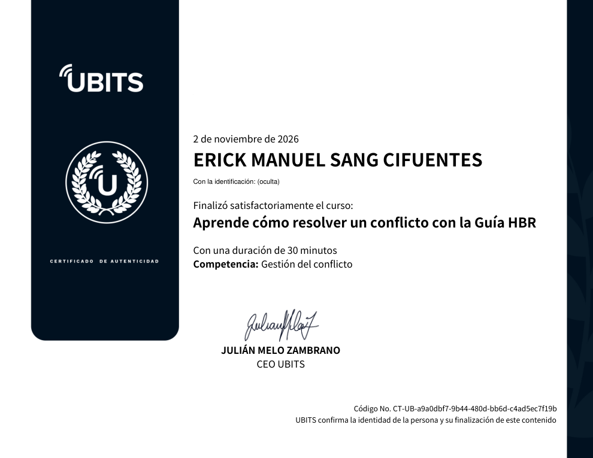

# 29 · Aprende cómo resolver un conflicto con la Guía HBR

**Plataforma:** UBITS · **Base:** *HBR Guide to Dealing with Conflict* (Amy Gallo, 2017) · **Duración:** 30 min · **Resultado:** prueba final 5/5 (100 %) · **Fecha:** 2 nov 2026

Es la continuación del curso 28. Tiene 3 videos, un recurso para identificar tu tendencia («¿eres evitador o buscador de conflictos?»), una reseña de la guía y la prueba. Recorre las opciones que hay ante un conflicto, cómo preparar la conversación y cómo sostenerla.

## 1. Las cuatro opciones ante un conflicto

Hacer un alto y resolver el conflicto no es la única salida válida. Siempre hay cuatro opciones:

| Opción | Cuándo conviene |
|---|---|
| **No hacer nada** | Cuando **el costo de abordarlo supera la recompensa**. No es huir: es decidir conscientemente no gastar tiempo ni energía, o reconocer que el otro no está dispuesto a hablar |
| **Actuar indirectamente** | Pedir a un tercero que hable o decida, o usar una **metáfora o historia**, como en las culturas asiáticas. Ejemplo: al llegar una compañera nueva, sugerirle al jefe controlador que «pronto podrá soltarla y confiar en ella» |
| **Actuar directamente** | Preparar y sostener una conversación. Es lo mejor si temes que quede resentimiento, si lo indirecto no funcionó o si **valoras mucho la relación** |
| **Salir de la relación** | Si nada funciona y es posible, por ejemplo con alguien de otra área. Da alivio, pero puede dañar otras relaciones o tu reputación |

## 2. Prepararse para la conversación: ocho pasos

1. **Cambiar el marco mental:** no es una «conversación difícil», sino una oportunidad para proponer una solución o restaurar la relación.
2. **Ponerse en la cabeza del otro:** ¿qué objetivo tiene? ¿qué terreno tenemos en común?
3. **Ver el contexto ampliado:** cultura competitiva, despidos recientes, un líder conciliador.
4. **Planear el mensaje:** pocas ideas clave, no un guion.
5. **Prepararse para varios escenarios:** ¿y si llora, grita, se queda callado o saca tus errores?
6. **Elegir el momento:** no esperar a que termine el proyecto ni hablar justo antes de una reunión clave o en el cierre de mes.
7. **Elegir el lugar:** que no dé ventaja a nadie, privado y cara a cara.
8. **Llegar con las emociones ventiladas:** desahogarse antes, con alguien o frente al espejo, para llegar «ligero».

## 3. Resolver el conflicto conversando

**Cómo conducir la conversación:**

- **Fijar reglas:** no interrumpir, no gritar, no atacar a la persona.
- **Escuchar y buscar terreno común:** ¿qué queremos los dos? Profundizar con preguntas: «¿por qué es tan importante para ti?», «¿cuál sería la mejor solución?», «¿qué te gustaría que pasara?».
- **Mirar al futuro:** «lo que pasó, pasó». Proponer: «enfoquémonos en lo que podemos hacer de aquí en adelante».

**Cómo regular las emociones, las propias y las del otro:**

- respiración, visualización, mantras;
- validar al otro con frases como «te entiendo» o «en tu lugar me sentiría igual»;
- reconocer la propia emoción (enojo, culpa, frustración) sin que contamine la forma de hablar.

**Cómo hablar:**

- **Hechos, no emociones:** evitar «que tú dijiste, que yo pensé».
- **Lenguaje no confrontacional:** «me molesta que el proyecto se retrase» en lugar de «no cumpliste el plazo». Evitar «siempre» y «nunca».
- **Transformar la culpa en responsabilidad:** en vez de «me siento fatal, muy culpable», decir **«me siento responsable por lo que nos trajo hasta aquí»**.
- **Poner límites asertivos** si el otro no se regula. Ejemplo: «cuando elevas la voz y usas sarcasmo siento que me menosprecias; te pido un tono más respetuoso. Aprecio nuestra relación».

## Evaluación (5/5)

1. Expresar la culpa de forma constructiva → **«Me siento responsable por aquello que nos trajo hasta aquí»**.
2. Evitar desbordarse en la conversación → **desahogar las emociones antes de la reunión para llegar con menos carga**.
3. Pedro y Ana, después de que el jefe no logró nada → **preparar una conversación directa con Ana y trabajar juntos en la solución**.
4. Cuando abordar el problema cuesta más de lo que vale → **dejarlo pasar**.
5. Preparar la conversación → **anticipar varias respuestas de la contraparte y planear cursos de acción constructivos**.

## Evidencia

## Fuentes y aviso legal

- **Fuente:** curso «Aprende cómo resolver un conflicto con la Guía HBR» de la plataforma [UBITS](https://www.ubits.com), basado en *HBR Guide to Dealing with Conflict* (Amy Gallo, Harvard Business Review Press, 2017). Asignado dentro de un plan de formación empresarial.
- **Uso:** apuntes personales de estudio, sin fines comerciales y con redacción propia.
- **Sin afiliación:** sitio no oficial, no afiliado ni respaldado por UBITS ni por HBR. Las marcas pertenecen a sus dueños.
- Más detalles y cómo pedir el retiro de contenido en el [aviso legal](../../aviso-legal.md).
