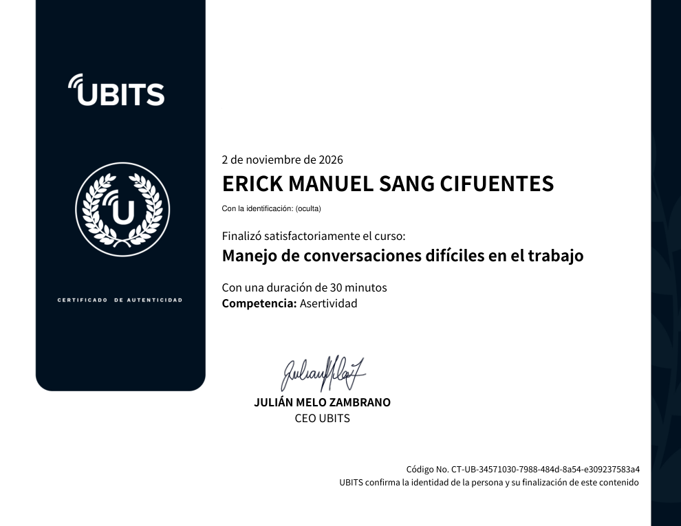

# 30 · Manejo de conversaciones difíciles en el trabajo

**Plataforma:** UBITS · **Experto:** Carlos Fernando Ramírez · **Duración:** 30 min · **Competencia:** asertividad · **Resultado:** quizzes 3/3 y 4/4, prueba final 10/10 (100 %) · **Fecha:** 2 nov 2026

La comunicación es el mecanismo por excelencia para conseguir resultados, pero no siempre sale como esperamos. El curso entrega herramientas verbales y no verbales para preparar y conducir conversaciones complejas, y cierra con tres maneras de llegar a una solución.

## Microbit 1 · La persuasión

- La persuasión tiene mala fama porque suena a engaño, pero bien usada es **la forma más eficiente de tomar el control amigable** de una conversación.
- **Sin ética**, alguien gana y alguien pierde, y muchas veces pierden todos.
- **Con ética**, mejora tus condiciones y las de tu equipo e invita a otros a ver el mundo de una manera que conviene a más personas.

## Microbit 2 · La certeza

- **Definición técnica:** la certeza es la habilidad de tener el control de una comunicación. Entre dos partes, **quien tiene mayor certeza tiene el control momentáneo** de la conversación.
- **Ejemplos naturales:** un niño que responde sin dudar qué quiere ser de grande; un equipo deportivo que sale al campo «con pinta de ganador» frente a otro que se ve nervioso.
- La clave es combinar las dos fuerzas: **certeza** (tu poder interior) al servicio de una **persuasión ética**.

## Microbit 3 · El lenguaje hipnótico

Son estructuras lingüísticas estudiadas por la programación neurolingüística. Tienen dos propósitos:

1. Conectar con el cerebro de la contraparte.
2. Enviar mensajes que pasen la «aduana lógica», es decir, que no activen sus defensas.

| Recurso | Cómo se usa |
|---|---|
| **El nombre** | Es la palabra que más activación genera en una persona. Anótalo al iniciar la conversación si te cuesta recordarlo, y úsalo |
| **La palabra «tú»** | Conecta más que el trato distante, incluso en entornos formales |
| **Las opciones ilusorias** | Al cerebro le gusta decidir porque le da sensación de poder. Ofrece opciones que llevan todas al resultado buscado: «¿Lavas la loza antes o después del noticiero?» |

## Microbit 4 · El espejeo

El **espejeo**, o activación de la neurona motora, genera cercanía y empatía: el cerebro del otro se asocia contigo.

**En el lenguaje verbal:**

- Busca lo que tienen en común: lugar de origen, estudios, algo que te guste de cómo viste o cómo habla, y házselo saber.
- **Debe ser real.** Fingir es inútil porque el cerebro del otro se defiende; nada asocia más que la verdad.
- Es una herencia de cuando cazábamos en grupo: el cerebro está hecho para trabajar en equipo.

**En el lenguaje no verbal:**

| Lenguaje disuasorio (cierra, protege) | Lenguaje invitacional (abre) |
|---|---|
| Brazos o piernas cruzados | Gestos amplios |
| Manos sobre la mesa e inclinarse hacia adelante: mensaje de poder | Palmas hacia arriba |
| Señalar con el dedo | **Ilustradores:** manos que acompañan el discurso de manera equilibrada |

Ubica en qué momento de la conversación estás y usa uno u otro **de forma intencional**.

## Microbit 6 · Tres tipos de solucionador

El propósito de entrenarse en conversaciones difíciles es encontrar soluciones, y la base del liderazgo moderno es la capacidad de servir.

| Solucionador | Qué hace | Resultado |
|---|---|---|
| **Goofy** | Acude solo a la fuerza y rompe la comunicación | Todos pierden: la organización, el líder (que debilita su posición) y la contraparte |
| **Rambo** | Gana sin importar el costo para la contraparte | Yo gano, tú pierdes; poco práctico para el equipo |
| **Integrado** | Usa todo el potencial del cerebro y junta ideas para beneficiar a todos | Gana la contraparte, gana el líder y gana el equipo |

**Cierre:** detrás de cada conversación difícil hay una oportunidad de crecer que no sospechabas.

## Evaluación

- **Ponte a prueba 1:** 3/3.
- **Ponte a prueba 2:** 4/4.
- **Prueba final:** 10/10.

## Evidencia

## Fuentes y aviso legal

- **Fuente:** curso «Manejo de conversaciones difíciles en el trabajo» de la plataforma [UBITS](https://www.ubits.com), asignado dentro de un plan de formación empresarial.
- **Uso:** apuntes personales de estudio, sin fines comerciales y con redacción propia. Las capturas son fragmentos breves citados con fines educativos; sus derechos son de sus titulares.
- **Sin afiliación:** sitio no oficial, no afiliado ni respaldado por UBITS. Las marcas pertenecen a sus dueños.
- Más detalles y cómo pedir el retiro de contenido en el [aviso legal](../../aviso-legal.md).
