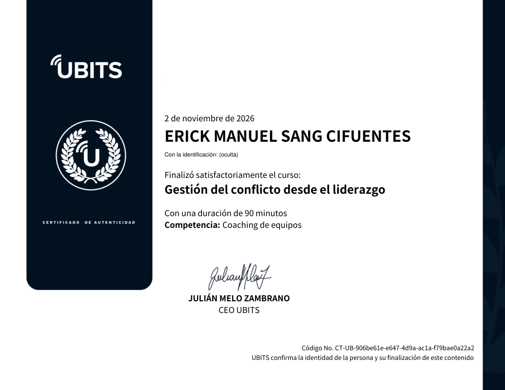

# 31 · Gestión del conflicto desde el liderazgo

**Plataforma:** UBITS (programa *Liderazgo ejecutivo*, módulo 8) · **Experto:** Ariel Etbul · **Duración:** 90 min · **Competencia:** coaching de equipos · **Resultado:** prueba final 5/5 (100 %) · **Fecha:** 2 nov 2026

Último módulo del programa *Liderazgo ejecutivo*. Trata qué es el conflicto, cómo gestionarlo con el modelo de Thomas–Kilmann y cómo mediar entre dos partes. Las emociones, las creencias, el estrés y el contexto influyen en cómo cada líder resuelve los conflictos laborales.

## 1. El conflicto

**Definición:** existe un conflicto cuando dos o más personas persiguen metas diferentes, defienden valores contradictorios, tienen intereses opuestos o buscan la misma meta de forma competitiva, y eso genera oposición o enfrentamiento.

**¿Es bueno o malo?** Simplemente *es*: lo importante es qué hacemos con él.

| Mirada positiva | Mirada negativa |
|---|---|
| Oportunidad de nuevos aprendizajes | Gasto de energía innecesario |
| Diálogo constructivo, innovación y creatividad | Frustración y violencia física o emocional |
| Motivación y empoderamiento del equipo | Desgaste o ruptura de la relación |

**La metáfora de la guitarra.** Cada cuerda necesita la tensión justa (afinación de 440 Hz) para sonar en armonía:

- **Sin tensión:** la guitarra no suena. En la organización, todos están en su zona de confort, nada apremia y no hay innovación.
- **Con tensión excesiva:** las cuerdas se rompen. En la organización aparece el estrés desmedido y el ***burnout*** (síndrome de desgaste profesional), que destruye las ideas, la cooperación y la salud de las personas.
- **En el punto medio:** hay respeto, valoración y legitimación del otro y de sus emociones; se gestiona el estrés, se reconocen los logros y se disfruta el camino. **Encontrar ese punto es tarea del líder.**

## 2. El modelo de Thomas–Kilmann

Kenneth Thomas y Ralph Kilmann evalúan la conducta natural frente al conflicto en dos ejes:

- **Asertividad:** énfasis en tus propias necesidades.
- **Cooperación:** énfasis en las necesidades de los demás.

Su cruce da **cinco estilos**. Ninguno es mejor que otro; usados de forma consciente se convierten en técnicas.

| Estilo | Qué lo caracteriza | Cuándo sirve |
|---|---|---|
| **Competir** | Ganar a toda costa y hacer valer tu posición, aun a riesgo de la relación | Con moderación, cuando estás convencido de que tu posición es la mejor para todos |
| **Complacer** | Priorizar las preocupaciones del otro y ceder | Cuando conservar la relación es muy importante o para evitar un daño mayor |
| **Evadir** | No afrontar el conflicto: aplazarlo o dar rodeos | Cuando no es el momento ni el lugar, o te sientes en desventaja |
| **Colaborar** | Buscar una solución que satisfaga a todos (*win-win*), con escucha activa e intercambio de información | Cuando todas las partes quieren conservar la relación y hay tiempo |
| **Comprometerse** | «Ni para ti ni para mí»: todos ceden un poco | Para llegar a una solución intermedia aceptable |

Cada persona tiene un estilo natural; el reto es aprender a usar los otros cuatro.

## 3. La mediación de conflictos

El mediador busca que ambas partes salgan con satisfacción y tranquilidad, **sin vencedores ni vencidos y sin rencor**.

**Cuatro reglas básicas:**

1. Ofrecer escucha empática a ambas partes.
2. No tomar partido.
3. No juzgar ni a las personas ni lo que dicen.
4. Procurar que las partes se escuchen, se respeten y cocreen una solución viable.

**Cuatro fases:**

| Fase | Qué hace el mediador |
|---|---|
| **1. Inicio** | Explica el propósito (llegar a un acuerdo y bajar la tensión), aclara su rol (no juzga, no toma partido, no resuelve por ellos) y fija turnos y tiempos para hablar |
| **2. Explicación** (mira al pasado) | Escucha a cada parte por turnos, sin interrumpir; recuerda que el punto de vista propio no es la verdad; pide a cada uno **resumir lo que entendió del otro**; pregunta por los intereses comunes y los puntos de acuerdo |
| **3. Cocreación de soluciones** (mira al futuro) | Busca el compromiso de ambos, propone una lluvia de ideas sin juicios, evalúa las propuestas (efectos a corto y largo plazo, costos y beneficios). Si se atasca, puede sugerir un camino, sin imponerlo |
| **4. Acuerdo** | Se redacta un acuerdo detallado y firmado, que incluye las consecuencias de incumplirlo. Si no hay acuerdo, se fija otro encuentro o se acepta un acuerdo parcial. Siempre se evalúa cómo salen las partes emocionalmente |

## 4. Cierre del programa

El video final repasa los ocho módulos de *Liderazgo ejecutivo*:

- el líder que empodera y los modelos de control frente a los de desarrollo;
- el propósito (el círculo dorado), los valores, las creencias, la confianza y la delegación;
- las preguntas poderosas, el *networking* y la inteligencia social;
- la eficacia en el liderazgo, la gestión del cambio y la visión del futuro;
- la responsabilidad 100 %, el ciclo de coordinación de acciones y las prioridades;
- el *feedback* como regalo, la metodología GROW, la inteligencia emocional, los hábitos y el estrés;
- y, por último, el conflicto.

La clave es poner todo en práctica.

## Evaluación

**Prueba final (5/5):**

1. Rotación alta, empleados agotados, apatía y enemistad → **la tensión es excesiva**: la gente renuncia y deja de cooperar.
2. Los directivos se niegan a dialogar un cambio de horario que genera malestar → **manejo inadecuado**: atender el malestar a tiempo reduce la tensión.
3. Dos analistas discuten con energía sobre teorías opuestas, pero entienden la perspectiva del otro → **conflicto positivo**: el intercambio de opiniones les permite aprender.
4. Primer paso al mediar entre dos colaboradores enfrentados → **explicar el propósito de la reunión y el rol del mediador** (fase de inicio).
5. Cada parte resume lo que dijo la otra y luego se preguntan los intereses comunes → **fase de explicación**.

## Evidencia

## Fuentes y aviso legal

- **Fuente:** curso «Gestión del conflicto desde el liderazgo» de la plataforma [UBITS](https://www.ubits.com), asignado dentro de un plan de formación empresarial.
- **Uso:** apuntes personales de estudio, sin fines comerciales y con redacción propia. Las capturas son fragmentos breves citados con fines educativos; sus derechos son de sus titulares.
- **Sin afiliación:** sitio no oficial, no afiliado ni respaldado por UBITS. Las marcas pertenecen a sus dueños.
- Más detalles y cómo pedir el retiro de contenido en el [aviso legal](../../aviso-legal.md).
