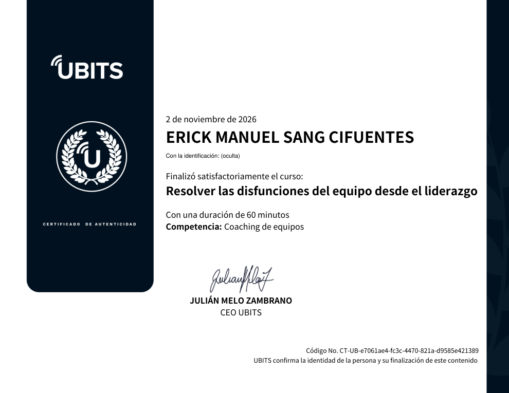

# 32 · Resolver las disfunciones del equipo desde el liderazgo

**Plataforma:** UBITS (programa *Liderazgo positivo*) · **Experto:** Iván Edwin Rodríguez · **Duración:** 60 min · **Competencia:** coaching de equipos · **Resultado:** prueba final 5/5 (100 %) · **Fecha:** 2 nov 2026

Último *bit* del programa *Liderazgo positivo*. Los conflictos son parte del ADN humano, pero fuera de control pueden acabar con una empresa. El curso identifica qué fisura el liderazgo y da herramientas para gestionar los conflictos de forma positiva y reconstruir la confianza del equipo.

## Microbit 1 · Fisuras en el liderazgo

**Por qué importa el liderazgo positivo.** La felicidad laboral ya se mide, y el líder es quien vela por un ambiente sano. Según Tomás Elorriaga, cuando los líderes promueven conductas positivas suben la confianza, el compromiso, la productividad, la innovación, la satisfacción del cliente y la rentabilidad; además, los líderes optimistas retienen más tiempo a sus mejores personas.

| Liderazgo negativo | Liderazgo positivo |
|---|---|
| Destruye el trabajo de los demás con crítica, amenazas, división del equipo y radicalismo | Impulsa acciones que generan un buen clima laboral |

**Tres fisuras que el jefe debe evitar:**

1. **Fragmentación:** sin unidad no hay una comunidad que colabore hacia un objetivo común.
2. **Incongruencia:** no hay respeto si no hay coherencia entre lo que se piensa, se quiere y se hace.
3. **Autoritarismo:** hoy la participación de los colaboradores es un mandato; hay que reconocer su valor y su potencial.

El microbit se complementa con una infografía sobre las **cinco disfunciones de los equipos** del libro homónimo de Patrick Lencioni.

## Microbit 2 · El remedio para el temor al conflicto

- Culturalmente vemos el conflicto como algo negativo y lo evitamos. Frank Furedi (*Cultura del miedo*) describe un pesimismo sobre nuestra capacidad de afrontar adversidades, que produce **equipos ansiosos**.
- Evitar el conflicto por ser complacientes o políticamente correctos crea una **paz aparente que se vuelve tóxica** y complica más las cosas.
- Toda relación sana y duradera necesita conflictos, siempre que sean **saludables**.

**Beneficios del conflicto:**

- favorece la expresión de sentimientos y formas de pensar;
- enseña a argumentar mediante diálogos y debates abiertos;
- desarrolla la escucha activa y el respeto por las ideas ajenas.

**La clave es la confianza.** Con confianza, la gente da un paso adelante, asume riesgos y se comunica con honestidad. El líder debe:

- promover los conflictos saludables;
- dejar de ser sobreprotector y no desviar todo desacuerdo;
- dar el espacio y la forma para que el equipo resuelva sus propios conflictos.

## Microbit 3 · La gestión negativa del conflicto

**Cinco estilos para manejar conflictos.** Todos usamos unos más que otros; lo importante es elegir el adecuado para cada situación:

| Estilo | Rasgo | Cuándo funciona |
|---|---|---|
| **Controlar** | «No hay otra opción mejor» | Crisis o emergencias que exigen decidir rápido |
| **Complacer** | Evita daños y atiende lo que es importante para el otro | Cuando el tema importa más a la otra persona; es un gesto de buena voluntad |
| **Colaborar** | «Hay que obtener compromisos» | Cuando se busca una solución conjunta |
| **Evitar** | No dar importancia a lo trivial | Asuntos menores que no merecen desgaste |
| **Transigir** | Sabe que no siempre se gana y cede en tiempo o recursos | Cuando conviene ceder una parte |

**Cuatro respuestas ante el conflicto:**

| Respuesta | Cómo se manifiesta |
|---|---|
| **Agresiva** | Ironía, manipulación u ofensa con intención de destruir; se pierde el control |
| **Pasiva** | Sometimiento, miedo o vergüenza; muestra poca confianza |
| **Pasivo-agresiva** | Aparente sometimiento que oculta un ataque velado, por ejemplo con la incomunicación |
| **Asertiva** | Se toma el tiempo para analizar alternativas; firme pero amable, sin temor ni agresión |

**La mediación.** La gestión negativa del conflicto es como un veneno que se expande en la organización. Una estrategia positiva es la mediación: un proceso **voluntario, flexible y participativo** en el que una tercera persona **ajena al conflicto e imparcial** facilita la comunicación para llegar a una solución pacífica.

**Cierre:** la diferencia entre jefe y líder es que el líder puede potenciar cada proceso y perspectiva del trabajo de su equipo.

## Evaluación

**Prueba final (5/5):**

1. Una gerente con dos colaboradores enfrentados que además son amigos suyos → **buscar un mediador ajeno al problema**.
2. Relacionar casos con estilos:
    - organización en crisis → **controlar**;
    - colaboradora que pide salir antes para recoger a sus hijos → **complacer**;
    - el líder no está del todo de acuerdo pero cede → **transigir**;
    - un rumor sobre el líder → **evitar**;
    - colaborador sobrecargado que necesita apoyo → **colaborar**.
3. Jefes sin coherencia entre lo que piensan, quieren y hacen → **la incongruencia**.
4. Identificar el tipo de respuesta:
    - analiza dos semanas y explica por qué no acepta el cambio → **asertiva**;
    - accede con preocupación a lo que le exigen → **pasiva**;
    - responde a una retroalimentación con comentarios hirientes → **agresiva**;
    - ignora al colaborador en el momento y luego lo critica con otros → **pasivo-agresiva**.
5. «Nadie puede evitar los conflictos ni darles un rumbo» → **falso**: no se eliminan, pero sí se gestionan.

## Evidencia

## Fuentes y aviso legal

- **Fuente:** curso «Resolver las disfunciones del equipo desde el liderazgo» de la plataforma [UBITS](https://www.ubits.com), asignado dentro de un plan de formación empresarial.
- **Uso:** apuntes personales de estudio, sin fines comerciales y con redacción propia. Las capturas son fragmentos breves citados con fines educativos; sus derechos son de sus titulares.
- **Sin afiliación:** sitio no oficial, no afiliado ni respaldado por UBITS. Las marcas pertenecen a sus dueños.
- Más detalles y cómo pedir el retiro de contenido en el [aviso legal](../../aviso-legal.md).
