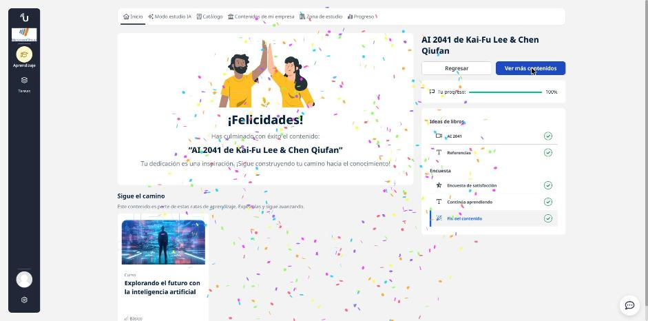

# 01 · AI 2041 (ideas del libro)

**Tipo:** Ideas de libro (video) · **Duración:** 30 min · **Estado:** Completado

Resumen de las ideas clave de *AI 2041* de Kai-Fu Lee y Chen Qiufan, un libro que mezcla relatos de ficción con análisis técnico para imaginar cómo la IA cambiará la vida en los próximos 20 años.

## Qué es la IA (según el libro)

Un conjunto de tecnologías que permiten a las máquinas **aprender de la experiencia** para resolver tareas que antes necesitaban inteligencia humana (reconocer voz, decidir, resolver problemas). No reemplaza a la persona: la **complementa**. Puede ayudar con grandes retos (clima, pobreza, educación, salud), pero trae riesgos de privacidad, seguridad y ética.

## Las seis ideas clave

| # | Idea | Lo que me llevo |
|---|------|-----------------|
| 1 | **Deep learning y sesgo** | El aprendizaje profundo encuentra patrones en millones de datos (ej. recomendaciones de redes sociales), pero no tiene sentido común: si los datos históricos traen prejuicios, el modelo los repite. |
| 2 | **Realidad mixta** | La mezcla de realidad virtual y aumentada se usará en juegos, entrenamiento militar, cirugía y educación. El riesgo: dispositivos que capturan datos íntimos todo el día. |
| 3 | **Deepfakes y fraude** | Las redes generativas adversarias (GAN) enfrentan a un "generador" contra un "discriminador" hasta que la imagen falsa parece real. Pueden usarse para extorsionar o manipular la opinión pública. |
| 4 | **Armas autónomas** | Toman decisiones sin intervención humana, pueden usarse de forma anónima y cometer errores graves. Los autores piden regulación y que la decisión de atacar siga siendo humana. |
| 5 | **Transformación del empleo** | La automatización desplaza trabajos básicos (y quizá conductores). Propuestas: renta básica, recapacitación y orientar a las personas hacia trabajos creativos y de cuidado, donde la empatía humana es difícil de reemplazar. |
| 6 | **IA y felicidad** | Usando la pirámide de Maslow: la IA puede ayudar con necesidades básicas, pero si el trabajo desaparece hay que pensar de dónde vendrán el reconocimiento y la autorrealización. |

## Cómo reducir el sesgo en un modelo

- Equipos de desarrollo **diversos** que detecten riesgos que otros no ven.
- Datos de entrenamiento **representativos** de la población objetivo, revisados en calidad.
- Técnicas de corrección: normalización, **ponderación** de datos y regularización.
- **Pruebas de sensibilidad** para detectar dónde el modelo discrimina.

## Privacidad y seguridad como usuario

- Leer qué datos pide una app de IA antes de instalarla y preferir proveedores reconocidos.
- Configurar las opciones de privacidad y compartir solo lo necesario.
- Tecnologías que protegen datos: **aprendizaje federado**, **cifrado homomórfico** y **entornos de ejecución confiables (TEE)**.

## Cómo no caer en un deepfake

1. Verificar que la fuente sea confiable.
2. Buscar evidencia adicional que lo respalde.
3. Revisar detalles: gestos, sincronía de labios, manos y movimientos.
4. Mantener una actitud crítica y usar herramientas de verificación.
5. Reportar el contenido falso.

## Otras ideas

- La IA también salva vidas: alertas de contagio en pandemia, diagnóstico con historias clínicas digitales y desarrollo más rápido de medicamentos.
- Los **transformers** hicieron posibles los chats modernos como ChatGPT; para 2041 se esperan asistentes de voz mucho más cercanos.
- La "singularidad" sigue siendo poco probable a mediano plazo: a la IA le falta pensamiento abstracto, causalidad profunda y sentido estético.
- Conclusión: solemos sobreestimar la tecnología a corto plazo y subestimarla a largo plazo. El futuro de la IA **depende de cómo la construyamos**, con regulación, ética y colaboración público-privada.

!!! tip "Para recordar"
    - IA = aprender de la experiencia; complementa, no sustituye.
    - Datos sesgados → modelo sesgado. Diversidad + datos representativos + pruebas.
    - GAN = generador vs. discriminador → base de los deepfakes.
    - Ante un video dudoso: fuente, evidencia, detalles, escepticismo.
    - Empleo: recapacitar hacia trabajo creativo y de cuidado.
    - La IA es moldeable: el resultado depende de nuestras decisiones.

## Fuentes y aviso legal

- **Fuente:** curso de UBITS. Sitios oficiales: [ubits.com](https://ubits.com).
- **Uso:** apuntes personales de estudio, sin fines comerciales y con redacción propia. Las imágenes del curso son fragmentos breves citados con fines educativos; sus derechos son de sus titulares.
- **Sin afiliación:** sitio no oficial, no afiliado ni respaldado por UBITS. Las marcas pertenecen a sus dueños.
- Más detalles y cómo pedir el retiro de contenido en el [aviso legal](../../aviso-legal.md).
